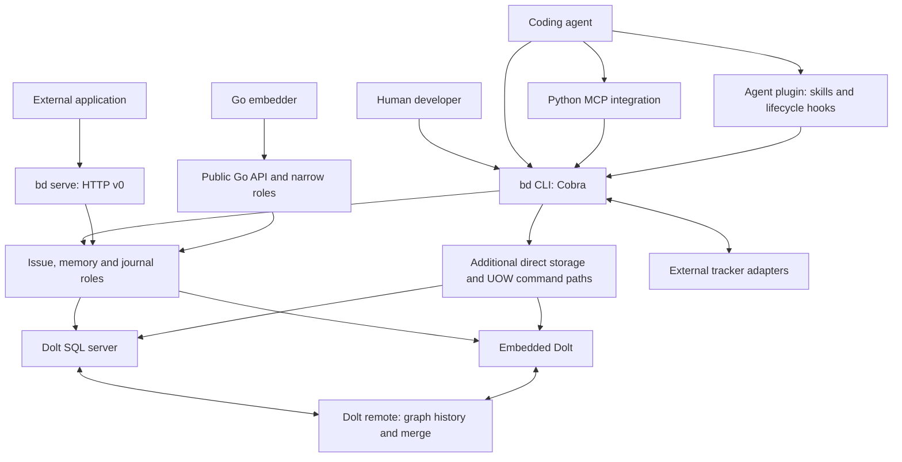
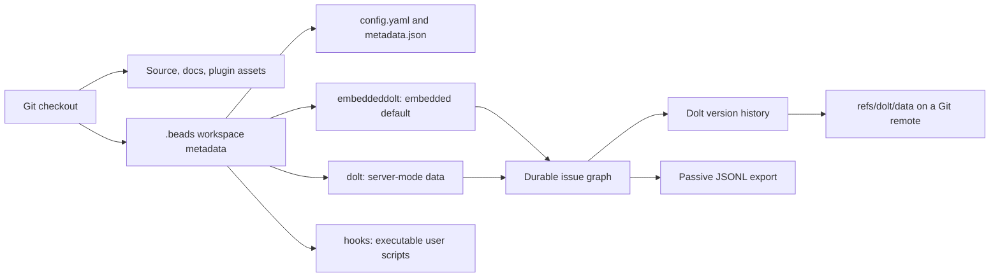
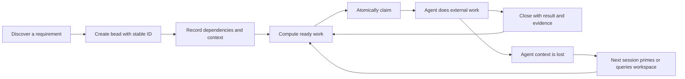
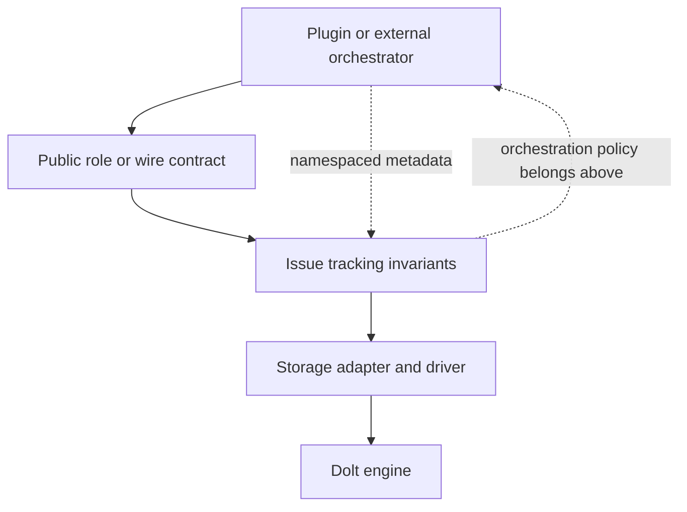

# Beads architecture: system overview

Beads gives an agent a durable, dependency-aware work graph that survives the agent's context window. The `bd` CLI is one frontend; Go consumers, HTTP clients, editor integrations, and MCP tools reach parts of the same model. The work graph and explicit keyed memories are structured storage, not a vector database or an LLM's hidden state.

This dossier describes upstream commit `9d6fff760b7a314b476539198504d77ce0959656`, imported on 2026-10-22. Source behavior wins over older documentation. The module still declares `github.com/steveyegge/beads` even though the canonical GitHub repository is `gastownhall/beads`. Keeping that module path initially avoids rewriting every import and preserves an easy-to-merge fork.

## The system in one picture

This is a conceptual component diagram, not a claim that every frontend uses one shared function. `cmd/bd` retains both direct store paths and provider/UOW paths. Many operations have narrow shared roles; some CLI query modes share request builders and pagination machinery instead. [CLI/runtime](02-cli-runtime.md) and [storage](03-data-model-and-storage.md) identify that boundary precisely.

## Architectural layers

| Layer | Responsibility | Source entry points |
|---|---|---|
| User and agent frontends | Commands, JSON and terminal presentation, context injection | [cmd/bd](../../cmd/bd), [agent plugin](../../plugins/beads), [MCP integration](../../integrations/beads-mcp) |
| Public consumer API | Open workspaces, domain types, narrow operation roles | [beads.go](../../beads.go), [issueops](../../issueops), [memoryops](../../memoryops), [journalops](../../journalops) |
| Backend implementer API | Registry, engine contract, conformance | [backend](../../backend), [backend/conformance](../../backend/conformance) |
| Application contracts | Query requests, readiness, lifecycle and claim invariants | [internal/workapi](../../internal/workapi), [internal/storage/issueops](../../internal/storage/issueops), [internal/storage/uow](../../internal/storage/uow) |
| Adapters and transaction plumbing | SQL work, UOW repositories, engine opens | [storage](../../internal/storage), [domain/db](../../internal/storage/domain/db), [Dolt](../../internal/storage/dolt), [embedded Dolt](../../internal/storage/embeddeddolt) |
| Persistence | Schema, migrations, engine-level transactions and history | [schema](../../internal/storage/schema), [driver dependency](../../go.mod) |
| Operational cross-cutting behavior | Discovery, config, hooks, telemetry, backup and recovery | [config](../../internal/config), [configfile](../../internal/configfile), [hooks](../../internal/hooks), [telemetry](../../internal/telemetry) |

Paths in this table are relative to this chapter's location and are checked by the guide validator. The generated HTML includes local snapshots of linked source files.

## What persists, and where

A source Git commit, a SQL transaction, and a Dolt history commit are different boundaries. A Git clone of this fork gives you the source; it does not automatically give you a separate user's issue database. An issues JSONL file is not the full database. Explicit memories, configuration, leases, wisps, journals, and database history have different persistence and replication rules; [chapter 3](03-data-model-and-storage.md) distinguishes their storage planes.

## Why dependency-aware memory matters

The database remembers decisions and dependencies, while the agent supplies reasoning and performs external effects. A claim arbitrates a database row; it does not make a deployment, email, or code change exactly-once. Beads' project charter places model choice, routing, scheduling, and cross-system orchestration outside core. That is an important design constraint for this fork's plugin system.

## Planned BDP graph plane

The checkout also contains a [BDP bead-graph plan](../BDP_BEAD_GRAPH_PLAN.md), [architecture draft](../BDP_GRAPH_ARCHITECTURE.md), and [CLI/storage specification](../BDP_GRAPH_CLI_AND_STORAGE_SPEC.md). They propose a separate graph plane beside issues and keyed memories, with its own roles, authority model and protocol. Their presence in the repository does not mean that planned runtime has landed. In particular, the proposed `graphops` domain is distinct from the existing issue dependency graph and its `GraphCounter` role. Keep these drafts in view when evolving plugin capabilities, but use the implemented issue/memory/journal contracts described here as the current baseline.

## Three boundaries to retain in the fork

1. Core owns issue identity, lifecycle, graph integrity, readiness, and atomic updates. A plugin should not mutate those invariants by writing arbitrary SQL.
2. Storage owns engine transactions, versioning, and crash safety. A plugin API should expose capabilities and results rather than leaking a driver handle.
3. Orchestration owns agent routing and external actions. Preserve that separation even when adding a convenient plugin host.

The proposed design in [chapter 7](07-plugin-system-design.md) is a plan for this fork. The imported code has several extension mechanisms, but no unified general plugin manager with installation, protocol negotiation, permissions, and a durable delivery runtime.

## Reading order

Start with [the source atlas](01-source-atlas.md), then [CLI/runtime](02-cli-runtime.md), [storage](03-data-model-and-storage.md), [sync/coordination](04-sync-and-coordination.md), and [workflows/memory](05-workflows-and-memory.md). Read [existing extension surfaces](06-extension-surfaces.md) before the [plugin proposal](07-plugin-system-design.md). [Build and verification](08-build-and-verification.md) closes the loop with the checks future changes need.

## Primary evidence

- [Project charter](../PROJECT_CHARTER.md): product, schema, orchestration and storage boundaries.
- [Root package](../../beads.go): consumer API, backend selection, workspace refusal and credential seams.
- [HTTP package contract](../../internal/httpapi/doc.go): precise sharing and non-sharing among frontends.
- [Backend contract](../../backend/backend.go): compiled registration and experimental stability.
- [Contributor instructions](../../AGENTS.md): current layering, build and test policy.
