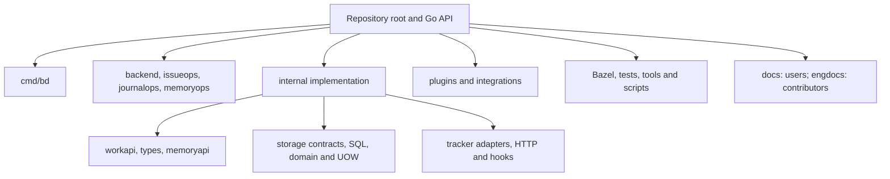
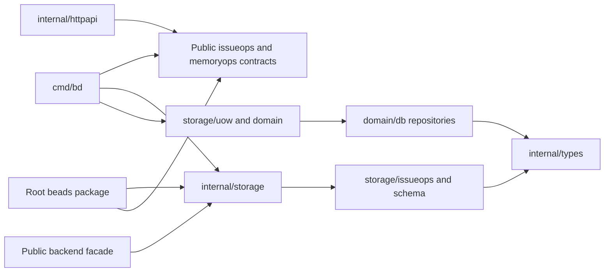

# Source atlas and navigation

This is a map of the exact imported source, including the broad areas that a plugin implementation is likely to cross. It is a directory/declaration inventory, not a claim to have traced every function. The detailed chapters trace the important behavior paths.

Snapshot: `9d6fff760b7a314b476539198504d77ce0959656`. Inventory: **5,087 files**, **3,866 Go files**, **2,323 Go test files**, **169 Go package directories**, **414 Markdown/MDX files**. Tests and generated files are included in these counts.

## Repository map

| Area | Files | Purpose |
|---|---:|---|
| [root](../../README.md) | 65 | Build/configuration assets; inspect the linked directory |
| [.agent](../../.agent) | 1 | Agent assets |
| `.beads` | 1 | Upstream contributor ledger/config artifacts; do not initialize this checkout as a user workspace |
| [.claude](../../.claude) | 7 | Contributor agent skills and configuration |
| [.claude-plugin](../../.claude-plugin) | 1 | Agent marketplace/plugin metadata |
| [.devcontainer](../../.devcontainer) | 3 | Development container setup |
| [.githooks](../../.githooks) | 5 | Contributor Git hook scripts |
| [.github](../../.github) | 52 | GitHub CI, release and repository automation |
| [backend](../../backend) | 116 | Public storage implementer API, conformance corpus and HTTP embedder API |
| [beadserrors](../../beadserrors) | 2 | Public error classification helpers |
| [cmd](../../cmd) | 1,485 | Cobra CLI, runtime dispatch, context setup, formatting and command implementations |
| [docs](../../docs) | 189 | Release-pinned published user documentation and generated CLI reference |
| [engdocs](../../engdocs) | 62 | Contributor design documents, ADRs, testing policy and this dossier |
| [examples](../../examples) | 42 | Runnable examples of extensions, configuration and workflows |
| [format](../../format) | 3 | Public presentation/formatting helpers |
| [integrations](../../integrations) | 36 | Separate MCP integration and editor/agent setup assets |
| [internal](../../internal) | 2,499 | Implementation packages: storage, contracts, discovery, adapters and operations |
| [issueops](../../issueops) | 55 | Public narrow issue operation contracts |
| [journalops](../../journalops) | 4 | Public committed-journal reader contract |
| [memoryops](../../memoryops) | 4 | Public persistent keyed-memory contract |
| [npm-package](../../npm-package) | 14 | npm binary-distribution wrapper |
| [platforms](../../platforms) | 1 | Platform-specific distribution assets |
| [plugins](../../plugins) | 57 | Agent-host plugin assets, skills, commands and lifecycle hook manifest |
| [release-gates](../../release-gates) | 31 | Release qualification scripts and evidence helpers |
| [schema](../../schema) | 3 | Public schema surface |
| [scripts](../../scripts) | 196 | Build, release, migration, documentation and repository checks |
| [test](../../test) | 13 | Cross-package, documentation, protocol and repository tests |
| [tests](../../tests) | 33 | Additional integration test assets |
| [third_party](../../third_party) | 10 | Vendored build or third-party support assets |
| [tools](../../tools) | 92 | Build generators, lint tooling, protocol/doc tooling and test support |
| [winget](../../winget) | 5 | Windows package manifests |

## Internal package families

The storage subtree is large enough to deserve its own [chapter](03-data-model-and-storage.md). This table covers each immediate implementation family.

| Family | Responsibility |
|---|---|
| [ado](../../internal/ado) | Azure DevOps adapter |
| [atomicfile](../../internal/atomicfile) | Atomic file replacement |
| [audit](../../internal/audit) | Audit helpers |
| [beads](../../internal/beads) | Internal compatibility/consumer API aliases |
| [ceiling](../../internal/ceiling) | Resource ceiling helpers |
| [compact](../../internal/compact) | Compaction logic |
| [config](../../internal/config) | Runtime configuration |
| [configfile](../../internal/configfile) | Workspace metadata and backend/mode configuration |
| [creds](../../internal/creds) | Credential lookup and configuration |
| [debug](../../internal/debug) | Debug facilities |
| [doltremote](../../internal/doltremote) | Dolt remote and Git-ref transport |
| [doltserver](../../internal/doltserver) | Local SQL server lifecycle |
| [doltversion](../../internal/doltversion) | Dolt version checks |
| [eventsjournal](../../internal/eventsjournal) | Published committed-change envelope and activation/retention |
| [execenv](../../internal/execenv) | Subprocess environment policy |
| [fdhygiene](../../internal/fdhygiene) | File descriptor hygiene |
| [formula](../../internal/formula) | Formula discovery, parsing and compilation |
| [git](../../internal/git) | Git operations |
| [gitenv](../../internal/gitenv) | Git environment isolation |
| [githooksenv](../../internal/githooksenv) | Git hook environment |
| [github](../../internal/github) | GitHub integration |
| [gitignore](../../internal/gitignore) | Ignore-file updates |
| [gitlab](../../internal/gitlab) | GitLab integration |
| [gittraceenv](../../internal/gittraceenv) | Git trace environment |
| [hooks](../../internal/hooks) | Executable workspace mutation hooks |
| [httpapi](../../internal/httpapi) | HTTP v0 server, routes, auth, schemas and handler adapters |
| [httpclient](../../internal/httpclient) | HTTP-backed store and wire negotiation |
| [idgen](../../internal/idgen) | Issue ID generation |
| [initprocs](../../internal/initprocs) | Initialization process helpers |
| [jira](../../internal/jira) | Jira adapter |
| [linear](../../internal/linear) | Linear adapter |
| [lockfile](../../internal/lockfile) | Local lockfile utility; not a distributed lease protocol |
| [memoryapi](../../internal/memoryapi) | Shared keyed-memory behavior |
| [metrics](../../internal/metrics) | Metrics helpers |
| [migration](../../internal/migration) | Migration support |
| [molecules](../../internal/molecules) | Molecule utilities |
| [notion](../../internal/notion) | Notion integration |
| [procid](../../internal/procid) | Process identity helpers |
| [query](../../internal/query) | Query utilities |
| [recipes](../../internal/recipes) | Recipe support |
| [remotecache](../../internal/remotecache) | Remote reference cache |
| [routing](../../internal/routing) | Cross-workspace issue routing |
| [storage](../../internal/storage) | Engine contracts, SQL operations, domain/UOW, schema and adapters |
| [telemetry](../../internal/telemetry) | OpenTelemetry setup and decorated roles/stores |
| [templates](../../internal/templates) | Built-in template assets |
| [testutil](../../internal/testutil) | Test-only fixtures and backend helpers |
| [timeparsing](../../internal/timeparsing) | Human time parsing |
| [tracker](../../internal/tracker) | Shared issue-tracker adapter contract, registry and sync engine |
| [types](../../internal/types) | Canonical model, filters and serialized field contracts |
| [ui](../../internal/ui) | Terminal presentation |
| [uimd](../../internal/uimd) | Markdown UI rendering |
| [utils](../../internal/utils) | Shared utilities |
| [validation](../../internal/validation) | Input validation |
| [versioncheck](../../internal/versioncheck) | Release/version checks |
| [versionedhistory](../../internal/versionedhistory) | History-mode policy |
| [workapi](../../internal/workapi) | Shared work-query request, defaults, builder and response logic |
| [workspacegate](../../internal/workspacegate) | Workspace concurrency/access gates |
| [worktreeremove](../../internal/worktreeremove) | Worktree removal support |

## Public API entry points

| Package | Intended consumer |
|---|---|
| [beads](../../beads.go) | Open workspaces, use exported types and storage without importing internal implementation |
| [issueops](../../issueops) | Narrow query/lifecycle/graph/claim/config roles |
| [memoryops](../../memoryops) | Keyed workspace memory operations |
| [journalops](../../journalops) | Read committed journal records |
| [backend](../../backend) | Implement and register a backend |
| [backend/conformance](../../backend/conformance) | Prove portable behavior and explicit unsupported contracts |
| [backend/http](../../backend/http) | Embed remote HTTP-backed workspaces and per-open credentials |
| [schema](../../schema) | Public schema entry points |
| [format](../../format) | Reuse formatting helpers |
| [beadserrors](../../beadserrors) | Public error classification |

## Package dependency spine

This is the important architectural spine, not an exhaustive import DAG. The HTTP transport has guard-enforced restrictions on constructing filters or directly reaching domain use cases; its startup/context files have narrow value-type exceptions. [The HTTP package documentation](../../internal/httpapi/doc.go) specifies those boundaries.

## Full package inventory

Every directory containing Go files appears here. Production/test counts are file counts; declarations are an anchored textual approximation, so grouped declarations and computed aliases may need direct source inspection. The [machine-readable inventory](source-inventory.json) includes direct imports, declaration names, file paths and literal Cobra command definitions.

| Package directory | Production files | Test files | Exported type declarations | Exported function/method names |
|---|---:|---:|---:|---:|
| [.](../../) | 4 | 12 | 26 | 17 |
| [backend](../../backend) | 3 | 2 | 8 | 9 |
| [backend/conformance](../../backend/conformance) | 64 | 4 | 69 | 715 |
| [backend/http](../../backend/http) | 5 | 22 | 7 | 10 |
| [backend/http/corpus](../../backend/http/corpus) | 0 | 6 | 0 | 0 |
| [beadserrors](../../beadserrors) | 1 | 0 | 1 | 1 |
| [cmd/bd](../../cmd/bd) | 355 | 802 | 88 | 95 |
| [cmd/bd/doctor](../../cmd/bd/doctor) | 48 | 58 | 14 | 158 |
| [cmd/bd/doctor/fix](../../cmd/bd/doctor/fix) | 24 | 30 | 8 | 40 |
| [cmd/bd/protocol](../../cmd/bd/protocol) | 1 | 29 | 3 | 4 |
| [cmd/bd/setup](../../cmd/bd/setup) | 17 | 14 | 1 | 42 |
| [cmd/bd/testdata](../../cmd/bd/testdata) | 2 | 0 | 0 | 0 |
| [examples/bd-example-extension-go](../../examples/bd-example-extension-go) | 1 | 0 | 0 | 0 |
| [examples/library-usage](../../examples/library-usage) | 1 | 1 | 0 | 0 |
| [format](../../format) | 1 | 1 | 0 | 6 |
| [internal/ado](../../internal/ado) | 10 | 9 | 20 | 70 |
| [internal/atomicfile](../../internal/atomicfile) | 1 | 1 | 1 | 5 |
| [internal/audit](../../internal/audit) | 1 | 2 | 1 | 6 |
| [internal/beads](../../internal/beads) | 3 | 18 | 10 | 35 |
| [internal/ceiling](../../internal/ceiling) | 1 | 1 | 1 | 3 |
| [internal/compact](../../internal/compact) | 3 | 4 | 3 | 6 |
| [internal/config](../../internal/config) | 10 | 14 | 8 | 74 |
| [internal/configfile](../../internal/configfile) | 10 | 7 | 5 | 63 |
| [internal/creds](../../internal/creds) | 2 | 3 | 4 | 3 |
| [internal/debug](../../internal/debug) | 1 | 1 | 0 | 8 |
| [internal/doltremote](../../internal/doltremote) | 1 | 2 | 0 | 3 |
| [internal/doltserver](../../internal/doltserver) | 24 | 30 | 9 | 78 |
| [internal/doltversion](../../internal/doltversion) | 6 | 6 | 6 | 13 |
| [internal/eventsjournal](../../internal/eventsjournal) | 3 | 2 | 2 | 9 |
| [internal/execenv](../../internal/execenv) | 1 | 1 | 0 | 9 |
| [internal/fdhygiene](../../internal/fdhygiene) | 3 | 1 | 0 | 1 |
| [internal/formula](../../internal/formula) | 10 | 11 | 29 | 43 |
| [internal/formula/cmd/schemagen](../../internal/formula/cmd/schemagen) | 1 | 0 | 0 | 0 |
| [internal/formula/schemagen](../../internal/formula/schemagen) | 1 | 0 | 2 | 3 |
| [internal/git](../../internal/git) | 4 | 3 | 1 | 24 |
| [internal/gitenv](../../internal/gitenv) | 1 | 1 | 0 | 7 |
| [internal/githooksenv](../../internal/githooksenv) | 1 | 1 | 0 | 4 |
| [internal/github](../../internal/github) | 7 | 7 | 26 | 59 |
| [internal/gitignore](../../internal/gitignore) | 2 | 2 | 0 | 3 |
| [internal/gitlab](../../internal/gitlab) | 6 | 6 | 25 | 49 |
| [internal/gittraceenv](../../internal/gittraceenv) | 1 | 1 | 0 | 3 |
| [internal/hooks](../../internal/hooks) | 5 | 3 | 1 | 7 |
| [internal/httpapi](../../internal/httpapi) | 42 | 56 | 6 | 82 |
| [internal/httpapi/apigen](../../internal/httpapi/apigen) | 2 | 0 | 162 | 1 |
| [internal/httpapi/spec](../../internal/httpapi/spec) | 1 | 0 | 0 | 1 |
| [internal/httpapi/wireshape](../../internal/httpapi/wireshape) | 2 | 2 | 3 | 3 |
| [internal/httpapi/wireshape/cmd/gendigest](../../internal/httpapi/wireshape/cmd/gendigest) | 1 | 1 | 0 | 0 |
| [internal/httpclient](../../internal/httpclient) | 60 | 98 | 18 | 290 |
| [internal/httpclient/encode](../../internal/httpclient/encode) | 9 | 8 | 13 | 27 |
| [internal/httpclient/wire](../../internal/httpclient/wire) | 12 | 20 | 30 | 56 |
| [internal/idgen](../../internal/idgen) | 1 | 1 | 0 | 2 |
| [internal/initprocs](../../internal/initprocs) | 1 | 1 | 0 | 1 |
| [internal/jira](../../internal/jira) | 5 | 4 | 13 | 36 |
| [internal/linear](../../internal/linear) | 15 | 10 | 52 | 93 |
| [internal/lockfile](../../internal/lockfile) | 7 | 1 | 0 | 6 |
| [internal/memoryapi](../../internal/memoryapi) | 1 | 1 | 0 | 5 |
| [internal/metrics](../../internal/metrics) | 6 | 7 | 0 | 16 |
| [internal/migration](../../internal/migration) | 1 | 1 | 2 | 4 |
| [internal/migration/legacysqlite](../../internal/migration/legacysqlite) | 2 | 1 | 0 | 1 |
| [internal/molecules](../../internal/molecules) | 1 | 2 | 2 | 2 |
| [internal/notion](../../internal/notion) | 7 | 5 | 33 | 56 |
| [internal/procid](../../internal/procid) | 5 | 3 | 2 | 9 |
| [internal/query](../../internal/query) | 3 | 1 | 12 | 9 |
| [internal/recipes](../../internal/recipes) | 2 | 1 | 3 | 7 |
| [internal/remotecache](../../internal/remotecache) | 2 | 3 | 3 | 11 |
| [internal/routing](../../internal/routing) | 1 | 1 | 3 | 5 |
| [internal/storage](../../internal/storage) | 65 | 30 | 103 | 127 |
| [internal/storage/backendnames](../../internal/storage/backendnames) | 1 | 0 | 0 | 3 |
| [internal/storage/backends](../../internal/storage/backends) | 1 | 4 | 3 | 7 |
| [internal/storage/batchbench](../../internal/storage/batchbench) | 1 | 0 | 0 | 2 |
| [internal/storage/batchfixtures](../../internal/storage/batchfixtures) | 4 | 1 | 1 | 11 |
| [internal/storage/contextinfo](../../internal/storage/contextinfo) | 1 | 1 | 1 | 2 |
| [internal/storage/createbatchequiv](../../internal/storage/createbatchequiv) | 5 | 0 | 2 | 4 |
| [internal/storage/dberrors](../../internal/storage/dberrors) | 2 | 2 | 0 | 9 |
| [internal/storage/dbproxy/identity](../../internal/storage/dbproxy/identity) | 2 | 1 | 1 | 6 |
| [internal/storage/dbproxy/pidfile](../../internal/storage/dbproxy/pidfile) | 1 | 1 | 1 | 5 |
| [internal/storage/dbproxy/proxy](../../internal/storage/dbproxy/proxy) | 19 | 11 | 11 | 38 |
| [internal/storage/dbproxy/server](../../internal/storage/dbproxy/server) | 4 | 6 | 7 | 17 |
| [internal/storage/dbproxy/util](../../internal/storage/dbproxy/util) | 2 | 1 | 4 | 4 |
| [internal/storage/depid](../../internal/storage/depid) | 1 | 1 | 0 | 1 |
| [internal/storage/dolt](../../internal/storage/dolt) | 73 | 256 | 9 | 335 |
| [internal/storage/doltutil](../../internal/storage/doltutil) | 7 | 6 | 1 | 17 |
| [internal/storage/domain](../../internal/storage/domain) | 16 | 5 | 101 | 195 |
| [internal/storage/domain/db](../../internal/storage/domain/db) | 19 | 60 | 3 | 131 |
| [internal/storage/domain/fs](../../internal/storage/domain/fs) | 2 | 3 | 0 | 25 |
| [internal/storage/domain/git](../../internal/storage/domain/git) | 1 | 2 | 0 | 15 |
| [internal/storage/embeddeddolt](../../internal/storage/embeddeddolt) | 62 | 144 | 1 | 308 |
| [internal/storage/embeddeddolt/cmd](../../internal/storage/embeddeddolt/cmd) | 1 | 0 | 0 | 0 |
| [internal/storage/externaldeps](../../internal/storage/externaldeps) | 7 | 9 | 5 | 78 |
| [internal/storage/fs](../../internal/storage/fs) | 1 | 0 | 1 | 2 |
| [internal/storage/git](../../internal/storage/git) | 1 | 0 | 1 | 2 |
| [internal/storage/historyoffequiv](../../internal/storage/historyoffequiv) | 3 | 0 | 4 | 5 |
| [internal/storage/issueops](../../internal/storage/issueops) | 105 | 78 | 46 | 480 |
| [internal/storage/journalscan](../../internal/storage/journalscan) | 1 | 1 | 2 | 9 |
| [internal/storage/kvkeys](../../internal/storage/kvkeys) | 1 | 1 | 0 | 0 |
| [internal/storage/memoryops](../../internal/storage/memoryops) | 1 | 1 | 0 | 6 |
| [internal/storage/rowid](../../internal/storage/rowid) | 1 | 1 | 0 | 2 |
| [internal/storage/schema](../../internal/storage/schema) | 17 | 29 | 15 | 54 |
| [internal/storage/sqlbuild](../../internal/storage/sqlbuild) | 8 | 7 | 6 | 26 |
| [internal/storage/sqlclass](../../internal/storage/sqlclass) | 1 | 1 | 1 | 2 |
| [internal/storage/sqlcount](../../internal/storage/sqlcount) | 1 | 0 | 3 | 25 |
| [internal/storage/storagecontract](../../internal/storage/storagecontract) | 1 | 0 | 1 | 7 |
| [internal/storage/unsupportedgen](../../internal/storage/unsupportedgen) | 1 | 1 | 0 | 0 |
| [internal/storage/uow](../../internal/storage/uow) | 50 | 84 | 50 | 213 |
| [internal/storage/versioncontrolops](../../internal/storage/versioncontrolops) | 17 | 10 | 4 | 63 |
| [internal/telemetry](../../internal/telemetry) | 35 | 7 | 1 | 198 |
| [internal/templates](../../internal/templates) | 1 | 0 | 0 | 2 |
| [internal/templates/agents](../../internal/templates/agents) | 2 | 3 | 3 | 13 |
| [internal/testutil](../../internal/testutil) | 15 | 12 | 2 | 37 |
| [internal/testutil/bazeltest](../../internal/testutil/bazeltest) | 1 | 1 | 0 | 8 |
| [internal/testutil/credentialcmd](../../internal/testutil/credentialcmd) | 3 | 1 | 0 | 7 |
| [internal/testutil/fixtures](../../internal/testutil/fixtures) | 1 | 1 | 1 | 5 |
| [internal/testutil/integration](../../internal/testutil/integration) | 3 | 1 | 4 | 27 |
| [internal/timeparsing](../../internal/timeparsing) | 1 | 2 | 0 | 3 |
| [internal/tracker](../../internal/tracker) | 8 | 14 | 28 | 25 |
| [internal/tracker/conformance](../../internal/tracker/conformance) | 3 | 1 | 10 | 23 |
| [internal/types](../../internal/types) | 6 | 7 | 51 | 67 |
| [internal/ui](../../internal/ui) | 4 | 4 | 1 | 39 |
| [internal/uimd](../../internal/uimd) | 1 | 1 | 0 | 2 |
| [internal/utils](../../internal/utils) | 6 | 13 | 3 | 16 |
| [internal/validation](../../internal/validation) | 3 | 4 | 3 | 23 |
| [internal/versioncheck](../../internal/versioncheck) | 1 | 1 | 3 | 5 |
| [internal/versionedhistory](../../internal/versionedhistory) | 1 | 1 | 0 | 9 |
| [internal/workapi](../../internal/workapi) | 17 | 25 | 12 | 86 |
| [internal/workapi/storecounter](../../internal/workapi/storecounter) | 1 | 0 | 0 | 3 |
| [internal/workapi/storequerier](../../internal/workapi/storequerier) | 1 | 0 | 0 | 2 |
| [internal/workapi/storereader](../../internal/workapi/storereader) | 1 | 1 | 0 | 4 |
| [internal/workapi/storereadycounter](../../internal/workapi/storereadycounter) | 1 | 0 | 0 | 2 |
| [internal/workapi/storestats](../../internal/workapi/storestats) | 1 | 0 | 0 | 3 |
| [internal/workapi/storeversionreconciler](../../internal/workapi/storeversionreconciler) | 1 | 0 | 0 | 3 |
| [internal/workapi/storeworkspaceconfig](../../internal/workapi/storeworkspaceconfig) | 1 | 0 | 0 | 5 |
| [internal/workspacegate](../../internal/workspacegate) | 1 | 2 | 6 | 12 |
| [internal/worktreeremove](../../internal/worktreeremove) | 1 | 1 | 19 | 5 |
| [issueops](../../issueops) | 44 | 10 | 203 | 44 |
| [journalops](../../journalops) | 3 | 0 | 4 | 1 |
| [memoryops](../../memoryops) | 3 | 0 | 9 | 0 |
| [plugins/beads](../../plugins/beads) | 1 | 0 | 0 | 1 |
| [schema](../../schema) | 1 | 1 | 2 | 4 |
| [scripts](../../scripts) | 0 | 65 | 0 | 0 |
| [scripts/bench-ready-indexes](../../scripts/bench-ready-indexes) | 1 | 1 | 0 | 0 |
| [scripts/check-versions](../../scripts/check-versions) | 1 | 2 | 0 | 2 |
| [scripts/checkworkflowtags](../../scripts/checkworkflowtags) | 1 | 0 | 0 | 0 |
| [scripts/ci/go-list-test-names](../../scripts/ci/go-list-test-names) | 1 | 0 | 0 | 0 |
| [scripts/gitattributespolicy](../../scripts/gitattributespolicy) | 0 | 3 | 0 | 0 |
| [scripts/internal/testbash](../../scripts/internal/testbash) | 3 | 3 | 1 | 5 |
| [scripts/migration-test/catalog](../../scripts/migration-test/catalog) | 1 | 1 | 8 | 0 |
| [scripts/pr-lint](../../scripts/pr-lint) | 1 | 1 | 0 | 0 |
| [scripts/prlintmake](../../scripts/prlintmake) | 0 | 2 | 0 | 0 |
| [scripts/repro-dolt-hang](../../scripts/repro-dolt-hang) | 1 | 0 | 0 | 0 |
| [scripts/repro-dolt-prod-timeouts](../../scripts/repro-dolt-prod-timeouts) | 1 | 1 | 0 | 0 |
| [scripts/workflowtags](../../scripts/workflowtags) | 1 | 1 | 1 | 2 |
| [test/conformance](../../test/conformance) | 1 | 2 | 2 | 2 |
| [test/docsync](../../test/docsync) | 0 | 4 | 0 | 0 |
| [test/embedder](../../test/embedder) | 0 | 1 | 0 | 0 |
| [test/testmainconvention](../../test/testmainconvention) | 0 | 1 | 0 | 0 |
| [tests/regression](../../tests/regression) | 0 | 4 | 0 | 0 |
| [tools/docsmint](../../tools/docsmint) | 3 | 2 | 0 | 0 |
| [tools/nogo](../../tools/nogo) | 0 | 2 | 0 | 0 |
| [tools/nogo/analyzers/depguard](../../tools/nogo/analyzers/depguard) | 1 | 1 | 0 | 1 |
| [tools/nogo/analyzers/errcheck](../../tools/nogo/analyzers/errcheck) | 1 | 1 | 0 | 1 |
| [tools/nogo/analyzers/forbidigo](../../tools/nogo/analyzers/forbidigo) | 1 | 1 | 0 | 1 |
| [tools/nogo/analyzers/gosec](../../tools/nogo/analyzers/gosec) | 1 | 1 | 0 | 0 |
| [tools/nogo/analyzers/misspell](../../tools/nogo/analyzers/misspell) | 1 | 1 | 0 | 1 |
| [tools/nogo/analyzers/sloglint](../../tools/nogo/analyzers/sloglint) | 1 | 1 | 0 | 2 |
| [tools/nogo/analyzers/unconvert](../../tools/nogo/analyzers/unconvert) | 1 | 1 | 0 | 0 |
| [tools/nogo/analyzers/unparam](../../tools/nogo/analyzers/unparam) | 1 | 1 | 0 | 0 |
| [tools/nogo/internal/analyzertest](../../tools/nogo/internal/analyzertest) | 1 | 0 | 1 | 4 |
| [tools/nogo/internal/golangci](../../tools/nogo/internal/golangci) | 2 | 1 | 19 | 11 |
| [tools/nogo/internal/position](../../tools/nogo/internal/position) | 1 | 0 | 1 | 2 |

## Small generated contract graph

[Interactive public backend graph](graphify-out/graph.html), [raw graph](graphify-out/graph.json), [audit report](graphify-out/GRAPH_REPORT.md), and [health diagnostic](graphify-out/health.txt) supplement the hand-authored diagrams. It covers only `backend/backend.go`, `backend/types.go`, and `backend/errors.go`. Go aliases and generic references are only partly captured: six unresolved endpoint edges and three repeated endpoint pairs were reported during extraction. Use it for navigation, not semantic authority or whole-repository coverage. No LLM tokens were used for that AST extraction.
