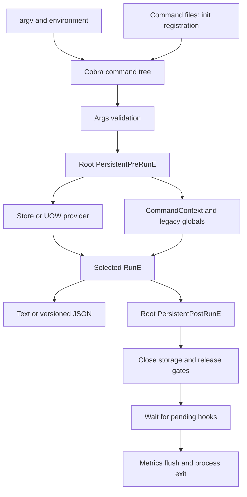
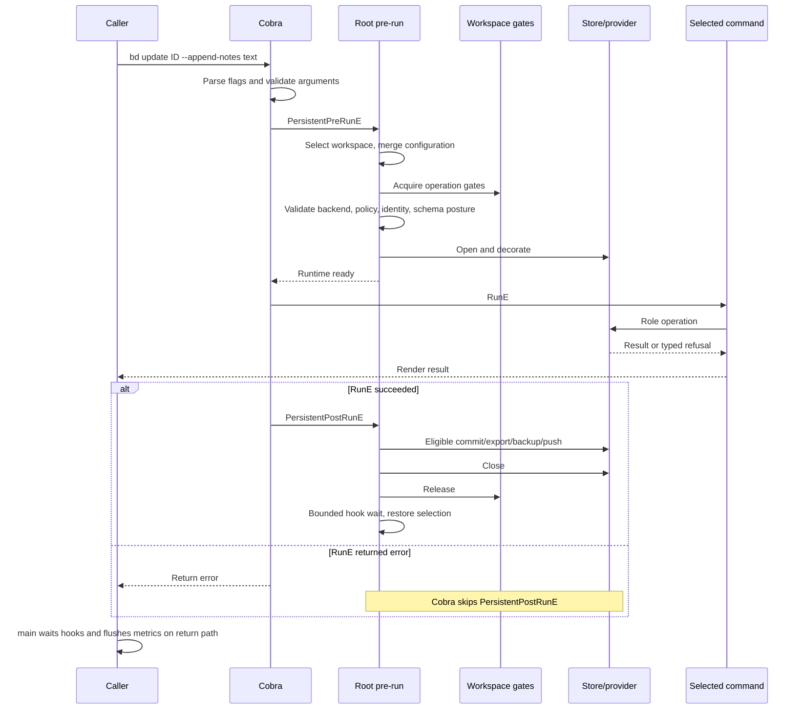
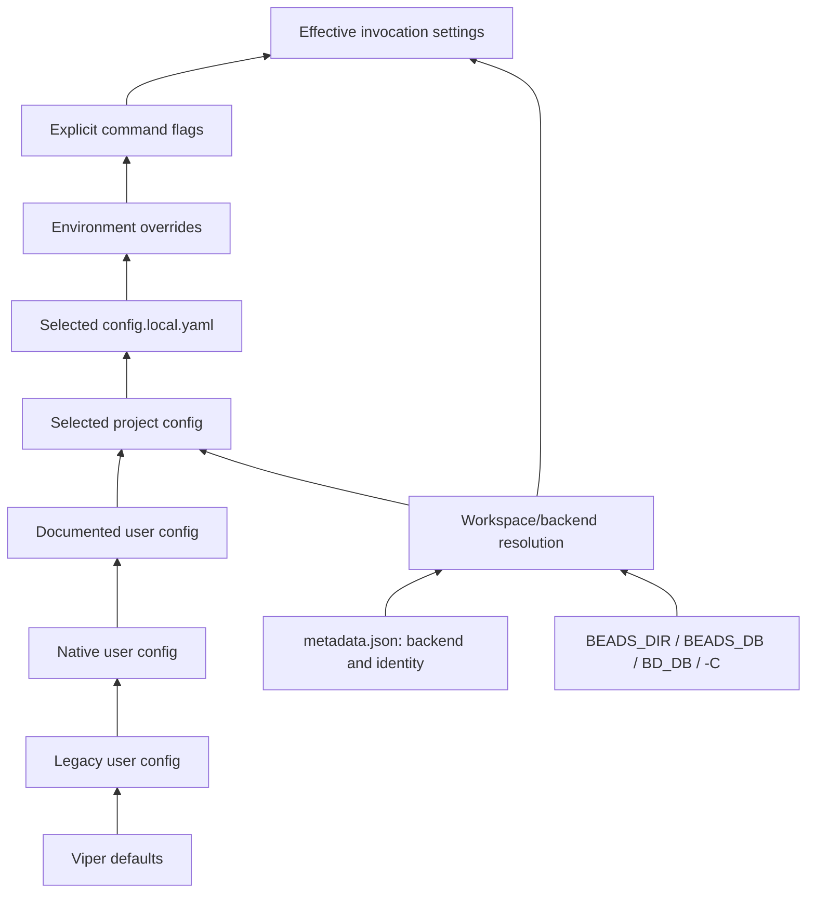
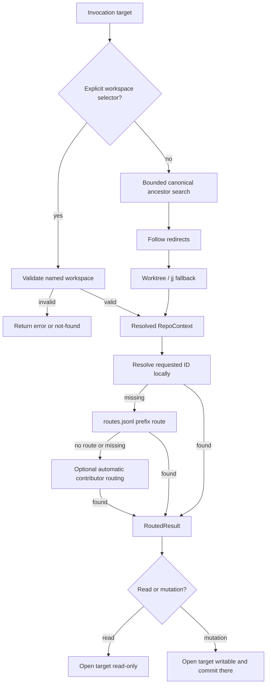
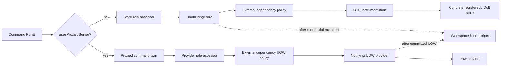
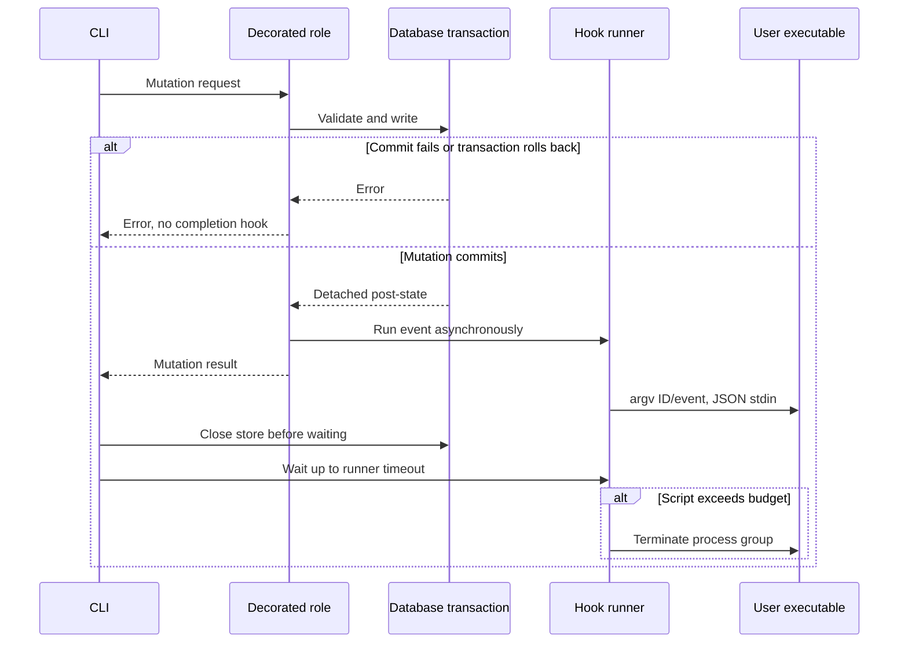
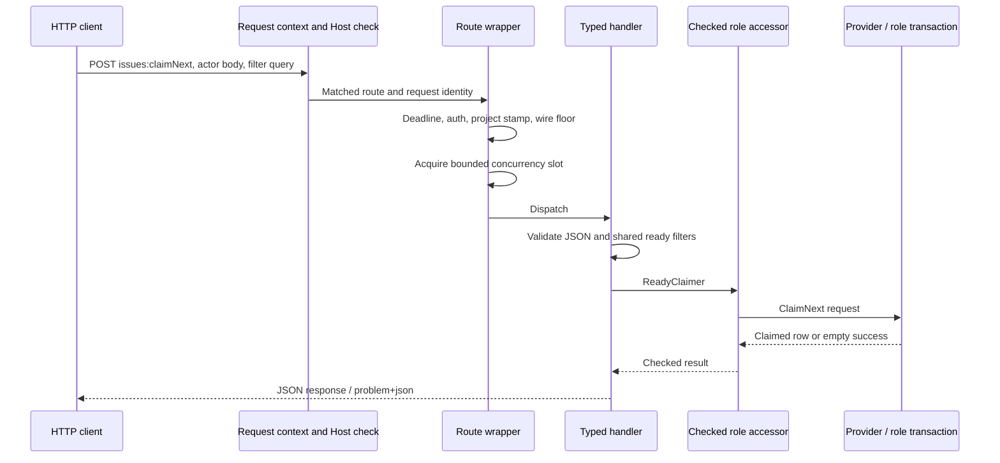

# CLI, runtime, and HTTP execution

This chapter explains where an invocation acquires its meaning, workspace, capabilities, storage, and output contract. It documents the implementation at upstream commit `9d6fff760b7a314b476539198504d77ce0959656`; it is contributor documentation for this fork, independent of the release-pinned user documentation.

## 1. The executable is a composition root

`bd` is one Cobra command tree in one large `package main`. Command files declare command values, register flags, and call `rootCmd.AddCommand` from their own `init()` functions. `main.go` supplies common runtime policy; it does not assemble a list of commands in `main()`. The source-pinned command inventory is [tree.golden](../../cmd/bd/testdata/command_tree/tree.golden), including hidden commands and flags.

The application is in a gradual state-ownership migration: [CommandContext](../../cmd/bd/context.go) groups the store, root context, actor, output settings, mode, and profiling state, but legacy globals still exist and accessors synchronize or fall back to them. This is not a fully dependency-injected per-command service container. Tests that execute Cobra repeatedly must reset shared state and serialize unsafe command-tree manipulation.

Source: [rootCmd and main](../../cmd/bd/main.go), [CommandContext](../../cmd/bd/context.go), [CLI contributor contract](../../cmd/bd/AGENTS.md).

## 2. Invocation lifecycle

Cobra parses flags and performs argument validation before the persistent pre-run hook. This ordering is deliberate for `update` and `close`: a missing ID in a noninteractive invocation is rejected before opening a store, migrating a schema, or importing data. Their last-touched fallback is restricted to interactive sessions unless `BD_LAST_TOUCHED_FALLBACK` explicitly changes the rule.

The persistent pre-run sequence has several early exits; the following is the normal store-backed path, rather than a claim that every command executes every step:

1. Clear inherited worktree Git routing, apply color flags, initialize `CommandContext`, and reset per-command write markers.
2. Install signal handling, initialize optional OTel, initialize usage metrics, and start a command span.
3. Apply `-C` workspace selection; reject dangerous backend environment overrides; load selector environment keys.
4. Reconcile explicit flags with Viper settings and determine text/JSON, actor, readonly, database, and commit policy.
5. Classify commands that need no root-managed store; prepare their selected workspace and return early when appropriate.
6. Resolve the actual workspace, rebind its configuration/environment, and acquire workspace and physical-root operation gates.
7. Validate backend selection and proxied capability policy before provider construction or workspace side effects.
8. Resolve read/preview policy, migration freeze and identity checks, backend configuration, database override, and server connection settings.
9. Open a direct store or a proxied-server UOW provider; compose policy, telemetry, and completion-notification layers.
10. On the direct route, run eligible empty-store auto-import and load molecule catalogs, then synchronize runtime state to `CommandContext`.

The error branch is architecturally important: post-run cleanup is not a universal `finally`. Pre-run failures after gate acquisition have their own deferred close-and-release path; `main()` independently waits for hooks and flushes metrics after `ExecuteC()`. Avoid designing an extension whose only durable completion work lives in Cobra post-run.

## 3. Store-free commands and startup side effects

The root has a `noDbCommands` classification and a local `bd:skip_store=1` annotation that applies through ancestors. `doctor` uses the annotation. Commands such as `prime`, `bootstrap`, `hooks`, `context`, `formula`, `setup`, and `where` do not receive a store from the normal root path; some open a narrowly scoped store themselves. “No root-managed store” does not imply “never accesses a database.”

Subcommands override the grouping rule: `dolt push/pull/commit` and `dolt remote ...` require storage, while configuration/diagnostic Dolt verbs do not; `human list/respond/dismiss/stats` are data-backed even though bare `human` is help. Newly added commands must fit both the store-init classification and the proxied capability registry.

Startup itself may perform work: metrics defaults can materialize in user configuration when metrics are enabled; ordinary read commands can retain compatibility maintenance/autostart behavior; normal opens can encounter migration gates; direct opens can load molecule catalogs or auto-import an empty eligible database. Strict `--readonly` is a separate stronger policy that disables autostart and maintenance, while previews use nonmutating opens. Proxied-server strict readonly is refused before provider construction because that route cannot guarantee it.

Source: [effectiveRootStorePolicy, isPreviewCommand, commandOptsOutOfStore](../../cmd/bd/main.go), [store factory](../../cmd/bd/store_factory.go), [workspace operation gates](../../cmd/bd/workspace_gate.go).

## 4. Configuration has several planes

Do not treat every setting as a Viper key. Beads separates startup policy, workspace backend metadata, database settings, persistent memories, and caller provenance.

| Plane | Implementation | Purpose and behavior |
|---|---|---|
| Command flags | [main.go](../../cmd/bd/main.go) and command files | Explicit flags beat merged configuration; a flag's *presence* can differ from its value, especially guards, clearing fields, and explicit zero limits. |
| User/project YAML | [config.Initialize](../../internal/config/config.go) | Viper defaults, `BD_` environment bindings, layered YAML, and runtime overrides. |
| Machine-local YAML | [config.local.yaml merge](../../internal/config/config.go) | Highest-priority file layer beside the selected project config; keeps machine settings out of tracked configuration. |
| Workspace metadata | [configfile.Config](../../internal/configfile/configfile.go) | `.beads/metadata.json` records backend/mode/database identity and connection configuration. Invalid metadata is refused instead of falling back to an empty embedded store. |
| Selector environment | [loadSelectionEnvironment](../../cmd/bd/main.go) | `BEADS_DIR`, `BEADS_DB`, `BD_DB` participate in early targeting before loading the selected workspace's broader environment. |
| Workspace `.env` | [loadBeadsEnvFile](../../cmd/bd/main.go) | Non-overriding dotenv load: existing process environment wins. Early selector loads are deliberately narrower than full credential/runtime loads. |
| Database configuration | [WorkspaceConfig role](../../issueops/workspaceconfig.go) | Settings whose meaning belongs to the selected store, exposed through role accessors. |
| Persistent memory | [Memories role](../../memoryops/memories.go) | Separate namespaced memory plane; sharing a table with settings does not make its operations interchangeable. |
| Actor | [currentActor and deferred Git fallback](../../cmd/bd/main.go) | Flag/env/config provenance with lazy Git-name fallback and user fallback; actor is not authenticated identity. |

The file precedence implemented by `config.Initialize` is lowest to highest: legacy `~/.beads/config.yaml`, native user-config `bd/config.yaml`, documented `~/.config/bd/config.yaml`, discovered project config, explicit `BEADS_DIR/config.yaml`, then the selected `config.local.yaml`. Duplicate paths are skipped. An explicit foreign `BEADS_DIR` prevents the ambient checkout's project configuration leaking underneath it. Environment and explicit runtime/flag overrides sit above file values according to the accessor/binding rules.

This diagram describes precedence, not a single parser that loads all these formats at once. Backend overrides `BD_BACKEND` and `BD_DATABASE_BACKEND` are rejected to prevent data fragmentation. Metrics consent and endpoint resolution intentionally use environment plus user-global configuration rather than a repository's merged settings.

## 5. Workspace discovery and routing

Workspace selection and issue routing are different operations. First find the workspace an invocation addresses. Later, an ID or contributor policy may route a read/write to another store.

[FindBeadsDir](../../internal/beads/beads.go) honors explicit `BEADS_DIR` first. An explicitly named directory that is absent or lacks project files returns not-found; discovery does not silently adopt an ambient ancestor. Otherwise it walks canonicalized ancestor paths, follows redirect files, accounts for Git worktrees and Jujutsu secondary workspaces, and can prefer the main/shared database over tracked metadata without database files. `BEADS_CEILING_DIRECTORIES` and temp-root ceilings bound ancestor discovery. A `.beads` directory with only registry files is insufficient; metadata, config, recognized database files/directories establish a project.

`-C` deserves care: its implementation resolves and exports the target workspace selection without simply changing the process working directory. [RepoContext](../../internal/beads/context.go) therefore distinguishes `BeadsDir`, the root owning Beads data, the caller's checkout root, redirects, and worktree status. Git operations for Beads data must use the selected repository context and scrub inherited Git routing environment.

The diagram combines discovery and the later ID lookup to expose their boundary. Actual routed opening occurs before constructing the successful `RoutedResult`. [routed.go](../../cmd/bd/routed.go) tries local, prefix, then optional auto routing; routing failures such as unreadable rules or failed target opens propagate instead of masquerading as local not-found. Read and mutation helpers are separate. Callers must close a routed result, and routed writes must commit the target explicitly because root post-run owns only the local store. [routing_read.go](../../cmd/bd/routing_read.go) also applies contributor planning-repository routing to collection reads.

## 6. Storage-mode dispatch and decorated capabilities

A command normally takes one of two entry paths: a `storage.DoltStorage` path, or a proxied UOW-provider path. The first includes embedded Dolt, SQL-server Dolt, and registered backends such as HTTP; “direct route” is therefore not synonymous with “embedded.” Proxied commands have explicit `*_proxied_server.go` twins and obtain capabilities from the provider rather than expecting the global store to exist.

[wireStorageDecorators](../../cmd/bd/storage_chain.go) defines the exact outer-to-inner store order: hooks → external-dependency policy → instrumentation → raw store. Telemetry can be a no-op; hooks can be disabled. The proxied composition is external policy → notifying provider → raw provider. Versioned-history activation happens in the store factories, so routed stores receive it too.

Commands must obtain `IssueReader`, `IssueLifecycle`, `ReadyClaimer`, `Heartbeater`, `Counter`, and related roles through the owning store/provider's accessor. Constructing a raw role manually can drop hook or policy decorators. Optional interfaces and capability availability matter; the [public role family](../../issueops/issueops.go) is explicitly experimental and exact-version pinning is appropriate for extensions.

The [capability registry](../../cmd/bd/capability_registry.go) inventories every command path and relevant execution-altering flag set for proxied workspaces. Outcomes distinguish pre-provider typed refusal, a known refusal inside `RunE`, and gate admission. Admission alone does not prove an implementation exists. Reasons distinguish deliberate design refusal from unimplemented parity. Tests assert command-tree coverage and stale-row absence.

## 7. CRUD, dependencies, claims, and batch boundaries

The commands gather presentation-oriented inputs, resolve IDs, build typed requests, obtain roles, and render detached results. [create.go](../../cmd/bd/create.go) builds a lifecycle create carrying content, labels, metadata, parent/dependency intent, persistence selection, and default policy; initial dependencies belong with creation rather than a series of unrelated follow-up commands. [update.go](../../cmd/bd/update.go) maps explicit changes into `IssuePatch`, where `Field.Set` distinguishes omission from clearing a field. Labels apply replacement → add → remove; metadata applies merge → sorted set → unset, unless whole-document replacement is selected.

`update --claim` combines claim and field changes in one lifecycle request. `--if-assignee`, `--if-status`, and `--if-revision` are preconditions and cannot be combined with the claim flag. An explicitly empty assignee guard means “must be unassigned”; omission means no guard. The row revision token is an opaque equality token, exposed as a decimal string in detail DTOs to preserve 64-bit precision for JavaScript clients. It is not the per-issue history revision and is not a universal change timestamp.

| Operation | Semantic owner | Important boundary |
|---|---|---|
| Create/update/close/reopen | [Lifecycle](../../issueops/issueops.go) | Complete guarded mutation within a transaction; deterministic validation failures do not write. |
| Claim a named issue | [Claimer](../../issueops/claimer.go) | State-checked ownership, same-actor idempotence; named-issue Claimer excludes the wisp plane. |
| Take the next ready issue | [ReadyClaimer](../../issueops/readyclaimer.go) | Selection, compare-and-set, and hydration share one transaction; can include ephemeral work when requested. |
| Add/remove graph edges | [DependencyEditor](../../issueops/dependencyeditor.go) | Typed dependency validation, cycle policy, and source-issue completion hooks. |
| Release/heartbeat/reclaim | [Releaser](../../issueops/releaser.go), [Heartbeater](../../issueops/heartbeater.go), [LeaseReclaimer](../../issueops/leasereclaimer.go) | Distinct ownership operations with different authorization-by-state and lease semantics. |
| Multiple ordinary `update` IDs | [update command](../../cmd/bd/update.go) | Per-ID mutations; some can succeed while others fail and the process exits nonzero. |
| Multiple `close` IDs | [BatchCloser](../../issueops/batchcloser.go), [close command](../../cmd/bd/close.go) | Per-item refusal outcomes can coexist with committed survivors and an optional claimed-next result. |
| `bd batch` | [batch.go](../../cmd/bd/batch.go) | Narrow line grammar over one transaction; any failure rolls the batch back. It does not reenter Cobra command handlers. |

Do not infer identical policy from similar spellings. `bd batch`'s legacy `close` grammar does not apply all the policy of ordinary `bd close`; its `update status=closed` does enforce close policy. This asymmetry is explicit in the source. The workflow chapter details readiness, molecule advance, and lease recovery.

## 8. Completion hooks are post-mutation subprocesses

The implemented hook surface consists of executable `.beads/hooks/on_create`, `on_update`, and `on_close` files. [hooks.Runner](../../internal/hooks/hooks.go) passes the issue ID and event as arguments and the serialized issue on stdin. Missing/nonexecutable scripts are skipped. Execution is asynchronous with a 10-second default timeout; mutation success is not reversed by script failure. Unix expiry kills the entire process group, including descendants. There is a separate Windows implementation and a typed unsupported path for WASM.

[HookFiringStore](../../internal/storage/hook_decorator.go) preserves hooks through role accessors and tracks transaction mutations until commit. The [notifying provider](../../internal/storage/uow/notifying.go) supplies the proxied equivalent. Hooks can therefore be fired by newly composed role operations, not just by the original CRUD command handlers. Conversely, retry/no-op behavior is operation-specific: batch closes fire only for landed changes; lifecycle close/update preserve their existing success behavior; heartbeat refreshes fire none, while a lease re-arm can fire `on_update`.

Teardown closes the embedded store before waiting because a script can invoke `bd` against the same workspace; keeping its parent store open would retain the embedded lock. This is a notification seam with bounded best-effort execution, not a transactional plugin veto, durable delivery queue, or plugin discovery/manifest system. Hooks installed on a CLI client also do not imply server-side hooks: `bd serve` deliberately serves unhooked roles.

## 9. HTTP execution: a second frontend over the same roles

[bd serve](../../cmd/bd/serve.go) serves the shared work surface for clients that would otherwise fork `bd` per operation. [routeTable](../../internal/httpapi/routes.go) is the runtime route/capability inventory; [OpenAPI](../../internal/httpapi/spec/openapi.v0.yaml) specifies the wire contract. `/v0/beads/context` advertises build capabilities, workspace identity, and schema/wire information. Clients use the handshake and capability tokens rather than assuming every backend/build implements a route or newly added filter.

The request layer orders identity/protocol refusal before acquiring database resources. Nonstreaming routes get deadlines; event streams use per-read budgets and release slots between passes. Checked role wrappers defend against malformed implementations returning success without required rows. `claimNext` shares the ready filter decoder and returns a successful empty result when the frontier is drained; listing then claiming is not used to implement it.

Loopback is the default trust boundary. Binding beyond it requires explicit posture and ordinarily a token file. Token rotation reloads the file; Host allowlisting addresses DNS rebinding. TLS is not implemented by this server. Actors remain caller-asserted provenance even when bearer authentication is enabled. `/healthz` is liveness without a database read; `/v0/beads/ready?limit=1` is a readiness query. Source: [server middleware](../../internal/httpapi/server.go), [claim-next handler](../../internal/httpapi/claim_next.go), [role checks](../../internal/httpapi/roles.go), [HTTP client](../../internal/httpclient/dial.go).

Serve requests commit their own mutations and do not run CLI script hooks or root per-command auto-export/push on each request. `bd serve` is also excluded from root post-command maintenance at shutdown: one process lifetime is not one CLI mutation. A plugin that depends on notification of every write must cover this frontend explicitly.

## 10. Output, error, cancellation, and observability contracts

[output.go](../../cmd/bd/output.go) declares `JSONSchemaVersion = 1`. The compatibility surface supports legacy flat output and `BD_JSON_ENVELOPE=1`, which adds `schema_version`, `data`, and optional pagination. Some command families still intentionally emit specialized/raw JSON shapes; do not assume every command returns one universal array/object type. The [protocol producer corpus](../../cmd/bd/protocol/CATALOG.md) pins representative outputs in both modes and explicitly lists gaps.

[errors.go](../../cmd/bd/errors.go) distinguishes already-rendered `exitError` values from ordinary errors, avoiding duplicate prose after JSON. Capability refusals carry stable `code`, `error`, and `mutates` fields, with additive `reason` when registry policy supplied it. Typed schema-skew and migration-consent failures get actionable text/JSON rendering. General failure is exit 1; guarded-update stale preconditions have a special exit path (13). HTTP uses typed `problem+json` classification rather than copying CLI stderr.

`setupGracefulShutdown` handles SIGINT/SIGTERM/SIGHUP, tries a bounded fresh-context batch flush before canceling, and forces exit on a second signal. Flush applies to an active direct store; proxied batch mode requires its explicit commit point. Hook waits and metrics flushing also exist on paths Cobra omits post-run for. Profiling flags support CPU, heap, and trace data; [telemetry](../../cmd/bd/command_telemetry.go) starts a root command span and nested storage/AI spans when enabled. Usage metrics consent is a different subsystem from opt-in OTel.

## 11. Complete top-level command taxonomy

This table inventories the checked-in command-tree golden at the pinned source. It groups commands by responsibility rather than duplicating every flag. For exact aliases, subcommands, defaults, hidden flags, and help strings use [tree.golden](../../cmd/bd/testdata/command_tree/tree.golden); new commands must also satisfy [capability_registry.go](../../cmd/bd/capability_registry.go). Hidden primary commands are marked “internal.”

| Responsibility | Primary top-level commands | Source entry points |
|---|---|---|
| Create and revise work | `create`, `create-form`, `q`, `update`, `edit`, `assign`, `priority`, `rename` | [create](../../cmd/bd/create.go), [update](../../cmd/bd/update.go), [quick capture](../../cmd/bd/quick.go) |
| Lifecycle and retention | `close`, `reopen`, `delete`, `defer`, `undefer`, `promote`, `unclaim`, `heartbeat`, `reclaim` | [close](../../cmd/bd/close.go), [unclaim](../../cmd/bd/unclaim.go), [reclaim](../../cmd/bd/reclaim.go) |
| Browse and query | `list`, `show`, `search`, `query`, `count`, `ready`, `blocked`, `children`, `graph` | [list](../../cmd/bd/list.go), [ready](../../cmd/bd/ready.go), [query](../../cmd/bd/query.go) |
| State and annotations | `label`, `tag`, `state`, `set-state`, `note`, `comment`, `comments`, `link`, `todo` | [label](../../cmd/bd/label.go), [state](../../cmd/bd/state.go), [comment](../../cmd/bd/comment.go) |
| Structure and relationships | `dep`, `epic`, `swarm`, `duplicate`, `duplicates`, `find-duplicates`, `supersede`, `flatten` | [dependencies](../../cmd/bd/dep.go), [swarm](../../cmd/bd/swarm.go), [epic](../../cmd/bd/epic.go) |
| Workflow compilation/execution | `formula`, `cook`, `mol`, `gate`, `merge-slot` | [formula](../../cmd/bd/formula.go), [cook](../../cmd/bd/cook.go), [molecule](../../cmd/bd/mol.go), [gate](../../cmd/bd/gate.go) |
| Persistent memories | `remember`, `recall`, `forget`, `memories` | [memory commands](../../cmd/bd/memory.go) |
| Context and human participation | `prime`, `human`, `mail`, `rules`, `provenance` | [prime](../../cmd/bd/prime.go), [human](../../cmd/bd/human.go), [messaging](../../cmd/bd/mail.go) |
| Workspace setup and recovery | `init`, `init-safety`, `bootstrap`, `connect`, `onboard`, `setup`, `context`, `where`, `info` | [init](../../cmd/bd/init.go), [bootstrap](../../cmd/bd/bootstrap.go), [context report](../../cmd/bd/context_cmd.go) |
| Help and surface discovery | `help`, `quickstart`, `completion`, `version`, `types`, `statuses`, `schema` | [help](../../cmd/bd/main_help.go), [schema](../../cmd/bd/schema.go), [version](../../cmd/bd/version.go) |
| Configuration and diagnostics | `config`, `hooks`, `doctor`, `preflight`, `ping`, `metrics` | [config](../../cmd/bd/config.go), [hooks](../../cmd/bd/hooks.go), [doctor](../../cmd/bd/doctor.go) |
| Reports and audit | `status`, `stale`, `orphans`, `lint`, `audit`, `events`, `history`, `versions` | [status](../../cmd/bd/status.go), [events](../../cmd/bd/events.go), [history](../../cmd/bd/history.go) |
| Data interchange and database tooling | `import`, `export`, `batch`, `sql`, `kv` | [import](../../cmd/bd/import.go), [export](../../cmd/bd/export.go), [batch](../../cmd/bd/batch.go) |
| Version control and replication | `sync`, `dolt`, `vc`, `branch`, `diff`, `conflicts`, `federation`, `repo`, `worktree` | [sync](../../cmd/bd/sync.go), [Dolt](../../cmd/bd/dolt.go), [worktree](../../cmd/bd/worktree_cmd.go) |
| Maintenance and migration | `admin`, `backup`, `compact`, `restore`, `gc`, `prune`, `purge`, `migrate`, `migrate-personal`, `rename-prefix`, `recompute-blocked`, `upgrade` | [compact](../../cmd/bd/compact.go), [backup](../../cmd/bd/backup.go), [migrate](../../cmd/bd/migrate.go) |
| External integrations | `ado`, `github`, `gitlab`, `jira`, `linear`, `notion`, `ship` | [ADO](../../cmd/bd/ado.go), [GitHub](../../cmd/bd/github.go), [Linear](../../cmd/bd/linear.go), [Notion](../../cmd/bd/notion.go) |
| HTTP frontend | `serve` | [serve](../../cmd/bd/serve.go), [HTTP API](../../internal/httpapi/server.go) |
| Internal process/lifecycle plumbing | `codex-hook`, `cursor-hook`, `db-proxy-child`, `send-metrics`, `migrate-issues` | [Codex hook](../../cmd/bd/codex_hook.go), [Cursor hook](../../cmd/bd/cursor_hook.go), [command golden](../../cmd/bd/testdata/command_tree/tree.golden) |

## 12. Extension consequences

Implemented seams in this chapter are executable notification hooks, role/decorator composition, registered backend dispatch, workflow formulas, and HTTP capability negotiation. There is no inference here that the CLI already loads arbitrary command plugins. A future plugin host must state where it runs in this lifecycle, whether it gets selected-workspace context or ambient process context, which operation roles it receives, how it behaves across proxied and HTTP routes, and whether its errors can affect a mutation. Preserve script-hook compatibility while designing stronger delivery or veto semantics separately.
