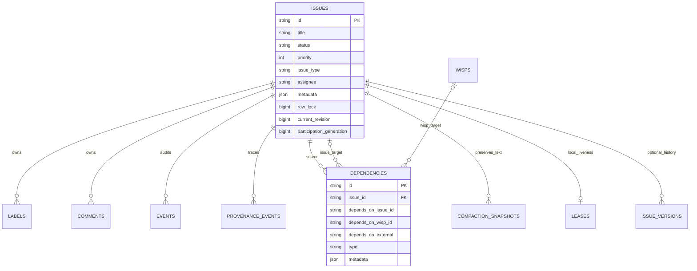
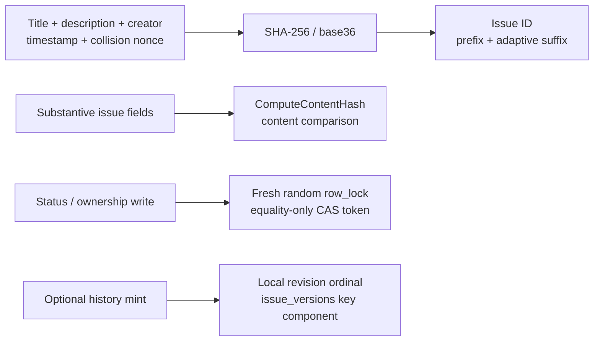
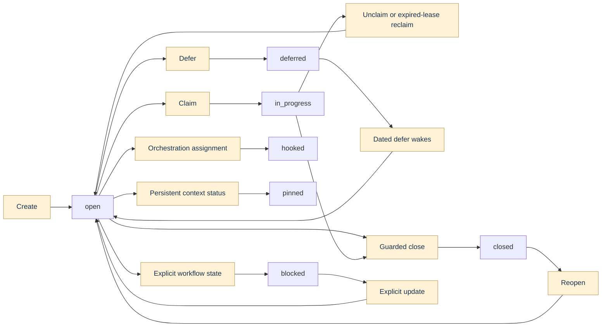
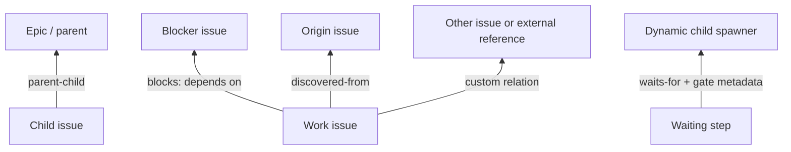
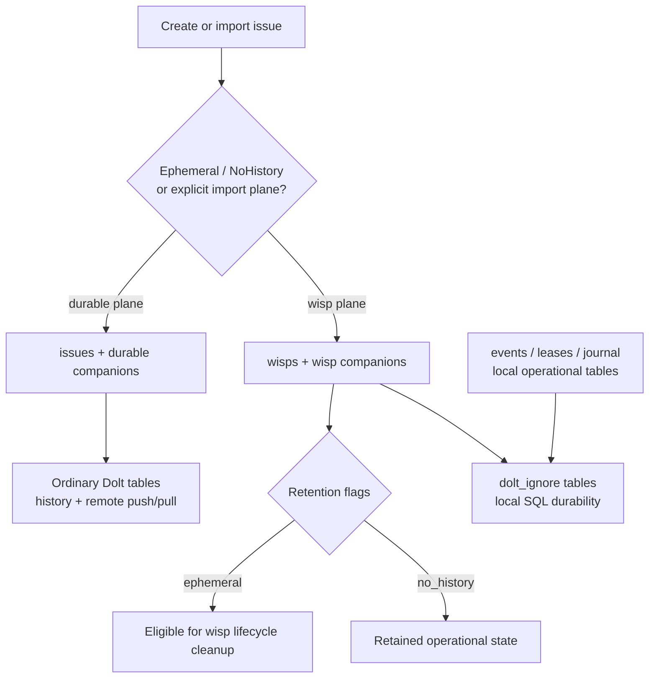
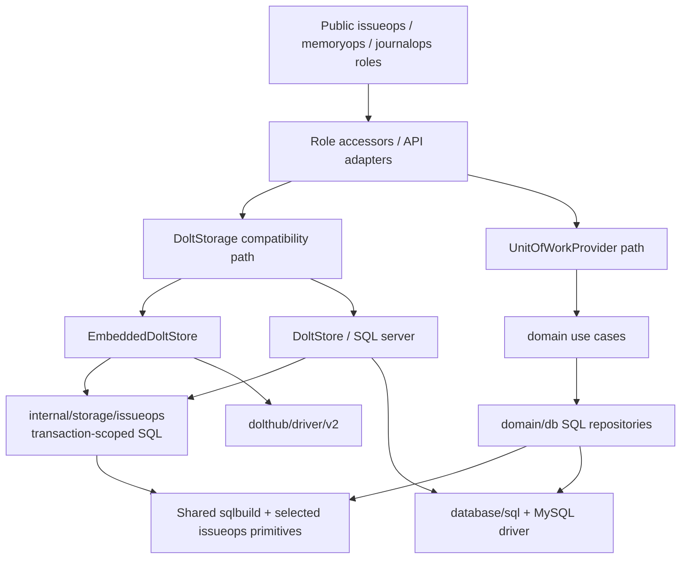
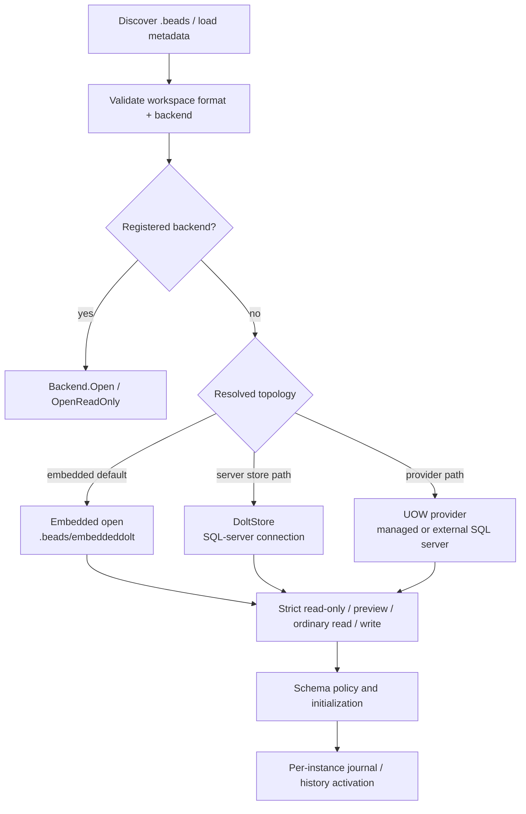
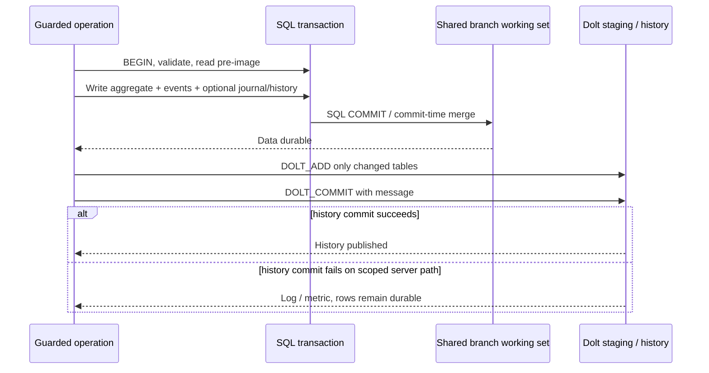
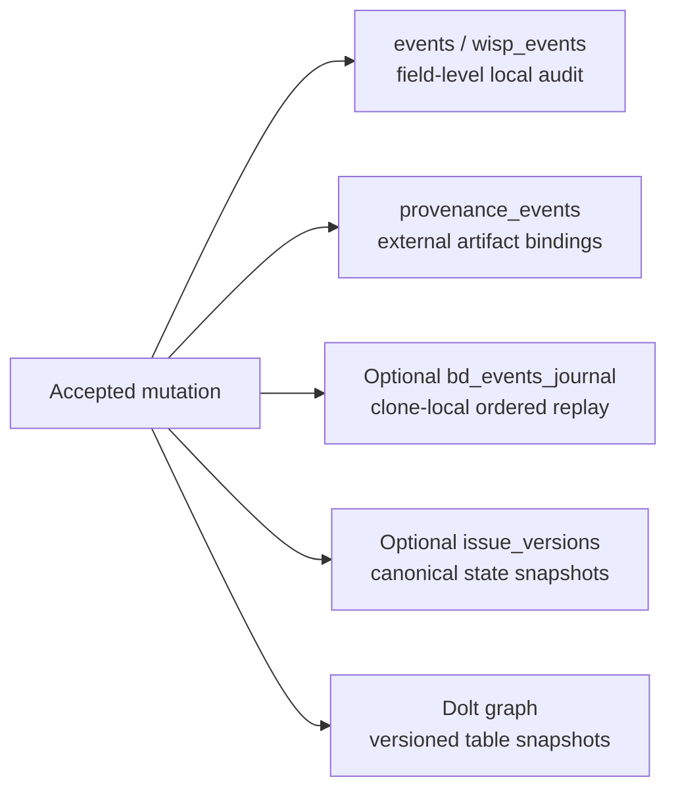
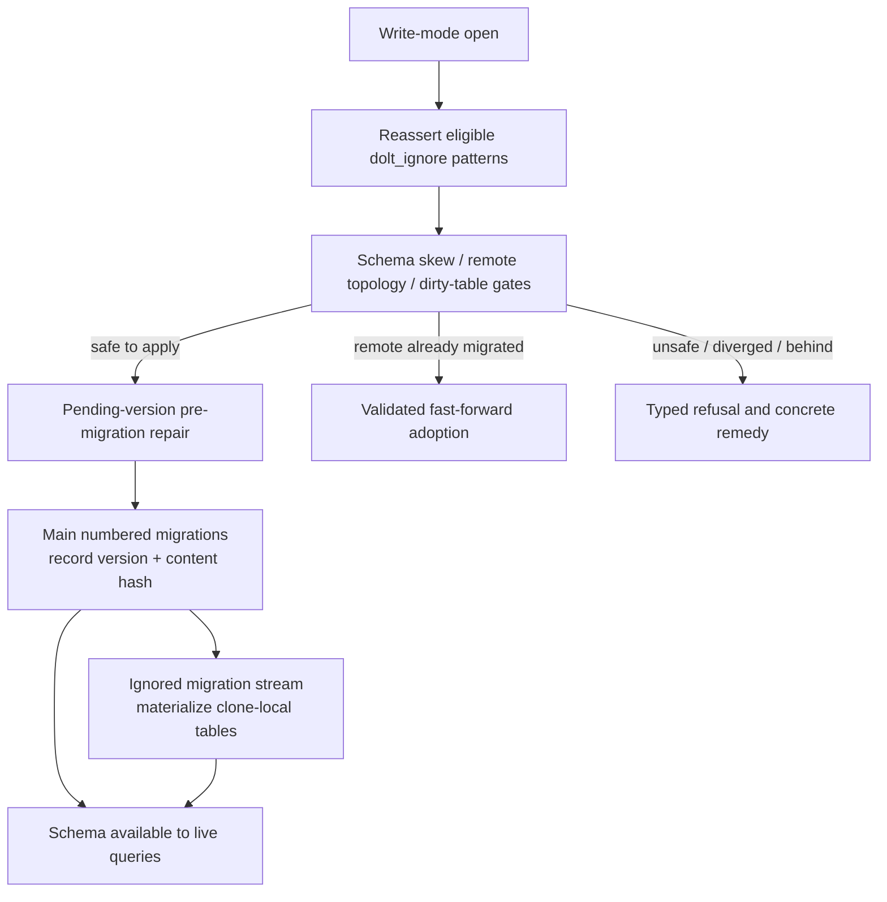

# Data model and storage

This chapter explains the data that a Beads extension must preserve, the two SQL implementation paths it can encounter, and the boundary between a successful database write and a published Dolt history entry.

**Source baseline:** upstream `9d6fff760b7a314b476539198504d77ce0959656`, inspected 2026-10-22. This is a description of that checkout, including features whose switches are off by default. It is contributor documentation; the published user docs target a separately pinned release.

## 1. The aggregate is an issue plus its graph

[`types.Issue`](../../internal/types/types.go) is the central record. A bead and an issue are the same unit. An issue's labels, outgoing dependencies, comments, audit events, and provenance are separate records. `Issue.Labels`, `Issue.Dependencies`, and `Issue.Comments` are hydration/interchange fields, not nested SQL documents.

The diagram is a logical map, not a promise that every relationship is a physical foreign key. Source rows have stronger referential constraints than arbitrary external targets; cross-plane references and clone-local tables require special handling. Read the migration chain rather than treating migration `0001` as the final schema.

| Field group | Representative fields | Architectural meaning |
|---|---|---|
| Identity | `ID`, internal `ContentHash` | Stable issue lookup key; content hash is a separate comparison value |
| Content | title, description, design, acceptance criteria, notes, spec ID | Agent-readable persistent context |
| Workflow | status, priority `0..4`, issue type, `IsBlocked` | State plus a materialized readiness projection |
| Assignment | assignee, owner, estimated minutes | Actor ownership and human attribution are separate |
| Time | created/updated/started/closed, due date, defer date | Creation, lifecycle, and scheduling clocks |
| Integration | external ref, source system, arbitrary JSON metadata | Links and extension-owned annotations |
| Persistence | ephemeral, no-history, storage class, wisp type | Plane and retention selectors; see section 4 |
| Workflow expansion | template marker, molecule/work type, bonded origins | Formula instantiation and lineage |
| Gates | await type/ID, timeout, waiters | Async wait conditions represented as issues |
| Operational event issues | event kind, actor, target, payload | Event-shaped **issues**, distinct from the audit event table |
| Internal routing | source repo, prefix overrides, wisp plane override | Runtime routing state omitted from ordinary serialization |

`IssueSummary` is a deliberately narrow read projection. `IsLitePartial` marks an `Issue` whose heavy text/JSON columns were not loaded. An empty description in a lite result does not prove the description is empty. `IssueDetails` and `IssueWithCounts` add relationship counts, omission markers, and derived decorations. A plugin that needs comment text must request it; `comments_omitted` and `comment_count` explain absence in supported views.

## 2. Identity: four different concepts

Do not collapse issue IDs, content hashes, optimistic revision tokens, and history ordinals into one identifier.

The production mint is [`internal/idgen.GenerateHashID`](../../internal/idgen/hash.go), called by [`GenerateIssueIDInTable`](../../internal/storage/issueops/helpers.go) and the domain path's [`mintTopLevelID`](../../internal/storage/domain/issue.go). It uses SHA-256 over title, description, creator, Unix nanoseconds, and nonce, then base36 encoding. The default adaptive configuration chooses lengths from 3 through 8 using a collision-probability target of `0.25`; collision handling tries ten nonces at each length. A failed length lookup falls back to six characters. The database unique key remains the final collision arbiter.

The helper [`types.GenerateHashID`](../../internal/types/id_generator.go) still describes a different hex/workspace-ID recipe. It is not the main issue mint used by these SQL paths. Extensions should use the supported create operation and let it assign IDs, rather than copying that helper's comment into a new protocol.

Other identity forms:

- Counter mode, selected by `issue_id_mode=counter`, allocates sequential durable issue IDs; wisp minting retains its own behavior. Counter allocation is a transactional database operation, not an in-process integer.
- Hierarchical IDs use `parent.N`. [`CheckHierarchyDepth`](../../internal/types/id_generator.go) defaults to a maximum depth of three; child counters and reconciliation keep allocation coherent with imported explicit children.
- Dependencies use deterministic UUIDv5 surrogate IDs from [`depid.New`](../../internal/storage/depid/depid.go), based on source and target. The logical edge key does not include dependency type: one source/target pair is one edge whose type can change.
- Comments, audit events, and compaction snapshots use content-derived IDs through [`rowid`](../../internal/storage/rowid) and [`derivedid.go`](../../internal/storage/issueops/derivedid.go). Frozen digest fields, UTC second-resolution timestamp rendering, and multiplicity ordinals make equivalent replica inserts converge. This is more specific than “every auxiliary row has a random UUID.”
- `Issue.RowVersion` mirrors a random nonzero `row_lock`. `IssueDetails.Revision` publishes its decimal spelling as a **JSON string**, preserving the full `int64` value in JavaScript. Tokens are equality-only and are not complete change detectors: some text-only and label/reopen paths do not remint them.

## 3. Status, type, and edge semantics

Built-in statuses are `open`, `in_progress`, `blocked`, `deferred`, `closed`, `pinned`, and `hooked`. Status and the boolean `Pinned` context marker are different fields. The following is the ordinary work lifecycle, not a closed finite-state machine: guarded operations and generic updates admit additional transitions.

Custom statuses have categories defined in [`types.ParseCustomStatusConfig`](../../internal/types/types.go):

| Category | Ready eligibility | Default list behavior |
|---|---|---|
| `active` | Eligible with the other ready predicates | Visible |
| `wip` | Excluded | Visible |
| `done` | Excluded | Excluded |
| `frozen` | Excluded | Excluded |
| `unspecified` | Excluded | Visible; compatibility for legacy flat status lists |

Names must match `[a-z][a-z0-9_-]*`, avoid built-in names, be unique, and stay within the limit of 50 custom statuses. Configuration accepts `review:wip,ready:active` and legacy comma-separated names. Custom types are resolved from `custom_types`, falling back to the `types.custom` config row when needed, then **unioned** with project YAML `types.custom`. [`config_helpers.go`](../../internal/storage/issueops/config_helpers.go) owns that composition and updates the lookup tables when corresponding config keys change.

Built-in issue types include bug, feature, task, epic, chore, decision, message, molecule, gate, spike, story, and milestone. Internal `event` is accepted by the broader validation path even though it is excluded from `AllIssueTypes`. Arbitrary orchestrator names such as `agent`, `rig`, and `convoy` are custom types, not universal core constants.

Direction is a frequent source of bugs: `Dependency.IssueID` is the dependent/source; `DependsOnID` is its target. “A depends on B” stores an edge from A to B. `parent-child` is stored from child to parent. Scheduling semantics are concentrated in [`blocked_state.go`](../../internal/storage/issueops/blocked_state.go), [`blocked_recheck.go`](../../internal/storage/issueops/blocked_recheck.go), and [`sqlbuild/ready.go`](../../internal/storage/sqlbuild/ready.go).

`blocks`, `conditional-blocks`, `waits-for`, and `parent-child` affect ready work. Structural parent-child propagation differs from a hard blocker: `IsBlockingEdge` excludes it. `waits-for` carries dynamic fanout semantics such as `all-children` and `any-children`; metadata is part of behavior, not decorative JSON. Association, conversation, duplication, provenance, validation, and delegation relations have their own meanings. `DependencyType.IsValid` permits any nonempty value fitting the 32-byte SQL column, while selected user commands intentionally accept only well-known types.

The physical dependency target is split into issue, wisp, or external columns. [`0041`](../../internal/storage/schema/migrations/0041_split_dependencies_target.up.sql) and subsequent fixes replace the original single-column design. Code presents a unified `DependsOnID`; SQL builders and edge helpers handle the split. Never add a cross-repo target by fabricating a foreign-key-backed local issue target.

## 4. Persistence plane, retention, history, replication

Three concepts overlap but are not interchangeable: where a row lives, whether it is eligible for cleanup, and whether Dolt versions/replicates it.

The current plane matrix is:

| Surface | SQL durability | Dolt history / ordinary Dolt replication | Qualification |
|---|---|---|---|
| `issues`, durable dependencies, labels, comments | Yes | Yes | Subject to explicit commit policy and successful publication |
| `wisps`, `wisp_*` | Yes in the local working set | No | Ephemeral/no-history operational plane; ignored migration series recreates it on clones |
| `events` audit table | Yes | **No after migration 0062** | Older committed event history can remain in ancestors; new audit rows are local |
| `leases`, `local_metadata`, `repo_mtimes` | Yes | No | Clone-local liveness and bookkeeping |
| `bd_events_journal`, `bd_events_seq` | Yes when enabled | No | Clone-local ordered change feed |
| `issue_versions`, `store_epoch`, epoch addresses | Yes | Ordinary non-ignored tables | History recording and epoch operations have separate activation/contracts |
| `.beads/issues.jsonl` | File export | Travels only if explicitly tracked/copied | Interchange/viewer artifact; not the live database |

[`schema.doltIgnorePatterns`](../../internal/storage/schema/schema.go) is the canonical ignored-table set; `events` is version-gated at migration 62. This corrects older diagrams that show all audit events synchronizing with the issue graph. [`0062_events_dolt_ignore`](../../internal/storage/schema/migrations/0062_events_dolt_ignore.up.sql) explicitly states that a separate unversioned replication leg is future work. Comments remain versioned.

`StorageClass` accepts `versioned`, `unversioned`, and `ephemeral`. Empty resolves to ephemeral for wisp/no-history flags and versioned otherwise. **Do not interpret the `unversioned` marker as proof of a complete alternative replication engine.** [`0060`](../../internal/storage/schema/migrations/0060_add_storage_class.up.sql) introduces class plumbing without changing replication behavior. The ordinary issues table is still a Dolt table, and the promised newest-wins replication leg is not implemented by that marker alone.

Promotion/demotion moves between issue and wisp planes; routing must inspect actual table membership. `-wisp-` in an ID is a hint, not authoritative: explicit-ID wisps lack it, and promoted wisps retain it. [`WispIDSetInTx`](../../internal/storage/issueops/wisp_routing.go) and store routing code exist to avoid misrouting those cases. `WispPlaneOverride` preserves imported explicit plane information without making it a persisted domain field.

## 5. Storage contracts and the two implementation paths

[`storage.Storage`](../../internal/storage/storage.go) is a large compatibility interface containing role accessors and legacy methods. [`storage.DoltStorage`](../../internal/storage/storage.go) composes it with version control, history, remote, sync, federation, bulk/query/config/compaction capabilities. The name does not mean every caller should depend on the entire surface.

Role accessors include lifecycle, reader, claimer, ready claimer, batch creator/closer/applier, dependency editor, commenter, counters, relations, graph/tree operations, metadata CAS, heartbeater/reclaimer, memories and other specialized roles. They return narrow public contracts and typed refusals. The optional public journal role is discovered by type assertion rather than a required `DoltStorage` accessor. Decorators must preserve accessor behavior so obtaining a role does not bypass hooks or telemetry. Optional storage capabilities use explicit interfaces and assertions, including backups, conflict inspection, strict history queries, and database maintenance.

The newer [`uow.UnitOfWork`](../../internal/storage/uow/uow.go) path is real runtime code, not just a proposal. `NewUOW` starts a transaction; a `baseUOW` lazily wires issue, dependency, label, comment, config, remote, raw-SQL, and events-journal use cases over repositories sharing one runner. `Close` rolls back unless committed. New public role adapters can be obtained from a provider. Domain and legacy SQL paths duplicate some lifecycle logic, but share filter construction, SQL builders, row-lock primitives, version/journal seams, and conformance tests. A change in one path does not automatically change the other.

## 6. Opening a store safely

The factories in [`cmd/bd/store_factory.go`](../../cmd/bd/store_factory.go), its no-cgo twin, and [`uow_factory.go`](../../cmd/bd/uow_factory.go) resolve the workspace/backend/open posture. They activate journals and optional version history at construction time, including routed writes into other workspaces.

Key refusal behavior matters for plugins:

- Unknown/removed backend names and incompatible graph-format workspaces fail closed instead of becoming empty Dolt databases.
- An unreadable present `metadata.json` does not fall back to embedded storage. This avoids successful-looking empty results against the wrong database.
- A routed write into an existing foreign workspace refuses to create a missing embedded database. Otherwise later bootstrap might mistake a new empty store for the authoritative database.
- “Classified read command” is not identical to strict read-only: `ready --claim` is a read-shaped command with a mutation, and `OpenForReadOnlyCommand` can return a writable store with relaxed migration refusals. `OpenReadOnly` and preview posture have stronger guarantees.
- An explicitly configured external server is not replaced with an auto-started shadow server when unreachable. Port provenance is retained because a user assertion and a generated port file have different recovery semantics.
- Embedded mode requires cgo. Its [`OpenSQL`](../../internal/storage/embeddeddolt/open.go) uses `dolthub/driver/v2`, a pool of two connections, and context-bounded driver backoff. The store opens short-lived engine connections per operation; concurrency control belongs to the driver. The CLI retains an init-time exclusive-lock helper; it is not the general write coordinator.
- Managed and external UOW providers both obtain a [`dbproxy`](../../internal/storage/dbproxy) endpoint, then open a MySQL pool and initialize/verify schema. Managed mode controls the Dolt child process; external mode preserves external lifecycle and optional TLS settings. A UOW pins a session so its database, transaction, and session flags cannot drift across pool borrowers.

The registry [`internal/storage/backends`](../../internal/storage/backends/backends.go) is an existing extension seam for compiled-in downstream backends. It handles open/discovery, not provisioning: `bd init`/`bootstrap` create/import Dolt and reject registered alternative names. Root extension chapters cover the public registration API.

## 7. SQL commit and Dolt commit are separate

An SQL transaction makes rows durable in the branch working set. A Dolt commit publishes staged tables to the version graph. Confusing those operations causes lost updates and duplicate retries.

[`runIssueOperationTxWithMessage`](../../internal/storage/dolt/issue_operations_tx.go) and [`doltServerTx.CommitScoped`](../../internal/storage/uow/doltserver_tx.go) require **SQL commit before staging**. Staging an entire table from a still-open transaction's stale root can otherwise write back rows that concurrent writers changed. Scoped commits stage named dirty tables rather than every table with `-Am`.

On the scoped server mutation path, failure of the trailing Dolt commit is logged and counted as `bd.db.post_tx_commit_dropped`; the operation still succeeds because its SQL data already landed. A later commit carries it. Another writer can also absorb the rows under another message, making an operation-specific `dolt log` message best-effort evidence. Do not use a missing message as proof of a failed claim.

The generic `RunInTransaction`/embedded path has a different error contract: publication after SQL commit can return `ErrCommitIndeterminate`. The callback is not blindly replayed after it has started. Embedded [`runTransactionWithMessage`](../../internal/storage/embeddeddolt/transaction.go) documents this at-most-once callback behavior; general server transactions can span regular and ignored transactions and cannot promise an atomic cross-plane commit. Choose a guarded request-level role for the operation you need instead of relying on a blanket “all Beads writes are one atomic Dolt commit” claim.

## 8. History surfaces serve different purposes

| History | Content and guarantees | Limit |
|---|---|---|
| Audit events | Actor, event type, old/new value, comment, timestamp; created/updated/claimed/closed/reopened/dependency/label/reclaim events | Current `events` is local and ignored; it is not a global feed |
| Provenance | Typed external artifact binding, actor/ref payload, source, occurrence vs ingest time | Core validates structural kind/ref-kind, leaving external ref interpretation to consumers |
| Events journal | Mutation snapshots plus dependency/comment payloads in the same SQL transaction; sequence drawn from a shared counter row | Optional, clone-local, retention-prunable; ordering depends on engine conflict handling |
| Issue version log | Exactly one final-state snapshot for an accepted participating durable mutation; no-op mints none | Off by default; single writer only at this baseline |
| Dolt history | Commits, branches, table diffs, historical snapshots | Publication can lag SQL durability; commit messages are not exact operation ownership |

[`journal.go`](../../internal/storage/issueops/journal.go) uses a transactionally updated singleton counter rather than `AUTO_INCREMENT`: insert-time auto-increment could commit sequence 11 before 10, causing `seq > cursor` consumers to skip the later commit of 10. Counter allocation rolls back with the mutation. Journal activation is instance- and transaction-scoped, not process-global.

The source describes the counter as a commit-ordering mechanism. Treat that as a contract to test under each engine, rather than proof that incrementing one row alone serializes all Dolt writers. The implementation also handles duplicate journal sequence keys by raising the counter to the journal high-watermark and retrying once. This guide did not rerun engine concurrency probes; a durable plugin dispatcher needs that evidence before relying on ordering guarantees.

[`version_history.go`](../../internal/storage/issueops/version_history.go) is implemented dual-write machinery behind `versioned-history.enabled`. It serializes RFC 8785 canonical JSON into a `LONGBLOB`, preserving bytes that a SQL JSON column would normalize. It refuses unrepresentable integers/duplicate keys where they can be observed. `participation_generation=NULL` marks legacy rows excluded from update-shaped version minting; new participating creates stamp a generation. `current_revision` is a local ordinal, separate from the `row_lock` wire token.

At this baseline the version log still has primary key `(issue_id, revision)` and allocates `MAX(revision)+1`. The promised UUID `version_id` primary-key change is **not landed**. Both concurrent transactions in one store and disconnected replicas can mint the same ordinal. The source explicitly limits this optional feature to one writer at a time; ordinary shared-server claim guarantees must not be generalized to the opt-in version log. `store_epoch` and [`epoch_minted_addresses`](../../internal/storage/schema/migrations/0072_add_epoch_minted_addresses.up.sql) are implemented separate primitives for address/epoch survival, not evidence that the remaining version-address migration is complete.

## 9. Migration architecture

[`schema.MigrateUp`](../../internal/storage/schema/schema.go) embeds and orders numbered SQL migrations, records cursor rows and content hashes, applies forward repairs before frozen migrations, and maintains the separate ignored-table migration stream. The baseline contains main migrations through **0072** and ignored migrations through **0028**.

Migration facts that constrain extension design:

- Shipped SQL files are frozen. Editing their content creates fresh/upgraded-clone skew. If a shipped migration itself fails on drifted state, a higher migration cannot run first; use the keyed pre-migration repair registry.
- Dolt DDL is not transactional across multiple statements. Resumable guarded steps and shape verification matter more than surrounding `BEGIN/ROLLBACK` text.
- The main and ignored streams are separate because clones receive the main cursor without receiving ignored tables. A new local-plane table or mirrored column needs the corresponding ignored-stream materialization.
- Current schema logic detects forward version skew and migration content skew. Shared/remote stores have migration consent and topology gates; one designated migrator and adoption elsewhere avoid schema forks.
- The smart gate can inspect remote hashes/ancestry, adopt a safe fast-forward, refuse a data-behind clone until it pulls, and distinguish an unsafe schema fork from a simple pending migration. Preview/read postures intentionally differ in which refused migrations they tolerate.
- Migration result sets must be drained and session variables restored on the pinned connection. A successful migration must not leave `FOREIGN_KEY_CHECKS=0` in the pool used by ordinary queries.
- Guarded `PREPARE/EXECUTE` DDL behaves differently through the external Dolt CLI on affected versions. [`cli_migrations.go`](../../internal/storage/schema/cli_migrations.go) contains explicit overrides. The migration README requires inspecting actual resulting constraints/columns, not trusting CLI exit status or SQL-mock echoes.

The source of truth for adding storage behavior is the schema, shared transaction operations/domain repositories, role adapters, and conformance coverage together. A new plugin should first ask whether metadata, custom types/statuses, a public role, or an external integration already supplies the needed primitive before adding a column or a new backend-wide required method.
