# Sync, concurrency, and coordination

Beads can coordinate agents sharing one database and synchronize independent databases. These are different consistency models. The distinction determines whether a claim prevents duplicate work or merely records an eventually visible ownership decision.

**Source baseline:** upstream `9d6fff760b7a314b476539198504d77ce0959656`, inspected 2026-10-22. Statements below describe source contracts and tests, not a new load test of a running deployment. See [data model and storage](03-data-model-and-storage.md) for persistence planes and transaction publication.

## 1. Choose the topology before reasoning about guarantees

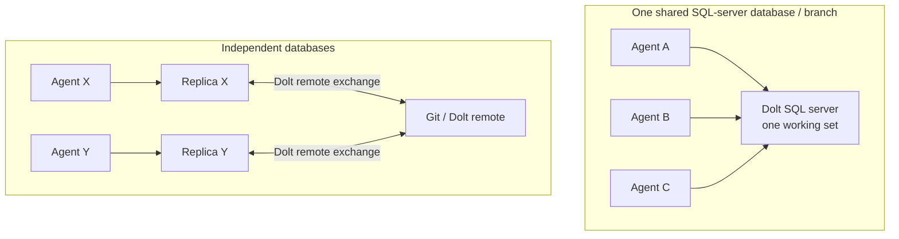

| Topology | Visibility | Exclusion scope | Failure tradeoff |
|---|---|---|---|
| Embedded database | Local database after committed operations | Driver serializes database access; one writer at a time | No separate SQL-server lifecycle; contention waits/cancels |
| Shared server, common database/branch | SQL transaction commits visible to other sessions | Claim CAS and retries coordinate through that database | Server availability is a dependency; retries have bounded budgets |
| Independent replicas | Changes visible after successful synchronization | Each granting database only | Offline progress; divergent claims and merge conflicts possible |
| Independent Dolt branches | Visibility waits for merge into a common branch | Each branch only | Useful version control, unsuitable as an implicit live shared queue |

The ordinary CLI opens `main`; explicit version-control APIs still support branches. Historical branch-per-worker design discussion is not a global mutual-exclusion guarantee. Likewise, two clients using the same repository URL do not share one transaction coordinator if each has a separate local database.

The upstream [`dolt-concurrency.md`](../design/dolt-concurrency.md) contains useful motivation but includes an older proposal to put `DOLT_COMMIT` inside the SQL transaction. Current guarded scoped mutation code deliberately commits SQL **before** staging/versioning to avoid stale-root lost updates. Read [`issue_operations_tx.go`](../../internal/storage/dolt/issue_operations_tx.go) and [`doltserver_tx.go`](../../internal/storage/uow/doltserver_tx.go) for the implemented ordering.

## 2. What ready work actually means

[`workapi.BuildReadyFilter`](../../internal/workapi) builds the request filter. [`sqlbuild.BuildReadyWorkWhere`](../../internal/storage/sqlbuild/ready.go) owns shared SQL readiness predicates for the direct and domain/UOW stacks; [`issueops.GetReadyWorkInTx`](../../internal/storage/issueops/ready_work.go) and domain repositories execute them.

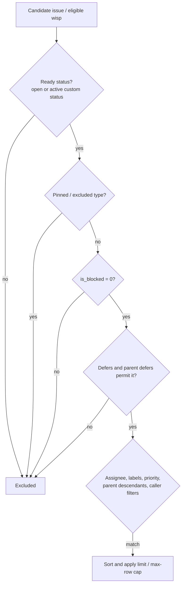

The exact filter can narrow or override these defaults. Important details:

- The CLI's singular `StatusOpen` ready filter expands to built-in open plus custom statuses categorized `active`. A raw internal filter with no status can have different defaults; use the public request builder rather than assuming a bare struct means the CLI's behavior.
- `is_blocked` is persisted derived state, not a fresh graph traversal on every ready query. Dependency mutations and close/reopen paths recompute affected records; merge paths repair it after graph reconciliation.
- Pinned context records, gate/molecule/rig/infrastructure types, and ordinary future-deferred records are excluded by the default ready filters. Asking for a specific type can differ from the default type-exclusion branch.
- Parent filtering is recursive over descendants. Future-deferred parents suppress their children unless deferred inclusion is requested.
- Wisps can participate when the request allows their plane. Durable and wisp results are merged, deduplicated by ID in favor of the current wisp record, re-sorted, and limited.
- The storage fallback for an empty sort policy is hybrid: the last 48 hours count as recent, recent issues come first by priority, and older work then ages through creation time. The CLI explicitly defaults `bd ready` to priority ordering; hybrid and oldest are selectable policies, with IDs breaking ties.
- Max-row caps are enforced explicitly. A cap failure is not an empty queue and should not be converted to one by a plugin.

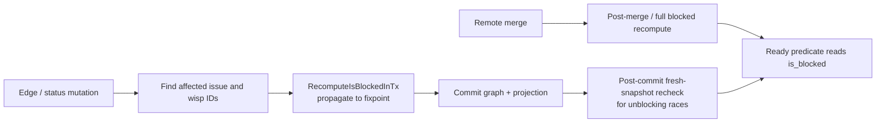

The extra recheck matters because two transactions can change different blockers concurrently and each observe the other blocker as still open. The post-commit pass repairs affected dependents on a fresh snapshot. Its failure after the primary write is committed is logged, rather than reported as a failed primary mutation that a caller might replay. The full repair in `bd sync` is a further recovery mechanism.

## 3. Claims combine selection and mutation

Use `bd ready --claim --json` to select and take ready work together, or `bd update ID --claim` to claim a named issue. A separate `ready` listing followed by an unguarded assignee update contains a race.

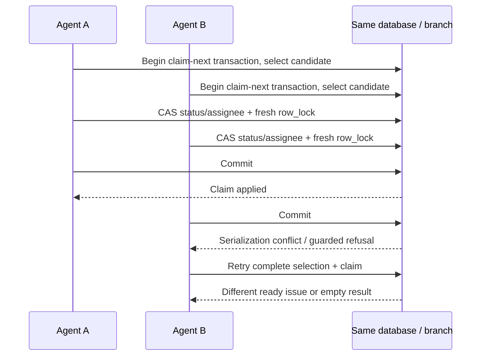

[`ClaimIssueInTx`](../../internal/storage/issueops/claim.go) reads the pre-image inside the transaction, resolves claimable statuses and pool aliases, and conditionally changes assignee/status/start time while comparing `row_lock`. A success changes status to `in_progress`, sets assignee, preserves the first start time, records the accepted mutation, and grants local liveness for durable issues. Reclaiming an already `in_progress` issue by the same actor is idempotent success with no new lifecycle mutation.

Claimable assignee slots are empty, already the same actor, or explicitly configured `claim.pools` aliases. Actor equivalence normalizes known separator encodings; pool alias membership remains exact-string. This is a coordination policy, not authentication: `--actor`/`BEADS_ACTOR` identifies the caller, and plugins should not treat that string alone as a security principal.

[`ReadyClaimer.ClaimNext`](../../internal/storage/dolt/ready_claimer.go) performs selection, guarded mutation, and relationship-count hydration in one transaction. [`uow.readyClaimer`](../../internal/storage/uow/ready_claimer.go) performs the same request in one UOW and wakes expired dated defers through an advisory preliminary operation. Empty ready work creates no claim commit. A retry rescans the frontier; the selected ID from an abandoned attempt must not leak into the final response.

Named claiming and ready claiming are not identical questions: named claim checks lifecycle ownership eligibility; ready claim also selects from the readiness predicate. A named claim is not proof that graph blockers were absent unless the specific role/request enforces that condition.

## 4. Why a random row token is necessary

Dolt can merge concurrent edits to different cells of one row. That is useful for independent content edits but dangerous for lifecycle invariants: one transaction could reclaim status while another closes the same issue, producing an incoherent merged state if their write sets were disjoint.

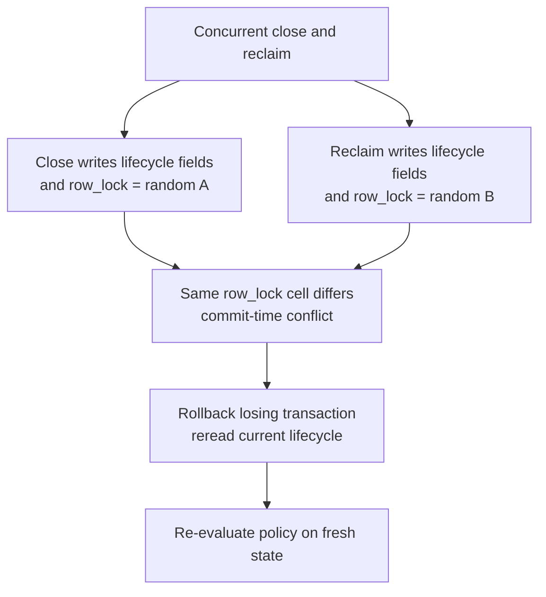

[`freshRowLock`](../../internal/storage/issueops/lease.go) must be used by paths changing the ownership/status/start-time fields relevant to claim/reclaim/close races. The token is random and nonzero, making a conflicting pair of writes differ even when timestamps or chosen assignees happen to match. It is not a SQL pessimistic row lock.

Auxiliary derived-state recomputes intentionally do not remint `row_lock`; doing so would spuriously invalidate a client CAS for a change to another issue's graph. Heartbeat refreshes write the separate lease row. Re-arming a missing lease remints the issue token so it conflicts with a concurrent release/close that otherwise shares no lease row.

Public guarded updates can carry expected revision, assignee, status, and other operation-specific guards. The detail response's `revision` is a decimal **string** representing the opaque row token. It must be echoed exactly, not incremented or interpreted as `issue_versions.revision`.

## 5. Retry, verification, and ambiguous outcomes

[`DoltStore.withRetryTx`](../../internal/storage/dolt/store.go) retries a **whole SQL transaction**, starting at 25 ms exponential backoff with a 15-second server budget. The non-server setting uses five seconds. UOW [`RunTxResultWithin`](../../internal/storage/uow/tx.go) has a 15-second default and supports an explicit budget for larger operations. Read/retry layers must not multiply independent retry loops around writes.

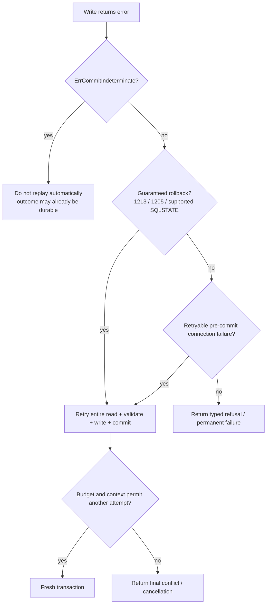

A guaranteed serialization rollback is safe to replay because the writes did not land. Retrying only `COMMIT` after such a rollback can produce “nothing to commit” while losing the intended mutation. The UOW classifier recognizes MySQL 1213/1205 and SQLSTATE 40001/40P01; the direct store also recognizes the exact Dolt autocommit-rollback error in the appropriate boundary. A generic error 1105 is not sufficient proof.

`ErrCommitIndeterminate` overrides an otherwise transient wrapped cause. Connection loss while receiving a commit response can mean the database committed and the caller never heard the answer. Replaying an append/create or an epoch bump can duplicate side effects. The generic transaction APIs therefore have more conservative replay contracts than internal guarded operations whose whole request can be safely retried.

The server store has a further claim-family [`verify-after-write`](../../internal/storage/dolt/claim_verify.go) protocol:

| Outcome | Action |
|---|---|
| Reported successful durable claim/unclaim | Reread expected ownership/status; a mismatch fails loudly |
| Ordinary CAS/policy refusal or exhausted pre-commit failure | Return the real error |
| Ambiguous commit loss | Retain indeterminate outcome; matching status/assignee alone cannot prove lease and attributed event landed |
| Named wisp claim through Lifecycle/legacy paths | No durable lease verification; wisps are not reclaimable leased state, and the public named-issue Claimer refuses them |
| Ready claim selecting a wisp | Verify the selected result in its actual plane, because the ID was unknown before selection |

This is a concrete store-path safeguard, not a statement that every backend implements identical extra round trips. The UOW path relies on its own transaction/role guarantees. Use the public contract, check errors, and inspect backend conformance coverage when adding another implementation.

Pool cleanup is correctness-critical: [`doltServerTx`](../../internal/storage/uow/doltserver_tx.go) rolls back unfinished transactions before releasing a session and poisons a session when rollback fails. `closeAttempt` uses a detached, bounded five-second context so a canceled HTTP request does not immediately cancel its cleanup and return an open transaction to the pool.

## 6. Leases detect dead workers locally

Status and assignee are durable coordination data; leases are separate clone-local SQL rows. The default TTL is five minutes. A heartbeat normally refreshes the lease row without minting a Dolt commit, avoiding history growth at heartbeat cadence.

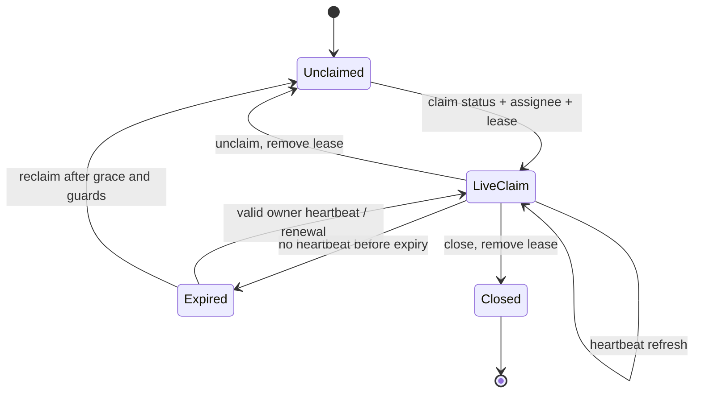

[`ReclaimExpiredLeasesInTx`](../../internal/storage/issueops/lease.go) selects stale durable claims, checks the lease again, deletes it, resets status to open, clears assignee/start time, remints the row token, and records the recovery. The caller uses a cutoff of `now - grace`; the CLI default grace is twice TTL. Wisps do not receive leases and are not reclaimed as durable worker claims.

The granting replica can be recorded in `granted_node`. A positively foreign imported lease is skipped unless `--any-replica` is explicitly requested. Empty provenance is treated as local for compatibility. This is deliberately not a global fencing-token protocol: if node identity is unset, the guard cannot distinguish replicas.

Ordinary Dolt synchronization does not carry the ignored lease table. JSONL import can materialize a lease from explicit lease fields, which is why foreign provenance guards exist. For federated operations, TTL and grace must exceed sync cadence; a lease does not become globally authoritative merely because its status/assignee eventually replicates.

## 7. What sync transports

Source Git history and Dolt database history are distinct graphs. Git-protocol Dolt remotes use a data ref, normally `refs/dolt/data`, separate from `refs/heads/main`. A normal `git clone` of the source does not materialize the Beads database.

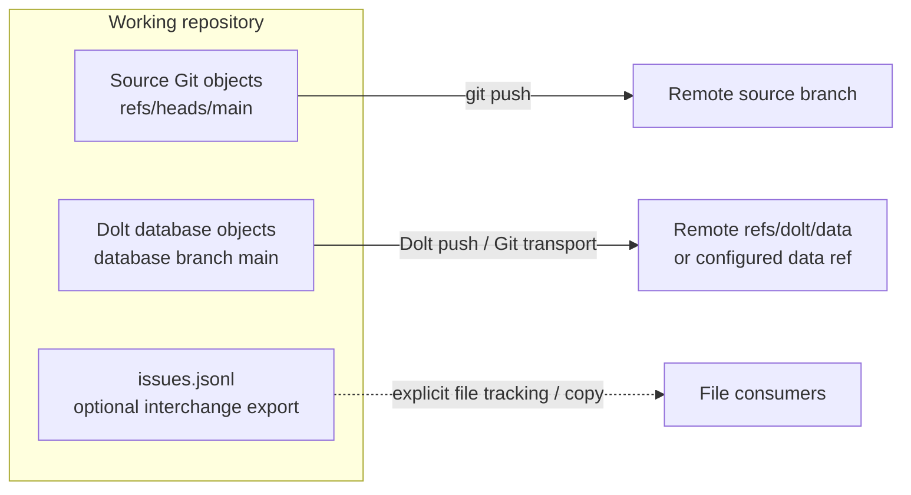

[`bd bootstrap`](../../cmd/bd/bootstrap.go) plans and provisions a missing local store from available remote/interchange/init inputs; [`dolt.BootstrapFromRemote`](../../internal/storage/dolt/bootstrap.go) and embedded clone helpers implement database materialization. Existing-database detection is consequential: it must not silently replace or mask a real local store. Main schema/cursor records replicate; ignored migrations then reconstruct clone-local tables. Bootstrap is not a distributed lock and does not provision arbitrary registered backend names.

`bd dolt push` and `bd dolt pull` perform explicit remote movement. [`versioncontrolops.Pull`](../../internal/storage/versioncontrolops/remotes.go) does fetch then merge/settle over a pinned session. Remote transports may use in-process stored procedures or an external Dolt CLI, depending on backend, Git protocol and authentication. Those routes can leave different observable conflict state; the API exposes it rather than pretending all transport failures are equivalent.

## 8. Two sync orchestrators have different contracts

The CLI `bd sync` loop is more defensive than the storage `Sync(peer,strategy)` convenience method. Do not select between them by name alone.

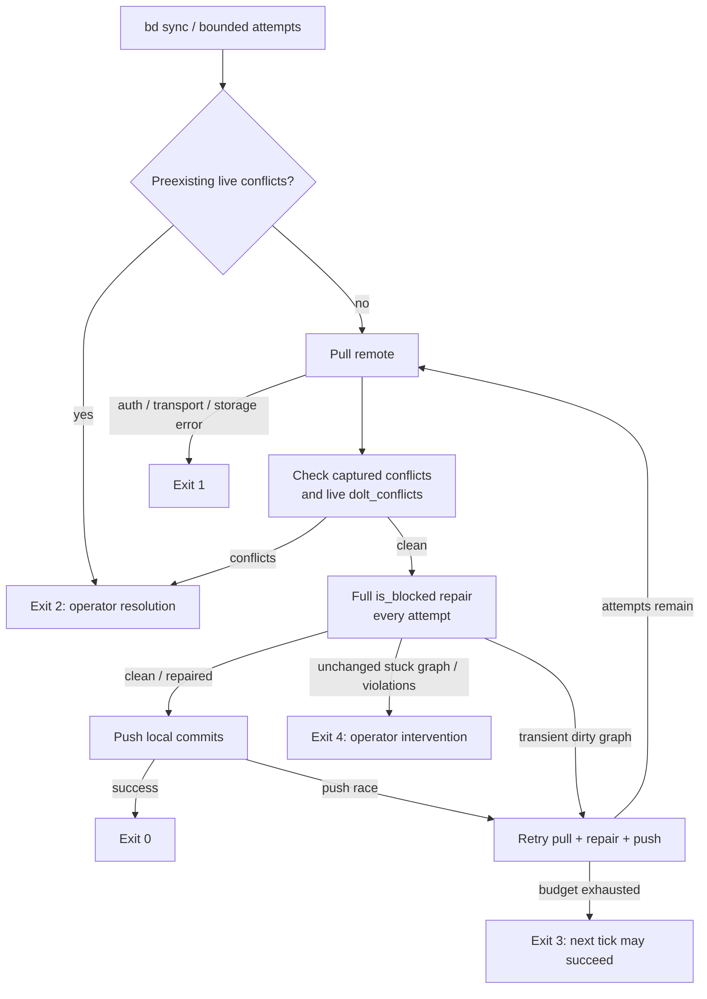

[`cmd/bd/sync.go`](../../cmd/bd/sync.go) defaults to three attempts. It positively checks both conflict rows captured before an aborted merge and currently live `dolt_conflicts`. Exit status alone cannot distinguish conflict from authentication failure, or detect conflicts a transport left behind without failing.

Full blocked-state repair runs on **every** attempt, even when HEAD did not advance. It repairs stale projection state left by earlier failed repairs or manual conflict resolution. A dirty working set can make safe repair impossible; repeated identical dirty-graph fingerprints across three exhausted runs escalate to a stuck outcome. Graph constraint violations can escalate immediately. The loop records transient causes and whether changes were already pulled, so “sync failed” does not imply it changed nothing.

| `bd sync` exit | Meaning for automation |
|---|---|
| `0` | Synced, nothing to do, or a reported benign skip such as disabled/no remote |
| `1` | Genuine transport/auth/storage failure |
| `2` | Positive conflict; loop halts before repair/push and requires resolution |
| `3` | Bounded retry exhaustion on a self-healing push race / moving dirty graph / fast-forwardable pull-behind |
| `4` | Stuck dirty graph or graph constraint state; repeated retries are insufficient |

The loop does not choose an arbitrary side for unresolved conflicts. Its lower-level pull may already have applied the safe domain-aware settlement described below. “No automatic conflict resolution in the sync loop” therefore does not mean “Dolt never merges or the pull helper never settles safe cases.”

By contrast, [`DoltStore.Sync`](../../internal/storage/dolt/federation.go) and [`EmbeddedDoltStore.Sync`](../../internal/storage/embeddeddolt/federation.go) commit pending changes, fetch a peer, merge, optionally resolve returned conflicts using a caller-provided strategy, recompute after resolution, and push. `SyncResult.PushError` is deliberately **nonfatal**: a successful merge can return nil error while `Pushed=false`. `PulledCommits` is simplified to one when HEAD changed, not an exact commit count. Consumers must inspect the structured result.

## 9. Merge settlement is domain-aware

[`MergeAndSettle`](../../internal/storage/versioncontrolops/mergesettle.go) pins session flags permitting inspection of conflicts/constraint violations, attempts safe repairs, and aborts when operator input is needed. It captures unresolved conflicts before abort so the caller can still report them after the working set is restored.

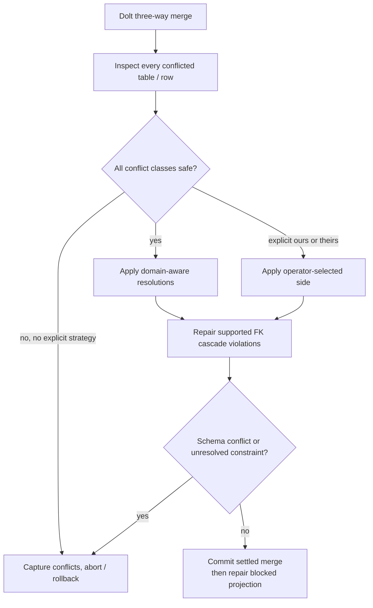

The resolver pre-screens all conflicts before changing any. Its relevant table policies are:

| Table/conflict | Safe automatic policy | Declined cases |
|---|---|---|
| `issues` modify/modify | Three-way merge by field; one-sided edit survives; contested scalar uses strictly later `updated_at` | Add/add, delete/modify, equal/unparseable deciding timestamps, contested non-scalar fields |
| Close fields | Close-related columns move as one group | A field mix that would invent an impossible lifecycle state |
| `notes`, `metadata` | Preserve an uncontested one-sided edit | Contested values, because scalar LWW could lose an append or JSON key |
| `dependencies` | Same edge/type on both sides with audit-only differences: theirs | Type disagreement or delete/modify |
| `labels` | Identical same-key membership; ordinary disjoint additions already union | Presence/deletion disagreement |
| `comments`, legacy `events` conflicts | Equal immutable same-ID append | Missing side or divergent payload |
| `schema_migrations` | Preserve a nonempty hash over absent hash; equal hashes converge | Two different nonempty hashes: actual migration fork |
| `config` persistent-memory rows | `kv.memory.*` same-key conflict takes theirs | Any conflicting non-memory setting, including prefix |
| Recognized metadata bookkeeping | Theirs | Unknown table/classes are left to the operator |

[`automerge.go`](../../internal/storage/versioncontrolops/automerge.go) also remints settled issue row tokens so stale CAS clients cannot treat a synthesized merged state as their old snapshot. The source still has union-resolution support for `events` because old committed history can be merged; current new event rows are ignored, as described in the storage chapter.

Explicit `ours`/`theirs` is a potentially lossy operator choice, not an assertion that both edits survived. Capability matters: `StrategicPuller` is implemented by the embedded store's single settle path; server `DoltStore` does **not** implement it because its several pull transports have different semantics. `StrategicMerger`, row conflict inspection, and merge-blocker inspection are optional interfaces, not universal backend promises.

## 10. Federation adds peer configuration, not global consensus

[`FederationPeer`](../../internal/storage/versioned.go) and `federation_peers` store peer name, URL and authentication metadata. Remote exchange still uses Dolt branches/merge/push. Server federation can filter excluded issue types via a temporary staging branch; embedded `Sync` pushes through its direct peer path. An extension must inspect actual backend capabilities before assuming filtering or strategies are portable.

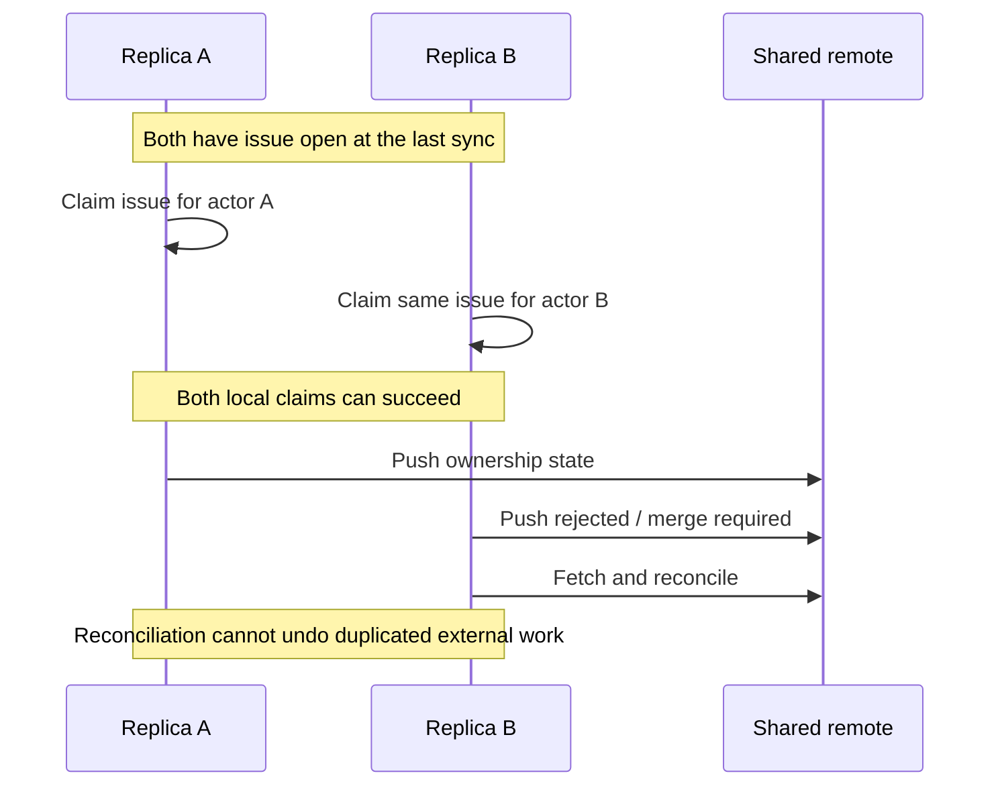

`.beads-credential-key` files are machine-local and gitignored; stored peer password blobs can travel with the database. The stores use AES-GCM encryption locally, so a peer row received from another machine may be undecryptable. `ErrCredentialKeyMismatch` carries concrete re-add-peer guidance instead of misclassifying this as an unreachable peer. Stored-peer and ambient-auth precedence is deliberate; do not silently fall back to another tenant's ambient credentials.

A shared server can enforce a claim winner within its current database transaction domain. Independent replicas cannot provide global at-most-once claiming, distributed lease enforcement, or exactly-once external work. For strict coordination across machines, use a common server or a dispatcher/partitioning policy outside Beads; make external side effects idempotent. The repository's core charter leaves orchestration policy to that layer.

## 11. Backup, export, compaction, and recovery

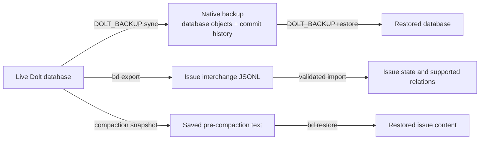

Native backups use [`storage.BackupStore`](../../internal/storage/storage.go) and [`versioncontrolops/backup.go`](../../internal/storage/versioncontrolops/backup.go), backed by `DOLT_BACKUP`. `bd backup` can export a local native backup and configure/sync a named destination. [`runBackupExport`](../../cmd/bd/backup_export.go) records the pre-backup HEAD as a conservative freshness cursor, avoids claiming a concurrent later commit is included, and writes state atomically. Native backups preserve full commit history, whereas issue JSONL cannot reconstruct the Dolt graph.

JSONL is valuable for interchange and explicit recovery, but is not the live source of truth or a replacement for Dolt replication. Import carries validation, prefix/plane handling, dependency/comment reconstruction, and stale-upsert rejection. A stale issue snapshot must not merge its stale auxiliary labels/comments after the primary row was rejected. Export inclusion of wisps and storage-class markers is explicit; do not assume every export includes local operational state.

Issue text compaction is separate from Dolt history compaction/flattening/garbage collection. [`compaction_snapshots`](../../internal/types/storage_ext.go) preserves pre-compaction text for `bd restore`; native database backup/restore operates on the whole database. Dolt history rewrite and GC are specialized capabilities with stronger operational effects than closing or deleting an issue. A plugin performing ordinary task workflow should not invoke them as incidental cleanup.

## 12. Guarantees a plugin may safely build on

| Need | Existing primitive | Boundary to preserve |
|---|---|---|
| Take next eligible work | `ReadyClaimer.ClaimNext` | One request / transaction; inspect empty result and typed refusal |
| Claim a specific issue | `Claimer` / guarded update | CAS against current ownership and claimable status; no global replica lock |
| Reject stale update | Expected revision/status/assignee guards | Echo opaque tokens; guards must share the write transaction |
| Recover dead worker | Heartbeat + local lease reclaimer | Local granting replica, TTL/grace/provenance, lifecycle token remint |
| React to changes | Hooks or optional ordered journal | Hooks are after-write effects; journal is local and retention-prunable |
| Move graph between machines | Dolt push/pull or CLI sync | Reconciliation and projection repair; push may need retry |
| Inspect failed merge | Conflict and merge-blocker interfaces | Row, schema, and constraint conflicts are different |
| Preserve history | Native backup plus verified restore procedure | JSONL has narrower semantics; optional version log is single-writer today |

The strongest design rule is to put database invariants inside the guarded operation and put external side effects after the result is known. Do not issue network calls inside a retryable transaction callback: the callback can run again after a guaranteed rollback while the network call cannot be rolled back with it. Beads supplies durable work state and coordination primitives; the plugin owns retry-safe use of external systems.
