# Agent workflows, formulas, and persistent memory

Beads makes an agent's work survive the agent's context window: issues, relationships, workflow instances, and selected memories live outside the conversation. This chapter traces the implemented workflow machinery at upstream commit `9d6fff760b7a314b476539198504d77ce0959656`, including boundaries that matter when building a plugin system.

## 1. The agent loop is graph-driven

The smallest useful loop is inspect → atomically claim → work → record progress → close. The work itself is performed by a human, agent, or external orchestrator; a ready issue is not an instruction for Beads to start a worker. Beads supplies graph state, concurrency primitives, reusable workflow shapes, and context injection.

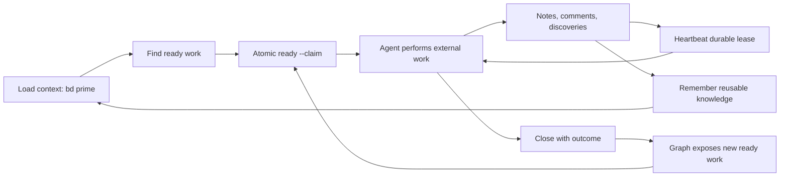

A consumer can use CLI JSON, the public Go role surfaces, or HTTP. The same claim/ready contracts matter regardless of transport. A shell wrapper that lists and then assigns a row has composed a race; `bd ready --claim --json` and HTTP `issues:claimNext` place selection and claim in one transaction.

## 2. Ready work is a semantic query

[BuildReadyFilter](../../internal/workapi/ready.go) is the shared definition of the request filter, including open-only status, type aliases, labels, assignee/unassigned precedence, metadata predicates, optional ephemeral/deferred inclusion, parent/molecule scope, projection, and limits. `bd list --ready` uses blocker-aware semantics too. CLI ready defaults to 100 results and priority order; explicit zero means unlimited. The storage filter's empty sort fallback can differ, so frontends explicitly set their advertised default.

Readiness depends on more than a row's status. [BlockedStateInvariant](../../issueops/blockedstate.go) defines persisted `is_blocked` as a fixpoint across both durable issues and wisps. An ordinary local mutation settles affected rows transactionally, including dependent rows and descendants; a pull merge needs the named post-merge recomputation because merge does not execute the ordinary mutator bodies.

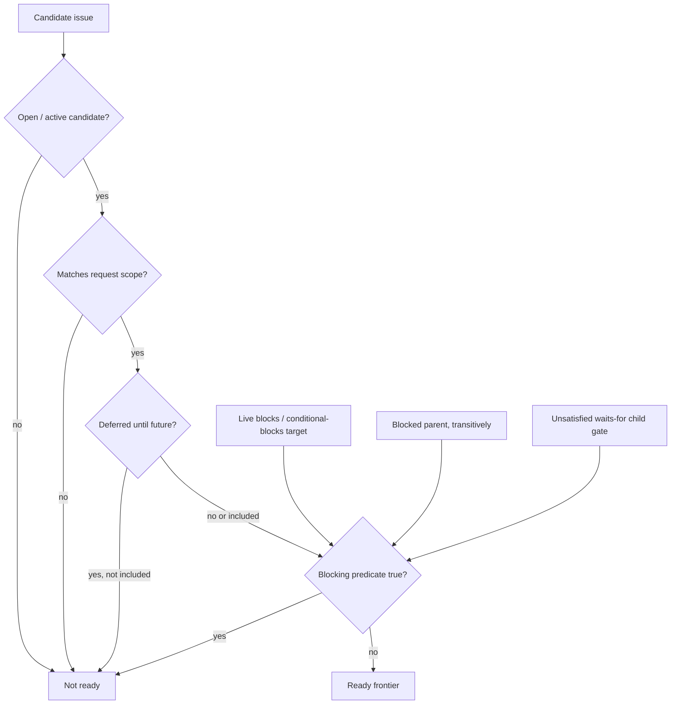

The diagram shows the conceptual predicate; SQL builders, shared request validation, and backend adapters implement it. Closed/pinned rows are never marked blocked by the invariant; being unblocked alone does not put a closed/pinned row into ready work. A `parent-child` edge does not make a child wait for its parent to close; it can propagate blockage inherited from the parent. This distinction prevents parent/child workflow deadlocks.

| Relationship family | Implemented types | Architectural meaning |
|---|---|---|
| Ordering/readiness | `blocks`, `conditional-blocks`, `waits-for` | Hard blocking semantics; waits-for observes a spawner's dynamic children and gate metadata. |
| Hierarchy | `parent-child` | Container membership and transitive inherited blockage; not an ordinary “wait until parent closes” edge. |
| Associations | `related`, `discovered-from`, `relates-to`, `replies-to` | Trace discoveries, context, conversations, and related knowledge without hard-blocking ready work. |
| Replacement | `duplicates`, `supersedes` | Relate distinct issue identities; superseding is not a history version of one issue. |
| Entity/provenance | `authored-by`, `assigned-to`, `approved-by`, `attests` | Graph relationships for provenance/approval/skills. They do not authenticate callers. |
| Coordination/reference | `tracks`, `until`, `caused-by`, `validates`, `delegated-from` | Named graph primitives consumed by relevant workflows/orchestrators; not all are scheduling constraints. |

Source: [DependencyType and IsBlockingEdge](../../internal/types/types.go), [dependency command](../../cmd/bd/dep.go), [dependency editor contract](../../issueops/dependencyeditor.go).

## 3. Ownership is guarded; actor is provenance

The [Claimer](../../issueops/claimer.go) takes a named durable issue. An eligible open/configured-active row may be unassigned, already assigned to the actor, or assigned to a configured pool. Claiming makes it `in_progress` under the actor. An `in_progress` issue already held by that actor is an idempotent success without a new mutation. A foreign holder or ineligible status returns a typed refusal; claim implementations retry commit-time merge races internally.

[ReadyClaimer](../../issueops/readyclaimer.go) takes a *question*, not a named ID. It shares `ReadyRequest` vocabulary, scans candidate order, skips rows another agent won, and hydrates the winning row/counts inside the claim transaction. Its request refuses limit/offset/brief: a bounded scan could falsely report no work after losing the first few candidates. A drained frontier is successful with no claimed row, not an operational error.

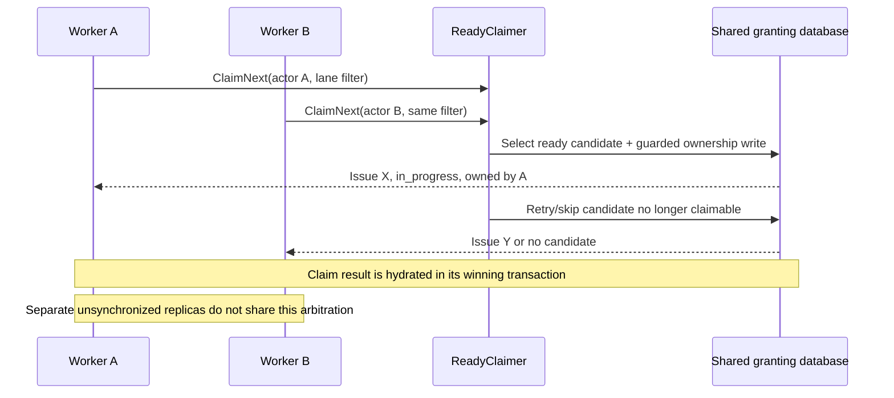

Atomicity belongs to the database granting the claim. It does not provide global exclusion across independently synchronized databases. A plugin with external side effects needs idempotence keys and its own coordination model when multiple replicas can independently select the same work. Neither the CLI actor flag nor an HTTP actor body is an authenticated identity: any caller with access can assert an actor.

A successful durable ready claim grants one lease. Wisps can be included explicitly and claimed by ReadyClaimer/Lifecycle, but do not get leases; the named-issue Claimer rejects wisp IDs. A plugin must not generalize from “claim succeeded” to “automatic stale-worker recovery exists for this row.”

## 4. Lease, heartbeat, release, and reclaim

Leases are in an ephemeral, node-local table. Committed issue status and assignee carry cross-replica ownership visibility; the granting node's lease carries local liveness. [Heartbeater](../../issueops/heartbeater.go) refreshes a held lease without changing issue content, row revision, timestamps, version history, event journal, or hooks. Reclaiming an already-held issue is not a heartbeat and does not extend its lease.

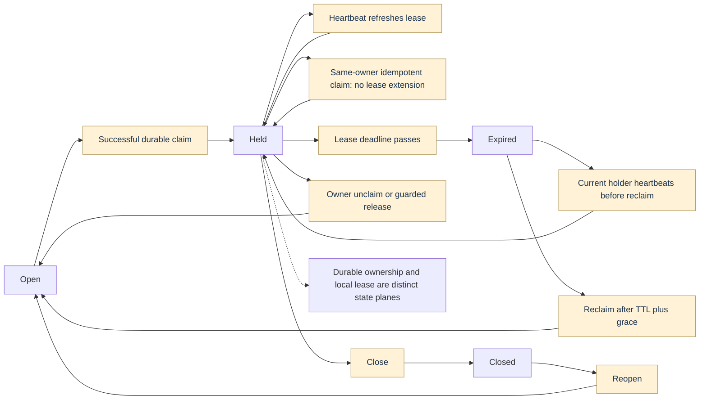

A first heartbeat can *re-arm* a live claim that has no lease, such as one created by a plain status/assignee update. Re-arm is a real mutation: it remints the row token and records the event/history/commit and `on_update`. Subsequent refreshes are deliberately quiet. A stale guarded writer may need to reread its revision after re-arm.

`unclaim` clears assignment and resets open status. Normal release is for the current holder; `--force` is explicit override. `--if-assignee` is a compare-and-swap release for supervisors and requires a nonempty expected assignee; it cannot be combined with force. [LeaseReclaimer](../../issueops/leasereclaimer.go) is a separate multi-row clock-based operation, with ID/assignee/label narrowing and a nonnegative grace period past lease expiration. It returns affected rows and fresh revisions; no matches is an empty success.

With `BEADS_NODE_ID` / machine-local `node_id`, reclaim skips positively foreign granting replicas unless `--any-replica` overrides that safeguard. The ID names a *store replica*, not a client host: clients sharing one SQL server share the same replica identity. There is no hostname fallback. An unnamed deployment retains unguarded behavior; a committed project-wide node ID would make every clone share the name and defeat the distinction. Wisps have no lease expiration recovery; their supervisor must release/finish/clean them itself.

## 5. Workflow vocabulary and persistence

| Concept | Concrete representation | Lifecycle |
|---|---|---|
| Formula | TOML/JSON source parsed by [internal/formula](../../internal/formula/types.go) | Reusable declarative source, with inheritance, variables, steps, expansion and advice. |
| Proto | Template epic/subgraph with `template` label | Cooked graph, held in memory or optionally persisted; contains unresolved substitution slots. |
| Molecule | Instantiated issue graph | Durable real work with fresh IDs/statuses and recreated dependency edges. |
| Wisp | Ephemeral workflow instance / wisp-plane records | Operational work outside normal replicated history; cleanup policy differs from durable issues. |
| Gate | An issue with await fields, plus blocking relationship | Async waiting state represented in the same graph. |
| Swarm | Structured epic analysis plus a swarm molecule linked to the epic | Measures graph parallelism and tracks coordination state; does not launch worker processes. |
| Memory | Namespaced key/value content through `memoryops.Memories` | Recalled or injected into later agent context; not an issue DAG. |

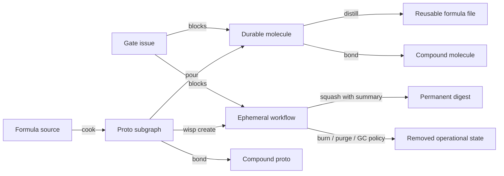

The storage mode (embedded vs server vs proxied) is orthogonal to whether a record is durable/ephemeral. Also distinguish `--no-history` from a GC-eligible wisp: both can route to the wisp plane, while `NoHistory` records are protected from ordinary ephemeral cleanup. New storage-class markers `versioned`, `unversioned`, and `ephemeral` define history/interchange intent; “unversioned” is not simply the `--no-history` flag. See [create persistence resolution](../../cmd/bd/create.go) and [StorageClass/PersistenceMode](../../internal/types/types.go) before assigning a plugin-owned record a retention policy.

## 6. Formula parsing and transformation

[Parser.DefaultSearchPaths](../../internal/formula/parser.go) searches the resolved project's `.beads/formulas`, the checkout-local `.beads/formulas` when distinct, the user's `~/.beads/formulas`, and `$GT_ROOT/.beads/formulas`. It deduplicates locations; the checkout-local path remains discoverable even when shared/redirected database state is elsewhere. `formula list/show/convert` are parser/file-oriented commands. A formula reference can be a registry name or a file path.

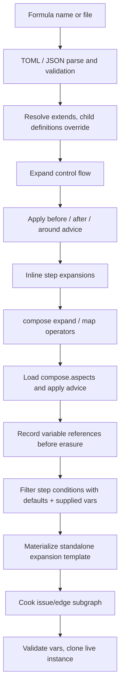

This diagram follows [resolveAndCookFormulaWithVars](../../cmd/bd/cook.go), the inline instantiation path. The standalone `cook` command uses `loadAndResolveFormula` with its own flag-dependent runtime/persist behavior; do not assume both paths are one identical function. `cook` defaults to emitting an ephemeral/in-memory proto representation; `--persist` writes a template subgraph. At this pin standalone `cook` is refused in proxied-server mode, while pouring a formula can cook in memory through its proxied implementation.

| Formula feature | Implementation | Mechanism and limit |
|---|---|---|
| Typed variables | [parser.go](../../internal/formula/parser.go) | Defaults, required values, enums, patterns, and string/int/bool validation; explicit empty defaults differ from missing defaults. |
| Inheritance | [Parser.Resolve](../../internal/formula/parser.go) | Parent formulas merge vars/steps/composition; child definitions replace matching IDs. |
| Nested steps | [Step](../../internal/formula/types.go), [collectSteps](../../cmd/bd/cook.go) | Turn hierarchy into child issues and `parent-child` edges. |
| `needs` / `depends_on` | [collectDependencies](../../cmd/bd/cook.go) | Resolve source step IDs into graph ordering edges; waits-for uses typed child-gate metadata. |
| Step condition | [stepcondition.go](../../internal/formula/stepcondition.go) | Compile-time inclusion using `{{var}}`, negation, equality/inequality. Dropped parent steps also drop children. |
| Count/range loops | [controlflow.go](../../internal/formula/controlflow.go), [range.go](../../internal/formula/range.go) | Expand repeated graph nodes with indexed IDs; chain iterations after nested expansion. |
| Conditional loop | [controlflow.go](../../internal/formula/controlflow.go) | Expands an initial body with runtime loop metadata/labels; not a built-in agent execution engine. |
| Parallel/fork-join and composition | [controlflow.go](../../internal/formula/controlflow.go), [expand.go](../../internal/formula/expand.go) | Transform step graphs before instantiation. |
| Aspect/advice | [advice.go](../../internal/formula/advice.go) | Insert steps around matching targets; formula type and selector validation apply. |
| Opaque intent | [Formula.Intent](../../internal/formula/types.go) | Caller-defined hint consumed by downstream tools, not core scheduling policy. |

Variable references are collected before condition filtering/materialization erases them. Otherwise a valid variable used only in a disabled step would be falsely rejected as unknown. Freshly cooked formulas know the complete declared-variable set; persisted protos cannot recover all declarations and therefore use a narrower unknown-variable check. This is an example of semantics lost when a source format is compiled into a graph.

The `Formula.Pour` field's comment describes intended materialization policy, but inspect the actual consumer: the current wisp path materializes children by default and uses `--root-only` as the explicit opt-out. Do not infer from the field comment that every formula with omitted `pour` produces only a root. Source: [runWispCreateCore](../../cmd/bd/wisp.go), [CloneOptions.RootOnly](../../cmd/bd/template.go), [wisp tests](../../cmd/bd/wisp_test.go).

## 7. Cooking and instantiation preserve graph structure

[TemplateSubgraph](../../cmd/bd/template.go) holds a root, all issues, internal edges, ID map, variable definitions, phase recommendation, and formula-source reference information. `collectSteps` produces issues and parent-child edges. A step gate produces an additional sibling gate issue and a `blocks` edge from the step to the gate.

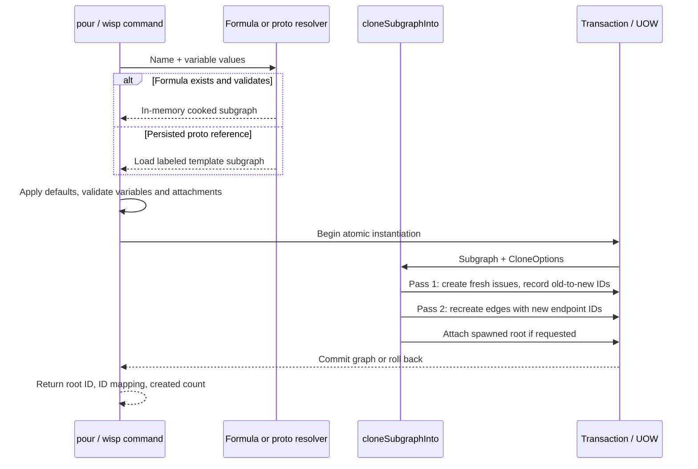

New issues start open, while priority/type/estimate and selected content survive cloning. Variable substitution reaches content, assignees, await IDs, labels, and metadata; an explicit root assignee override wins literally. Edges whose endpoints are outside the cloned subgraph are skipped. Dynamic bonding can generate readable child references under a parent; ordinary instantiation lets storage mint fresh hash IDs.

The clone plus attachment is transactional so an attachment failure cannot leave orphaned live work. [mol_port.go](../../cmd/bd/mol_port.go) adapts these operations to direct transactions and UOWs. Its reader methods deliberately remain transaction-bound rather than opening fresh role transactions that would miss in-progress changes; the code documents remaining legacy/unbounded-read caveats. This workflow code is not yet a completely uniform migration to public role APIs.

Molecule catalogs are a separate input from formula registries. [molecules.Loader.LoadAll](../../internal/molecules/molecules.go) visits the currently empty builtin catalog, optional town catalog, user catalog, then project `molecules.jsonl`, and upserts template records by ID. The root direct startup invokes this loader after eligible auto-import; `formula` discovery is parser/file lookup, not that catalog load.

## 8. Executing and advancing a molecule

`bd ready --mol ID`, `bd mol current`, `bd mol progress`, and `bd mol show` expose step position and graph state. [MoleculeReader helpers](../../issueops/molecule.go) traverse membership and edges; [MoleculeStepper](../../issueops/moleculestepper.go) implements the next-step rule shared by store backends and the HTTP server.

`bd close --continue` closes then advances the molecule, normally claiming the next ready step; `--no-auto` reports it without claiming. A durable next-step claim goes through Claimer; a wisp step uses Lifecycle's claim capability. Lost races skip to later ready steps; another actor's claim is not silently stolen. A capable HTTP server must advertise `issues.advanceMolecule` before a remote `--continue` can safely be used.

Closing the last open step can also close a poured/wisp/template molecule root. An ordinary epic stays open as closure-eligible work. If root close policy refuses because of a blocker, pin, or ownership, the successful child close stands and reports the root refusal. Completion of a workflow is therefore not always equivalent to root closure; consumers should inspect the returned auto-close/refusal fields.

| Molecule command | Responsibility |
|---|---|
| `mol pour`, `mol wisp create` | Instantiate persistent or ephemeral work with substitution; wisp can use root-only mode. |
| `mol show`, `mol current`, `mol progress`, `mol last-activity` | Inspect graph structure, current/next step, progress, and activity. |
| `mol ready`, `mol ready --gated`, `mol stale` | Discover runnable/resumable/stalled workflow instances. |
| `mol bond` | Compose formula/proto/molecule operands into compound graphs or attach spawned arms. |
| `mol squash`, `mol burn` | Preserve a digest or discard an instance. |
| `mol distill`, `mol seed` | Extract reusable workflow source or populate template material. |

Source: [molecule command registration](../../cmd/bd/mol.go) and [command-tree golden](../../cmd/bd/testdata/command_tree/tree.golden). Availability still depends on mode/capability, not merely presence in help.

## 9. Gates are polling/notification state, not autonomous background workers

Gate issues have `AwaitType`, `AwaitID`, `Timeout`, waiters, and optional repo metadata. [gate create](../../cmd/bd/gate.go) creates a gate and blocking edge through role operations. [gate check](../../cmd/bd/gate.go) evaluates open gates and can resolve or escalate them; callers or supervisors decide when to run it. Adding a waiter uses guarded updates/retries rather than overwriting a concurrently appended list.

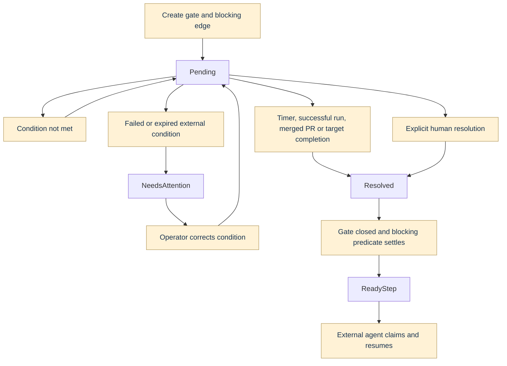

| Gate type | Check behavior in the implementation |
|---|---|
| `human` | Explicit `gate resolve`; automatic `evaluateGates` does not invent a human answer. |
| `timer` | Compares elapsed time against the gate timeout. |
| `gh:run` | Runs `gh` to inspect a run, can discover a run ID from workflow hints, and persists discovered identity. |
| `gh:pr` | Runs `gh` against the configured/derived GitHub repo and PR state. |
| `bead` | Resolves local or routed target issues with seen-target metadata and rereads; missing/unseen targets are not blindly interpreted as completed. |
| Other serialized await types | Model fields may carry them, but the automatic evaluation switch handles the types above; presence in a struct comment is not proof of an evaluator. |

[gate_discover.go](../../cmd/bd/gate_discover.go) and [mol_ready_gated.go](../../cmd/bd/mol_ready_gated.go) support identifying resumed workflows. `waits-for` is related but distinct: it is an edge primitive gating on dynamic children, not an external GitHub/timer gate issue. A plugin can integrate an external condition by observing and resolving gates, but a new await string needs actual checking behavior and capability/transport support if it is to be core-managed.

## 10. Bonding, swarms, and lifecycle compression

[Bond](../../cmd/bd/mol_bond.go) handles formula+formula, proto+proto, proto+live, and live+live combinations. Sequential, parallel, and conditional bonds express different edge structure. Spawned arms inherit the live target's persistence phase unless explicitly overridden. `--ref` nests an arm inside the molecule and cannot order it against its own container; conditional+ref is refused rather than creating an unsatisfiable graph.

[Swarm analysis](../../cmd/bd/swarm.go) inspects an epic's children/dependencies, reports structural errors/cycles/disconnected pieces, and computes ready fronts with Kahn's algorithm over open issues. Closed blockers do not increase indegree. Each front is a wave of potential parallelism; maximum wave size and estimated sessions are graph analysis, not reserved worker slots or a process scheduler.

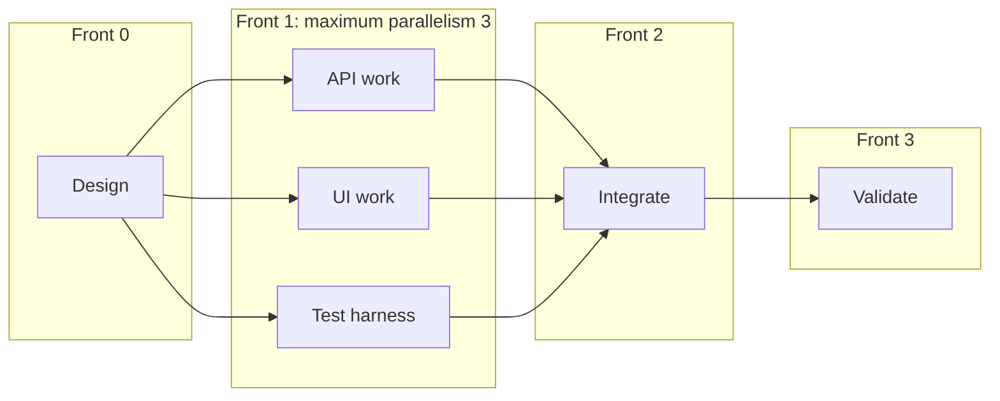

This is an explanatory example, not a claim about this repository's work graph. `swarm create` creates a molecule with swarm metadata and a `relates-to` link to the epic; `swarm status/list` read coordination state. External agent allocation remains outside Beads.

`mol squash` is graph-level retention: [squashMoleculeInto](../../cmd/bd/mol_squash.go) creates a closed permanent digest, links it to the root, deletes selected ephemeral children unless `--keep-children`, and closes/promotes an ephemeral root. Its actual body does **not** promote every kept child even though older help wording suggests that. A caller-provided summary replaces the simple concatenated digest; Beads does not invoke an LLM for this operation. `mol burn` deletes without a digest; `mol distill` writes reusable formula JSON by replacing selected concrete values with variables.

## 11. Memory storage is a separate key/value role

[Memories](../../memoryops/memories.go) exposes `Remember`, `Recall`, `Forget`, and `List`. Memory content uses a namespaced `kv.memory.` storage encoding underneath the role; callers operate on user keys. [memoryapi](../../internal/memoryapi/memoryapi.go) owns key derivation, validation, and matching so CLI/HTTP/storage implementations agree.

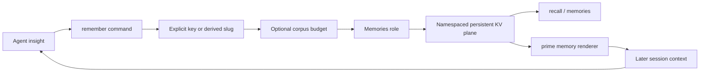

Derived keys lowercase content, collapse nonalphanumerics to hyphens, retain eight segments, and cap the result at 60 bytes. These quirks are compatibility behavior, not a free normalization choice. Explicit keys are preserved, including surrounding spaces that survive nonblank validation. A recall miss is `Found=false` with no error; forgetting an absent key is successful and does not touch generic KV/settings neighbors. Remembering the same value still writes because merge convergence depends on asserting the fact.

The CLI rejects likely command-name mistakes and has a bare-slug behavior: an existing bare key recalls it; an unknown bare slug is refused rather than accidentally becoming a memory. `memories.budget-chars` optionally limits the projected sum of key+content bytes; 80% warns, crossing refuses unless `--force`. Overwriting uses the delta from the previous content. This corpus budget is not the same as the prime injection budget, which counts rendered entries and can elide whole memories.

## 12. Prime and agent lifecycle adapters

[prime.go](../../cmd/bd/prime.go) renders workflow context plus persistent memories. Outside a workspace it silently succeeds with no content (or an empty hook envelope). `prime.disabled` suppresses injection. It can emit full CLI guidance or abbreviated MCP-oriented guidance, and agent policy profiles control authority wording. This is prompt preparation, not enforcement of execution permission.

A custom `PRIME.md` replaces the default workflow text, searched from checkout-local `.beads`, resolved workspace `.beads`, then the OS user configuration directory for Beads. Memories still append unless disabled. `--memories-only` wins over custom templates and export; `--no-memories` omits the memory section. Count/byte caps stop at whole-memory boundaries, emit at least one memory, and include an elision banner so truncation is visible. The renderer opens a bounded/scoped store for memory reads because the root startup treats prime as store-free.

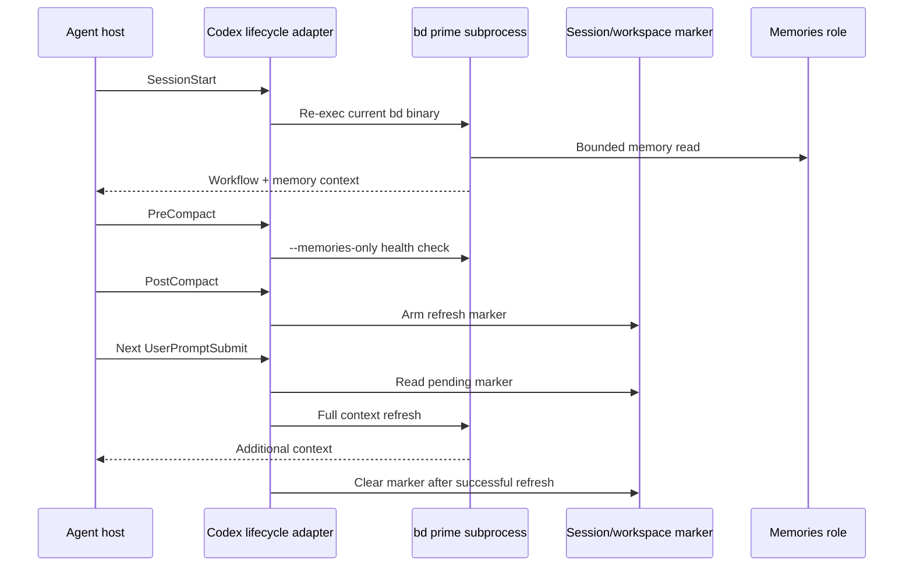

[Codex](../../cmd/bd/codex_hook.go) and [Cursor](../../cmd/bd/cursor_hook.go) adapt their own event names/JSON schemas around shared [agent_hook.go](../../cmd/bd/agent_hook.go) helpers. Cursor arms at `preCompact` and refreshes on `postToolUse`; Codex arms at `PostCompact` and refreshes on `UserPromptSubmit`. Re-execution resolves the running binary and allows only fixed internal prime arguments, preventing arbitrary caller input becoming subprocess flags. Marker paths hash session+workspace, keeping concurrent sessions distinct. Prime failures are nonfatal to the host; successful injection should not be confused with guaranteed agent obedience.

Setup/init can install integration instructions and hooks for supported agent environments; [init_agent.go](../../cmd/bd/init_agent.go) updates marked instruction sections and preserves a higher-information full profile. This fork's contributor checkout must not run end-user `bd init`/`bd setup` against itself, per root contributor instructions.

## 13. Compaction has four different meanings

Agent context-window compaction happens in the host and triggers prime refresh. Molecule squash compresses an execution trace into a digest. Issue semantic compaction rewrites long closed issue content. Dolt GC reclaims storage/history objects. They have different APIs and failure modes.

[compact.go](../../cmd/bd/compact.go) offers `--analyze` (export candidates), `--apply` (accept a supplied summary), `--auto` (model-generated summary), `--stats`, and `--dolt` (database GC). Only tier 1 semantic compaction is implemented by the command; tier 2 metadata/eligibility infrastructure does not make tier 2 execution available. Mutating semantic modes require server mode at this pin; embedded permits stats/analyze/dry-run. Proxied support is limited to the permitted Dolt GC path.

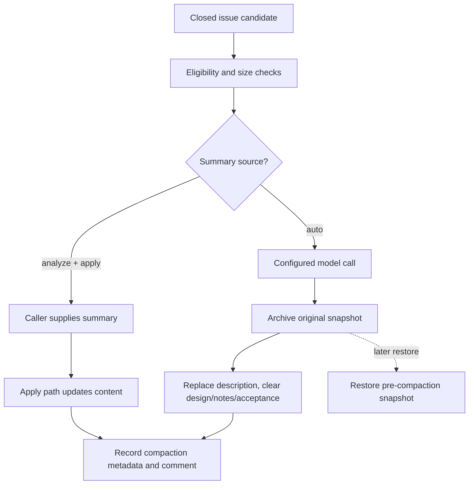

[Compactor.CompactTier1](../../internal/compact/compactor.go) checks eligibility, requests a shorter summary, snapshots before overwrite, updates content, records compaction metadata, and adds a comment. Defaults are 30 days closed for tier 1 and 90 days for tier 2 eligibility, configurable through database settings. The automatic client uses the Anthropic SDK with configured credential/model/base URL resolution, retries, optional audit records, and OTel usage metrics; a missing API key downgrades construction to dry-run behavior.

There is an important implementation difference: [runCompactApply](../../cmd/bd/compact.go) performs validation, direct content update, metadata, and comment writes without the explicit `SnapshotIssue` step used by automatic compaction. The diagram intentionally keeps that branch separate. Do not promise a new pre-apply recovery snapshot merely because automatic compaction has one. The multi-call semantic rewrite sequence is also not one application-level atomic transaction; failures after overwrite can leave partially completed bookkeeping. [restore](../../cmd/bd/restore.go) reads stored snapshots; it cannot recreate a snapshot never recorded.

## 14. What an extension can safely build upon

The implemented foundations support externally managed agents, formula distribution, graph/metadata annotations, memory readers/writers, gate condition integration, lifecycle notification, and alternate transports/backends. They do not constitute a worker scheduler, globally synchronized lease service, arbitrary formula code executor, generic runtime plugin manifest loader, or durable hook queue. When designing a plugin, choose explicit contracts for issue operations, notification coverage across CLI/HTTP, duplicate execution, storage class/retention, and context budget. Keep new proposed semantics separate from these source-verified existing ones.
