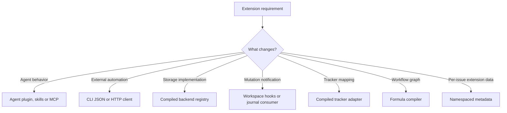
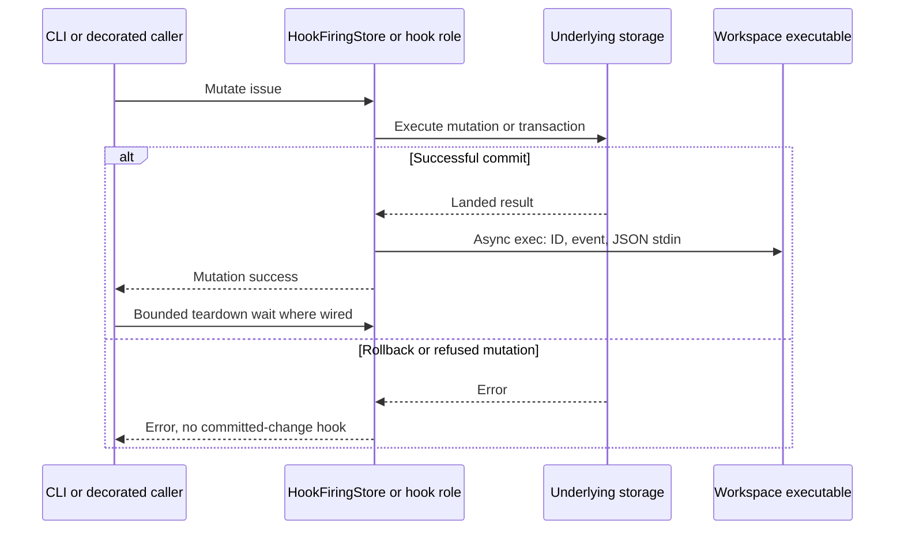
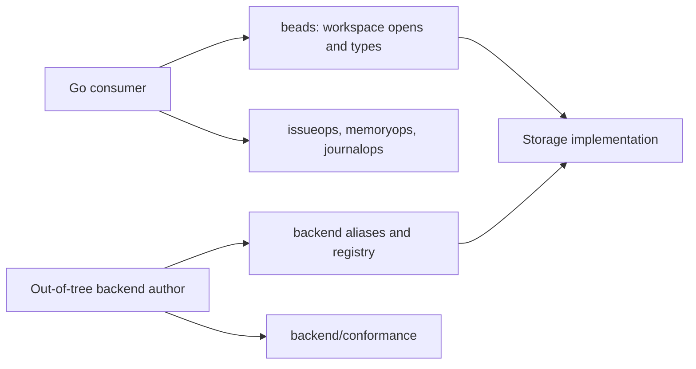
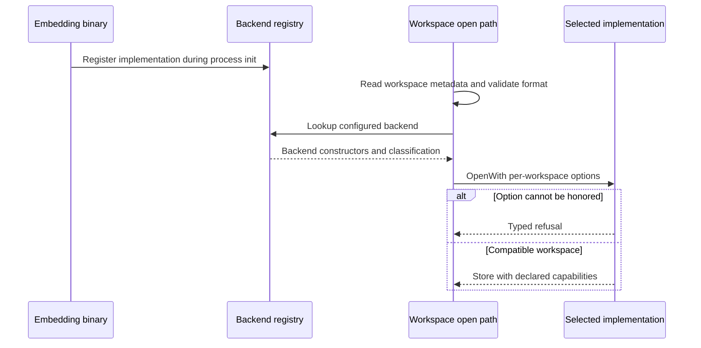
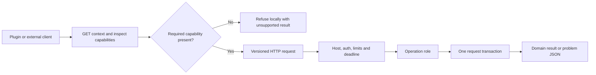
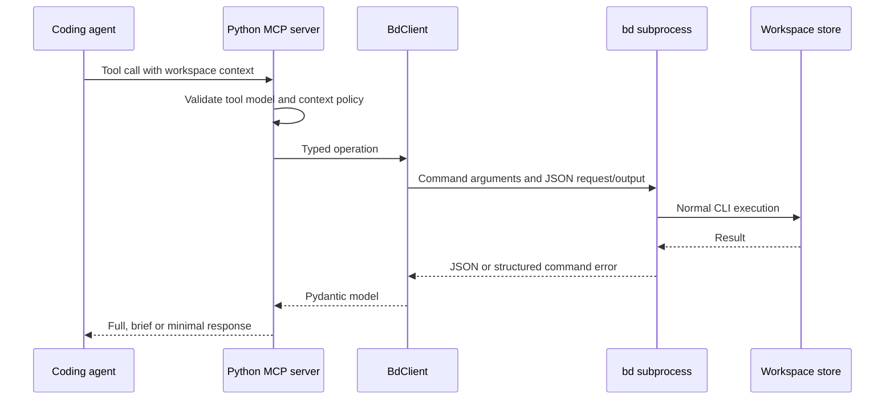
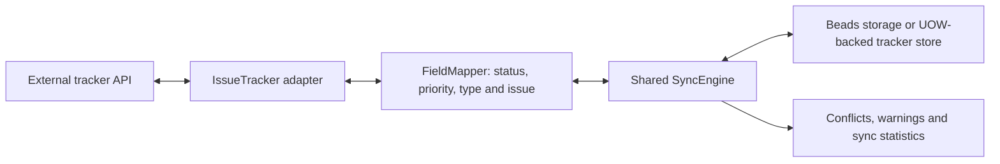

# Existing extension surfaces and integrations

Beads already supports several kinds of extension. They serve different purposes, have different trust models, and should not be treated as one plugin ABI. This chapter describes the imported implementation; the next chapter proposes a common host for the fork.

## Extension inventory

| Surface | What it enables | How it is loaded | Current constraint |
|---|---|---|---|
| CLI plus `--json` | Scripts and orchestration in any language | External subprocess | Process startup, CLI/version compatibility; supported flags matter |
| SQL query access | Schema-aware queries and reporting | `bd sql` or an explicitly managed SQL connection | Couples to engine/schema; direct writes can bypass application contracts; `bd query` instead uses the issue-filter DSL |
| Public Go consumer API | Programmatic reads and mutations | Linked Go module | Exact version pin recommended for evolving roles |
| Public backend registry | Out-of-tree storage implementations | Compile-time registration, usually `init`/blank import | Experimental broad engine interface; no dynamic loader or provisioning |
| HTTP client backend | Remote `bd serve` as a store | Explicit registration/open wiring | Negotiated server capabilities and per-open credentials |
| Workspace mutation hooks | React after create/update/close | Executable files in `.beads/hooks/` | Best-effort subprocess execution, no durable delivery guarantee |
| Agent/editor plugin | Teach an agent how to operate `bd` | Host agent's plugin/skill system | It extends the agent, not the Beads command registry |
| Python MCP server | Expose tools/resources to MCP agents | Separate Python application | Invokes `bd`; subset of CLI model and separate versioning |
| Tracker adapter registry | Import and synchronize external issues | Compiled Go factories | Internal interface; not importable by an unrelated Go module |
| Formula files | Declarative workflow inputs | Discover and compile TOML/JSON | Workflow configuration, not arbitrary executable plugins |
| Metadata | Attach extension-owned data to issues | Normal issue mutations/CAS APIs | Namespace, size and lifecycle rules remain the extension's responsibility |

## Workspace mutation hooks

The [runner](../../internal/hooks/hooks.go) recognizes `on_create`, `on_update`, and `on_close`. On Unix the file must exist and have an execute bit. The runner passes the issue ID and event as arguments and sends the issue JSON to stdin. It launches asynchronously, enforces a 10-second per-hook timeout, captures output for telemetry, and kills the process group on Unix timeout. The corresponding Windows and WASM files define their platform behavior; WASM refuses execution.

[HookFiringStore](../../internal/storage/hook_decorator.go) decorates the wide store, and `hook_*.go` adapters preserve hook behavior across narrow operation roles. Transaction callbacks accumulate changes so hooks run after success rather than for writes that later roll back. Particular mutations can emit more than one synthetic event; do not assume one script invocation per command. The hook role census tests exist because adding a role without retaining decorators is an easy regression.

Hooks cannot veto committed writes. A failing hook does not roll back the issue mutation. A crash after commit but before exec can lose notification. There is no installable plugin manifest, durable acknowledgement, replay cursor, or exactly-once protocol here. These scripts run with the invoking user's privileges and are not a sandbox.

The HTTP service deliberately excludes these hooks. It rejects hook-firing role values instead of launching user scripts per network mutation. A plugin system attached only to this decorator would therefore observe CLI mutations but miss server mutations. The durable journal is a better candidate for cross-frontend event processing, with the caveats in [the proposal](07-plugin-system-design.md).

Three mechanisms share the word hook, but have separate triggers and lifecycles:

| Mechanism | Trigger and owner |
|---|---|
| Workspace mutation scripts | `on_create`, `on_update`, `on_close` after decorated storage mutations |
| [Managed Git hooks](../../cmd/bd/hooks.go) | Git lifecycle such as pre-commit/post-merge, dispatched through `bd hooks run`; distinct from contributor `.githooks/` policy |
| Agent-host plugin hooks | SessionStart and PreCompact invoke `bd prime` in the agent's host |

The Git-hook shim has its own timeout-helper and chaining policy; it does not inherit the mutation runner's 10-second process-group contract.

## Public Go API: consumption versus implementation

The [root package](../../beads.go) is the consumer API. [backend](../../backend/backend.go) is the implementer API, re-exporting internal contract types as aliases so external modules can satisfy the same interface without importing Go `internal` packages. The narrow role packages reduce the amount of engine behavior an application has to know about. Use typed unsupported errors and capability contracts; the existence of a Go method or an HTTP operation token does not imply every backend supports it.

Backend registration is process-initialization wiring. The built-in Dolt family is hand-wired partly because a proxied mode provides a UOW provider rather than a normal store. A registrant supplies `Open`, `OpenReadOnly`, and optional `OpenWith` plus classification flags. Registration validates names and contracts; `dolt` is reserved. Opening an existing custom workspace is supported; `bd init` and `bd bootstrap` do not provision arbitrary registered backends.

The `OpenReadOnly` field does not mechanically guarantee a write-refusing object. It is used for both classified read commands and stricter preview/hydration cases; a command such as `ready --claim` complicates that posture. Enforce a plugin's read-only policy separately rather than deriving it from that constructor's name.

[backend/http](../../backend/http/http.go) supplies explicit HTTP registration, transport wiring, handshakes and workspace opening. Its package doc is more precise than older blanket statements that OSS has no alternate backend. `Register` installs both a registry entry and a default dialer; merely inserting a backend name is insufficient. Credential, custom client and user-agent injection must fail closed when a backend cannot honor them.

Per-open credentials are especially important for a process serving multiple workspaces. The HTTP implementation keeps a supplied credential on that open rather than caching a token by host globally. The ambient CLI credential ladder is a single-tenant convenience, not a safe default for multi-tenant plugin hosting.

## SQL escape hatch and legacy examples

The root API comment also discusses direct SQL as an extension option. Treat that as a schema-aware escape hatch, especially for reporting, rather than a stable plugin protocol. The [old custom-table extension example](../../examples/bd-example-extension-go/README.md) explicitly identifies itself as a legacy SQLite pattern and directs current integrations toward standalone `bd --json` tools or `bd query`. Writing core tables directly can bypass role validation, blocked-state recomputation, decorators, journal/version hooks and guarded lifecycle operations. The proposed broker deliberately does not expose arbitrary SQL.

## HTTP as a language-independent boundary

[The OpenAPI document](../../internal/httpapi/spec/openapi.v0.yaml), [route table](../../internal/httpapi/routes.go), and `/v0/beads/context` handshake define the live wire surface. The route/spec parity test prevents route drift, and the handshake advertises implemented operation and behavior capabilities. A client must negotiate the behavior it needs before transmitting parameters a previous server would reject or interpret differently.

`bd serve` defaults to loopback, optionally authenticates with a rotating token file, and requires explicit non-loopback permission plus authentication unless the operator deliberately opts out. It supplies no TLS itself. Its token authorizes API access; caller-supplied actor strings are provenance rather than an authenticated per-user identity. The service has Host checks for DNS rebinding, connection/database concurrency limits, request budgets, and graceful shutdown. [The runbook](../SERVE_RUNBOOK.md) and [server implementation](../../internal/httpapi/server.go) describe the operational contract.

`/healthz` is process liveness without a database round trip; a real ready query is the readiness probe. HTTP mutation transactions do not run the CLI's per-command auto-commit machinery, and do not fire workspace hooks. Keep these differences visible when choosing an extension transport.

## MCP and agent-host plugins

The [Python integration](../../integrations/beads-mcp/src/beads_mcp/server.py) exposes MCP tools/resources and uses [BdClient](../../integrations/beads-mcp/src/beads_mcp/bd_client.py). Workspace wrappers and context requirements constrain mutating tools. Response projection, field selection and truncation help context budgets. These are distinct from storage projection optimizations. Some comments retain older daemon terminology; use the actual subprocess/client implementation as the guide.

The [Beads agent plugin manifest](../../plugins/beads/.claude-plugin/plugin.json) points at skills and commands and invokes `bd prime` on SessionStart and PreCompact. This installs behavior in the agent host. It does not cause `bd` to load arbitrary command handlers or packages at runtime.

## External tracker integration

The [IssueTracker interface](../../internal/tracker/tracker.go) defines fetch/create/update, identity/ref mapping, configuration and lifecycle. Optional interfaces support batching, dry runs and pull statistics. [The registry](../../internal/tracker/registry.go) maps names to compiled factories. [The engine](../../internal/tracker/engine.go) coordinates conversion, comparison and persistence; tracker-specific packages supply adapters. [The integration charter](../INTEGRATION_CHARTER.md) describes the supported scope and deterministic conflict strategies.

This registry lives under `internal`, unlike the public backend registry. Exporting a stable tracker plugin SDK would require deliberate public request/result types and lifecycle guarantees. Do not expose internal storage or tracker objects across a process protocol. Polling and import are the maintained pattern; a new generic plugin runtime should not accidentally turn Beads into a webhook gateway or cross-tracker workflow product.

## Metadata and event journals

Issue metadata is the lowest-friction extension point. Prefer a namespace such as `plugins.example.com/reviewer` and a versioned object over new core columns. Atomic metadata CAS operations are available through [issueops.MetadataCAS](../../issueops/metadatacas.go); normal read-modify-write is vulnerable to concurrent updates.

The HTTP surface also implements [events:watch](../../internal/httpapi/events_watch.go): a long-lived event stream over the committed journal with polling, heartbeat, reconnect/Last-Event-ID, and truncation handling. A streaming transport already exists. A managed plugin consumer still needs its own acknowledgement, checkpoint, retry, retention-gap, and idempotency policy.

[Journal records](../../internal/eventsjournal/record.go) use a shared envelope for CLI and HTTP consumers: sequence, timestamp, operation, issue ID, optional actor, full post-mutation issue or delete `null`, and optional dependency/comment payloads. This journal differs from historical issue audit events and from Dolt commits. It records local mutation paths, not rows arriving through pull/merge; a consumer mirroring a synced workspace must re-baseline after sync, as the [events command contract](../../cmd/bd/events.go) explains. Activation, retention/pruning, backend support and cursor validity matter for reliable consumers. The next chapter proposes an acknowledged consumer model; current hooks do not implement it.
