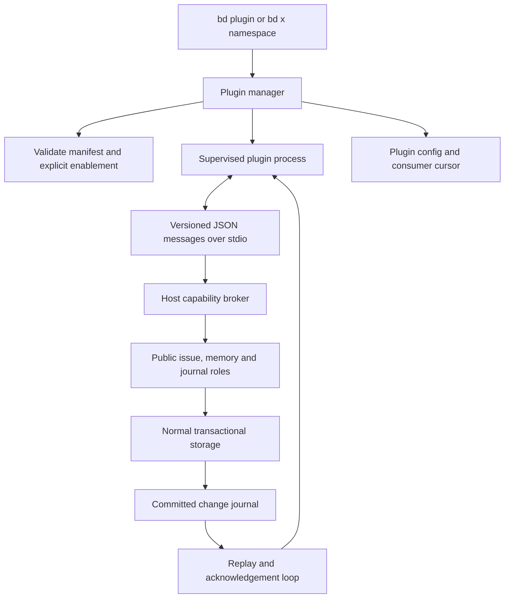
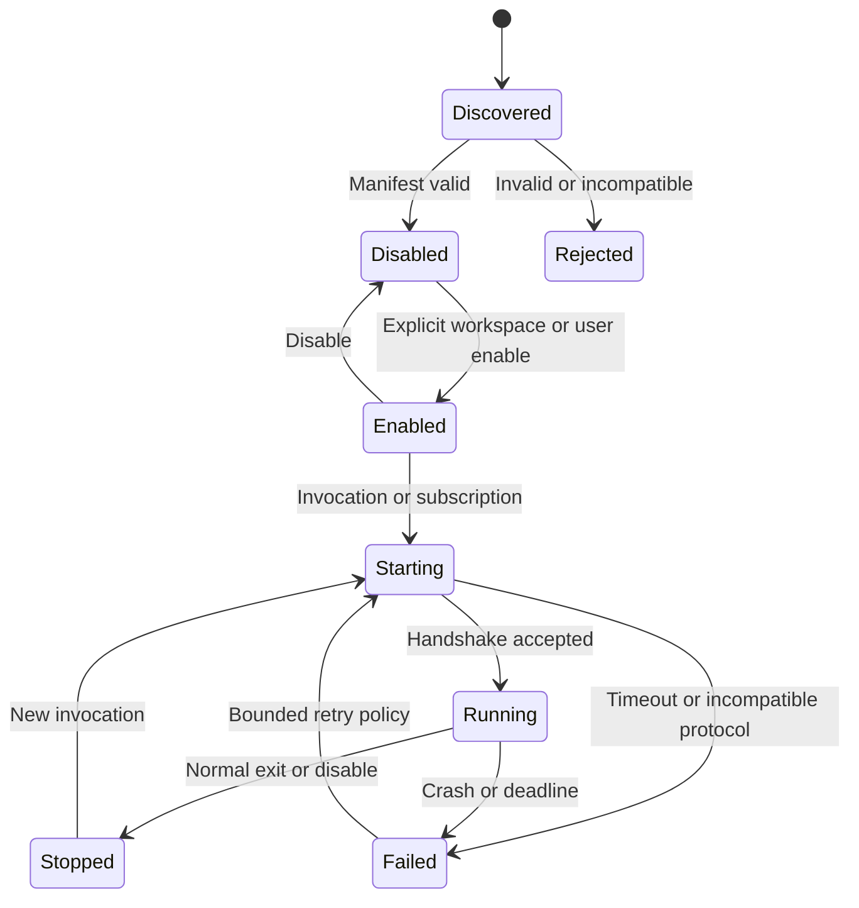
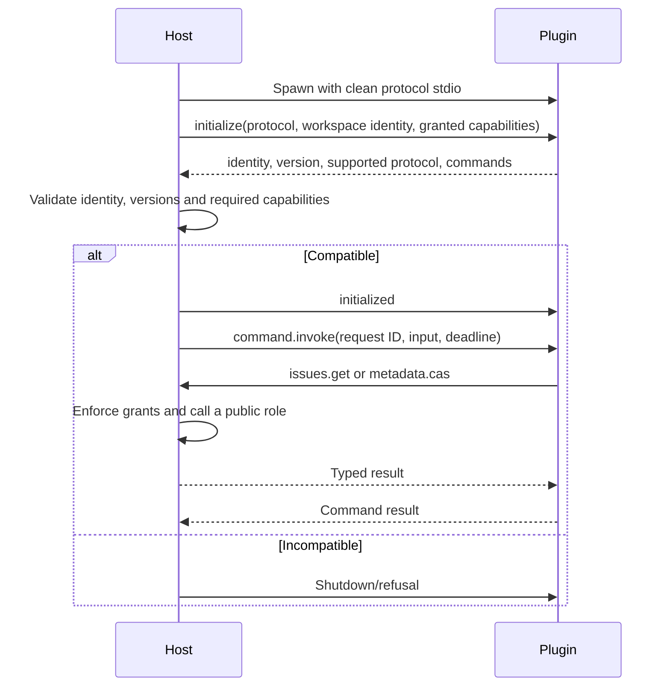
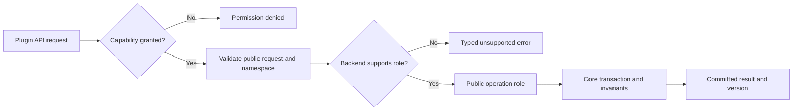
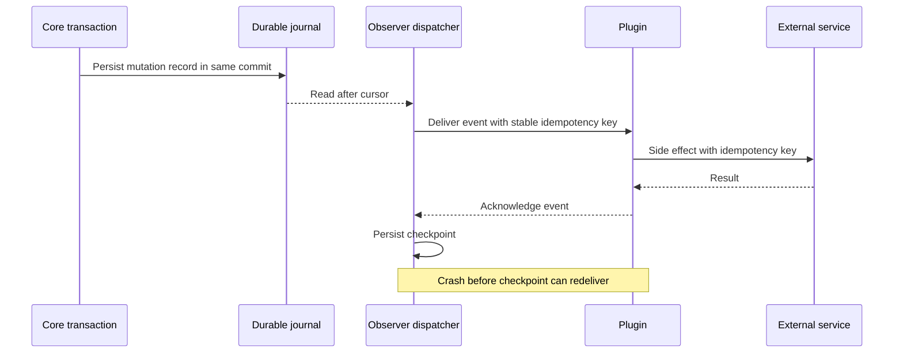
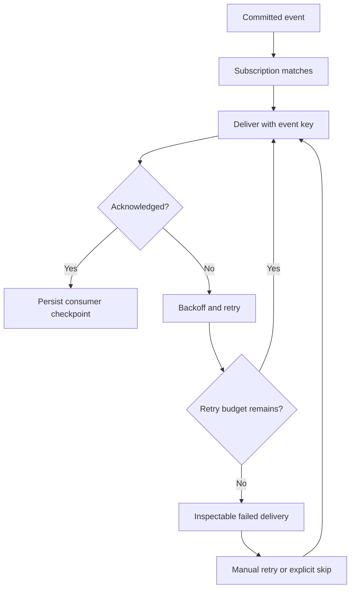
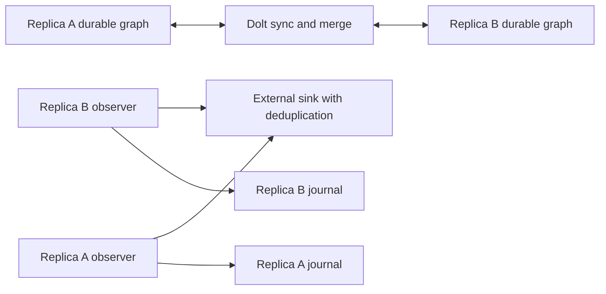

# A plugin system for this fork: proposed design

Everything in this chapter is a proposal for `nikhilshinday/plugs`. The imported Beads source does not implement this manifest, protocol, manager, delivery state, command namespace, or permission model. Existing capabilities are catalogued in [chapter 6](06-extension-surfaces.md).

The aim is to make Beads extensible without forcing every experiment into its command package or schema. Keep core responsible for issue invariants and make plugins clients of a narrow, versioned host contract.

## Start with subprocess plugins

| Approach | Benefits | Costs | Recommendation |
|---|---|---|---|
| Go shared objects | Direct calls | Toolchain/platform coupling, process-wide crashes and privileges, limited portability | Avoid as the default ABI |
| Statically linked Go registrants | Existing backend mechanism, typed contracts | Requires rebuilding distribution; broad backend contract | Retain for storage engines |
| Executable subprocess protocol | Any language, process lifecycle control, explicit messages, portable | Serialization, supervision, version negotiation | First general plugin runtime |
| WASM | Potential capability isolation and portable artifact | Host-call ABI, runtime/dependency work, integration constraints | Consider after protocol stabilizes |
| HTTP-only external service | Already available wire surface, remote hosting | Deployment, auth, networking and lifecycle burden | Support as external clients; do not require for local plugins |

A subprocess boundary isolates crashes and makes lifecycle observable; it does not sandbox filesystem, network or credentials by itself. Permission declarations become enforcement only when the host mediates API calls and an OS sandbox actually restricts ambient access. The first version should call plugins trusted local executables and say that plainly.



## Define three extension kinds separately

| Kind | Role | Initial scope |
|---|---|---|
| Command | Handle a namespaced user/agent operation | `bd x <plugin> <command>`, structured output, bounded execution |
| Observer | React to committed mutations | Journal subscription with cursor and acknowledgement |
| Provider | Supply an alternative subsystem | Defer; storage remains the existing compiled backend SDK |

Command and observer plugins can share transport and lifecycle, but should not share implicit transaction access. A command asks the host to perform each validated operation. An observer receives evidence of a committed fact; it cannot retroactively veto it. Do not add synchronous pre-commit callbacks in version one: arbitrary subprocess code inside a SQL transaction would extend locks and turn plugin outages into core write outages.



## Manifest draft

This is illustrative configuration, not an accepted Beads file format:

```json
{
  "manifest_version": 1,
  "id": "com.example.review-helper",
  "version": "0.1.0",
  "entrypoint": ["./bin/review-helper"],
  "protocol": {"name": "beads-plugin", "major": 1},
  "commands": [{"name": "suggest", "description": "Suggest review context"}],
  "subscriptions": ["issue.created", "issue.updated", "issue.closed"],
  "capabilities": ["issues.read", "metadata.cas:com.example.review_helper"],
  "config_schema": "./config.schema.json"
}
```

A relative entrypoint must resolve inside the installed plugin directory; launch it with argument arrays rather than shell interpolation. Pin artifact version and digest in a lockfile. Define separate user-installed and workspace-enabled state so cloning a repository does not silently grant execution to its plugins. Reject duplicate IDs and ambiguous command names. Plugin installation must not execute post-install scripts by default.

Plugin IDs and metadata key prefixes are separate fields: current metadata CAS keys allow letters, digits, underscores, periods and slashes, but not hyphens. Define and validate an explicit namespace mapping, as the manifest example does, rather than using the ID verbatim as a key.

Suggested layout, also unimplemented:

```text
.beads/plugins.yaml                 # workspace enablement and nonsecret config
.beads/plugins.lock                 # exact artifacts/digests
<user-data>/beads/plugins/<id>/     # installed immutable artifacts
<user-state>/beads/plugins/         # local delivery/checkpoint state
```

Before choosing final paths, classify each file's behavior for Git, Dolt, worktrees, redirects and multiple machines. Delivery cursors are consumer-local state, not automatically shareable workspace policy. Never store secrets in issue metadata or a checked-in manifest.

## Protocol and negotiation

Use length-bounded JSON-RPC 2.0 messages or an equally explicit framed JSON protocol. Reserve stdout for protocol messages and stderr for diagnostics. Negotiate protocol major/minor, plugin identity, requested capabilities and host backend capabilities. A transport version and an operation capability are separate: a protocol-compatible plugin may still ask for a role the selected backend cannot implement.



Expose stable DTOs with documented JSON schema and typed error codes. Never serialize the entire `DoltStorage`, `domain.UnitOfWork`, SQL connection or `context.Context`. Include request IDs, cancellation, maximum request/response bytes and deadlines. Unknown optional fields can be forward compatible; unknown required capabilities must fail explicitly. Treat workspace identity as an opaque stable value and validate it to prevent a plugin response or saved cursor being applied to another database.

## Keep core writes behind a broker



Initial capabilities should be specific: issue reads, bounded query, namespaced metadata CAS, comment creation, and explicit lifecycle operations. A generic `sql.execute` or `store.call` would bypass the boundary. Do not let an observer obtain a new capability just because an event contains metadata from a different plugin. Extension metadata should include its own schema version, and CAS should protect concurrent updates.

Use a provenance convention that distinguishes host actor, plugin ID and triggering event. Existing actor strings are not authenticated identities; the broker must not represent a supplied string as a verified principal. For remote hosts, design authentication separately from provenance.

## Event delivery must be explicit

Build observers over the committed journal rather than solely over CLI hooks. Check journal availability and retention for the chosen backend; a backend with only best-effort hooks cannot satisfy a durable subscription contract. Pin the journal incarnation/workspace identity with the checkpoint so restore or replacement cannot silently skip or replay an unrelated history.



Choose at-least-once delivery. Event identity should include the workspace/journal identity and sequence. Persist a checkpoint only after successful acknowledgement. If an external effect succeeds and the plugin crashes before acknowledging, the event is delivered again; the external sink must deduplicate. A SQL journal cannot make an unrelated network service and a local cursor atomic. Do not promise exactly-once external effects.

Specify retry backoff, attempt limits, an inspectable failed-delivery queue, manual retry and poison-event handling. Pruning must not silently discard undelivered data. Either integrate checkpoint-aware retention or fail with a resnapshot requirement when a cursor falls behind. Initial snapshots need a high-watermark/replay strategy to avoid races between the snapshot and subscription.



Prevent feedback loops. An observer that writes a comment may generate another event. Record causal metadata in the host envelope, allow self-origin filtering, bound causal depth and keep idempotency records. Do not suppress all same-plugin events globally: that could hide unrelated legitimate work.

## Distributed operation



The journals are clone-local and do not move through ordinary Dolt replication. Pull/merge changes do not become local journal records either: an observer that promises to cover the whole synced graph needs an explicit re-baseline/rescan policy after sync, in addition to replaying local writes. Do not interpret two local consumer cursors as one distributed worker lock. Pick one deployment model for the first release: one observer owner per authoritative workspace/server, or explicitly independent local observers with idempotent sinks. Lease semantics in Beads are replica-local. A plugin host needing exclusive global dispatch must supply coordination or ownership partitioning outside the ordinary replication path.

## Proposed implementation slices

| Slice | Concrete deliverable | Verification required |
|---|---|---|
| 0. Contract ADR | Protocol, kinds, trust model, loading paths, stability policy | Review against every frontend/backend path in this guide |
| 1. Manifest and discovery | Parsing, schema, duplicate-ID refusal, explicit enable/disable, list/info | Invalid manifests, traversal, duplicate IDs, disabled-by-default workspace clone |
| 2. Command process host | One command plugin, handshake, cancellation, stdout framing, bounds | Fixture executable, crash, hang, protocol skew, large output, stderr separation |
| 3. Read-only broker | Issue get/query and capability checks | Same response semantics across direct and provider storage; unsupported backend refusal |
| 4. Namespaced writes | Metadata CAS and comments through roles | Race, stale version, namespace denial, rollback, actor provenance |
| 5. Durable observers | Journal replay, acknowledgements, checkpoints and failed-delivery inspection | Commit/crash windows, restart, pruning gap, restore, duplicate delivery |
| 6. Packaging and compatibility | Artifact lock, install/update/remove, explicit upgrades | Cross-platform paths, digest mismatch, old protocol, no ambient credential leakage |
| 7. Stable SDK | Reference plugins and language helpers | Consumer conformance corpus and release compatibility matrix |

Keep each slice reversible and separately reviewable. Do not start by adding plugin-owned columns to core tables. Prototype a useful read-only plugin first, then one idempotent journal observer. Storage-provider plugins remain compiled until a smaller provider contract has a compelling use case.

Before stabilizing the plugin SDK, revisit the upstream BDP graph work in [merged design PR #6154](https://github.com/gastownhall/beads/pull/6154) and [open draft PR #6422](https://github.com/gastownhall/beads/pull/6422), reviewed 2026-10-22. They describe a separate graph domain and transport direction; the planned graph runtime is not implemented in this guide's baseline. Reconcile plugin DTOs, capability discovery and changefeed integration with its eventual accepted contracts. The proposal here does not replace those contributor designs.

## Files to revisit first

- [Public roles](../../issueops), [memory role](../../memoryops), [journal role](../../journalops): host broker building blocks.
- [Backend registry](../../backend/backend.go) and [HTTP embedder API](../../backend/http/http.go): existing initialization and credential policy.
- [Hook decorator](../../internal/storage/hook_decorator.go) and [runner](../../internal/hooks/hooks.go): reuse concepts, do not mistake best-effort scripts for a delivery engine.
- [Journal record](../../internal/eventsjournal/record.go) and [journal role](../../journalops/journal.go): event envelope and reader contracts.
- [CLI context and routes](02-cli-runtime.md): where a namespaced command group would attach and how provider dispatch differs.
- [Project charter](../PROJECT_CHARTER.md): preserve orchestration, schema and storage boundaries.
