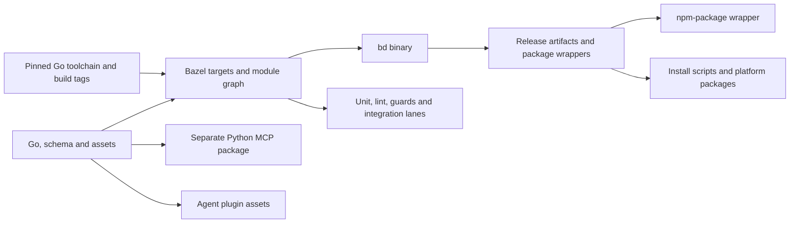
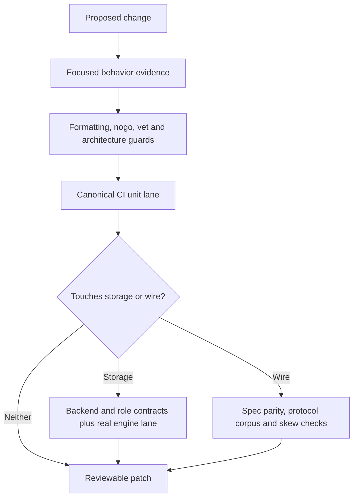
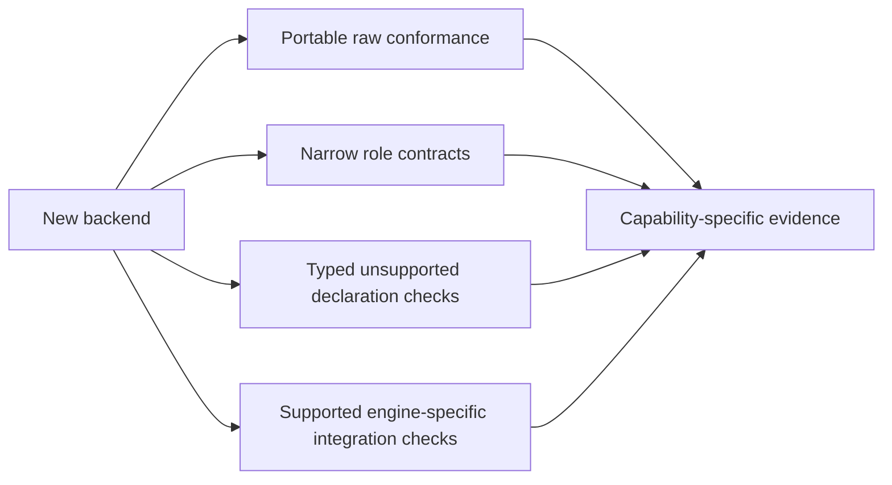
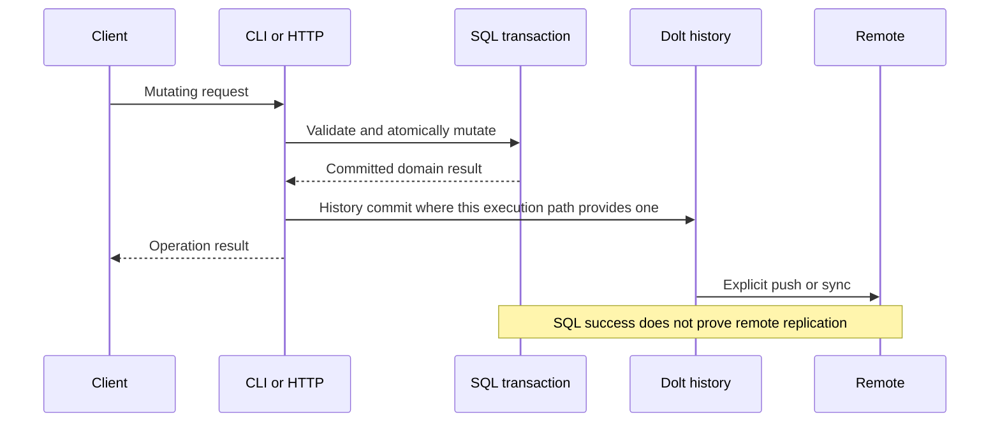
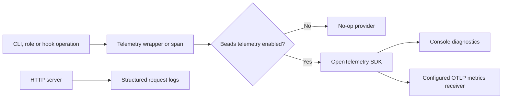

# Build, operations and verification architecture

This fork begins as an upstream-compatible source import. The guide and viewer do not change Beads runtime behavior. A future plugin implementation must follow the same build, lint, storage and wire-contract checks as core changes.

## Build and distribution

[go.mod](../../go.mod) declares Go `1.26.5` and toolchain `go1.26.10`. [.bazelversion](../../.bazelversion) pins Bazel `9.3.0`; [MODULE.bazel](../../MODULE.bazel) and generated `BUILD.bazel` files define the canonical build graph. The [Makefile](../../Makefile) is the human entry point to those lanes. The `gms_pure_go` build tag avoids the ICU regex dependency; embedded-capable builds still need CGO. A non-CGO build cannot supply embedded Dolt just because server mode can run without it.

[The npm package](../../npm-package), [installation script](../../scripts/install.sh), [platform packaging](../../platforms), [Nix files](../../flake.nix), and [release workflow](../../RELEASING.md) distribute or install the CLI. The MCP integration has its own [Python project definition](../../integrations/beads-mcp/pyproject.toml); the agent plugin manifest is a separate versioned artifact. Do not assume their version strings all match the Go binary.

## Canonical contributor gates

| Change | Checks and evidence |
|---|---|
| Any Go behavior | Focused `bazel test` with a log proving the named test ran, then `make test` |
| Imports, files or module graph | `make bazel-sync`; inspect generated BUILD diffs |
| Lint or public boundary changes | `make ci-pr-lint`; lint/vet includes architecture guards |
| Contributor Markdown | Exact relative links and docsync tests |
| Published user docs | `make check-docs`; release pin and generated CLI docs rules |
| HTTP API | OpenAPI source, generated types, route/spec parity, `make api-check`, wire/capability skew tests |
| New storage role/backend | Per-role contracts, unsupported allowlist, backend conformance, applicable real engine lanes |
| Embedded/server changes | Exact lane selection from [TESTING.md](../TESTING.md); CI's short suite is insufficient |

Contributor policy forbids raw `go test` for agent verification, because it bypasses the Bazel gate and may omit guards or tagged files. A green filtered target is not enough if the test skipped or the filter matched nothing. See [AGENTS.md](../../AGENTS.md) and [TESTING.md](../TESTING.md). Do not initialize a user Beads workspace in this contributor checkout; use disposable directories for runtime experiments.

## Backend conformance is intentionally incomplete

[backend/conformance](../../backend/conformance) covers a portable raw surface and narrow role contracts. [backend/backend.go](../../backend/backend.go) explicitly warns that `RunAll` does not exercise all engine capabilities: version control, history, remotes, sync, federation, compaction and fast statistics have separate unsupported declarations/contracts. A custom backend passing the portable suite is not evidence that it correctly replicates history or supports every CLI command.

## Operational state and failure boundaries

| State or operation | Failure boundary to inspect |
|---|---|
| Workspace discovery | Wrong directory, redirect, worktree routing or metadata backend selection |
| Workspace open | Unsupported graph format, unknown backend, missing engine, credential/transport injection refusal |
| Mutation | Validation, graph policy, claim/version conflict, transaction rollback |
| Hook | Committed write can succeed even if script fails or process exits |
| HTTP request | Liveness differs from DB readiness; capability and budget must match client |
| Dolt commit | Separate history boundary from SQL transaction |
| Remote sync | Divergence, merge conflict, transport failure; replica-local coordination remains local |
| JSONL export | Partial interchange, not a restorable full-database backup |
| Plugin observer (proposed) | Replay/checkpoint/side-effect boundaries; duplicates possible |

The precise ordering of output, maintenance and history commit is command/path-specific; this sequence shows distinct boundaries rather than asserting one common implementation. Use [CLI/runtime](02-cli-runtime.md) and [sync](04-sync-and-coordination.md) for concrete paths.

## Observability

[internal/telemetry](../../internal/telemetry/telemetry.go) supplies opt-in OpenTelemetry and store/role decorators. `BD_OTEL_ENABLED=true` (or legacy Beads-specific variables) activates it; unrelated machine-wide `OTEL_*` settings alone do not. Standard OTel exporter/resource configuration applies after opt-in. Hook execution has its own spans and captured diagnostics. [internal/metrics](../../internal/metrics) is a separate package; avoid equating all local counters with an exported telemetry pipeline.

## This guide's verification

The [verification record](verification.json) records what was actually run and its limits. The local viewer is generated from Markdown and pre-rendered SVGs; the source chapters remain editable. Generated `site/` and browser-verification artifacts stay outside Git and Bazel source scans. The [render script](../../scripts/architecture/render.mjs) and [validator](../../scripts/architecture/validate.mjs) are independent from the Go runtime build. They check this guide, not the correctness of every Beads feature.

A successful diagram render proves Mermaid syntax/layout generation, not the accuracy of the modeled architecture. Source inspection and explicit caveats provide that evidence. Full upstream tests, live tracker APIs, replica failure injection, and production deployments must not be inferred from documentation verification.

## Keeping the fork mergeable

Keep `origin` pointing at `nikhilshinday/plugs` and `upstream` at `gastownhall/beads`. [FORK.md](../../FORK.md) pins the import and describes updates. Preserve the upstream [MIT license](../../LICENSE) and authorship. Keep fork-specific design docs clearly identified; when implementing a plugin runtime, use small changes to public boundaries rather than a broad rename or rewrite of `cmd/bd`. Pin SDK consumers to an exact version until the intended compatibility policy is established.

The retained Go module path also means an ordinary `go get github.com/steveyegge/beads` still selects upstream. Testing a Go consumer against this fork requires an explicit module replacement or a later deliberate module-path migration. Copying the source into a differently named GitHub repository does not redirect upstream module consumers automatically.
