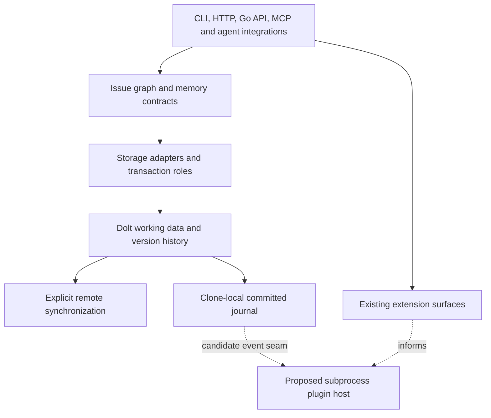

# Beads architecture field guide

A source-grounded guide for developing the Beads fork in `buildbetter-app/plugs`, with editable diagrams, exact source links, a package atlas, and a proposed plugin architecture.

**Baseline:** [gastownhall/beads](https://github.com/gastownhall/beads) at [`9d6fff760b7a314b476539198504d77ce0959656`](https://github.com/gastownhall/beads/commit/9d6fff760b7a314b476539198504d77ce0959656), inspected 2026-10-22. [Fork provenance](../../FORK.md) records import details. This guide describes the imported main-branch source; the published `docs/` site targets its own release pin.

Open the generated offline HTML edition at `site/index.html` for chapter navigation, search, expandable SVG diagrams, editable Mermaid definitions, and local snapshots of linked source files. No network or server is needed to read the generated edition. The Markdown chapters also render their diagrams on GitHub.

## Chapters

| Chapter | What it explains |
|---|---|
| [00 · System overview](00-system-overview.md) | The purpose, actors, layering, persistence and core product boundaries |
| [01 · Source atlas](01-source-atlas.md) | Repository map, every Go package directory, public API entry points and machine-readable inventory |
| [02 · CLI and runtime](02-cli-runtime.md) | Startup, configuration, command context, backend dispatch, query and mutation flows, HTTP |
| [03 · Data model and storage](03-data-model-and-storage.md) | Issues and edges, IDs, schema planes, storage adapters, UOW, transactions, history and hooks |
| [04 · Sync and coordination](04-sync-and-coordination.md) | Dolt/Git transport, commit boundaries, replicas, federation, claims, leases, backup and failure semantics |
| [05 · Workflows and memory](05-workflows-and-memory.md) | Formula compilation, protos, molecules, wisps, gates, priming, keyed memory and compaction |
| [06 · Extension surfaces](06-extension-surfaces.md) | Existing hooks, Go SDK, backends, HTTP, MCP, agent plugins, tracker adapters and metadata |
| [07 · Proposed plugin system](07-plugin-system-design.md) | Tradeoffs, subprocess protocol, discovery, capabilities, delivery semantics and implementation slices |
| [08 · Build and verification](08-build-and-verification.md) | Bazel, packaging, conformance, operational boundaries, observability and validation limits |

## Architecture at a glance



## Start here for plugin work

Read [the actual extension inventory](06-extension-surfaces.md) before [the design proposal](07-plugin-system-design.md). Beads already has extension seams; it does not yet have the unified plugin manager proposed here. CLI hooks and HTTP mutations have different behavior, and committed journal data is clone-local. These are design constraints, not details to paper over with one event callback.

The recommended first implementation is a trusted local executable plugin with a negotiated stdio protocol and a read-only command broker. Add namespaced metadata writes and acknowledged event consumption in separate slices after the contract is proven. Storage backends retain their existing compiled registration path.

## Scope and evidence

The guide covers every major runtime subsystem and indexes all 169 Go package directories. It is not a claim that every implementation branch or all 2,323 test files were audited. It distinguishes:

- **Implemented behavior:** statements linked to the pinned source and current contracts.
- **Design proposal:** chapter 7; manifest, command namespace, broker and observer lifecycle are not implemented.
- **Verification:** [the execution record](verification.json) states exactly what was checked; documentation rendering is not a full runtime test.

The [source inventory](source-inventory.json) is a textual declaration/import index, not a semantic call graph. The [small generated backend graph](graphify-out/graph.html) is a supplementary partial view; its [audit report](graphify-out/GRAPH_REPORT.md) and [diagnostics](graphify-out/health.txt) expose extraction limitations. The hand-authored diagrams are the architecture reference.

## Rebuild the offline edition

From the repository root:

```sh
python3 scripts/architecture/inventory.py
node scripts/architecture/validate.mjs
node scripts/architecture/render.mjs
```

The renderer installs pinned Markdown, Mermaid and browser-control libraries in a user cache on first use; it does not add runtime dependencies to the Beads module. It needs Node 20+ and a Chromium browser. Set `CHROME_PATH` or `ARCHITECTURE_TOOLS_DIR` for explicit local dependencies. The generated `site/` is self-contained; rebuilding needs the tools, reading does not.

## Source hierarchy

When prose and implementation disagree, inspect the pinned source first, then package comments, role contracts and tests. Existing contributor references remain useful: [project charter](../PROJECT_CHARTER.md), [extension contracts](../EXTENDING.md), [HTTP runbook](../SERVE_RUNBOOK.md), [test policy](../TESTING.md), and [adding an issueops role](../ADDING_AN_ISSUEOPS_ROLE.md). Source references are exact relative repository links. The offline viewer bundles the linked source as readable line-addressed snapshots.
