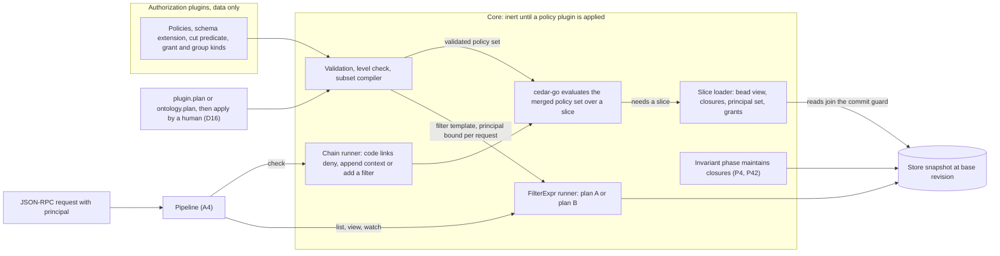

# Authorization: a Cedar-style model?

Analysis for Nikhil's question of 2026-10-28 ([review, open question 1](review-2026-10-27.md#open-questions)). Revised the same day after a critic pass.

**Answer.** Adopt the data contract now. Adopt Cedar if the spike passes. Your concern is the right one: Cedar does no I/O, so Plug has to plan every read a policy can trigger and every list it must filter. P4 and P50 already fix most of those reads. Write them down as a contract, accept only policies that compile onto it, and measure the list plans on Postgres and SQLite at 100,000 beads before changing P16. If Cedar is adopted, put it where the checked decision already points: **core hosts the Cedar evaluator and compiler, authorization plugins supply policies as data, and with no policy plugin nothing runs and every request is allowed** (option (v) below). Authorization stays optional, and no plugin has to rebuild core's data plane. If the spike fails, authorization is revisited altogether, leaning toward simple Linear-style team permissions (AZ1, decided 2026-10-28).

Decide now: AZ2, AZ5, AZ6, AZ8, AZ9 and AZ10. Decide after the spike: AZ1, AZ3, AZ4 and AZ7.

## What Cedar is

Only what bears on this decision:

- **Request and decision.** A request is principal, action, resource and context. Any true forbid gives Deny; otherwise any true permit gives Allow; otherwise Deny. A policy that errors is skipped, so **an erroring forbid allows** ([authorization](https://docs.cedarpolicy.com/auth/authorization.html)).
- **Entities.** An entity has a uid, attributes, tags and **one** `parents` set ([entities syntax](https://docs.cedarpolicy.com/auth/entities-syntax.html)). `in` is transitive, reflexive membership over that set, and its right side may be a set ([operators](https://docs.cedarpolicy.com/policies/syntax-operators.html)). So `in` follows exactly one hierarchy per entity. The evaluator "supports neither I/O nor mutable state" ([Cutler et al., OOPSLA 2024, §2.2](https://arxiv.org/abs/2403.04651)).
- **Bounding the data.** Validated policies do not error on schema-compliant input, and the validator is proved correct in Lean ([security](https://github.com/cedar-policy/cedar-docs/blob/main/docs/collections/_other/security.md)). But "if you change your schema, any policies that you validated before the change might no longer be valid" ([validation](https://docs.cedarpolicy.com/policies/validation.html)). Level validation (Rust 4.4.0) caps dereference chains at *n*, so a host can load a bounded slice and get the same answer as with all data loaded. Cedar does not ship that loader ([level validation](https://docs.cedarpolicy.com/policies/level-validation.html)).
- **Speed.** Median checks of about 4 to 11 µs, excluding data loading ([paper §5.2](https://arxiv.org/abs/2403.04651)). In Plug the cost is the reads.

| Implementation | What matters for Plug | Source |
|---|---|---|
| Rust `cedar-policy` 4.14.0 | Type-aware partial evaluation (`tpe`: `query_resource`, `is_authorized_batched`) is **experimental**, changing in every release from 4.6.0 to 4.14.0, with a Lean model. `query_resource` scans in-memory entities; nothing translates residuals to SQL. 4.14.0 added schema linking (`external` declarations, `Schema::schema_link`) | [CHANGELOG](https://github.com/cedar-policy/cedar/blob/main/cedar-policy/CHANGELOG.md), [RFC 95](https://github.com/cedar-policy/rfcs/blob/main/text/0095-type-aware-partial-evaluation.md), [tpe.rs](https://github.com/cedar-policy/cedar/blob/main/cedar-policy/src/api/tpe.rs) |
| `cedar-go` v1.8.0 (pure Go) | `Authorize` takes a lazy `EntityGetter` and returns a `Diagnostic` naming the deciding and erroring policy IDs. The stable `ast` package only builds policies; its types wrap `x/exp/ast`. A policy's structure is readable through `Policy.MarshalJSON` (Cedar's JSON policy format) or the `x/exp` types. The validator is `x/exp/schema`. The README lists partial evaluation and templates as not included, yet `x/exp/eval.PartialPolicy` is public, experimental, takes no schema, and its comment suggests converting the result to SQL. No level validation in the source at commit `4bbbf50` | [README](https://github.com/cedar-policy/cedar-go/blob/main/README.md), [ast/policy.go](https://github.com/cedar-policy/cedar-go/blob/main/ast/policy.go), [ast/node.go](https://github.com/cedar-policy/cedar-go/blob/main/ast/node.go), [policy.go](https://github.com/cedar-policy/cedar-go/blob/main/policy.go), [x/exp/eval/eval.go](https://github.com/cedar-policy/cedar-go/blob/main/x/exp/eval/eval.go), [types/authorize.go](https://github.com/cedar-policy/cedar-go/blob/main/types/authorize.go) |
| WebAssembly | Official `cedar-wasm` targets JavaScript, not WASI. One third-party measurement under wazero: about 4 to 5 times native | [build-wasm.sh](https://github.com/cedar-policy/cedar/blob/main/cedar-wasm/build-wasm.sh), [cedar-cgo notes](https://github.com/ChrisMckerracher/cedar-cgo/blob/v0.2.0/docs/history/wasm-performance.md) |
| Amazon Verified Permissions | No operation lists authorized resources; batches hold 30 requests. Relevant only as an external engine (P28d) | [operations](https://docs.aws.amazon.com/verifiedpermissions/latest/apireference/API_Operations.html), [quotas](https://docs.aws.amazon.com/verifiedpermissions/latest/userguide/quotas.html) |

## What "storage access patterns" means for Plug

**The set of reads any policy can trigger is fixed before the policy runs.** Each read has an indexed path in every driver, is maintained in the write's transaction, and joins the commit guard's read set ([A4](design.md#a4-event-system)). A policy needing any other read is refused at plan time. This holds for a relationship schema as much as for Cedar.

| # | Query | What a decision needs | Difficulty |
|---|---|---|---|
| Q1 | `bead.get`, `bead.transitions` | The bead's authorizer view, its ancestor IDs (about 10), the principal set, grants on those ancestors | **Easy.** About four indexed reads |
| Q2 | Writes, `tx.apply` up to 1,000 ops | Q1 for each pre-image, and the post-image when a reparent or label change alters it | **Moderate.** One batched load; every fact joins the read set |
| Q3 | Mutator-set fields, deputies | Q2's slice plus context (field, setter, root principal) | **Easy for Cedar**, awkward for relations |
| Q4 | `bead.ready`: ordered, limited, cursored | The ready predicate ([ready.go](../../../internal/storage/sqlbuild/ready.go)) **and** read permission | **Hard.** Permission is a predicate in the same SQL |
| Q5 | `bead.claimNext` | Q4, then `claim` re-checked on the locked candidate ([claim.go](../../../internal/storage/issueops/claim.go)) | **Hard** |
| Q6 | `view.run` with `groups[].count` | Counts over visible rows only ("restricted items leave no trace", [A7](design.md#a7-collaboration-and-ui)) | **Hard.** Touches every visible row |
| Q7 | Watches: 500 at 50 writes/s | Before and after visibility per subscriber | **Moderate.** Route by scope, then a compiled filter in memory |
| Q8 | `history.*`, as-of lists | Read permission **now** (decided) | **Easy** |
| Q9 | Mentions, presence, `LookupSubjects` | Who can read bead X | **Moderate.** Grants on X's ancestors, expanded, batch-checked |

There are three ways to filter a list. **Post-filtering** scans about `k / f` rows to fill a page of `k = 50` when a fraction `f` is visible: 5,000 at 1%, 50,000 at 0.1%. **A per-principal permission table** is fastest to read but turns attribute changes into mass re-evaluation; SpiceDB and OpenFGA cap their list APIs and recommend an index beside the data ([AuthZed](https://authzed.com/docs/spicedb/modeling/protecting-a-list-endpoint), [OpenFGA](https://openfga.dev/docs/interacting/search-with-permissions)). **Compiling the policy into the query** is the only way to meet Q4 to Q6 without that table. OPA's SQL compiler likewise accepts only a declared fragment ([OPA](https://www.openpolicyagent.org/docs/filtering/fragment)).

### Two hierarchies, one meaning

`restricted` cuts inheritance, and Cedar's `in` cannot say "unless a restricted bead lies between". Since `in` walks one `parents` set, Plug gives each one job:

| Cedar construct | Means | Compiles to |
|---|---|---|
| `resource in X` (Cedar `parents`) | X is an ancestor, ignoring cuts. For scope guardrails | `authz_closure (descendant, ancestor)`, the P50 closure, with a self row per bead since `in` is reflexive |
| `resource.inheritsFrom` (set attribute) | The bead itself, then ancestors up to and including the nearest restricted one. For role inheritance | `authz_cut_closure (descendant, ancestor)` |
| `principal.readerOf` and similar (set attributes) | Scopes where the principal set holds a role | `plugin_grant` rows joined on `(subject, scope)` |
| `A.containsAny(B)` over the two above | Some grant scope is in the bead's cut closure | `EXISTS` over cut closure joined to grants |

```cedar
permit (principal, action == Action::"read", resource is Bead)
when { principal.readerOf.containsAny(resource.inheritsFrom) || resource.assignee == principal };

forbid (principal is Agent, action, resource is Bead)
unless { resource in context.token.scopeRoot };
```

Both policies are level 1. For a single check the loader supplies `principal.readerOf` only as its intersection with `resource.inheritsFrom`, not a user's 2,000 grants; `containsAny` gives the same answer on that slice. An agent scoped above a restricted bead still reaches beads below it through the full closure, and the per-item decision and the SQL below agree.

```sql
-- Postgres syntax, illustrative. The OR becomes a UNION of two ordered, limited branches.
SELECT * FROM (
  (SELECT b.id, b.sort_bucket, b.sort_rank, b.sort_created FROM bead b
   WHERE <view and ready predicate>
     AND (b.sort_bucket, b.sort_rank, b.sort_created, b.id) > ($c1, $c2, $c3, $c4)
     AND EXISTS (SELECT 1 FROM authz_cut_closure c JOIN plugin_grant g ON g.scope = c.ancestor
                 WHERE c.descendant = b.id AND g.subject = ANY($principal_set)
                   AND g.role IN ('reader', 'editor'))
     AND <agent forbid>
   ORDER BY 2, 3, 4, 1 LIMIT 50)
  UNION
  (SELECT b.id, b.sort_bucket, b.sort_rank, b.sort_created FROM bead b
   WHERE <view and ready predicate>
     AND (b.sort_bucket, b.sort_rank, b.sort_created, b.id) > ($c1, $c2, $c3, $c4)
     AND b.assignee = $principal AND <agent forbid>
   ORDER BY 2, 3, 4, 1 LIMIT 50)
) page ORDER BY 2, 3, 4, 1 LIMIT 50;
-- <agent forbid>, only for agents:
--   EXISTS (SELECT 1 FROM authz_closure s WHERE s.descendant = b.id AND s.ancestor = $scope_root)
```

### Plan shapes

Moving the filter into SQL does not remove the `k / f` cost by itself; it depends on the plan. Core writes the SQL shape itself rather than trusting each planner. An OR across EXISTS subqueries often keeps a planner from using indexes, hence the UNION (unverified on Plug's schema; the spike measures it).

| Plan | Shape | Rows touched | Use when |
|---|---|---|---|
| A: scope first | Grants by `(subject)`, then the cut closure on `(ancestor, descendant)`, then beads; filter, then sort the top `k` | Every visible row, `V = f × N` | `V` is small |
| B: index walk | Walk the bead sort index, probe EXISTS per row | About `k / f` rows, each probing about 10 closure rows | `f` is large |

At `N = 100,000` the crossover is near `f²N = 10k`, about 7% visible (back-of-envelope). Core estimates `V` from per-scope descendant counts kept with the closure. The plans need these rules:

- **Stored sort keys only.** Today's default hybrid order is a CASE around a moving 48-hour cutoff ([ready.go](../../../internal/storage/sqlbuild/ready.go)), which no index can return in order. Store the bucket and rank as columns, and have a background job move beads across the cutoff. Ordering then lags by the job interval; permissions do not.
- **Indexed attributes.** A6 keeps bead fields in JSON record bodies ([A6](design.md#a6-storage-and-versioning)). The authorizer view and sort keys become generated columns or expression indexes on Postgres and SQLite ([Postgres](https://www.postgresql.org/docs/current/indexes-expressional.html), [SQLite](https://www.sqlite.org/expridx.html)). The memory driver has no planner and implements both shapes in Go.
- **Grouped counts** touch every visible row: 100,000 at `f = 100%`. The 50 ms p95 target applies to pages. The spike sets a separate target for counts.
- **The 20,000-candidate cap** ([A7](design.md#a7-collaboration-and-ui)) counts rows **after** authorization. A cap counted before it would tell a principal how many hidden beads exist. Statement timeouts bound the scan.

### Closure maintenance never lags

A reparent, or a label change that sets `restricted`, rewrites closure and cut-closure rows for the whole subtree. A6 defers readiness fan-out beyond 5,000 dependents to follow-up changesets ([A6 Locks](design.md#a6-storage-and-versioning)). Closures must not follow that pattern, because P4 (a) promises that a revoke cannot race a write. **Closure rewrites always run in the triggering write's transaction.** Above a row limit (proposed: 5,000, as for P21), the write is refused with `closure_too_large`, or it runs as one locked migration-class write, like A3's migrations. It is never deferred.

### Compile rules

- **Compile at plan time, bind at request time.** Compile with the principal symbolic, then bind the principal set per request. A residual computed for a concrete principal has that principal's ID folded in, so reusing it for someone else silently grants their access ([cedar-java#372](https://github.com/cedar-policy/cedar-java/pull/372)). That a residual computed with the principal unknown stays safe to reuse is **inference**, not a claim of the PR. Plug's compiler must guarantee it, and the differential test enforces it.
- **Grant attributes appear only inside `containsAny` or as the right side of `in`.** In SQL they are joins, never `IN` lists; today's code splits `IN` lists into batches of 200 ([sqlbuild.go](../../../internal/storage/sqlbuild/sqlbuild.go)).
- **Level 1 or 2, current state only.** As-of reads use current policy, as decided.

## The contract, and who owns it

The contract is data, not decisions. To respect P28d ("core keeps no permission data of its own") and P26b (plugin methods only under `x.<alias>.*`):

| Fact | Owner | Shape |
|---|---|---|
| Bead authorizer view, sort keys | Core | The fixed A5 attributes as indexed columns |
| Ancestor closure | Core (P50) | `(descendant, ancestor, depth)`, indexed both ways. Also serves non-authorization scope queries |
| Cut closure, derived attributes | Declared by the plugin, maintained by core in the invariant phase (P42 (a)) | Same shape as the closure |
| Grants, groups | Record kinds the plugin declares, stored by core in the plugin's namespace | `(subject, scope, role)`, indexed both ways. Methods are `x.<alias>.grant.*`. Removing the plugin is refused while grant data exists, as [A2](design.md#a2-plugin-platform) already does for data in use |
| Principal, sponsor, token caveats | The authentication plugin | Request context |
| Revision sentinels | Core | Policy set, schema, grants per scope: read set, cache keys, watch resets |

**Authentication first.** Policy enforcement requires authentication (checked). `plugin.plan` refuses an authorization plugin with `authz_requires_authn` unless an authentication provider is configured. Anonymous mode exists only without one, so policies never see an anonymous principal.

**Ontology changes.** The Cedar entity schema is generated from the A3 ontology. That ontology is versioned (P10), fully customizable (D3), and split into a server base plus per-project overlays that overwrite base definitions (P41). A schema change can invalidate a validated policy, so:

- `ontology.plan` and `ontology.apply` regenerate the Cedar schema for every project overlay and revalidate every policy. Apply is refused (`authz_policy_invalid`) if any policy fails.
- A policy is either scoped to one project and validated against that project's schema, or server-wide and validated against every project's schema.
- Rust Cedar 4.14's schema linking is one possible mechanism for base plus overlays. It is untried and absent from cedar-go.

## Where the model sits

| | (i) Cedar plugin, core unchanged | (ii) Cedar as core's own authorizer | (iii) Relationship schema plugin (current P16) | (iv) Plugin evaluates over a core contract | **(v) Core evaluates, plugins supply policies** |
|---|---|---|---|---|---|
| No plugin installed | Allow | Cedar default deny, unless core adds a rule | Allow | Allow | Allow: nothing runs |
| Lists | Post-filter unless the plugin rebuilds push-down | Compiled | Compiled semi-join, untested | Compiled subset | Compiled subset |
| Expressiveness | Cedar | Cedar | Relations; conditions fall to A3 guards and validators | Cedar for checks, subset for reads | Same as (iv) |
| Fit | Rebuilds the loader in the plugin | Reverses plugin-only | Keeps everything | Departs from the checked wording (below) | Matches the checked wording |

(iv) and (v) differ only in who runs the evaluator and compiler:

| Test | (iv) | (v) |
|---|---|---|
| Checked: "an authorization plugin supplies its rules as data and core evaluates them inside the write; with no plugin, nothing runs" | **Departs**: the plugin evaluates | **Matches** literally |
| P14 (a): authorizers compiled in | cedar-go is in the binary either way, so "a language dependency moves into core" costs both the same | Same |
| AZ5 (c): one evaluation, so any plugin's forbid wins | The Cedar plugin must collect other plugins' fragments, and the platform has no mechanism for that (P26b) | Native: core merges every plugin's policies into one set |
| Swapping engines later | Swap the plugin | Change core; pin cedar-go meanwhile |

**On moving authorization out of plugins:** (v) is the middle path. The engine is in core but inert; the policies, grants and cut predicate are plugin data. That keeps "no plugin means allow" and "core keeps no authorization of principals", and puts push-down where the data is.



### How chain links combine for lists

A non-Cedar link, such as an external engine (P28d), can answer single checks but cannot emit a filter. AZ4 refuses read rules that cannot compile, and post-filtering fails Q4 to Q6. So, for lists:

- Every link returns a `FilterExpr` conjunct, or declares itself **check-only**. Context a link appends must not depend on the resource, or it cannot be pushed down.
- `plugin.plan` refuses a check-only link unless the operator accepts a capped post-filter. That post-filter uses A7's candidate cap and fails with a typed error (`authz_postfilter_cap`) rather than returning a short or wrong page.
- An external engine therefore fits for checks; for lists it fits only through that opt-in.

## The spike

Under P1 (b) none of the record store, commit guard or watch manager exists yet, so a two-week spike cannot test them. Narrow it to:

1. Q4 to Q6 as hand-written SQL, plans A and B, on Postgres and SQLite, over synthetic tables at 100,000 beads and depth 10. Visible fractions 100%, 1% and 0.1%, the hybrid order through stored keys, and grouped counts.
2. A 50,000-descendant reparent and a `restricted` toggle on a large epic, timed inside one transaction.
3. Nikhil's real policies (CP7, 2026-10-28), written both as a relationship schema and as Cedar, compared for readability and for fit with the subset:
   - Only admin users can import bulk history.
   - All users can read all beads.
   - Agents can modify only the projects their sponsoring user is involved in.

Pass: page p95 under 50 ms at every fraction on both engines, a count target agreed before the run, and the time of the 50,000-descendant closure rewrite measured as the migration-class write that [P56](design.md#open) (c) gives rewrites above its 5,000-row limit. A normal write over that limit is refused with `closure_too_large`. Revoke-during-write and watches move to the A4 and A6 conformance slices. The memory driver gets correctness from the differential test, not latency targets. **If the spike fails, authorization is revisited altogether** (AZ1, decided 2026-10-28), leaning toward simple Linear-style team permissions; the contract, plan shapes and closure rules still apply, since any model needs them for lists.

Rough size beyond what (iii) also needs (contract, closures, plan shapes, FilterExpr runner). These are guesses, not estimates from code: subset compiler over the JSON policy format, 3 to 4 engineer-weeks; level checker, about 1 week, since cedar-go has none; list explain, mapping a compiled conjunct back to its policy, 1 to 2 weeks (cedar-go's `Diagnostic` already names deciding policies for checks); differential harness, 1 to 2 weeks. That makes 6 to 9 weeks for Cedar, against perhaps 3 to 5 for the relationship-schema compiler (iii) still needs.

## What changes in the design

If the recommendation is taken:

| ID | Change |
|---|---|
| P16 | (a) becomes Cedar policies over the contract, evaluated by core (v), if the spike passes |
| P4 | Survives. "Tuples" become data derived in the write's transaction: closures, cut closure, derived attributes |
| P42 | Survives. `derive:` shrinks to the cut predicate and derived attributes. **Core** evaluates policies (the earlier draft said the plugin did) |
| P50 | Survives as the compile target for `in`. Adds the cut closure, the operator mapping, plans A and B and stored sort keys |
| P28a | Chain rule per AZ5, plus the list rule above |
| P28d, P26b | Unchanged. Grants are plugin-namespaced records with `x.<alias>.grant.*` methods |
| P23b, A3 `permission` guard | Per AZ9 |
| A2 lifecycle | Remove "exactly one authorizer is always active". Refuse an authorization plugin without authentication |
| A3 `ontology.plan` and `apply` | Regenerate the Cedar schema per overlay and revalidate every policy |
| A5 port | `PolicyReader.Tuples` gives way to a slice loader, a closure reader and a candidate enumerator |
| A5 failure | Per AZ6 |
| A6 Locks, conformance | Closure rewrites are never deferred. Differential test on every driver: compiled list equals per-item cedar-go decisions |
| A7 views, watches | Cap counted after authorization. Route watches by scope closure, then each subscriber's compiled filter |

## Decisions for Nikhil

### Decide now

| ID | Question | Options | Recommendation |
|---|---|---|---|
| AZ10 | Adopt the data contract (research note Z1) | (a) yes, before choosing a language; (b) each authorizer brings its own data access | **(a).** Either language needs it for lists and watches |
| AZ2 | How to decide P16 | (a) the narrowed spike above; (b) decide now | **(a)**, with the stated fallback |
| AZ5 | How the chain combines (P28a, open question 2) | (a) the first decision wins, as decided; (b) any link may deny or append context, only the end allows, no decision means deny; (c) one Cedar evaluation over merged fragments | **(b) with (c)** for Cedar policies. Under (a), an earlier Allow skips a later forbid, the guardrail Cedar is built around |
| AZ6 | Policy errors | (a) Cedar's default: skip; (b) any error denies; (c) an erroring forbid denies, an erroring permit is skipped, alerted and reported by `authz.verify` | **(c).** Only an erroring forbid is a safety risk; (b) lets one faulty permit from one plugin deny what other plugins allow. Apply-time and ontology revalidation make errors rare |
| AZ8 | "Fixed in v1: role-scoped workflow permissions" ([review](review-2026-10-27.md#decisions)) against "out of scope for v1" ([A3](design.md#a3-ontology-and-enforcement)) | (a) included in v1; (b) fixed, not customizable | Needs your reading |
| AZ9 | The A3 `permission` guard, tied to AZ8 and P23b (tentative) | (a) stays in the fixed catalog and delegates to the chain, with a `transition` action and the target status in context; (b) removed in favor of a `transition` action; (c) stays a plain role check | **(a).** Keeps P23b's fixed catalog. With no authorization plugin it allows |

### Decide after the spike

| ID | Question | Options | Recommendation |
|---|---|---|---|
| AZ1 | Where the model lives (P16) | (i) to (v), above | **(v)** if the spike passes, **(iii)** if not |
| AZ3 | Engine | (a) cedar-go, with Plug's compiler walking the JSON policy format and `x/exp/eval.PartialPolicy` as an optional front end, cedar-go pinned since the validator is `x/exp`; (b) Rust Cedar with TPE through wasm or cgo; (c) wait | **(a)** for v1. Revisit (b) once TPE is stable |
| AZ4 | Read policies that cannot compile | (a) refused at plan; (b) allowed with a capped post-filter | **(a)**, matching the list rule |
| AZ7 | Grants | (a) plugin-declared records, shown to policies as principal attributes; (b) Cedar templates | **(a).** cedar-go has no templates, and grants stay dumpable data (P19, P20) |

## Sources

Repository (relative to this file): [review-2026-10-27.md](review-2026-10-27.md), [design.md](design.md) (A2 to A7 and the decision table), [transcript.md](transcript.md) ([05:05]), [ready.go](../../../internal/storage/sqlbuild/ready.go) (hybrid order, lines 57 to 65), [sqlbuild.go](../../../internal/storage/sqlbuild/sqlbuild.go), [claim.go](../../../internal/storage/issueops/claim.go). Working research notes are outside the repository in `/tmp/plug-authz/`. On partial evaluation they are wrong: r1 says cedar-go has none, and r2 says its partial evaluator is internal only. This document relies on the cedar-go source instead.

External sources are linked where they are used.

Unverified: the plan crossover and the effort guesses; whether Plug's real policies fit the subset; whether Postgres and SQLite pick the intended plan without hints; Rust schema linking as a fit for overlays; the third-party wasm figures. Verified by reading source at cedar-go `4bbbf50` (2026-10-28): the `ast` wrapping, `PartialPolicy`, `MarshalJSON`, `Diagnostic`, and the absence of level validation.
