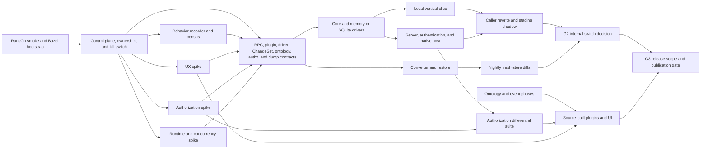

# Plug: clean-room plan

Status: proposal, 2026-10-28, re-planned for an agent swarm. This plan follows [design.md](design.md), the recorded [design review](../../adr/0005-plug-design-decisions.md), and the [decision ledger](decisions-needed.md). The Open table in `design.md` is empty; only the plan-level questions in [Decisions for Nikhil](#decisions-for-nikhil) remain.

## Completion contract

Done = by 2026-10-31 the swarm has a green Plug control plane, frozen contracts, independently recorded behavior and data evidence, and a first restored end-to-end local slice, proven by fresh Bazel results, adversarial review artifacts, converter diffs, and a signed workgraph snapshot; a large diff, a unit-test pass without an independent oracle, or a green PR without its evidence does not count.

Scope = the clean-room Plug tree, its contracts, behavior cards, drivers, server path, converter, restore validator, and swarm controls; production cutover, public publication, and any data movement remain outside the burst until their gates pass.

## Goal and boundaries

Build Plug 0.1.0 in `buildbetter-app/plugs` as a clean-room rewrite. Beads is the behavior reference and, until cutover, the data exporter. Plug does not import, wrap, or call Beads code. The new tree contains the `plug` binary, JSON-RPC 2.0 server, OpenRPC discovery, the public `pluginapi` and `sdk/go`, internal core and driver packages, specification cards, and migration tooling. The old public Go API, HTTP v0, `bd` compatibility, Dolt storage, and formula or molecule commands have no successor in core.

Plug sits at the root of `main`. `beads-base` preserves provenance and the `beads` branch carries the reference build, recorder, and exporter. The only data path between trees is `plug-dump/1`, exported by a pinned `bd` build and restored into an empty Plug store. Several source stores may be merged offline into one archive with one project per prefix; BuildBetter production moves once. Rehearsals may run repeatedly, but they never write into a non-empty target.

The 2026-10-31 stop line is the end of the unlimited-budget burst, not a release or a production switch. The burst must leave a usable control plane, contracts, evidence, a first local vertical slice, and a ranked graph. It must not claim migration safety from a few tests or move production data before parity, rehearsal, rollback, authentication, and shadow gates pass.

## Binding decisions

The following decisions are carried from `design.md` and [../../adr/0005-plug-design-decisions.md](../../adr/0005-plug-design-decisions.md). They are inputs to the graph, not questions for an implementation agent.

### Product, API, and repository

| IDs | Binding decision |
|---|---|
| D1-D13 | Remote UI only; optional identity and authorization plugins; customizable ontology and event subscribers; plugin configuration; two plugin modes; a shared server and dump as the source of truth; JSON-RPC; clean layers; and Nikhil decides only the listed gates. The name is `plug` with `plg` as an alias. |
| D14-D16 | Every graph item is a bead and `issue` is one type. The repository remains `buildbetter-app/plugs`. Agents plan plugin changes; only a human applies them, enforced when authentication exists. |
| D17-D22 | Authorization is optional plugin data and core has no authorizer of its own. With no authorization plugin every request is allowed. Policy enforcement requires authentication. Anonymous mode is the default without an authentication provider, serves only localhost, and has no network override. |
| D23-D28 | Authorization plugins form a chain; overlays overwrite by key; the v1 fixed list includes bead templates, role-scoped workflow permissions, priorities, and dependency types; history uses current read permission; local mode runs the server and plugins in the CLI; partial failures are `result.warnings`; the warning is visible to end users. |
| D29-D33 | Same-origin UI plugins use session cookies. Other-origin apps use OIDC PKCE and short-lived Plug-audience bearer tokens from an operator CORS allowlist. Bundles are prebuilt and digest checked. Declarative panels sit beside iframes. The nine interpretations in `design.md` are confirmed, including local server UI versus in-process no-UI and the P44 history floor. |
| P1-P5 | Clean-room rewrite, one typed `ChangeSet`, pre subscribers before the transaction and post subscribers after commit, authorization facts derived in the write when a plugin is installed, and a hard fork. |
| P6-P11 | Every driver has a Plug change log; drivers are record store plus `sqlkit`; wasm runs in-process on wazero; mutators run in dataflow order with one scalar owner; ontology is stored and versioned on the server; a Go registry generates OpenRPC. |
| P12-P16 | Many projects share one graph. Manifests set maximum reads and ownership, ontology narrows them. Authorization plugins are compiled in for v1, with storage, secret, and policy-data plugins in mode 1; the narrowed spike decides Cedar evaluated by core versus the relationship schema, and a failed spike reopens authorization rather than silently selecting a weaker fallback. |
| P17-P24 | Trackers export plus one-shot import. `Ref.Branch` is reserved. Dumps contain secret references and ciphertext only by flag, carry full history by default with head-only by flag, and require ontology directives for violations. Imports accept Plug semantics. Typed fields are separate from metadata. Guards are a fixed catalog, conditional rules are validate subscribers, bindings fail closed by default, and the audited per-binding fail-open and `admin.binding.suspend` controls remain. |
| P25-P32b | Mode-2 sync phases require operator grants. The plugin set and lock are versioned objects, plugin methods use `x.<alias>.*`, authorization is a chain, unreadable blockers appear as counts, OIDC uses revocable core sessions, lagging listeners and projections stall, script hooks are replaced by listeners, versions are JSON Patch diffs with bases, text uses field-scoped compare-and-set, views are core resources, and UI uses sandboxed iframes with a narrow bridge embedded in the binary. |
| P35-P40 | HTTP v0 is deleted at cutover. A driver lock and `plug server --local` provide local concurrency. Docs print `plug`. Usage metrics are opt-in to an operator collector, the license is MIT, history is filtered with `git filter-repo` before tags, transcripts are never committed, public release is after the gate at 0.1.0. |
| P41-P50 | One organization has a server base ontology and per-project overlays. Core runs declarative rules in the transaction. Mode-2 plugins are source-built at pinned commits. Restore accepts only an empty store. History and audit remain forever except explicit redaction, with ephemeral runs unversioned. There is no `bd` compatibility or old public Go API. Formulas and molecules are a workflow plugin. Storage owns active and standby topology. Ancestor closure is transactional and lists use a semi-join. |

### Authorization, storage, UI, and migration decisions made today

| IDs | Binding decision |
|---|---|
| AZ2, AZ5, AZ6, AZ8, AZ9, AZ10 | Adopt the authorization data contract before choosing a language. Any chain link may deny or append context; only the end allows and no decision denies. Cedar policies are evaluated as one merged set. An erroring forbid denies; an erroring permit is skipped, alerted, and reported. Role-scoped workflow permissions stay out of the ontology. The fixed `permission` guard asks the chain for `transition`. |
| AZ1, AZ3, AZ4, AZ7 | If the narrowed spike passes, core hosts an inert `cedar-go` evaluator and plugins supply policies as data. If it fails, authorization is revisited toward simple Linear-style team permissions. `cedar-go` is pinned, rules that cannot compile to list filters are refused at plan, and grants are plugin-declared records exposed as principal attributes. |
| P51-P56 | Schema plugins merge into one schema. `authz.*` has no egress. Policy-data authorization is mode 1 only. Code links have explicit order and the order is shown by `plugin.plan`. v1 has a fixed authorizer view. A closure rewrite over the limit is refused with `closure_too_large` or is one explicit locked migration-class write. |
| P57-P62 | There is no `authz.explain {asOf}`; history uses current permissions. Authentication refuses scoped agent tokens when no authorization plugin exists. There is no break-glass root list; recovery is through the bootstrap admin or offline repair. Anonymous mode records a client-asserted `_meta.agent` label beside `anonymous` and uses it for lease and idempotency scope. `authn-local` is optional. A boot tier may hold one provider and a bootstrap admin. |
| P63-P69 | With authentication, `ontology.apply`, `override_guard`, binding suspension, event-subscription skip, restore administration, `history.redact`, ciphertext dumps, protected reverts, and `sync.import` require a `user` principal and the D32 human proof. Anonymous multi-approval gates are refused. Overlay moves need `map_status` and `map_type`. Failed post subscribers return the commit with a warning, dead-letter, and breaker count and make no graph writes. Artifacts are digest locked, reproducibility is checked in CI, local mode begins Linux-only then uses a Linux container, and all warnings reach end users. |
| P70-P78 | v1 delegates replication, failover, and backup to managed HA Postgres. `Store.Lease` fences commits with a 10-second TTL and 3-second renewal; the server stops reads and writes after lease loss. Each storage plugin documents RPO and RTO, with Postgres at 5 minutes and 1 hour. History uses JSON Patch with a full base every 32 versions after the as-of benchmark. Stored ready order may lag one minute. Restore loads digest-checked artifacts and rebuilds asynchronously as a check. Offline export merges stores by project. `sync.import` may mint new IDs into an existing project, and remote edits are overwritten on push and counted as drift. |
| P83-P85 | The last code link may allow. Check-only links may use an explicitly accepted capped post-filter that fails with `authz_postfilter_cap`, never a short page. Memories are core records returned by `agent.brief`. |
| P5b, P5c, P38d, P39b, P48b, P79-P82 | The new tree is at `main` root, and Beads is read through `bd export --format plug-dump/1` on `beads`; the exporter is standalone for plain Beads users. History filtering runs early while private. Design docs are committed without transcripts. The workflow plugin is compiled in from this repository without Beads formula files. No remote build cache is used at first. A delegate drafts the command keep/fold/drop list, Nikhil signs off families and only in-use command drops individually. Metrics contain method, result code, latency bucket, principal kind, and client version, never IDs or text. Goldens freeze at `beads-base`, fixes on `beads` re-record through reviewed PRs, and nightly diffs back them. |
| P76-P78, P83-P85 | Offline multi-store merge remains inside P44. Tracker imports and late data are ordinary head-only writes with new IDs. Synced remote edits are overwritten and counted as drift. The last code link can allow, check-only links have the capped post-filter option, and memories are a core kind. |
| D32-D33 | For D16, authenticated apply requires an interactive login session rather than an API key; anonymous apply requires a human-presence check such as typing the plan digest. All nine design interpretations are confirmed. |

### Swarm decisions and infrastructure facts

- The swarm starts immediately after this re-plan is approved. Its budget is effectively unlimited through 2026-10-31.
- The only swarm models are GPT-6.1-Sol through `gpt-worker-max` and Codex through Paseo as `codex/gpt-6.1-sol` with thinking `max` or `ultra`. Claude remains orchestration only.
- Agents open PRs with the remote-dev GitHub App identity and merge on green after Bazel CI and an adversarial review by a second agent. Nikhil is pulled in at decision gates only.
- CI runs on RunsOn classes used by BuildBetter. The new tree owns `.github/runs-on.yml`; a smoke run must pass before the swarm relies on the service.
- The authorization spike uses these three real policies: only admin users can import bulk history; all users can read all beads; agents can modify only projects their sponsoring user is involved in.

## Repository and infrastructure baseline

These facts were checked against this checkout and the host on 2026-10-28:

- `origin` is `buildbetter-app/plugs`, the branch is `main`, and the repository is private. [`.bazelversion`](../../../.bazelversion) pins Bazel 9.3.0. The host `bb-forge-us-01` has 32 cores, 249 GiB RAM, and 4.4 TiB free disk, with Nix, `bd` 1.3.1, `gh`, `aws`, `jq`, `openssl`, and `blacksmith`; Go, Bazel, and Bazelisk are not installed globally.
- The existing [Bazel workflow](../../../.github/workflows/bazel.yml) and [PR workflow](../../../.github/workflows/pr.yml) require or assume rbe-west for the Linux gate. The new tree cannot use that workflow as its trust boundary and must run its own Bazel lane without rbe-west credentials or cache.
- The current [module](../../../go.mod) is `github.com/steveyegge/beads`; the new module is `github.com/buildbetter-app/plugs`. The current release workflow publishes only for `gastownhall/beads`, so it is reference-only for Plug.
- The repository has 72 main migration files in [migrations](../../../internal/storage/schema/migrations) and 28 ignored migration files under `migrations/ignored`; [schema.go](../../../internal/storage/schema/schema.go) maintains the second cursor `ignored_schema_migrations`. The census must treat both series as a pair per machine.
- The source inventory contains 46 role-contract cases even though `backend/conformance` also has helper and test files, 29 protocol test files, 306 command paths in `tree.golden`, and 13,139 Go test functions. The counts are census inputs, not proof of parity.
- GitHub state is Actions enabled, `allow_auto_merge` false, and `main` unprotected. No worker changes settings. A repository administrator must enable branch protection, required checks, and native GitHub auto-merge if that native mechanism is desired; otherwise the app-owned merge controller below is authoritative.
- BuildBetter's `/home/dev/buildbetter/.github/runs-on.yml` defines `bb-x64-16`, `bb-x64-16-nvme`, `bb-x64-16-ondemand`, and `bb-x64-4`. The normal Plug job uses `bb-x64-16` (16 vCPU, 64 GiB, Spot families m8i, m7i, m8a, m7a, Ubuntu 24 full image, 200 GB gp3, S3 cache). The pinned `runs-on/action` is `17b59092eb37ebfdbb034460892887c09100eaa3` (v2.5.0).

A checked fact can drift. The bootstrap records the observed values in the graph and stops if a required setting, workflow, runner class, or toolchain pin changes.

## Plan shape

Three shapes were considered:

1. Wide implementation fan-out starts core, storage, server, UI, migration, and authorization at once. It spends model capacity quickly but creates incompatible contracts and a merge storm.
2. A serialized contract train minimizes divergence but leaves capacity idle and postpones the UX, authorization, and runtime facts that should shape the contracts.
3. A two-plane contract factory starts a small control plane, then runs behavior capture, the UX and authorization spikes, and contract drafting in parallel. Only contract-approved packages enter implementation waves, and every merge carries independent evidence.

The third shape is selected. It puts the independent spikes on the critical path early while keeping implementation parallel behind explicit contracts. The work graph is the durable coordination surface, not an agent transcript.

## Swarm execution model

Claude is the orchestrator. It owns the graph, prompts, stop switches, merge admission, and evidence ledger, but does not write product code or approve a PR it initiated. The only worker lanes are:

- `gpt-worker-max` is GPT-6.1-Sol at maximum reasoning. Use it for short, bounded specification capture, repository census, judgments, reviews, and verification. A worker gets one contract, a small input set, and a time box. The orchestrator retries a task when the worker returns no result or times out.
- Paseo launches `codex/gpt-6.1-sol` in its own full-access worktree with thinking `max` or `ultra`. Use it for long implementation tasks, the runtime and concurrency prototype, source-built plugin work, and integration repairs. Long work never goes to `gpt-worker-max`.

Three `gpt-worker-max` requests already died after roughly 57 minutes with 180,000 to 240,000-token contexts and no retry. The graph therefore rejects prompts above a small bounded context budget, splits long outputs into sections, and treats an empty response as a failed attempt. It never asks one worker to carry the whole design or a whole milestone.

A peak wave may use up to 16 short GPT workers and six Paseo worktrees, but the controller admits work by dependencies, not by filling slots. No more than eight PRs run CI at once and no more than two green PRs enter the merge queue in a 15-minute window. A worker edits only its package, tests, and named generated files. Worktrees are isolated. Cross-package changes are a contract PR followed by implementation PRs. A worker rebases immediately before review and the controller re-runs required checks on the merge commit.

The graph lives in a dedicated Beads workspace outside the repository, for example `/home/dev/.local/state/plug-swarm/workgraph`. It is not a BuildBetter issue store and never holds customer data. Each item records a stable ID, dependencies, owner, inputs, output paths, acceptance command, risk class, evidence artifact, worker lane, PR, and merge state. The controller exports a signed JSON snapshot after each merge. The states are `blocked`, `ready`, `running`, `review`, `merged`, and `rejected`; unresolved work is never deleted.

## CI and merge bootstrap

### RunsOn first

The new tree owns `.github/runs-on.yml` and copies the four tested classes used by BuildBetter. `bb-x64-16` is the default for Plug CI. Its jobs use:

```yaml
runs-on: runs-on=${{ github.run_id }}/runner=bb-x64-16
```

and pin `runs-on/action@17b59092eb37ebfdbb034460892887c09100eaa3`. The file defines `bb-x64-16` (16 vCPU, 64 GiB, Spot, m8i/m7i/m8a/m7a families, `ubuntu24-full-x64`, 200 GB gp3, `s3-cache`), `bb-x64-16-nvme`, `bb-x64-16-ondemand` (no Spot), and `bb-x64-4`. The class declarations remain the repository's own copy; a workflow never assumes that another repository's configuration is loaded.

Before any swarm job depends on RunsOn, dispatch the repository's own `runs-on-smoke.yml`. It exercises each class, reports capacity and lifecycle, and confirms the RunsOn app serves `buildbetter-app/plugs`. A failed or unavailable smoke run blocks scale-up and leaves the fallback as a GitHub-hosted Ubuntu runner for the bounded bootstrap only. The smoke workflow is first-run evidence, not a setup checkbox.

### Bazel from the first Plug commit

The host has Nix but no global Go, Bazel, or Bazelisk. The new tree installs Bazelisk through the pinned Nix environment or runner bootstrap, resolves `.bazelversion` 9.3.0, and exposes `bazel` on `PATH` before any build. The preflight records `bazel --version`, `nix --version`, the resolved Go SDK supplied to Bazel, the Bzlmod lock digest, and the runner class. Every test, nogo, gofmt, guard, generated-file, acceptance, and link check runs through `bazel test`; the swarm does not use `go test` as a substitute.

The Plug workflow is independent of the existing rbe-west workflows and cache. Its required jobs are:

- Bazel build, nogo, gofmt, layer and depguard checks, and generated OpenRPC and schema checks.
- Memory and SQLite conformance, behavior cards, seeded traces, and no-outbound-connection tests.
- Postgres integration, authorization differential tests, converter and restore tests, and the runtime and plugin ABI lane.
- Docs and link checks, lexicon checks, Gitleaks, and fresh test results for migration and security suites.

The required jobs upload test XML, a build-event file, the exact Bazel command, source and generator digests, and the evidence manifest. A clean RunsOn runner with no rbe-west secrets must pass the first Plug commit before implementation waves scale.

### App-owned auto-merge

The selected mechanism is a merge controller using short-lived remote-dev GitHub App installation tokens. Agents open small PRs with that identity and request `nikhilshinday` as reviewer when a PR is created. The controller checks the exact head, required Plug statuses, fresh acceptance results, and an adversarial review by a different agent. It then merges the green head through the GitHub API as the app identity. A red, stale, unreviewed, or head-changed PR is refused. Workers never receive a long-lived token and never push directly to `main`.

The current repository has `allow_auto_merge` false and no branch protection. Native GitHub auto-merge is therefore not assumed. A repository administrator must enable branch protection, required Plug checks, no force-push, and `allow_auto_merge` if the controller is to request GitHub's native queue. That admin action also needs to grant the remote-dev App the minimum contents, pull-request, checks, and actions permissions required for its controller. Until then, the app-owned controller's merge call is the authoritative auto-merge path and follows the same checks. No worker changes repository settings.

### Control and kill switches

B0 creates an external graph, ownership map, prompt templates, evidence schema, and a soft pause flag. B3 adds three switches:

- Soft pause prevents new dispatch and merge admission while allowing an explicitly approved verification to finish.
- Hard stop revokes or disables the remote-dev App installation and terminates the controller.
- Containment disables credentials and outbound egress for testbox and shadow agents.

The controller verifies the soft pause and hard stop in dry-run mode before it starts implementation. Every run summary records the switch state.

## Work graph and parallel tracks

The graph is contract-first. Each row below is one agent-sized task with an explicit acceptance artifact. A task is not complete when code exists; its acceptance command must run and its evidence must attach to the graph item.

### Bootstrap and contracts

| ID | Inputs | Output | Acceptance |
|---|---|---|---|
| B0 | This plan, all recorded decisions, repository metadata | Graph, ownership map, prompt templates, kill procedure, evidence schema | A clean-context verifier can locate inputs, create a task, pause dispatch, and resume without reading a transcript |
| B1 | `main`, `beads-base` candidate, `AGENTS.md`, lexicon decision | Clean Plug skeleton, module identity, `NOTICE.md`, ownership file, lexicon | Tree check rejects banned vocabulary outside provenance zones and Plug has no Beads import |
| B2 | `.bazelversion`, `.bazelrc`, `MODULE.bazel`, current workflows, RunsOn smoke | Plug `.github/runs-on.yml`, smoke workflow, Bazel bootstrap, Plug-only CI | Smoke passes first; a fresh `bb-x64-16` runner installs Bazel 9.3.0, runs required Bazel targets, and needs no rbe-west credential |
| B3 | Repository settings, app token procedure, required checks | App-owned merge controller, pause and health sentinel | A stale, red, or unreviewed PR cannot merge; a failed `main` sentinel freezes admission; no worker receives a durable token |
| C1 | A1 JSON-RPC rules and error catalog | `MethodDesc` registry, generated OpenRPC, wire schemas, method and permission catalog | Registry lint rejects a missing effect, permission, error, idempotency, or schema; unknown parameters fail |
| C2 | A2 plugin contract and `pluginapi` sketch | Versioned `pluginapi/v1`, host call shapes, manifest, native seams | SDK kit runs a native plugin, rejects undeclared prefixes and fields, and proves hot paths cannot write or use undeclared egress |
| C3 | A6 driver guarantees, lease, version, dump and history decisions | `Driver`, `Store`, `Reader`, `WriteTx`, lease, version, changeset, blob, and derived-table interfaces | Memory and SQLite doubles pass identical fixtures; stale lease commit returns `ErrFenced`; service code cannot see `WriteTx` |
| C4 | P2, A1, operation inventory | Closed `ChangeSet` union, preconditions, commit and warning models | Every write lowers to one operation and a generation check fails for an effect without an operation or a union member with extra payload |
| C5 | A3 ontology, status and type inventory, UX fields | Versioned ontology schema, overlays-by-key, categories, slots, guards, migration directives | Base plus overlay compilation is deterministic; fixed v1 items cannot be redefined; dry-run emits a typed plan digest |
| C6 | AZ10 and authorization analysis | Indexed bead view, ancestor and cut closures, grant shapes, `FilterExpr` boundary | Policy fixtures request only declared facts; revoke-during-write and list filters record all reads in the commit guard; no plugin creates an allow path |
| C7 | Both migration series, config loaders, data inventory, P19/P20/P44 | `plug-dump/1` schema and samples, paired census, archive policy, converter manifest | Unknown main or ignored versions refuse; secrets are references by default; restore accepts only an empty store |

### Evidence and spikes

| ID | Inputs | Output | Acceptance |
|---|---|---|---|
| E1 | `beads-base`, protocol catalog, role cases, Oracle A, regression log | Spec cards, Beads twins, controlled-clock provenance, projection goldens | Re-recording a card twice gives one digest. `keep` has a golden; `deviate` stores both results and a decision |
| E2 | E1 harness, all tests, both schema series, config sources | Seeded graph traces, test census and store census ratchets | Any undispositioned test, table, column, ignored table, or configuration source fails the target; counts only decrease |
| E3 | `bd serve`, 20,000-bead disposable corpus, 50 simulated agents | UX decision record for views, home, blocked explanation, history, presence, declarative UI | Five scripted tasks produce observations and timings and name the required view and wire fields |
| E4 | C6, the three real policies, synthetic 100,000-bead Postgres and SQLite tables | Authorization plan comparison and policy-fit report | Plans A and B measure page and count targets. A 50,000-descendant reparent is measured as a migration-class write, not misclassified as a normal 5,000-row write |
| E5 | C2-C4, Linux host, wazero candidate, Postgres | WASI ABI, sandbox, lock-order, lazy-claim, and failover report | Two-export ABI runs; 200 claimers and mutators exercise deadlocks, retries, stale leases; failover choice is recorded before production design freezes |

The authorization spike uses these real policies, exactly as answered today:

1. Only admin users can import bulk history.
2. All users can read all beads.
3. Agents can modify only projects their sponsoring user is involved in.

The page target is p95 under 50 ms at 100,000 beads for visible fractions 100%, 1%, and 0.1% on Postgres and SQLite. The count target is set at the decision gate, with 250 ms p95 at 100,000 beads as the recommendation. The spike also times the 50,000-descendant closure rewrite and tests revoke-during-write and list-filter consistency. If it fails, authorization is revisited toward simple Linear-style team permissions; the data contract, closure, and filter shapes remain.

### Implementation waves

| ID | Inputs | Output | Acceptance |
|---|---|---|---|
| I1 | C3-C6 and E1 cards | Memory and SQLite drivers, core model, pipeline, derived tables | Readiness, blocking, IDs, claims, leases, guards, batch apply, history, and warnings pass under Bazel with no outbound connection |
| I2 | I1, C1, C2, E3 | In-process `plug` slice for ready, claim, update, comment, close, history, dump, and restore | A fresh restored fixture goes from ready to close. In-process mode has no listener and no `/ui/`; asynchronous work is drained or owned by `plug server --local` |
| I3 | C1, C3, I1, E5 | HTTP, WebSocket, stdio, MCP, API-key auth, local server, native plugin host | The same JSON-RPC bytes work on each transport. Anonymous mode is loopback-only and rejects hostile `Host` and `Origin`. D16 checks apply |
| I4 | C4, C5, I1, C2 | Pre, invariant, post, projection, listener, and gate phases | Core invariants run in the transaction; post failure returns a warning and dead-letter; event log and write are atomic; multi-approval gates count sponsor-resolved humans |
| I5 | C6, E4, I1, I3 | Relationship schema or Cedar implementation chosen by the spike, filters, chain, grants | Compiled lists equal per-item decisions on every driver. Tests cover no-plugin allow, forbid precedence, erroring-forbid denial, current-permission history, post-image checks, and revoke-during-write |
| I6 | C7, E1/E2, the Beads branch, store inventory | `bd export --format plug-dump/1`, converter, restore validator, diff report, reverse converter | Every inventoried store exports and restores to a new store. Counts, IDs, prefixes, counters, dependencies, versions, wisp-plane dispositions, archives, and digests are explained or block the run |
| I7 | C2, E5, I3/I4, D29-D31 | Sandboxed Go `wasip1` builder, digest lock, static bundle checks, iframe bridge, declarative catalog | Pinned source builds reproduce in CI. Restore loads artifacts by digest before an asynchronous rebuild check. UI tests cover CSP, `event.source`, no credentials, no egress, and CORS without credentials |
| I8 | I2, I3, I6, agent callers and prompts | `plug` agent plugin, `agent.brief`, caller rewrite, staging shadow harness, backups and rollback images | A sampled factory pool runs against staging with no GitHub writes or production egress. Reverse conversion and full image, prompt, plugin, and data rollback are rehearsed |
| V1 | Every task diff, contract, evidence, and review finding | Independent review, mutation checks, security and data-loss findings | A clean-worktree verifier finds no weakened test, hidden skip, privilege bypass, secret, layer violation, or unverified claim; findings block merge until fixed or gated |

The critical path is RunsOn smoke and Bazel bootstrap, B0-B3, C1-C7, I1, I2 and I3, I6's first restore, three clean rehearsals, I8's shadow evidence, and the G2 switch decision. E1, E3, E4, and E5 run in parallel after B0. I4, I5, and I7 proceed as soon as their contracts are green. A failed spike is evidence and a blocked edge, never a passing stub.



## Verification that replaces routine human review

Every PR body names one graph item, one package boundary, exact input and output digests, the acceptance command, the evidence path, and known deviations. The controller verifies the merge-base diff and then the exact merge head. A green status without its evidence manifest is incomplete.

The test and review lanes use these controls:

- The test census and store census are ratchets. Deleted, renamed, skipped, shortened, or reclassified tests, cards, fixtures, tables, columns, or config sources fail unless a contract task records the disposition.
- A verifier scans for `Skip`, broad filters, `|| true`, ignored errors, weaker assertions, reduced iteration counts, disabled race or integration lanes, changed goldens without provenance, and new network access. It compares the acceptance command with the graph contract.
- Critical acceptance suites run from a clean checkout with fresh results. Nightly migration, authorization, security, and converter jobs disable test-result reuse. Seeded generators and negative cases are owned by their contract task, not by the implementation PR.
- Beads goldens come from the independent recorder and projection tool. Plug cannot write its own expected output. Authorization compares compiled lists with an independently evaluated per-item oracle and always includes the no-plugin allow case.
- The adversarial reviewer receives the exact diff, task contract, design references, logs, and artifact digests, not the author's rationale as a substitute for inspection. High-risk tasks use a different prompt template and the other worker lane. A finding blocks the app-owned merge until fixed or explicitly gated.

The five adversarial blockers are acceptance requirements: protected plugin, lock, ontology, restore, and binding records cannot be changed through generic `tx.apply`, `setMeta`, `history.revert`, iframe bridge calls, or other-origin tokens; UI bundles carry their own restrictive CSP and identify frames by `event.source`; the first authorization grant has an install plan and bootstrap path; failover cannot reuse revisions after uncertain replication; and both main and ignored schema series participate in the census and converter. Additional safety requirements include post-image authorization checks, one total lock order with sentinels, lazy `claimNext` refetch, anonymous idempotency scope, artifact digest loading before rebuild, and distinct sponsor-resolved human approvals.

Native mode-1 plugins are trusted compiled-in code governed by code review and depguard. Runtime sandboxing applies to source-built WebAssembly guests. The host still enforces method prefixes, owned fields, grants, deadlines, quotas, and egress declarations at the plugin boundary.

A health sentinel runs after every merge on a clean merge commit. A failed sentinel freezes dispatch and merge admission, records the first bad head, and uses the controller to revert or repair it. No worker repairs `main` by direct push. Gitleaks and secret scans cover diffs and generated evidence. Workers get no production credentials or durable GitHub token. If a secret appears, the controller revokes it, invalidates the PR and artifact, deletes redacted copies, and reruns from a clean worktree.

## Behavior specification and census

The behavior specification remains the parity mechanism. Its inputs are the 46 role-contract cases in `backend/conformance` (the directory also contains helpers and tests), 29 protocol test files and their corpus, 523 Oracle A scenarios, 72 regression entries, 306 command paths, 72 main migration versions, and the 13,139 Go test functions measured in this checkout. Each item receives a Plug card, `drop:<decision>`, or `n/a:<reason>`; the undispositioned count can only decrease.

A card states behavior in Plug terms and calls the agent core JSON-RPC surface. It compares projections rather than CLI text: ready membership and order, blocked sets, claim holder, status category, error code, warnings, history visibility, versions, and IDs. The Beads twin runs on `beads-base` or the pinned `beads` build, with the exact source commit and controlled clock recorded. Only a recorded golden can be `keep`; a `deviate` card stores both results and the decision. Seeded traces cover readiness, mixed dependency cycles, blocking, claim order, and child IDs.

The controlled clock covers both Go and SQL time. The recorder injects the clock at the Beads time sites that time-dependent cards reach, binds timestamps passed into SQL, and rejects unreviewed `UTC_TIMESTAMP`, `CURRENT_TIMESTAMP`, and `ON UPDATE` paths in that surface. A card that uses wall time without provenance cannot be `keep`. Cards cover the five-minute lease, stale and defer behavior, readiness membership with at most the selected one-minute stored-order lag, cycle refusal, close guards, atomic `tx.apply` up to 1,000 operations, JSON Patch history, compaction with old text retained, memories, comments, labels, metadata compare-and-set, search, counts, stale, defer, and gates.

The status mapping is fixed: `open` to `unstarted`, `in_progress` and `hooked` to `started` without inventing a live lease, `blocked` and `deferred` to backlog categories, `closed` to completed success, and `pinned` to backlog. A pinned blocker no longer satisfies a block in Plug, and a leaseless started bead is reported in the comparison warning. Readiness and blocking cards capture those deviations explicitly.

The `frozen` category maps to backlog and does not satisfy a blocker. Readiness membership stays exact even when the stored ready order lags within the one-minute bound. The comparison report counts both the pinned and frozen deviations.

The store census treats the main `schema_migrations` series and the per-machine `ignored_schema_migrations` series as a pair. It inventories every table and column, dependencies, custom statuses and types, versions and compaction snapshots, memories, labels, comments, metadata, interactions, routes, issue snapshots, provenance, event journals, leases, wisps and their auxiliary tables, counters, prefixes, `spec_id`, `no_history`, `storage_class`, attribution, epoch-minted addresses, local metadata, and repository mtimes. Wisp rows are separated by `issue_type` and `storage_class`: workflow runs, agent, rig, role, and message records each receive a disposition. The census also collects each repository's `.beads/config.yaml`, `.beads/formulas/`, and `.beads/routes.jsonl`, which are outside the database snapshot. An unmapped inactive row becomes an explicit read-only, redactable archive or a recorded drop; active use enters the parity set.

ID continuity is a card family. Every project keeps its prefix, ID mode, adaptive hash length, top-level and child counters. Restore seeds counters from stored values and observed IDs, including ephemeral-run children, and proves that new hash IDs cannot collide with restored IDs. History inventory records version-history enablement, flatten and compaction, Dolt commit depth, missing dependencies, and the machine holding ignored working-set rows. The converter never fabricates attribution or a complete history when the source cannot prove it.

Dropped behavior is explicit: sync and branch federation, Dolt commit and merge semantics, script hooks, HTTP v0, CLI text and exit envelopes, the public Go API, formula and molecule commands in core, literal statuses in favor of categories, prefix routing across stores, and upstream metrics. Each drop points to its binding decision and remains visible in the census.

## Data cutover, converter, and rollback

`plug-dump/1` is a versioned archive containing a manifest, checksums, sorted records, blobs, versions, changesets, configuration sources, plugin-lock digest, ontology, and verification reports. Derived tables, sessions, presence, leases, and checkpoints are rebuilt. Secrets are references by default and ciphertext only with an explicit flag. An unknown main or ignored schema version, an unmerged remote, unresolved live claim, duplicate prefix, or unaccounted configuration input refuses conversion.

The dump has a kind registry. Restore refuses an unknown kind rather than dropping it. After the switch, additive `plug-dump/1.1` records are accepted only when their registry entry is present in the target.

The exporter runs on the `beads` branch as `bd export --format plug-dump/1` using Beads code. It accepts the main and ignored schema pair for every machine holding a store working set, takes configuration sources alongside data, and can merge several stores offline by project prefix. The restore validator is built from Plug and accepts only an empty target. No Plug package links Dolt.

Mapping preserves IDs, prefixes, ID mode, counters, dependencies, status categories, versions, memories, and declared overlays. `issue_versions` and compaction snapshots become diff history where present. Events, ignored working-set tables, and configuration sources are copied from their owning machine. Missing history is reported as a history floor or an attachment with unverified attribution; it is never invented. The recommended default is verified history plus an explicit floor or archive when flattening or compaction removed states. The full Dolt reconstruction option is a Nikhil decision under CP11.

From the first converter task, a BuildBetter-controlled host takes read-only filesystem snapshots of every inventoried store and its external config sources. It exports, validates, restores into a fresh SQLite store, and compares per-project bead and edge counts, IDs and counters, ready and blocked sets, cycle results, sampled and available history, source row counts, content digests, and every archived or dropped item. The same job repeats against Postgres once that driver exists. Copies remain off shared CI, are retained seven days by default, and never contain customer data in evidence artifacts.

Nightly rehearsal evidence is a ratchet: unexplained differences may only shrink. A first real-store conversion is an early exit before broad implementation scaling. From the server wave, a weekly dress rehearsal runs rewritten prompts against that night's restore. Three consecutive clean rehearsals with the latest within seven days, a freeze window with margin, a successful restore comparison, failover evidence, and a rollback drill are required for G2.

The shadow fortnight runs before the internal switch. A duplicate factory pool uses `/mcp` and rewritten prompts against staging, restores staging nightly into an empty store, and discards its writes. It has no GitHub write access, no git push, dry-run gate plugins, and egress only to staging. During its last week, error-code rate per method is no higher than the Beads pool, no call uses an unknown method or flag, task completion is within five percentage points, and p95 agent-core latency meets the measured design targets. A failed shadow metric blocks G2.

G2 also requires every parity-set card to pass or carry an approved deviation, a fully dispositioned paired census, every BuildBetter `bd` caller and prompt rewritten, authenticated network service, the selected D16 human proof, a production-topology failover drill within its RPO and RTO, and a full software-and-data rollback rehearsal. If workflow or gate records are daily-critical, they join the parity set and the move waits for that plugin path.

Rollback has two layers. Software rollback pins the pre-switch images, prompts, `plugins/beads`, and HTTP v0 consumers by digest and rehearses redeployment. Data rollback keeps Beads stores read-only during a proposed 30-day window and uses a reverse converter for a Plug head-state dump into the frozen Beads branch. The reverse report lists lost post-switch history, Plug-only kinds, blobs, principals, warnings, and unsupported fields. Production creates no kind that the reverse path cannot represent while the window is open. This is the recommended CP5 option and remains blocked until Nikhil chooses it.

The internal switch stops agents, quiesces or locks embedded stores, makes server stores read-only, exports with the pinned `bd`, restores into the empty Plug target, requires a clean comparison, points images at `PLUG_SERVER`, and removes `bd` so stale calls fail loudly. It tags `beads-final` and freezes the reference branch. There is no public release, no 0.1.0 claim, and no production movement during the burst.

## Timeline through 2026-10-31

All times are UTC. `H` is the moment Nikhil approves this re-plan. Approval does not move the stop line.

### First hour after approval

- **H+0 to H+10:** Record the approval, selected defaults, stop-line time, and soft pause in the external graph. Verify the pause blocks dispatch. Start no implementation.
- **H+10 to H+20:** Create B0's ownership map, evidence schema, small prompt templates, hard-stop procedure, and signed snapshot. Keep all prompts below the bounded context budget.
- **H+20 to H+30:** Create the minimal Plug-owned `.github/runs-on.yml` and `runs-on-smoke.yml` from the checked class definitions. This is the only repository mutation in the first hour besides the control files; it does not start product implementation.
- **H+30 to H+45:** Run that repository-owned smoke workflow for every class, beginning with `bb-x64-16`. Confirm the RunsOn app serves `buildbetter-app/plugs`, capacity matches the class, and the pinned action is the expected version. If smoke fails, keep the bounded bootstrap on GitHub-hosted Ubuntu and do not scale.
- **H+45 to H+55:** Install Bazelisk through Nix or runner bootstrap, resolve `.bazelversion` 9.3.0, and run the first Plug-only Bazel preflight with no rbe-west secret. Record the exact command and build-event output.
- **H+55 to H+60:** Put B3's app-owned merge controller in dry-run. Check required statuses, exact-head handling, adversarial-review evidence, pause behavior, health-sentinel freeze, and short-lived token scope. Dispatch only the bounded census and CI checks after this passes.

### 2026-10-28 after the first hour

- **H+1 to H+3:** B1 and B2 create the clean-tree skeleton, module, lexicon, `NOTICE.md`, ownership file, `.github/runs-on.yml`, smoke workflow, Bazel bootstrap, and Plug CI. The old rbe-dependent workflow remains reference-only for the new tree.
- **H+3 to H+6:** C1-C7 split into independent contract tasks. E1, E3, E4, and E5 begin on separate inputs. `gpt-worker-max` handles only short census, review, and judgment jobs; Codex worktrees take long implementation tasks.
- **H+6 to H+12:** First contract PRs, behavior cards, UX observations, and spike fixtures enter independent review. The controller measures runner availability, lane duration, cache behavior, and merge latency. A missing runner or secret is an infrastructure blocker, never a reason to disable a check.

### 2026-10-29

By 06:00, the graph has a green CI skeleton, first RPC and driver schemas, first Beads projections, and all three spikes running. By 12:00, the target is the contract pack for RPC, `pluginapi`, driver, `ChangeSet`, ontology, authorization data, and dump manifest, with generated artifacts and negative tests. The first decision batch is due: the count target, release scope, move timing, failover choice, rollback, history depth, factory pin, freeze window, and external converter support.

From 12:00 to midnight, workers implement memory and SQLite contract doubles, the controlled recorder clock, the first local pipeline, and the provisional dump validator in parallel. E5 measures lock order, lazy claim, and failover on disposable Postgres. No source-built plugin or UI work enters without C2 and security contracts.

### 2026-10-30

The target is a thin real vertical slice on memory and SQLite: a fresh restored fixture, `bead.ready`, `bead.claimNext`, update, comment, close guard, history, `tx.apply`, warnings, and the generated registry path. The converter dry run covers every available inventory sample. The first adversarial pass targets test gaming, layer violations, no outbound connections, anonymous isolation, post-image authorization, and projection independence.

Transport, API-key authentication, native host seams, ontology phase ordering, Postgres conformance, and the authorization differential suite proceed in parallel when their contracts are green. A failed experiment remains a blocked graph edge with its evidence.

### 2026-10-31 and the stop line

From 00:00 to 12:00, workers close contract gaps, repeat goldens, run seeded traces, complete authorization and runtime reports, and perform the first full restore-and-compare on disposable data. From 12:00 to 18:00, the controller rehearses merge freeze and compiles the evidence ledger. Nikhil receives a go, re-plan, or stop recommendation for normal-budget continuation.

At **2026-10-31 18:00 UTC**, new scope stops and the merge queue closes except for repairs to a failing required check. At **2026-10-31 23:59 UTC**, the unlimited-budget swarm burst ends. The stop-line deliverable is green Plug CI independent of rbe-west, a working pause and kill switch, the contract pack and generated schemas, first behavior cards and ratchets, UX and authorization spike reports, the runtime and concurrency report, the local vertical slice, the provisional dump and restore validator, inventory gaps, and a dependency-ranked post-stop graph. Production data does not move, and no unresolved safety gate is bypassed.

## Work after the stop line

Keep the same graph, evidence, ownership, and merge rules at normal budget. Reduce concurrency only after the evidence ledger is consistent. Finish the complete behavior and paired store census, settle the remaining gates, repeat nightly restore diffs, then complete I1-I8 in dependency order. A production candidate requires the shadow metrics, three clean rehearsals, failover and rollback evidence, platform safety, authenticated deployment, and the release publication gate. The graph may report a candidate date only after those proofs; the stop line is not a release promise.

## Gates

- **G1 continuation gate:** the control plane, contracts, first local vertical slice, independent behavior evidence, and provisional converter are green. If they are not, pause and re-plan; do not widen scope to make the graph look healthy.
- **G2 internal switch gate:** the parity set, paired census, three-night rehearsal streak, shadow metrics, caller rewrite, authenticated service, failover drill, freeze-window rehearsal, and full software-and-data rollback proof all pass. G2 is the only gate that can authorize the one empty-store production restore, and only after the selected Nikhil decisions are recorded.
- **G3 release gate:** the 0.1.0 scope is still supportable, four weeks of dogfood has no open data-loss or corruption issue, performance and UI/plugin safety checks pass, the publication scan is clean, and the release is separately approved. G3 never turns a green PR or G2 restore into an automatic public release.

## Retired plan items

- **CP4 staffing and the four-engineer capacity model:** retired; bounded GPT workers and Paseo worktrees replace human headcount.
- **The 113-to-182 engineer-week estimate:** retired; the graph measures completed evidence and critical-path throughput.
- **The weeks-0-to-56 M0-M8 calendar:** retired; the burst uses UTC hour and day windows through 2026-10-31 and dependency waves afterward.
- **The old five-workstream staffing table:** retired; package ownership and graph dependencies determine concurrency.
- **Routine human review of every command path or PR:** retired; census ratchets and independent adversarial review are the default, with Nikhil only at listed decision gates.
- **Old rbe-west CI as the Plug trust boundary:** retired; the Plug-specific RunsOn and Bazel workflow is authoritative.

## Defaults adopted from the adversarial review

These defaults are active unless Nikhil changes them in the decision table below. The swarm model changes staffing and timing only.

- AZ3 uses pinned `cedar-go`; AZ7 uses plugin-declared grant records; P51 merges schema plugins into one schema.
- P55 uses a fixed authorizer view in v1. P56 refuses an over-limit closure or runs it only as an explicit locked migration-class write.
- P58 refuses scoped tokens without an authorization plugin. P62 uses a boot-tier provider and bootstrap admin. P64 refuses anonymous multi-approval gates.
- P65 archives base elements and requires `map_status` and `map_type` for overlay moves. P66 returns a committed write with a warning, dead-letter, and breaker count. P67 keeps the toolchain in the server image and stores artifacts by digest. P68 starts Linux-only, then a Linux container.
- P73 is confirmed by the `asOf` benchmark. P74 permits one-minute ready-order lag. P75 loads dumped artifacts by digest and treats rebuilding as an asynchronous check.
- P5c, P85, P5b, P38d, P48b, P79, P81, and P82 use the decisions recorded above. P80 uses a delegate for command dispositions and one-batch family sign-off.
- Interpretations 2 through 9 remain as written in `design.md`. CP1, CP6, CP8, CP9, CP10, CP12, CP14 after the per-type wisp inventory, CP15, CP16, and CP19 use the adversarial recommendations.
- The review's P69 default is superseded by Nikhil's explicit decision: end users see every warning. The plan does not hide a warning based on catalog audience.

## Decisions for Nikhil

Only these plan-level choices remain. All product and design decisions above are already made. Each recommendation is the default for the graph; a decision is needed before the affected gate can close.

### CP7 count target

**Question:** Set the authorization spike's grouped-count target to p95 under 250 ms at 100,000 beads, or choose a stricter or looser target before E4 runs?

**Options:** (a) 250 ms p95; (b) a stricter target; (c) a looser target with a documented reason.

**Recommendation:** (a). Keep the page target at p95 under 50 ms at visible fractions 100%, 1%, and 0.1%.

### CP2 scope at G3

**Question:** Keep the full design in 0.1.0, or move mode-2 plugins and iframes to 0.2?

**Options:** (a) full design in 0.1.0; (b) mode 2 and iframes in 0.2; (c) release only core and server.

**Recommendation:** (a), with a G3 re-cut if the evidence cannot support it.

### CP3 internal move

**Question:** When may BuildBetter move its data?

**Options:** (a) at 0.1.0; (b) at G2 on measured parity; (c) after M4 workflow and authorization.

**Recommendation:** (b), unless the census shows daily workflow or gate use, in which case use (c). The switch remains one empty-store restore.

### P70-P72 failover

**Question:** Which rule prevents revision reuse after uncertain replication?

**Options:** (a) synchronous replication with RPO 0; (b) mint a new incarnation on every uncertain lease-epoch change; (c) keep a durable head watermark outside the database.

**Recommendation:** (b), with managed HA Postgres under P70, the P71 lease fence, and P72's documented 5-minute RPO and 1-hour RTO. No production failover claim is accepted until E5 and the production-topology drill pass.

### CP5 rollback

**Question:** What rollback evidence is required for the unstageable cutover?

**Options:** (a) no rollback; (b) read-only Beads and manual re-entry; (c) read-only Beads, a reverse converter, pinned software and prompts, and a full rehearsal.

**Recommendation:** (c), with a proposed 30-day window and an explicit report of post-switch loss.

### CP11 history depth

**Question:** How should stores with flattened, compacted, or never-enabled version history be restored?

**Options:** (a) baseline restore at the earliest recorded state; (b) head-only `HistoryFloor`; (c) events attachment plus verified history where available; (d) rebuild every missing version from Dolt history.

**Recommendation:** (c) by default after the inventory. Never fabricate history. Choose (d) only where the store proves Dolt history is complete and the cost is measured.

### CP18 factory `bd` pin

**Question:** After the M0 version inventory, should the factory use one pinned `beads` build or continue with the current production `bd`?

**Options:** (a) pin the `beads-base`-derived build after copies migrate to one main and ignored pair; (b) keep the current production build and record its version.

**Recommendation:** (a), with a stated tracker-feature freeze and a re-tagged spec base if any store is newer than the candidate. Never downgrade a live store.

### CP20 freeze window

**Question:** How long may the factory be down on switch day?

**Options:** (a) at most four hours in a weekend slot; (b) a longer window approved after rehearsal; (c) no fixed cap.

**Recommendation:** (a). A rehearsal over budget blocks G2 until the window or topology changes.

### External converter support

**Question:** Is the standalone exporter/converter for external Beads users part of this release?

**Options:** (a) BuildBetter-only converter; (b) tagged standalone converter from `beads-final`.

**Recommendation:** (b) if the converter remains isolated from the Plug tree and costs about one bounded implementation task; otherwise retain the standalone `bd export` format and record the gap at G3.

## Risks and containment

| Risk | Detection | Containment |
|---|---|---|
| Contract drift or invented wire/storage types | Contract-owner review, generated schemas, graph mismatch | Stop dependents, revise one contract PR, regenerate fixtures, rebase consumers |
| Merge storm or stale branches | Ownership conflicts, queue latency, repeated rebase failures | Limit CI and merge concurrency, freeze a wave, admit only topological-ready work |
| Broken or slow CI | RunsOn smoke, runner preflight, lane duration, missing required status | Fall back only for bounded bootstrap, then halt merges rather than weakening checks |
| Test gaming or tautological oracles | Mutation scan, census ratchet, fresh results, independent recorder, adversarial lane | Reject PR, quarantine evidence, rerun clean with a different verifier |
| Broken `main` | Post-merge health sentinel and clean-merge build | Freeze queue, revert through controller, reopen the graph task |
| Secrets in code, prompts, logs, or artifacts | Gitleaks, diff scan, secret-free worker tokens, redacted manifest | Revoke credential, invalidate PR, delete artifact, rerun from clean worktree |
| Authorization or UI bypass | Negative bridge, Origin, step-up, lockout, post-image, and deputy tests | Block gate; never ship a permissive stub as production implementation |
| Data loss in converter or restore | Paired schema census, counts and digests, fresh-store diff, reverse converter | Refuse G2, preserve Beads read-only, add mapping or decision, repeat rehearsals |
| Model timeout or host loss | Per-task deadline, no-output retry, signed graph snapshot, isolated worktree | Retry a bounded task; replace a Codex worktree from its contract; never infer a missing result |
| Runaway token or runner cost | Per-wave concurrency and duration budgets, controller audit | Pause new dispatch, finish only approved verification, use the decision gate |

The plan is complete only when the graph, evidence ledger, and stop-line report agree. A green PR is necessary but not sufficient.
