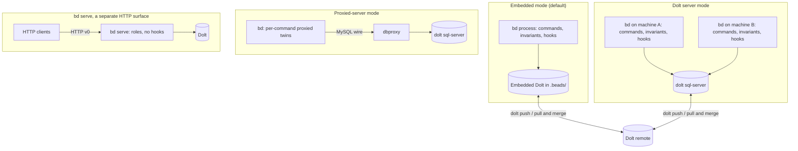
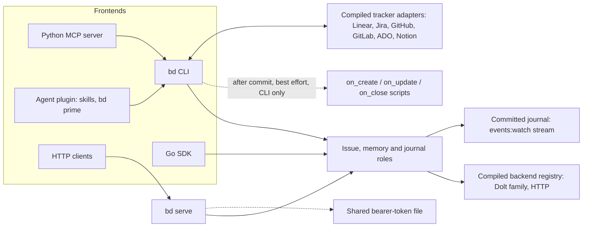
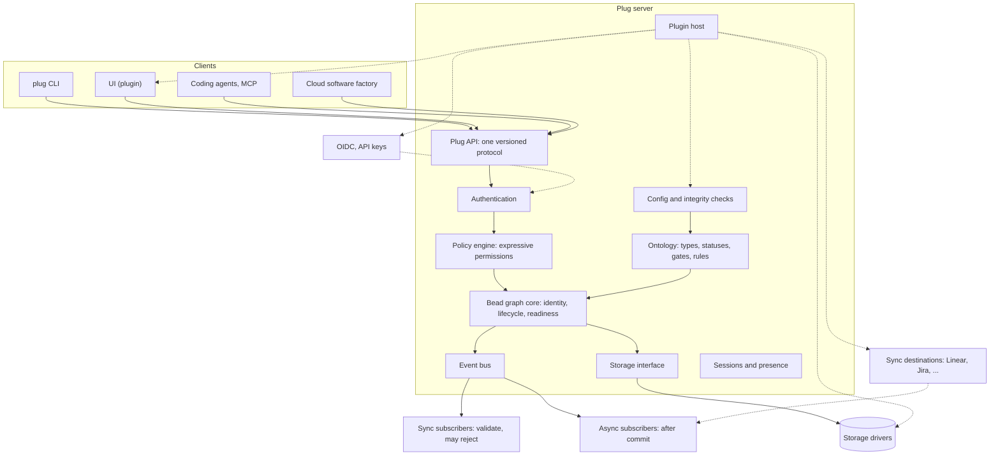
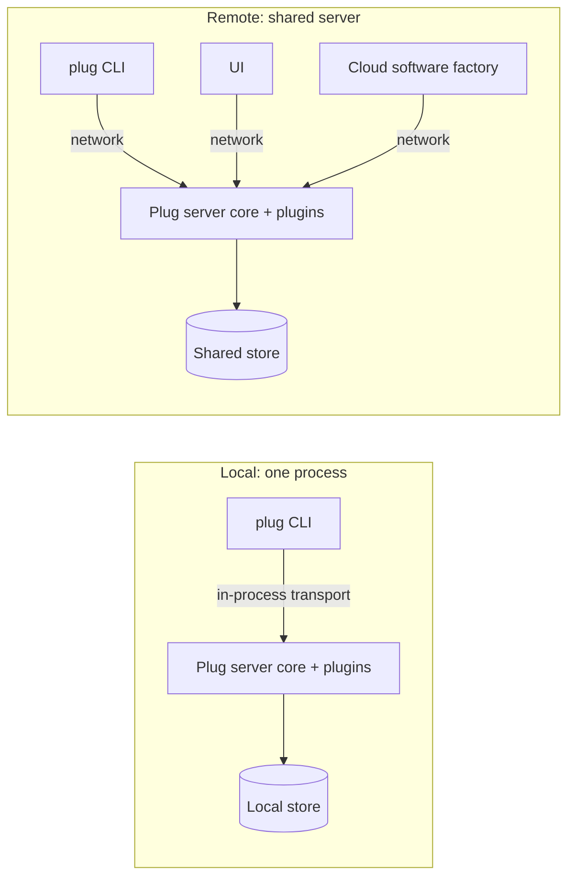
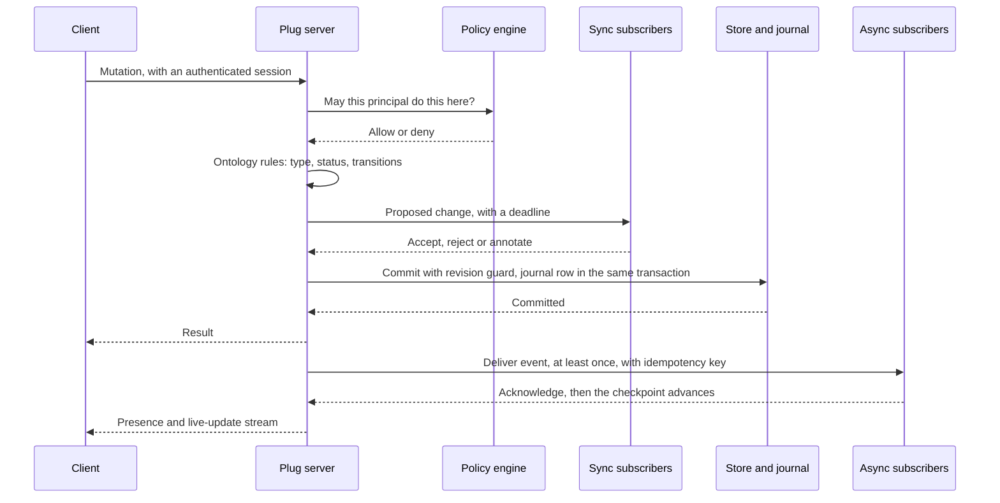
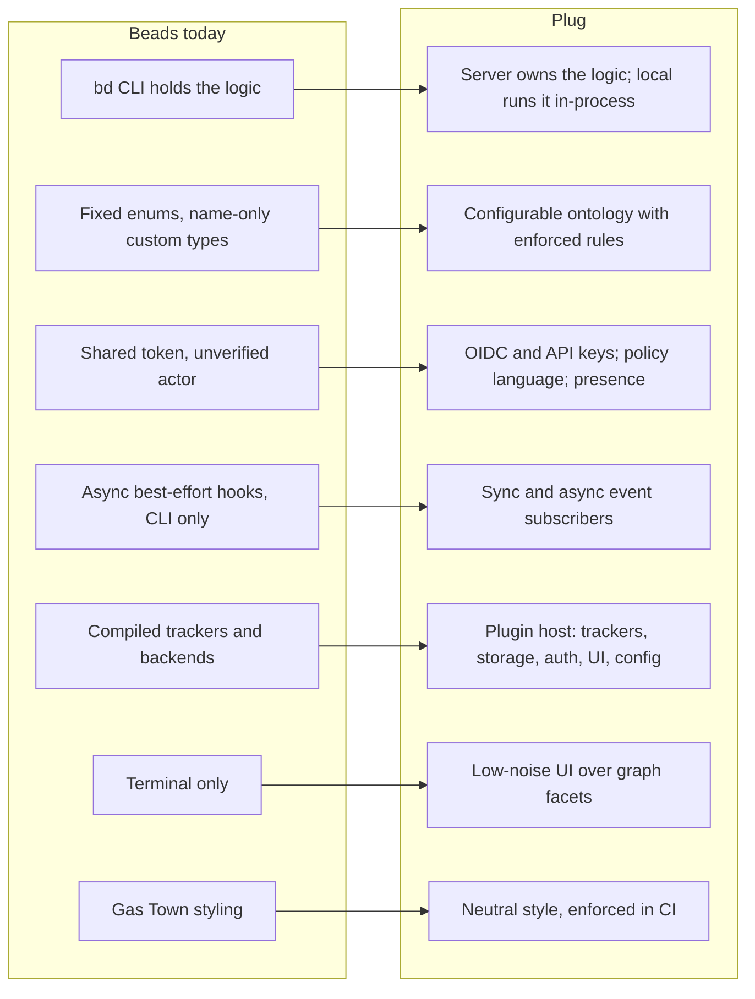

# Plug: current state and desired state

Plug is the planned rename and re-architecture of this Beads fork. This
document turns Nikhil's voice memo ([working transcript intentionally not committed; decision record: review-2026-10-27.md](review-2026-10-27.md), timestamps in
brackets below) into a picture of where the code is today and where the memo
wants it to go.

- **Current state** describes the imported Beads source pinned in
  [FORK.md](https://github.com/buildbetter-app/plugs/blob/9013b29dabab39df633fa0e7a2748a55f147bd8f/FORK.md), checked against the code on 2026-10-26. The
  [architecture guide](https://github.com/buildbetter-app/plugs/blob/9013b29dabab39df633fa0e7a2748a55f147bd8f/engdocs/architecture-guide/README.md) has the detail.
- **Desired state** is the memo's vision. None of it is implemented, and the
  memo leaves several parts open on purpose; see [open questions](#open-questions).

Nikhil answered the open questions on 2026-10-27. The
[refined design](design.md) records those decisions (D1 to D13) and
supersedes this document's desired-state section wherever they differ.

## The problem the memo states

Plug should let a cloud software factory run on top of a shared issue graph
[02:07]. Beads already has the valuable part: persistent memory, and a
dependency graph of the organization's work that agents can read even when it
is bigger than any human can hold in their head [02:37]. What it lacks is
collaboration. Beads is "kind of single player", so it does not get used on
real team projects [02:18]. Humans also need facets: views onto subsets of the
graph that fit limited attention and working memory [02:56].

## Current state

### How Beads runs today

Every mode puts business logic in a different place. In the two Dolt modes
the `bd` process *is* the application, and the database is only storage.
Collaboration means either sharing one Dolt SQL server or pushing and pulling
whole databases through Dolt remotes.

No mode has a clean client/server split. In proxied-server mode the CLI still
runs the commands. It reaches Dolt over the MySQL wire through
[dbproxy](https://github.com/buildbetter-app/plugs/blob/9d6fff760b7a314b476539198504d77ce0959656/internal/storage/dbproxy/proxy/proxy.go), and each command
needs a hand-written `*_proxied_server.go` twin (58 of them). The
[capability registry](https://github.com/buildbetter-app/plugs/blob/9d6fff760b7a314b476539198504d77ce0959656/cmd/bd/capability_registry.go) refuses many
command paths on proxied workspaces, some by design and some as unimplemented
parity. `bd serve` is a real application server, but it is a separate HTTP
surface for other clients, and the CLI does not use it. This is the unclear
server/client boundary the memo calls out [01:48].

### What exists for each thing the memo asks for

| Memo asks for | What exists today | Gap |
|---|---|---|
| Name `plug`, CLI `pg` [00:15, 01:11]; now `plug`, short form `plg` (D9) | Binary is `bd`; Go module stays `github.com/steveyegge/beads` to keep upstream merges easy ([FORK.md](https://github.com/buildbetter-app/plugs/blob/9013b29dabab39df633fa0e7a2748a55f147bd8f/FORK.md)) | Rename the binary; decide whether the module path moves too |
| New issue ontologies, editable "human blockers" [00:48] | 12 built-in types (plus the internal `event` type) and 7 built-in statuses in [types.go](https://github.com/buildbetter-app/plugs/blob/9d6fff760b7a314b476539198504d77ce0959656/internal/types/types.go). Custom statuses carry one of five fixed categories (`active`, `wip`, `done`, `frozen`, `unspecified`) that decide whether they show in ready work and default lists; they are stored in a `custom_statuses` table ([config_helpers.go](https://github.com/buildbetter-app/plugs/blob/9d6fff760b7a314b476539198504d77ce0959656/internal/storage/issueops/config_helpers.go)). Custom types (`types.custom` in [config.go](https://github.com/buildbetter-app/plugs/blob/9d6fff760b7a314b476539198504d77ce0959656/internal/config/config.go)) are names only. Gate wait types are a fixed set (`gh:run`, `gh:pr`, `timer`, `human`, `mail`). Priority is fixed at P0 to P4 | Per-type workflows, transitions and gates with behavior, defined in config |
| Enforcement on a flexible ontology [08:45] | Custom values are free strings; metadata has a schema-validation mode | Declarative rules: allowed transitions, required fields, constraints |
| A plugin system [01:04] | Separate seams with separate trust models (hooks, compiled backends, internal tracker registry, agent plugin, MCP); no plugin manager ([chapter 6](https://github.com/buildbetter-app/plugs/blob/9013b29dabab39df633fa0e7a2748a55f147bd8f/engdocs/architecture-guide/06-extension-surfaces.md)) | One plugin host; [chapter 7](https://github.com/buildbetter-app/plugs/blob/9013b29dabab39df633fa0e7a2748a55f147bd8f/engdocs/architecture-guide/07-plugin-system-design.md) proposes subprocess plugins |
| Plugins run on the server in remote mode [01:33] | Mutation hooks run only in the CLI; `bd serve` refuses to fire them | Plugin host lives in the server |
| A clear server/client boundary; same process when local [01:48, 03:37] | Three modes with logic in different places (diagram above) | One application API every client uses, with an in-process transport for local use |
| UI plugin with low-noise UX, plus a UX spike [03:21, 07:50, 08:36] | Terminal output only ([ui](https://github.com/buildbetter-app/plugs/blob/9d6fff760b7a314b476539198504d77ce0959656/internal/ui/styles.go), [uimd](https://github.com/buildbetter-app/plugs/blob/9d6fff760b7a314b476539198504d77ce0959656/internal/uimd/markdown.go) for markdown) | A UI, local or remote (the memo is undecided) |
| OIDC login and API-key plugins [04:19, 04:44] | `bd serve` accepts shared bearer tokens from a file ([runbook](https://github.com/buildbetter-app/plugs/blob/9d6fff760b7a314b476539198504d77ce0959656/engdocs/SERVE_RUNBOOK.md)). Actor strings are unverified provenance, not identity | Per-user identity through auth-provider plugins |
| Permissions in an expressive policy language [05:05] | None beyond the token gate | Policy engine over principals, actions and graph scopes |
| Native multiplayer with presence [05:24] | Claims, leases and heartbeats on issues. No notion of who is connected | Sessions and presence |
| Rich markdown issues [06:25] | Text fields; the CLI renders markdown in the terminal | Rich editing and rendering in the UI |
| More sync destinations through plugins [06:40] | Six compiled adapters behind an `internal` registry ([registry.go](https://github.com/buildbetter-app/plugs/blob/9d6fff760b7a314b476539198504d77ce0959656/internal/tracker/registry.go)); the memo mentions only Linear | A public tracker-adapter plugin contract |
| JDBC-like storage interface through plugins [06:51] | Public compiled backend registry ([backend.go](https://github.com/buildbetter-app/plugs/blob/9d6fff760b7a314b476539198504d77ce0959656/backend/backend.go)). Upstream built Postgres and MySQL adapters and rolled them back ([proposal](https://github.com/buildbetter-app/plugs/blob/9d6fff760b7a314b476539198504d77ce0959656/PROPOSAL-pluggable-storage-backends.md)) | A storage-driver contract that does not depend on Dolt-only features |
| Config file or config plugin, checked against the store [09:18] | `config.yaml` plus a config table in the database; `bd doctor` runs checks | Validate config, especially the ontology, against stored data on startup and on change |
| Drop the Gas Town / steampunk styling [10:20] | `docs/` and the README mention Gas Town and its terms (convoy, polecat, mayor) throughout | Neutral vocabulary, plus a style rule that CI enforces |
| Event system with sync and async subscribers [11:08] | Async best-effort hooks (10-second timeout, CLI only); committed journal with an HTTP [events:watch](https://github.com/buildbetter-app/plugs/blob/9d6fff760b7a314b476539198504d77ce0959656/internal/httpapi/events_watch.go) stream. No synchronous hook | Sync handlers that can reject a change, and durable async delivery |
| A public BuildBetter repository [10:54] | The repository is private; the upstream MIT license is retained | Publish |

## Desired state

### Components

One Plug server owns the graph's rules. Every client, human or agent, talks to
it through one versioned API. Plugins attach to the server, never to the
client.

The memo names these plugin kinds:

| Plugin kind | Attaches to | Memo |
|---|---|---|
| UI | Plug API, as a client the server can host | [03:21] |
| Authentication: OIDC, API keys | Authentication | [04:19, 04:44] |
| Sync destination | Async events, plus import | [06:40] |
| Storage driver | Storage interface | [06:51] |
| Configuration | Ontology and config | [09:29] |
| Event subscriber, sync or async | Event bus | [11:08] |

### Deployment modes

The same server core runs in both modes, so commands behave the same either
way. Locally there is no network hop and no separate process [03:43].

### A write, end to end

The memo asks for synchronous and asynchronous subscribers. [Chapter
7](https://github.com/buildbetter-app/plugs/blob/9013b29dabab39df633fa0e7a2748a55f147bd8f/engdocs/architecture-guide/07-plugin-system-design.md) warns against running
plugin code inside a SQL transaction, because it holds locks and turns a plugin
outage into a write outage. This sequence keeps both: sync handlers run on the
proposed change *before* the transaction opens, and the commit is guarded by
revision so a concurrent write cannot slip in between.

## From current to desired

The server boundary comes first. Plugins on the server [01:33], auth,
permissions, presence and a remote UI all assume one place that owns the rules.
Today that place is each `bd` process.

## Open questions

These were open when this overview was written. Nikhil answered them on
2026-10-27; the [refined design](design.md) carries each answer through and
lists the decisions it still needs.

| Question | Answer |
|---|---|
| Local or remote UI | Remote only (D1) |
| Policy language | The authorization plugin answers whether a principal can access a resource, and subscribes to resource changes to keep its policy graph current (D2) |
| Which enforcements | Gates, types and statuses are all fully customizable; per-type event subscribers enforce behavior (D3, D4) |
| Sync subscriber semantics | A synchronous subscriber can change the write (D7) |
| Storage plugins and Dolt | Versioning is a first-class capability of every storage plugin (D8) |
| Name collisions | `plug`, with `plg` as the short form (D9) |
| Collaboration model | The shared server is the one source of truth; no push/pull replica sync; the whole state can be dumped (D10) |
| "Heartbead" | Still unidentified |
