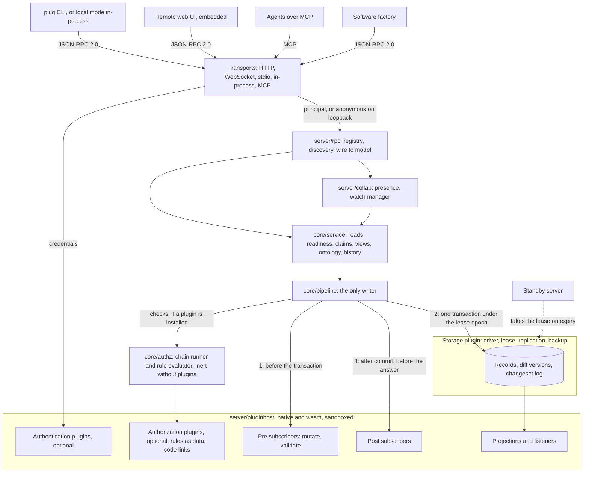
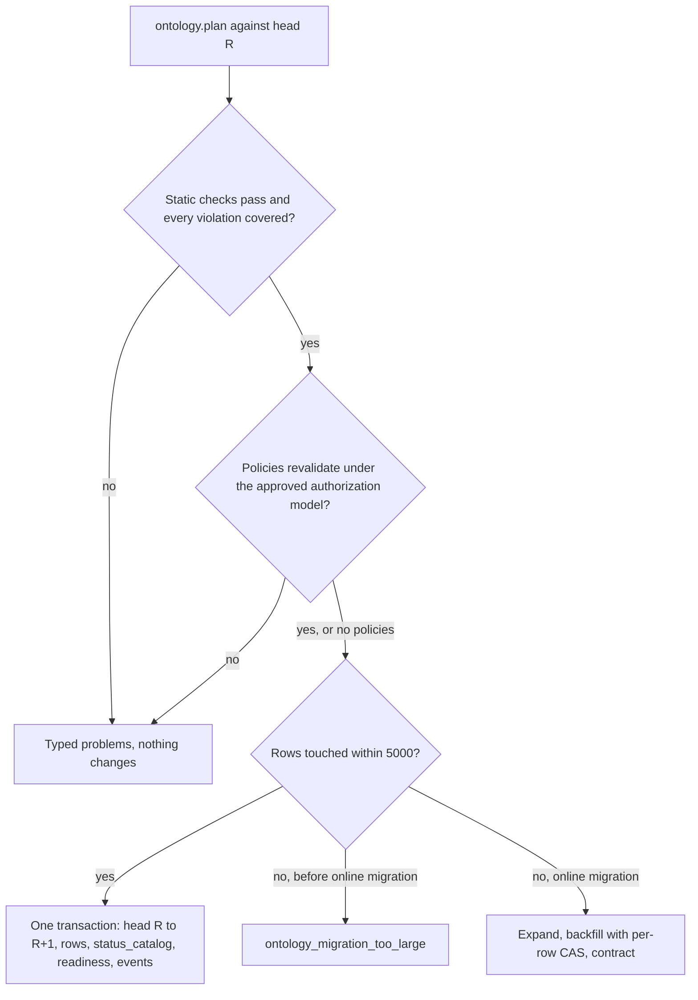
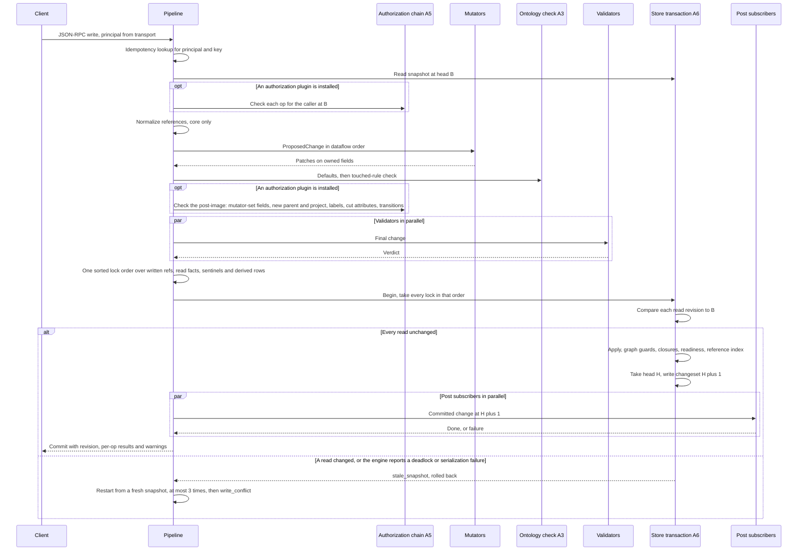
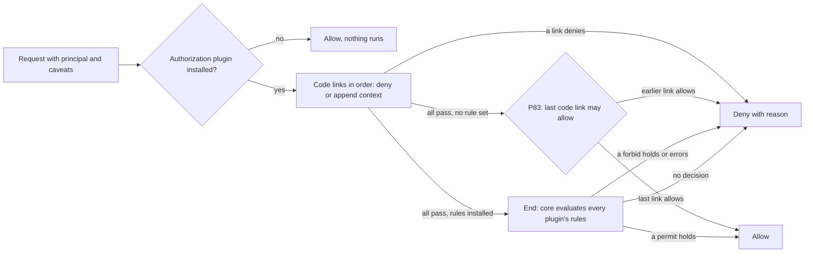
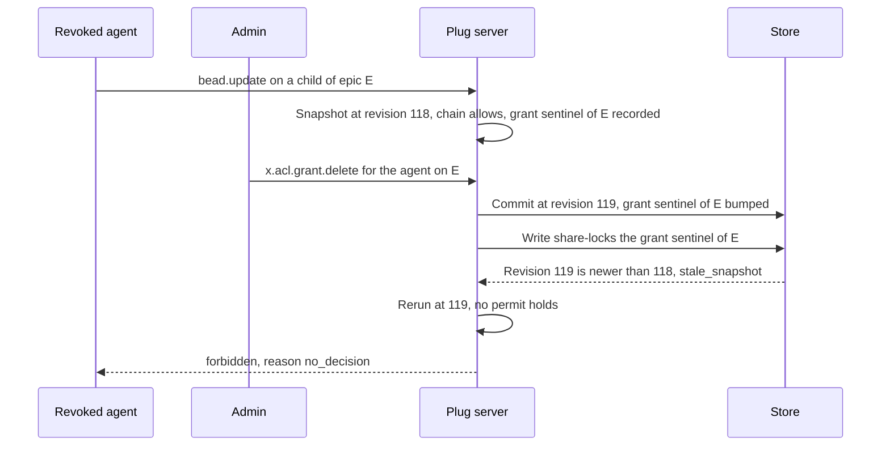
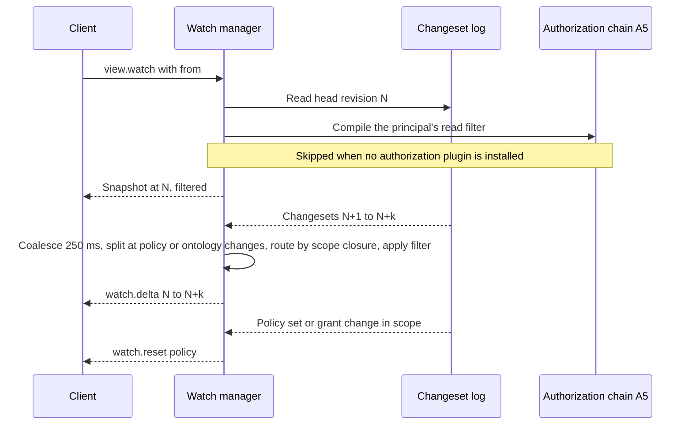

# Plug: refined design

Status: proposal, updated 2026-10-29 with Nikhil's decisions from the [design review](review-2026-10-27.md), the accepted plan decisions, and the [authorization analysis](authorization-options.md). Nothing is implemented. Earlier sources are the memo [working transcript intentionally not committed; decision record: review-2026-10-27.md](review-2026-10-27.md) and the [current and desired state](current-and-desired-state.md) overview; where they disagree with this document, this one supersedes them.

## Summary

- **One server, one contract.** One server core behind JSON-RPC 2.0, declared in a Go registry that generates OpenRPC; every program is a client, and the plugin SDK is the only public Go ([A1](#a1-architecture-layering-and-the-api); P11, P47).
- **A clean-room rewrite.** Beads behavior is the specification, not code to wrap; `bd` stops working at cutover ([clean-room plan](#clean-room-plan); P1, P46).
- **One write path.** Every write is a typed `ChangeSet`. Pre subscribers run before the transaction and may change it, only core code runs inside it, and post subscribers run after commit, before the answer. Bindings fail closed by default ([A4](#a4-event-system); P2, P3, P24).
- **Partial failures are warnings.** A committed write with a failed part returns `result.warnings`, never an `error` beside a `result` (D28).
- **Two plugin modes, one contract.** Plugins are compiled in, or built from Go source at a pinned commit and run as in-process WebAssembly. Only a human applies plugin changes: an interactive session when authenticated, a presence check otherwise ([A2](#a2-plugin-platform); P8, P43, D16, D32).
- **A customizable ontology.** A server base plus per-project overlays that overwrite it by key: status categories, per-type workflows with slots, typed fields and gates, with a short list fixed in v1 ([A3](#a3-ontology-and-enforcement); P10, P41, D25).
- **Identity and authorization are optional plugins.** With no authentication provider the server is anonymous and serves only localhost. Authorization is a chain of optional plugins whose rules core evaluates inside the write over a fixed data contract; with none installed, every request is allowed. The repaired rerun passes correctness, corpus, Q5, closure, and independent differential checks but fails the unchanged latency targets. Under accepted #15, authorization reopens toward simple Linear-style team permissions; affected implementation is blocked pending approval of the revisited design, with no replacement model selected ([A5](#a5-identity-and-authorization); AZ1, AZ2, AZ3, AZ4, AZ5, AZ7, AZ10; plan #15).
- **Versioning in every driver.** Each write is one gapless revision and one changeset, with versions stored as diffs and history kept forever. Data enters a server only by restore into an empty store (restores; one-shot imports are P77) ([A6](#a6-storage-and-versioning); P6, P30, P44, P45).
- **The storage plugin owns topology.** One active server plus a standby, chosen by a storage-plugin lease that fences stale commits ([A6](#a6-storage-and-versioning), [Operations](#operations-observability-and-testing); P49).
- **Low-noise collaboration.** Presence, budgeted views and delta watches. The embedded web UI is served only by a shared server, plugin UI runs in sandboxed iframes beside declarative additions, and trackers are export plus one-shot import ([A7](#a7-collaboration-and-ui); D1, D29 to D31, P17, P32a).
- **A hard fork, public at 0.1.0.** MIT, a CI lexicon from the first commit, and history cleaned with `git filter-repo` ([A8](#a8-project-identity-and-hygiene); P5, P38b, P38c, P40).

## Decisions

### Open

The prior design rows and all 15 plan decisions remain recorded under [Made](#made) and [Decisions](clean-room-plan.md#decisions). The repaired rerun failed the unchanged latency gate, activating #15's authorization revisit toward simple Linear-style team permissions. The remaining human decision is approval of the revisited authorization design; no concrete replacement model is selected, and affected implementation remains blocked. [A5](#a5-identity-and-authorization) records the evidence and separate review and CI gates. [Decisions needed](decisions-needed.md) remains the ledger of the prior answers.

### Made

Every decision so far. D1 to D13 are Nikhil's answers of 2026-10-27, recorded in the [overview](current-and-desired-state.md#open-questions); D17 to D31 are the review's chat decisions, numbered in the order they appear there. Each ID links to its source, where timestamps and wording are kept; P and AZ IDs keep their original numbers. P27 became D16; P33 and P34 were removed with the fork-and-flush aspect (see [How this was produced](#how-this-was-produced)).

| ID | Decision |
|---|---|
| [D1](current-and-desired-state.md#open-questions) | UI is remote only; no UI served by a local CLI |
| [D2](current-and-desired-state.md#open-questions) | Authorization is a plugin interface, kept current through resource-change events; realized by P4, P42 and D18 as plugin-declared rules whose facts core derives in the write's transaction, with listeners left for plugins that mirror external engines (P28d) |
| [D3](current-and-desired-state.md#open-questions) | Gates, types and statuses customizable at Linear's level |
| [D4](current-and-desired-state.md#open-questions) | Behavior enforced per type through event subscribers |
| [D5](current-and-desired-state.md#open-questions) | Plugins have their own configuration |
| [D6](current-and-desired-state.md#open-questions) | Two plugin modes: compiled in, or GitHub repositories with a manifest at the root |
| [D7](current-and-desired-state.md#open-questions) | A synchronous subscriber can change the write |
| [D8](current-and-desired-state.md#open-questions) | Storage plugins treat versioning as first-class |
| [D9](current-and-desired-state.md#open-questions) | Name `plug`, short form `plg`, not `pg` |
| [D10](current-and-desired-state.md#open-questions) | One source of truth, the shared server; no push or pull; the whole state can be dumped |
| [D11](current-and-desired-state.md#open-questions) | The API is JSON-RPC |
| [D12](current-and-desired-state.md#open-questions) | Clean agent interfaces and clean layer boundaries |
| [D13](current-and-desired-state.md#open-questions) | Big choices are surfaced to Nikhil as decisions |
| D14 | Every graph item is a bead; `issue` is one type |
| D15 | The repository stays `buildbetter-app/plugs` |
| [D16](review-2026-10-27.md#decisions) | Agents plan plugin changes; only a `user` principal applies them (was P27), enforced only with an authentication provider (D18) |
| [D17](review-2026-10-27.md#decisions) | Authorization exists only as optional plugins; core has no authorizer, and with none installed every request is allowed |
| [D18](review-2026-10-27.md#decisions) | Core keeps no authorization of principals: D16 stays as platform safety; plugin sandboxing stays in the host; rules are plugin data core evaluates; the authentication plugin issues scoped agent tokens and the chain enforces them |
| [D19](review-2026-10-27.md#decisions) | Policy enforcement is completely optional |
| [D20](review-2026-10-27.md#decisions) | Policy enforcement requires authentication; `plugin.plan` refuses an authorization plugin without a provider |
| [D21](review-2026-10-27.md#decisions) | An anonymous principal mode, the default with no authentication provider |
| [D22](review-2026-10-27.md#decisions) | Anonymous mode serves only localhost, with no override |
| [D23](review-2026-10-27.md#decisions) | Authorization plugins form a chain; how links combine is AZ5 |
| [D24](review-2026-10-27.md#decisions) | Project overlay definitions overwrite base definitions with the same key |
| [D25](review-2026-10-27.md#decisions) | Fixed in v1: bead templates, role-scoped workflow permissions, priorities, dependency types |
| [D26](review-2026-10-27.md#decisions) | An old version is readable only by someone who can read the bead now |
| [D27](review-2026-10-27.md#decisions) | Local mode runs the server, and its plugins, in the CLI process |
| [D28](review-2026-10-27.md#decisions) | Partial failures are `result.warnings` from the error catalog, never an `error` beside a `result` |
| [D29](review-2026-10-27.md#decisions) | Two kinds of custom UI: same-origin `ui` plugins on session cookies, and apps on other origins that sign users in with OIDC PKCE as public clients and send short-lived bearer tokens, only from an operator-configured CORS allowlist (was P32e (b)) |
| [D30](review-2026-10-27.md#decisions) | Plugin UI bundles are prebuilt and committed at the pinned commit, served as-is after a digest check; no JavaScript build on the server in v1 (was P32c (a)) |
| [D31](review-2026-10-27.md#decisions) | Declarative panels, columns and buttons stay beside iframes; iframes are for custom logic and drawing (was P32d (a)) |
| [P1](review-2026-10-27.md#decisions) | (b) Clean-room rewrite, not strangler slices ([plan](#clean-room-plan)) |
| [P2](review-2026-10-27.md#decisions) | (a) One typed `ChangeSet`, a union over all change kinds |
| [P3](review-2026-10-27.md#decisions) | Pre subscribers (before the transaction, may change the write) and post subscribers (after commit, before the answer, cannot) |
| [P4](review-2026-10-27.md#decisions) | (a) Authorization data derived in the write's transaction, when a plugin is installed |
| [P5](review-2026-10-27.md#decisions) | (a) Hard fork |
| [P6](review-2026-10-27.md#decisions) | (a) A Plug change log in every driver |
| [P7](review-2026-10-27.md#decisions) | (a) Record store plus `sqlkit` |
| [P8](review-2026-10-27.md#decisions) | (a) Mode 2 runs in-process on wazero |
| [P9](review-2026-10-27.md#decisions) | (a) Mutators in dataflow order, one owner per scalar field |
| [P10](review-2026-10-27.md#decisions) | (a) Ontology stored on the server, versioned, migration-like |
| [P11](review-2026-10-27.md#decisions) | (a) Go registry generating OpenRPC |
| [P12](review-2026-10-27.md#decisions) | (a) Many projects in one graph |
| [P13](review-2026-10-27.md#decisions) | (a) Manifest sets maximum reads and owns; the ontology narrows them per type |
| [P14](review-2026-10-27.md#decisions) | (a) Authorization plugins compiled in only, for v1 |
| [P15](review-2026-10-27.md#decisions) | Storage and secret providers mode 1 only; `authz` mode 1 in v1; wasm sync subscribers by grant |
| [P16](review-2026-10-27.md#decisions) | The follow-up speed spike was the gate for the core-hosted Cedar path. It has reported and failed the unchanged latency targets, so its contingency is active: authorization reopens toward simple Linear-style team permissions (AZ1, AZ2), without selecting a replacement model |
| [P17](review-2026-10-27.md#decisions) | (b) Trackers: export plus one-shot import |
| [P18](review-2026-10-27.md#decisions) | (a) Reserve `Ref.Branch`, build nothing |
| [P19](review-2026-10-27.md#decisions) | Secrets in dumps as references, ciphertext by flag |
| [P20](review-2026-10-27.md#decisions) | Full-history dumps, head-only by flag |
| [P21](review-2026-10-27.md#decisions) | (a) Violations on ontology apply need directives; atomic below 5,000 rows |
| [P22](review-2026-10-27.md#decisions) | (a) Import accepts Plug's semantics |
| [P23a](review-2026-10-27.md#decisions) | (a) Typed `fields` apart from `metadata` |
| [P23b](review-2026-10-27.md#decisions) | (a) A fixed guard catalog; anything conditional is a validate subscriber |
| [P24](review-2026-10-27.md#decisions) | (a) Fail closed by default; per-binding fail-open and audited `admin.binding.suspend` stay |
| [P25](review-2026-10-27.md#decisions) | (a) Mode-2 sync phases by operator grant |
| [P26a](review-2026-10-27.md#decisions) | (a) Plugin set and lock as versioned store objects |
| [P26b](review-2026-10-27.md#decisions) | (a) Plugin methods only under `x.<alias>.*` |
| [P28a](review-2026-10-27.md#decisions) | (b) Zero or more chained authorization plugins |
| [P28b](review-2026-10-27.md#decisions) | (a) Unreadable blockers shown as a count |
| [P28c](review-2026-10-27.md#decisions) | (a) OIDC through revocable core sessions |
| [P28d](review-2026-10-27.md#decisions) | Not a core decision: external engines are the authorization plugin's business |
| [P29a](review-2026-10-27.md#decisions) | (a) Lagging consumers stall: listeners at 7 days, projections at 30 |
| [P29b](review-2026-10-27.md#decisions) | (a) Script hooks deleted; listeners replace them |
| [P30](review-2026-10-27.md#decisions) | (b) Versions stored as diffs |
| [P31a](review-2026-10-27.md#decisions) | (a) Field-scoped compare-and-set for text |
| [P31b](review-2026-10-27.md#decisions) | (a) Views are a core resource |
| [P32a](review-2026-10-27.md#decisions) | (c) Plugin UI in sandboxed iframes with a narrow message bridge |
| [P32b](review-2026-10-27.md#decisions) | (a) UI embedded in the binary |
| [P35](review-2026-10-27.md#decisions) | (a) HTTP v0 deleted at cutover |
| [P36](review-2026-10-27.md#decisions) | (a) Driver lock plus `plug server --local` |
| [P37](review-2026-10-27.md#decisions) | (a) Docs print `plug`; `plg` is an alias |
| [P38a](review-2026-10-27.md#decisions) | (b) Usage metrics opt-in, exported to an operator's OpenTelemetry collector |
| [P38b](review-2026-10-27.md#decisions) | MIT license |
| [P38c](review-2026-10-27.md#decisions) | (a) This repository's history, after `git filter-repo` removes personal data |
| [P39](review-2026-10-27.md#decisions) | (a) Transcripts never committed; public docs link ADRs; Mintlify site |
| [P40](review-2026-10-27.md#decisions) | Public at 0.1.0, after the gate |
| [P41](review-2026-10-27.md#decisions) | (a) One organization per deployment; server base ontology plus per-project overlays |
| [P42](review-2026-10-27.md#decisions) | (a) Declarative rules that core runs in the transaction |
| [P43](review-2026-10-27.md#decisions) | (b) Mode-2 plugins always built from source at a pinned commit, Go only at first |
| [P44](review-2026-10-27.md#decisions) | (a) Restore only into an empty store |
| [P45](review-2026-10-27.md#decisions) | (a) History and audit kept forever; only `history.redact` removes; ephemeral runs unversioned |
| [P46](review-2026-10-27.md#decisions) | (a) No `bd` compatibility |
| [P47](review-2026-10-27.md#decisions) | (a) `beads.go` and `backend/` deleted, with the rest of today's public Go API; the new `pluginapi` and `sdk/go` are the only public Go |
| [P48](review-2026-10-27.md#decisions) | (b) Formulas and molecules become a plugin |
| [P49](review-2026-10-27.md#decisions) | (a) One active server plus a standby; the storage plugin owns replication, failover, backup and the lease |
| [P50](review-2026-10-27.md#decisions) | (a) Transactional ancestor closure plus a semi-join |
| [AZ2](review-2026-10-27.md#decisions) | The repaired rerun has reported and failed the unchanged latency gate, activating P16's authorization revisit toward simple Linear-style team permissions rather than the relationship-schema fallback; no replacement model is selected |
| [AZ5](review-2026-10-27.md#decisions) | Any link may deny or append context; only the end of the chain allows; no decision denies; if a Cedar ruleset is approved, rules from every plugin are one merged set |
| [AZ6](review-2026-10-27.md#decisions) | An erroring forbid denies; an erroring permit is skipped, alerted and reported by `authz.verify` |
| [AZ8](review-2026-10-27.md#decisions) | Role-scoped workflow permissions stay out of the ontology in v1 |
| [AZ9](review-2026-10-27.md#decisions) | The `permission` guard stays in the fixed catalog and asks the chain with a `transition` action |
| [AZ10](review-2026-10-27.md#decisions) | Adopt the authorization data contract before choosing a policy language |
| [AZ1](review-2026-10-27.md#decisions) | The (v) core-hosted inert Cedar evaluator was conditional on the speed spike. The repaired rerun failed the unchanged latency gate, so the accepted contingency reopens authorization toward simple Linear-style team permissions; no replacement model is selected. This replaces the (iii) fallback |
| [AZ3](review-2026-10-27.md#decisions) | Conditional Cedar branch: (a) `cedar-go`, pinned, with Plug's subset compiler; revisit Rust partial evaluation once it is stable. The failed latency gate leaves implementation blocked pending the revisited AZ1 design |
| [AZ4](review-2026-10-27.md#decisions) | Conditional Cedar branch: (a) read rules that cannot compile to a list filter are refused at plan; subject to the revisited AZ1 design |
| [AZ7](review-2026-10-27.md#decisions) | Conditional Cedar branch: (a) grants are plugin-declared records, seen by policies as principal attributes; subject to the revisited AZ1 design |
| [P51](review-2026-10-27.md#decisions) | If schema plugins are used, they merge into one schema at the end of the chain; the repaired spike's failed latency gate has reopened the authorization approach under AZ1 |
| [P52](review-2026-10-27.md#decisions) | (a) no egress in `authz.*` calls; external engines are mirrored by listeners |
| [P53](review-2026-10-27.md#decisions) | (a) policy-data-only authorization plugins are mode 1 only in v1 (P14) |
| [P54](review-2026-10-27.md#decisions) | (b) an explicit code-link order in the plugin set, defaulting to apply order and shown by `plugin.plan` |
| [P55](review-2026-10-27.md#decisions) | (a) a fixed authorizer view in v1; `authz_visible` ontology fields only after the spike prices their indexes |
| [P56](review-2026-10-27.md#decisions) | (c) a closure rewrite above the limit is refused with `closure_too_large`, or runs as one locked migration-class write by explicit admin call |
| [P57](review-2026-10-27.md#decisions) | (a) no `authz.explain {asOf}`; history uses current permissions (D26) |
| [P58](review-2026-10-27.md#decisions) | (a) the authentication plugin refuses scoped agent tokens (`authz_not_installed`) when no authorization plugin is installed |
| [P59](review-2026-10-27.md#decisions) | (b) no break-glass `authz.rootPrincipals`; recovery goes through P62's bootstrap admin or offline repair |
| [P60](review-2026-10-27.md#decisions) | (b) in anonymous mode an unverified, client-asserted `_meta.agent` label scopes leases and is recorded beside `anonymous` |
| [P61](review-2026-10-27.md#decisions) | (b) `authn-local` (the OS user) survives as an optional provider over in-process, stdio and Unix-socket peer credentials only |
| [P62](review-2026-10-27.md#decisions) | (b) the boot tier may hold one authentication provider and a bootstrap admin, so a network-facing server starts authenticated |
| [P63](review-2026-10-27.md#decisions) | (b) with authentication, `ontology.apply`, `override_guard`, `admin.binding.suspend`, `event.subscription.skip` and `admin.restore.*` need a `user` principal; widens D18 |
| [P64](review-2026-10-27.md#decisions) | (a) `ontology.plan` refuses manual gates needing more than one approval when no authentication provider is configured |
| [P65](review-2026-10-27.md#decisions) | Overlays only archive base elements; moving a bead between projects whose overlays differ needs `map_status` and `map_type` directives. Plain Beads data must be ingestible into Plug |
| [P66](review-2026-10-27.md#decisions) | (a) a failed post subscriber returns the `Commit` with `post_subscriber_failed`, is dead-lettered and counts toward its breaker; post subscribers make no graph writes; egress within 1 s |
| [P67](review-2026-10-27.md#decisions) | Toolchain in the server image; artifacts stored by digest, so the standby never builds; reproducibility checked in CI; old artifacts kept until a plan rebuilds; a per-principal build quota |
| [P68](review-2026-10-27.md#decisions) | (a) local mode takes mode-2 plugins only on Linux at first, then (b) builds in a Linux container, then (c) unsandboxed builds by explicit flag later; not "never (c)" |
| [P69](review-2026-10-27.md#decisions) | (b) end users see every warning; the catalog's `audience` field does not filter warnings |
| [P70](review-2026-10-27.md#decisions) | (b) in v1 the storage plugin delegates replication, failover and backup to a managed HA Postgres; `Store.Lease` and `Store.Health` are its topology methods; narrows P49's wording |
| [P71](review-2026-10-27.md#decisions) | (a) `Store.Lease` with fenced `Commit`; a server that loses its lease stops reads and writes; TTL 10 s, renewal 3 s |
| [P72](review-2026-10-27.md#decisions) | (b) RPO and RTO documented per storage plugin; Postgres meets 5 minutes and 1 hour |
| [P73](review-2026-10-27.md#decisions) | JSON Patch diffs with a full base every 32 versions, confirmed after benchmarking `history.query {asOf}` |
| [P74](review-2026-10-27.md#decisions) | The stored ready order lags by at most 1 minute |
| [P75](review-2026-10-27.md#decisions) | Restore loads the dumped plugin artifacts after checking each against the lock's digest; the rebuild from the pinned commit runs as an asynchronous check that alerts on mismatch |
| [P76](review-2026-10-27.md#decisions) | (b) the export merges several Beads stores, one project per prefix; an offline merge before an empty-store restore is within P44 |
| [P77](review-2026-10-27.md#decisions) | (a) tracker `sync.import` may run into any project, minting new IDs, head state only; P44 governs restores, not writes that mint new IDs |
| [P78](review-2026-10-27.md#decisions) | (a) a remote edit to a synced field is overwritten on the next push and counted as drift |
| [P83](review-2026-10-27.md#decisions) | (a) the last code link may return `Allow`; from an earlier link it is an error (`authz_link_allow_not_last`) |
| [P84](review-2026-10-27.md#decisions) | (b) check-only code links are allowed in lists when the operator accepts a capped post-filter that fails with `authz_postfilter_cap`, never a short page |
| [P85](review-2026-10-27.md#decisions) | (a) memories are a core record kind with `memory.*` methods, returned in `agent.brief` |
| [P5b](review-2026-10-27.md#decisions) | (a) the new tree sits at the root of `main`; Beads is read from `beads-base` or the `beads` branch |
| [P38d](review-2026-10-27.md#decisions) | (a) `git filter-repo` runs early, while the repository is private, before tags exist |
| [P39b](review-2026-10-27.md#decisions) | (a) design docs are committed without transcripts, citing ADRs |
| [P48b](review-2026-10-27.md#decisions) | (a) the workflow plugin is compiled in from this repository, without Beads formula files |
| [P79](review-2026-10-27.md#decisions) | No remote build cache at first; a BuildBetter cache only for cgo or remote execution |
| [P80](review-2026-10-27.md#decisions) | The accepted one-batch drop covers Dolt and merge-conflict plumbing, federation and version-control sync, destructive cleanup, raw SQL and untyped key-value commands, script hooks, orchestration-only helpers, Beads ID rewrites, legacy migration modes, and the named visible commands |
| [P81](review-2026-10-27.md#decisions) | Usage-metrics fields: method, result code, latency bucket, principal kind, client version; no IDs or text; any OpenTelemetry collector |
| [P82](review-2026-10-27.md#decisions) | (a) behavior goldens frozen at `beads-base`, plus recorded fixes from the `beads` branch, each re-record a reviewed PR to `main`, backed by nightly diffs |
| [P5c](review-2026-10-27.md#decisions) | (b) Beads stores are read by `bd export --format plug-dump/1` on the `beads` branch, then restored; shipped standalone, the same exporter lets outside Beads users ingest plain Beads data. No Dolt in the new tree |
| [D32](review-2026-10-27.md#decisions) | "A human" for D16 means an interactive login session, not an API key, when authenticated, and a human-presence check, such as typing the plan's digest, in anonymous mode |
| [D33](review-2026-10-27.md#decisions) | The nine [interpretations](#interpretations-confirmed) are confirmed |
| [P70-P72 / #4](review-2026-10-27.md#decisions) | On every uncertain lease-epoch change, mint a new incarnation before the new holder admits traffic; use managed HA Postgres with documented 5-minute RPO and 1-hour RTO |
| [P80 / #10](review-2026-10-27.md#decisions) | Drop the accepted command families in one batch, including Dolt and merge-conflict plumbing, federation and version-control sync, destructive cleanup, raw SQL and untyped key-value commands, script hooks, orchestration-only helpers, Beads ID rewrites, legacy migration modes, and the named visible commands |
| [A7 / #11](review-2026-10-27.md#decisions) | `bd rename` keeps title and display edits through `bead.update`; ID and prefix rewrites are dropped because bead keys are immutable |
| [P17 / #12](review-2026-10-27.md#decisions) | Generic `sync.*` methods replace every provider-specific tracker command |
| [A7 / #13](review-2026-10-27.md#decisions) | Home is “What changed since I looked”; bounded views say what they hid; deltas stay stable; presence is compact; epic progress is counts; the declarative catalog sits beside custom UI; validate with five people against real view and watch data before the UI milestone |
| [T4 / #14](review-2026-10-27.md#decisions) | Freeze `admin.restore.begin/chunk/finish`, `memory.*`, `admin.compact`, and gate shapes; use contiguous error numbers; carry incarnation on every cursor; add `session.close` with bounded expiry and reconnect; settle rollback, close, the changeset header, error mapping, and the anonymous agent label in the driver contract |

## Target architecture

Arrows show call flow. Imports follow the layer table: each layer imports only the layers below it. Core has no authorizer: the chain runner in `core/authz` is inert until an authorization plugin is applied, and without one every request is allowed. Every package except `pluginapi` and `sdk/go` lives under `internal/`, so the compiler enforces P47; the paths below omit that prefix.



| Layer | Packages | Interface it exposes |
|---|---|---|
| Wire contract | `api/wire` | Envelope, `_meta`, DTOs, error catalog with warning codes, `MethodDesc` |
| Client | `client`, `cli`, `cmd/plug` | `Transport.RoundTrip(ctx, []byte)`; not supported for other programs (P47) |
| Transport | `server/transport/*` | Framing, admission control, loopback-only binding in anonymous mode, credentials to `Principal` |
| RPC | `server/rpc` | Registry, validation, cursors; the only wire-to-model mapper |
| Collaboration | `server/collab` | Presence and watches; core never imports it |
| Plugin host | `server/pluginhost` | Implements core ports by adapting `pluginapi/v1`; sandboxes hosts, secrets, owned fields and method prefixes |
| Service | `core/service` | Reads, readiness, claims, views, ontology and history methods |
| Pipeline | `core/pipeline` | `Writer.Apply(ctx, principal, ChangeSet, meta) (Commit, error)`, with pre, invariant and post phases |
| Domain | `core/model`, `core/ontology`, `core/authz`, `core/port` | Domain types, ontology checks, the chain runner and rule evaluation, derived authorization data, ports |
| Plugin contract, public | `pluginapi`, `sdk/go` | Wire-typed plugin interfaces, identical in both modes; the only public Go |
| Storage | `storage/driver`, `storage/sqlkit`, storage plugins | `Driver`, `Store` (with `Lease`), `Reader`, `WriteTx` (visible only to `core/pipeline`) |

## A1 Architecture, layering and the API

One server core sits behind one JSON-RPC 2.0 contract (D11), declared in a Go registry that generates OpenRPC (P11). HTTP, WebSocket, stdio and in-process transports carry the same bytes. Every write lowers to one `ChangeSet`, a union over every change kind (P2): the pipeline's only input, what an authorization chain checks op by op (A5), what A4's pre subscribers change, and the unit of idempotency.

**Today.**

- `bd` is one Cobra `package main` with 306 command paths ([tree.golden](../../../cmd/bd/testdata/command_tree/tree.golden)).
- Write policy also sits above the roles, in gates ([close.go](../../../cmd/bd/close.go)) and routing ([routed.go](../../../cmd/bd/routed.go)); 58 `*_proxied_server.go` twins reach Dolt through [dbproxy](../../../internal/storage/dbproxy/proxy/proxy.go), not HTTP v0.
- The [issueops](../../../issueops/issueops.go) roles and [BatchApplier](../../../issueops/batchapplier.go) are a real service layer.
- HTTP v0 has 46 operations ([routes.go](../../../internal/httpapi/routes.go)) and a closed error vocabulary ([problem.go](../../../internal/httpapi/problem.go)), but the actor is caller-asserted and there is "no wire struct" ([doc.go](../../../internal/httpapi/doc.go)).

**Layers.** `layers.yaml` encodes the layer table, enforced by a `layercheck` nogo analyzer beside the [depguard analyzer](../../../tools/nogo/analyzers/depguard/depguard.go), a closure test and Bazel `visibility`, so only `core/pipeline` and the drivers see `driver.WriteTx`, unlike the bypassable chain in [storage_chain.go](../../../cmd/bd/storage_chain.go). Core never sees wire types. There is no public Go API (P47): everything but `pluginapi` and `sdk/go` is under `internal/`, and other programs use JSON-RPC and the OpenRPC document.

```go
// core/model
type ChangeSet struct {
    Ops    []Op           // any mix of kinds, one revision
    Expect []Precondition // {Ref, Revision} or {Ref, Field, Hash}; checked by A4's commit guard
}
type Op struct { // a tagged union: Kind names the one member that is set
    Kind     OpKind      // create | patch | reparent | link | unlink | comment | attach | delete | setMeta
    Create   *CreateOp   // {Key, Type (A3), Fields, Parent?}
    Patch    *PatchOp    // {Target, Fields}; null clears (today's Field[T])
    Reparent *ReparentOp // {Target, Parent?, Project?}; no Parent makes it top-level; rewrites closures (A6)
    Link     *LinkOp     // {From, To, Kind}, for link and unlink
    Comment  *CommentOp  // {Target, Body}
    Attach   *AttachOp   // {Target, Kind, URI | ContentRef, MediaType, Summary}
    Delete   *DeleteOp   // {Target}
    SetMeta  *SetMetaOp  // {Target, Key, Value}
} // Ref: an ID, or the Key of an earlier create (today's issueops.Ref)
// No op may target the plugin set, the lock or the ontology: they change only by plan and apply (A2, A3)
type Writer interface { // core/pipeline
    Apply(ctx context.Context, by model.Principal, cs model.ChangeSet, m model.WriteMeta) (model.Commit, error)
}
type Commit struct {
    Revision model.Revision
    Results  []OpResult
    Warnings []Warning // partial failures, coded from the error catalog
}
type OpResult struct {
    Ref      Ref
    Revision model.Revision    // the record's new compare-and-set token
    Record   json.RawMessage   // post-image, masked by read policy; omitted if _meta.return is "minimal"
    SetBy    map[string]string // field -> "request" or "x.<alias>/<subscription>"
}
```

The union is closed: a new change kind is a new member, and the startup lint fails on a method whose `Effect` lowers to none. The plugin set, lock, instance configs and ontology are protected records: `tx.apply`, a `setMeta` op and `history.revert` refuse any change to them with `protected_record`, so they change only through `plugin.plan` and `plugin.apply` or `ontology.plan` and `ontology.apply` (A2 "Who applies"). Named verbs build guarded `ChangeSet`s; `tx.apply` takes one directly. Pre subscribers see a `ProposedChange` and may change it; post subscribers run after commit, before the answer, and cannot (P3, A4). `Changeset` is A6's committed record. A `dryRun` returns `Commit` plus `{wouldCommit, violations}`. A partial failure is a `result.warnings` entry `{code, message, details?}` from the catalog (D28).

**Agent core surface.** These methods carry `AgentCore: true`. The resource is `bead` (D14); `issue` is one bead type, never a method name.

```text
bead.get          {id, asOf?}                           -> {bead, attachments, lease?}
bead.ready        {viewId? | filter?, limit?, cursor?}  -> {items, nextCursor, asOf}
bead.create       {type, fields, parent?}               -> Commit
bead.update       {id, fields, expect?}                 -> Commit
bead.claim        {id, expect?}                         -> Commit + {leaseExpiresAt, leaseTtlMs}
bead.claimNext    {viewId? | filter?}                   -> the same, or a null result when nothing is ready
bead.heartbeat    {id}                                  -> {leaseExpiresAt}, no revision
bead.release      {id, reason?}                         -> Commit
bead.close | fail | cancel | reopen | defer  {id, reason?, expect?}  -> Commit (A3 slot verbs)
bead.comment      {id, body}                            -> Commit
bead.link | unlink  {from, to, kind}                    -> Commit
bead.attach       {id, kind: link|commit|blob|log, uri? | contentRef?, mediaType, summary} -> Commit
blob.upload       chunked, 64 MiB cap                   -> {contentRef}
bead.transitions  {id}                                  -> next statuses with unmet guards
tx.apply          {changeSet}                           -> Commit
auth.whoami       {}                                    -> {principal, sponsor?, caveats?, defaultProject}
agent.brief       {project?, budgetTokens?}             -> {whoami, claims, readyTop, recentChanges, ontologySummary, conventions}
event.list        {filter, after, limit}                -> {events, cursor}
memory.get/list/save/delete                                -> frozen memory methods (P85, plan #14)
```

The catalog expands the shorthand slot and link alternatives into separate method descriptors and carries the frozen default wire shapes for those verbs, `memory.*`, `gate.*`, `admin.compact`, and `admin.restore.begin/chunk/finish` (plan #14), alongside subscription and plugin-extension descriptors; see the [OpenRPC catalog](contracts/openrpc.json). Its flattened `bead.claim` and `bead.claimNext` result shape is the wire choice.

Only slot verbs enter slot statuses (`bead.update {status}` otherwise fails with `ontology_use_slot_verb`). Every `filter` parameter, here and in `event.*` and views, is one object shape: `{query?, resources?, types?, events?}`, where `query` is a string in today's query grammar (A7 "Views") and the other members are lists. `bead.claimNext` answers `{"result": null}` when nothing is ready; that is not an error, and it is never returned while a ready bead remains (A4 "Queue verbs"). Attachments are the evidence store for A3's `evidence_required` guard. `sponsor` and `caveats` come from the authentication plugin (A5).

```json
{"jsonrpc":"2.0","id":1,"method":"bead.claimNext","params":{"filter":{"query":"type=bug"},"_meta":{"project":"web","idempotencyKey":"01JB7W3K9QX4T2M8V6RZ0YDC5H"}}}
{"jsonrpc":"2.0","id":1,"result":{"revision":812,"results":[{"ref":"pl-a3f","revision":812,"setBy":{"status":"request"}}],"leaseExpiresAt":"2026-10-27T10:05:00Z","leaseTtlMs":300000}}
{"jsonrpc":"2.0","id":2,"method":"bead.close","params":{"id":"pl-a3f","expect":[{"ref":"pl-a3f","revision":812}]}}
{"jsonrpc":"2.0","id":2,"error":{"code":-32010,"message":"guard failed","data":{"code":"ontology_guard_failed","retryable":false,"hint":"attach a PR","traceId":"7c1e","details":{"violations":[{"guard":"evidence_required","message":"needs a link"}]}}}}
```

**Conventions.**

- **Names.** `<resource>[.<sub>].<verb>`, singular resources, `x.<alias>.*` for plugins (P26b). Members are camelCase with one spelling per concept (`asOf: {revision}` for history, `expect: [...]` for compare-and-set), checked by a startup registry lint.
- **Permissions and events.** Core has no authorizer: with no authorization plugin every request is allowed, otherwise the chain decides (AZ5, A5). `MethodDesc.Permission` is the action it is asked (`bead.update` and `bead.close` map to `write`, `gate.approve` to `approve`; `override_guard` is one too, and A3's `permission` guard asks `transition`, AZ9). Event types come from op kind plus slot (`bead.created`, `bead.claimed`, `bead.closed`, `bead.leaseReclaimed`). `rpc.describe` publishes both maps, so renaming a method changes neither policy nor filters.
- **Transports.** `POST /rpc/v1`, `/rpc/v1/ws`, `plug rpc --stdio` [03:31] and `/mcp`. A write sent as a notification is dropped, logged and, on WebSocket, answered by `rpc.rejected`. Browser-facing rules (Origin checks on cookie requests and WebSocket upgrades, CORS without credentials, TLS on non-loopback listeners) are in A7's deployment table.
- **Anonymous mode.** The default when no authentication provider is configured: every request is the `anonymous` principal, and the server binds only loopback, with no override; any other address fails startup. Since browsers reach loopback, HTTP also refuses a non-loopback `Host` or `Origin`. An unverified, client-asserted `_meta.agent` label scopes leases and is recorded beside `anonymous` (P60).
- **Discovery and versioning.** Every method declares `MethodDesc {Params, Result, Errors, Effect, Idempotency, Permission, Stability, AgentCore}`; startup fails on a gap. `rpc.methods`, `rpc.describe` and `rpc.discover` list a method when it is resource-free or the chain allows its action somewhere in scope. `server.hello` and `rpc.discover` need no auth, and `server.hello` returns `methodsHash`, `ontologyRevision`, the default project and the auth mode. `methodsHash` is computed over the method set the calling principal sees, so it changes for a principal exactly when that principal's `rpc.methods` answer changes. The major version is in the path; unknown parameters are errors.
- **Errors.** One closed catalog in `rpc.describe` (code, JSON-RPC integer, retryable, strategy, audience, warning-capable), seeded from v0's. The JSON-RPC integer assignments use the contiguous allocation accepted in plan #14; typed details, retry strategy and visibility of host/internal entries are defined in the [error catalog](contracts/errors.md). Host/internal entries remain diagnostics and never client errors. `data` is `{code, retryable, retryAfterMs?, hint, traceId, details?}`, typed per code. Added: `unauthenticated`, `token_expired`, `authn_unavailable` (an authentication plugin failed or missed its deadline; retryable, never a fall back to anonymous), `forbidden`, the `authz_*` codes (only where an authorization plugin is involved), `closure_too_large` (a closure rewrite above the limit, with or without an authorization plugin; P56), `protected_record`, `subscriber_unavailable` (a fail-closed pre binding failed; retryable), `precondition_failed` (every compare-and-set miss; `details.reason` is revision, hash or revert), `write_conflict`, `ontology_*`, `field_owned`, `busy`, `rate_limited`, `cursor_invalid`, `cursor_expired`, `idempotency_key_reused`, `lease_not_held`, `lease_expired`, `project_required` and `incarnation_changed`. Warning-only codes include `subscriber_skipped`, `post_subscriber_failed` and `ontology_drifted`. Unreadable resources are `not_found`. `stale_snapshot` is internal, and `plugin_*` codes never reach clients.
- **Meta.** `params._meta {project, idempotencyKey, deadlineMs, traceparent, dryRun, return}`. Identity comes only from transport auth, or is `anonymous`; the host stamps the causal chain. Many projects share one graph (P12), so IDs are global; `project` scopes list, claim and view methods. Without `_meta.project` they use the principal's default project (`auth.whoami`, `server.hello`), and the default satisfies the requirement; they fail with `project_required` only when there is neither.
- **Reads.** `{items, nextCursor, asOf}`, with opaque cursors bound to method, filter, principal, ontology revision and incarnation. Every cursor carries an incarnation, and the event-stream tuple is `{incarnation, revision, index}` with the binding rules in the [event contract](contracts/events.md#event-envelope) (plan #14). A list cursor continues over live data, not a snapshot at `asOf`: rows changed or reordered between pages (by writes, or by A6's sort-key job, P74) may be skipped or repeated, as with today's moving cutoff. A consistent read uses `history.query {asOf}`.
- **Idempotency and batching.** Keys per principal and method replay for 24 hours, re-authorized and marked `_meta.replayed`; other params under a used key fail with `idempotency_key_reused`. Every write needs a key, because a lost answer or an `ErrIndeterminate` commit (A6) can be resolved only by replay: `client`, `plug` and `/mcp` generate a random one when the caller gives none, and a raw JSON-RPC write without one is refused. In anonymous mode every client is the same principal, so the scope also includes the `_meta.agent` label if P60 (b) is adopted, and either way a key must be random with at least 128 bits (a ULID or UUIDv4; a short key like `w7-1` is refused). Anonymous mode gives no isolation between local clients: the label is unverified, and any local process may reuse another's. Batches hold 100 calls, reads and writes mixed, answered in order. `tx.apply` is atomic up to 1,000 ops.
- **Subscriptions.** `event.subscribe {filter: {resources?, types?, events?, viewId?}, from?}` (default head) returns `{subscriptionId, cursor}`, and the server pushes `event.notify {subscriptionId, events, cursor}` until `event.unsubscribe`. `event.list {filter, after, limit}` is the pull twin. Below the retention floor a cursor fails with `cursor_expired {floor}`. A restore sends `event.gap`; after a failover (P49), clients resume from their cursors.
- **Admission.** Token buckets per principal and sponsor, plus per-project write budgets, run before the pipeline and return `rate_limited`. Interactive and bulk traffic queue separately, and failed logins are throttled per IP and key prefix.

**Local mode, agents, dump.** `inproc.New(server)` runs the server core in the CLI process, plugins included, with no listener or UI (D1), as `anonymous` unless an authentication provider is configured. `authn-local` remains an optional provider over in-process, stdio and Unix-socket peer credentials only (P61). A second process gets `busy` from the driver lock after a bounded wait; `plug server --local` serves several local agents on loopback (P36). A one-shot in-process call stays cheap: at startup it parses only the ontology document and the plugin set, leaving A3's full integrity checks to `plug server`, `plug server --local` and `ontology.check`, and wazero compilations are cached on disk by artifact digest. Asynchronous work (the A4 dispatcher, listeners, projections, lease reclaim, gate polling and A6's sort-key job) runs under `plug server --local`; without one, each in-process command ends with a bounded drain (proposed: 2 s) of whatever is due, so in pure in-process use listeners, projections and reclaim lag until the next command, and that lag is documented. The client tries `--server`, then `PLUG_SERVER` with `PLUG_TOKEN`, then `.plug/config.yaml`, then local mode. An unreachable server is an error, never a fallback. Local data reaches a shared server only by dump, then restore into an empty store (P44), through the paged `admin.dump` and the frozen `admin.restore.*` method shapes in the [OpenRPC catalog](contracts/openrpc.json) (plan #14). A restored project keeps minting IDs where its source left off: the dump carries each project's prefix, ID mode (hash or counter) and adaptive hash-length config, and restore seeds the top-level, child and ephemeral-run child counters from both the stored counters and the highest IDs observed, as today's code seeds counters from existing IDs (`seedCounterFromExistingIssuesTx` in [issues.go](../../../internal/storage/dolt/issues.go); [child_id.go](../../../internal/storage/issueops/child_id.go) reads existing children); a conformance case checks that new hash IDs never collide with restored ones.

Agents also get `plug describe`, `plug call` and `--json`. `/mcp` maps about 15 tools onto the agent core (`bead_ready`, `bead_claim_next`, `bead_close`, `bead_attach`, `event_list`, ...) plus `plug_call` and `plug_describe` for everything else, and emits `tools/list_changed` when `methodsHash` changes. `agent.brief {project?, budgetTokens?}` returns `{whoami, claims, readyTop, recentChanges, ontologySummary, conventions}` and takes the place of `bd prime`. Nothing translates `bd` commands (P46).

**What today's code is for (P1).** Nothing is moved or wrapped. The Beads tree keeps building `bd` until cutover and has no successor after it. P5b puts the new tree at the root of `main` while Beads is read from `beads-base` or the `beads` branch; deletion timing remains in the plan's [CP3 and CP5](clean-room-plan.md#decisions).

- **Behavior reference.** The issueops roles, BatchApplier and `internal/workapi` specify claims, leases, readiness, close gates, batch apply and read filters; `problem.go` seeds the error catalog; `tree.golden` is the CLI inventory, each path kept, folded or dropped on a reviewed list (P80); the molecule code informs the formulas plugin (P48).
- **Tests mined.** Tests of the roles, `internal/httpapi`, `internal/hooks` and `integrations/beads-mcp` become conformance cases where the behavior survives (P82). The Beads converter is the only code that reads a Beads store; P5c places the exporter on the `beads` branch and uses the resulting `plug-dump/1` archive for restore.
- **No successor.** `cmd/bd`, its proxied twins, [uow_factory.go](../../../cmd/bd/uow_factory.go) and `dbproxy`; HTTP v0 (P35); `internal/httpclient`; `internal/hooks` (P29b); `integrations/beads-mcp`; the whole public Go API, `beads.go`, `backend/` and the top-level role packages `issueops/`, `journalops/`, `memoryops/`, `format/` and `beadserrors/` (P47).

Server-owned workflows and plugins depart from the [charter](../../PROJECT_CHARTER.md); authorization exists only as optional plugins (A5).

## A2 Plugin platform

A plugin is a set of JSON-RPC messages with JSON Schemas plus one `Host` surface for all its I/O. Two runtimes carry the same messages in v1: **native** (mode 1, compiled in) and **wasm** (mode 2, in-process wazero, P8). Authorization checks and sync subscribers never cross a process boundary. Mode-1 plugins are trusted build-time code: they are limited statically, by the `plugins-host-io-only` depguard rule and code review, and at the host boundary, which enforces owned fields and method prefixes on everything they send through `Host`. Only wasm plugins are isolated at run time, confined to their declared egress hosts, secrets, owned fields and method prefixes. `plugin.plan` marks every native plugin "trusted, not isolated". These limits bind plugins, not people, with or without an authorization plugin. An instance acts as `plugin:<id>/<instance>`.

**Today.** Separate seams and no plugin manager ([chapter 6](../../architecture-guide/06-extension-surfaces.md)): a storage registry ([backend.go](../../../backend/backend.go)), six trackers typed on `internal/types` ([registry.go](../../../internal/tracker/registry.go)), hook scripts ([hooks.go](../../../internal/hooks/hooks.go)), gates shelling out to `gh` ([gate.go](../../../cmd/bd/gate.go)) and a credential ladder ([creds.go](../../../internal/creds/creds.go)). The Bazel `js/wasm` lane runs only the hooks test ([bazel.yml](../../../.github/workflows/bazel.yml)), so a `wasip1` lane is new work. This design keeps [chapter 7](../../architecture-guide/07-plugin-system-design.md)'s manifest, digest lock and broker, and adopts WASM because chapter 7's own criterion demands enforced permissions.

| Kind | Owner | native | wasm |
|---|---|---|---|
| `authn` (OIDC, API keys, scoped agent tokens) | A5 | yes | yes |
| `authz` (chain link: policies as data, deny or append context, AZ5) | A5 | yes | no in v1 (P14) |
| sync subscriber: `pre` (`mutate`, `validate`) and `post` (P3) | A4 | yes | by operator grant (P25) |
| async `subscriber`, `gate`, `sync_destination`, `methods`, `alert_sink` | A4, A3, A7, A1 | yes | yes |
| `ontology`, `ui` (declarative data; static iframe bundles, P32a) | A3, A7 | data | data |
| `storage` (also replication, backup and the active-server lease, P49), `secret_provider` | A6, A2 | boot tier | no |


```go
// package pluginapi (v1): the same interfaces behind both runtimes
type Configurable interface {
    ValidateConfig(ctx context.Context, c ConfigDoc) ([]ConfigProblem, error)
    ApplyConfig(ctx context.Context, c ConfigDoc) error
    CheckIntegrity(ctx context.Context, p IntegrityParams) ([]IntegrityProblem, error) // [09:18]
}
type Host interface { // the plugin's entire world
    Call(ctx context.Context, method string, params, result any) error // A1 API as plugin:<id>/<instance>
    State() StateStore                                                 // per-instance KV with CAS
    HTTP() *http.Client                                                // transport is the host's egress proxy
    Secret(ctx context.Context, name string) (SecretValue, error)       // audited
}
```

The field-level `Host`, state, secret and integrity sketches are [provisional in the plugin contract](contracts/go-sketches.md#pluginapi-public); the wire method registry remains the [provisional OpenRPC catalog](contracts/openrpc.json).

**Hot path.** The host drives every call, ticks included. In hot calls (`authn.authenticate`, `authz.*`, `pre` subscribers), `Host.Call` reads a view pinned to the write's base revision, writes fail with `plugin_host_write_in_sync_call`, and egress fails with `plugin_egress_in_hot_path`. Verdicts are pure and replayable. A `post` subscriber runs after commit, before the client's answer, and cannot change the write; its failure or missed deadline is a `result.warnings` entry, never an `error` beside the result. A post subscriber may use egress and its own state within its grants, capped at 1 s (P66). Mirroring to or consulting an external engine is an `authz` plugin's own business (P28d), but `authz.*` calls themselves have no egress (P52).

**Runtimes.** The wasm ABI is two exports (`plug_alloc`, `plug_handle`) and one import (`plug.call`), each crossing one JSON-RPC message. Its written specification, an exit of the plan's runtime spike, fixes pointer and length ownership, message framing, the mapping of traps and guest errors to catalog codes, deadline cancellation and size caps, and `sdk/go`'s cases run on both native and wasm. Guests have no filesystem, sockets or environment, run from memory-capped pools, and are discarded on a trap. An exhausted pool queues a call until its deadline, then fails it with `plugin_busy`, which counts toward the breaker. The egress proxy resolves DNS itself, refuses private and link-local targets, re-checks redirects, and injects secrets as headers the plugin never sees. A secret is injected only on a request whose resolved target is one of that secret's declared `hosts`, and stripped from any redirect that leaves them; response bodies and egress bytes per call are capped (proposed: 10 MiB each). Conformance covers redirects off a declared host and a declared host whose CNAME points elsewhere.

```yaml
# plug-plugin.yaml at the repository root; may list several plugins
manifest_version: 1
plugins:
  - id: app.buildbetter.linear
    alias: linear
    version: 1.4.2                    # equals the tag
    plugin_api: "1.2"
    runtime: {wasm: {build: {go: ./cmd/linear}, instances: 4, memory_mb: 64}}
    provides:                         # maximum scope; A3 bindings narrow it per type (P13)
      - {kind: subscriber, name: link-required, phases: [mutate], reads: [status, fields.*], owns: ["meta:linear/*"]}
      - {kind: methods, prefix: x.linear, methods: {relink: {permission: write, resource: params.id}}}
      - {kind: ui, bundle: ui/dist, bridge: {methods: [bead.get, bead.comment, x.linear.relink], scope: {project: web}}}
    requires:
      egress: ["api.linear.app:443"]
      secrets: [{name: api_key, use: inject, hosts: [api.linear.app], header: Authorization}]
    config: {schema: linear/config.schema.json, version: 3}
```

**Manifest validation.** A reference is `github.com/<owner>/<repo>@<tag-or-commit>#<id>`; mode-1 packages embed the same file. Validation refuses unknown fields, paths outside the repository, shell-string entrypoints, duplicate aliases, kind-runtime pairs P15 forbids, non-Go mode-2 builds, a method prefix other than `x.<alias>` (P26b), and methods lacking the permission and resource parameter that the authorization chain, if any, checks. The method registration, discovery and merge details are [provisional in the OpenRPC catalog](contracts/openrpc.json). Config fields marked `x-plug-ref` join A3's integrity checks.

**Mode-2 builds (P43).** Mode-2 plugins are always built from source at a pinned commit, in Go only at first. `plugin.plan` builds under `plug __plugin-build` (seccomp, Landlock, `no_new_privs`, resource limits): a fetch reaching only the repository and the Go module proxy, each module checked against `go.sum` and the checksum database, then a `GOOS=wasip1` build with a pinned toolchain and no network. The output digest goes in the lock; the artifact is stored as a blob in the store by digest, so restarts and the standby (P49) do not rebuild. P67 keeps the toolchain in the server image, stores artifacts by digest, checks reproducibility in CI, retains old artifacts until a plan rebuilds them and applies a per-principal build quota. P68 starts local mode with Linux-only mode-2 plugins, then builds in a Linux container, with a later explicit unsandboxed-build flag.

**Metadata keys** are `<alias>/<path>`, reserved by the plugin; other plugins need a grant approved at `plugin.apply`, and a request writing a mutator-owned field fails with `field_owned`.

**Set and lock (P26a).** The plugin set, the lock and each instance's config are versioned store objects, changed only by `plugin.plan` then `plugin.apply {planDigest, expect}`, so an approval applies exactly the permission diff that was read. Lock entries pin commit and tag, manifest and output digests, toolchain, a fetch-token reference for private repositories, an optional offline mirror, and grants with their approver. A moved tag fails with `ref_moved`. A file boot tier holds the storage plugin, secret providers and the key-encryption key source.

**Who applies (D16).** With an authentication provider configured, agents may call `plugin.plan`, and only a `user` principal in an interactive login session, not an API key, may call `plugin.apply` (D32). Without one, the server is anonymous and localhost-only, and `plugin.apply` requires a human-presence check, such as typing the plan's digest at the terminal or in the UI (D32). In every mode, D16-class methods (`plugin.plan`, `plugin.apply`, `ontology.apply`) are never callable through the iframe bridge (A7) or with an other-origin bearer token (D29), even though both act as a user; they fail with `forbidden`. The records they change (the plugin set, the lock, instance configs and the ontology) are refused by `tx.apply`, `setMeta` ops and `history.revert` (A1 `Op` union, A6 "Change log"), so they change only through plan and apply. A network-facing server gets its first authentication provider and a bootstrap admin from the boot tier (P62). `plugin.plan` refuses an `authz` plugin unless the resulting set has an authentication provider (`authz_requires_authn`).

**Lifecycle.** A config change is validated, dry-run, written with compare-and-set, then applied; on failure the old config stays and the instance is degraded. Removing a plugin is refused while its data, grants included, is in use. Removing the last authentication provider is refused while an `authz` plugin is installed (`authz_requires_authn`), and removing the last one yielding a `user` principal is refused (`lockout_refused`). A plan that changes the authorization chain is simulated: `plugin.plan` evaluates the resulting chain for the applier on `plugin.plan`, `plugin.apply` and `x.<alias>.grant.*`, and refuses with `lockout_refused` unless all three are allowed. A plan may carry one bootstrap grant, bound to the applier and the plan digest: it is written as the plan applies and is used up then, so no other plan can replay it, and a newly applied authorization plugin starts with the grant the simulation counted on. Ceilings and breakers are in [A4's deadline table](#a4-event-system); sync bindings fail closed by default, with per-binding fail-open and audited `admin.binding.suspend` (P24). Authn never falls back to anonymous, and a gate keeps its last state marked `stale`. `plugin_api` is semver: a 1.x host loads plugins built for 1.0 through 1.x.

**Codebase.** Under the clean-room rewrite (P1), `server/pluginhost` is new. The six trackers become export plus one-shot import plugins (P17), `gh` and `timer` gate plugins, formulas and molecules a plugin (P48); listeners replace hook scripts (P29b). `backend/` goes with the rest of the public Go API (P47); `pluginapi` and `sdk/go` are new and are the only public Go. Add a `plugins-host-io-only` depguard rule like `workapi-frontend-boundary`, and replace `plugins/beads/`, the agent plugin that teaches `bd`, with one for `plug` (P46).

**Risks.** Go `wasip1` guests are single-threaded and need several MB each (TinyGo is the fallback); with 4 instances and a 250 ms budget, one slow mutator caps its type near 16 writes/s on the active server. Plan-time builds are slow and need a Go toolchain on the server, and in local mode on the user's machine (P68). Authorization and identity as plugins depart from the [charter](../../PROJECT_CHARTER.md); having no webhook kind keeps the [integration charter](../../INTEGRATION_CHARTER.md).

## A3 Ontology and enforcement

Every item in the graph is a **bead**; `issue` is one type in the default ontology, beside `task`, `bug`, `epic` and the other types carried from Beads. The ontology is a versioned document on the server, changed only by a migration-like plan and apply (P10). It is a server base plus per-project overlays, whose definitions replace base definitions with the same key whole (P41, D24). Overlays archive base elements only; moving a bead between projects whose overlays differ requires `map_status` and `map_type` directives, and plain Beads data remains ingestible (P65). It holds statuses in six categories, with an outcome on terminal ones, per-type workflows with slots and guarded transitions, typed fields, gate kinds and bindings. Categories stay global: the kernel reads only categories, outcomes and slots (D3).

**Today.**

- [types.go](../../../internal/types/types.go) defines 7 built-in statuses, 12 built-in types and fixed priorities and dependency types. Custom statuses (up to 50, each in category `active`, `wip`, `done` or `frozen`) live in the `custom_statuses` table, and custom types in the `custom_types` table, falling back to the `types.custom` config row and always unioned with config.yaml's `types.custom` ([config_helpers.go](../../../internal/storage/issueops/config_helpers.go)). When `custom_statuses` is empty, a malformed `status.custom` row silently drops custom statuses.
- The `is_blocked` recompute ([blocked_consistency.go](../../../internal/storage/issueops/blocked_consistency.go)) tests literal `'closed'` and `'pinned'`, while the [0045](../../../internal/storage/schema/migrations/0045_update_blocked_view_drop_depends_on_id.up.sql) view treats custom `done` and `frozen` blockers as satisfied, so the two disagree.
- `Claim`, `Close` and `Reopen` target literal statuses ([issueops.go](../../../issueops/issueops.go)); `types.StatusClosed` is in 116 non-test files.
- `conditional-blocks` is treated as `blocks`. Close guards already run in the transaction ([close_guard.go](../../../internal/storage/issueops/close_guard.go)).

| Category | Ready-eligible | Terminal | Kernel effect |
|---|---|---|---|
| `triage`, `backlog` | no | no | `backlog` is the `defer` target |
| `unstarted` | yes | no | `claim` allowed from here |
| `started` | no | no | `started_at` set on entry |
| `completed`, `canceled` | no | yes | `closed_at`, satisfies `blocks`, close guards |

A `completed` status has outcome `success` or `failure`; only `failure` satisfies `conditional-blocks`, and any other end emits `dependency.conditionUnmet`. Keys are immutable, names are free text, and elements are archived, never reused. The importer accepts Plug's semantics, listing affected beads (P22); its `beads-compat` preset maps `active` to `unstarted`, `wip` to `started`, `done` to `completed`, and `frozen` and `unspecified` to `backlog`, so frozen blockers stop counting as satisfied. `status_catalog(project, key, category, outcome)` replaces `custom_statuses`, which only the importer reads; a cross-project blocker is judged by its own project's categories.

```yaml
statuses:
  todo:        {name: Todo,        category: unstarted}
  in_progress: {name: In progress, category: started}
  done:        {name: Done,        category: completed}
  failed:      {name: Failed,      category: completed, outcome: failure}
gate_kinds:
  human_approval: {resolver: builtin.manual, params: {min_approvals: 2}, timeout: 72h, on_timeout: escalate}
workflows:
  engineering:
    statuses: [todo, in_progress, done, failed]
    slots: {claim: in_progress, close: done, fail: failed, reopen: todo}
    transitions: [{to: done, guards: [{gates_resolved: [human_approval]}, {evidence_required: {kinds: [link]}}, permission]}]
types:
  bug:
    workflow: engineering
    fields: {severity: {type: enum, values: [low, high]}}
    subscribers:
      - {id: triage, plugin: acme.triage/default, phase: mutate, reads: [status, labels], owns: [fields.severity], failure: fail_closed}
```

**Slots** replace literals: `claim` (started; required only for ready-eligible types), `close` (completed, success), `reopen` (unstarted), and optionally `fail`, `cancel` and `defer`. **Fields** are typed and apart from plugin `metadata` (P23a). **Guards** are a fixed catalog (P23b): `fields_required`, `evidence_required`, `no_open_children`, `no_open_blockers`, `not_template`, `gates_resolved`, `permission`; anything conditional is a validating `pre` subscriber. `permission` asks the A5 chain with action `transition`, the target status in context, and allows when no authorization plugin is installed (AZ9).

**Bindings** narrow a manifest's maximum `reads` and `owns` per type (P13), checked for ownership at load. A `pre` binding runs before the transaction and may change fields it owns; a `post` binding runs after commit, before the answer, and owns nothing (P3). Bindings fail closed unless set to `fail_open` (P24).

```go
func Compile(base Document, overlays map[ProjectKey]Document, plugins PluginCatalog) (Snapshot, []Problem) // package core/ontology
func Check(o Effective, pre, post *BeadState, touched FieldSet) []Violation // pure, no I/O, per project
type GraphGuard interface { Eval(ctx context.Context, g GraphReader, id BeadKey) []Violation } // built-in, in the transaction
```

**Enforcement.** SQL reads categories from the `status_catalog` projection, as [ready.go](../../../internal/storage/sqlbuild/ready.go) reads `custom_statuses` today, and a Bazel guard forbids status literals outside `core/ontology`. In [A4's write path](#a4-event-system) checks run:

0. core `normalize` (reference syntax only, A7);
1. `pre` subscribers that own fields;
2. `core.ontology`: defaults, `Check` on the final proposal and `permission` guards; it cannot be unbound;
3. validating `pre` subscribers;
4. graph guards inside the transaction;
5. `post` subscribers; failures become `result.warnings`.

The ontology revision is in every write's read set. Writes run only the rules they touch; untouched violations return in `result.warnings` as `ontology_drifted`. `override_guard` and `apply_ontology` are chain actions, allowed without an authorization plugin; with an authentication provider, P63 requires a `user` principal for them. A type whose fail-closed binding lost its plugin becomes `degraded`.

**Gates** stay graph nodes: a gate-class bead with a `gate_kind` and a `blocks` edge. Resolvers `poll` with backoff, take a `push` through `gate.report`, or are `manual`, where `gate.approve` counts approvals under compare-and-set. Anonymous mode has one principal, and `ontology.plan` refuses a manual gate needing more than one approval when no authentication provider is configured (P64). For `human_approval`, an approval counts once per distinct sponsor-resolved human: a `user` principal counts as itself, an agent or service counts as the user at the end of its sponsor chain (or not at all if there is none), and two tokens of one human count once. Agents and services count in their own right only where the gate kind says so (`count: principals`). A resolution moves the gate to its `close` or `fail` slot; an escalating timeout emits `gate.escalated`. GitHub kinds become a plugin.

**API.** `ontology.get`, `ontology.describe`, `ontology.schema {project, type, status?}` (a JSON Schema), `bead.transitions {id}`, `ontology.plan`, `ontology.apply {planDigest, expect}`, `ontology.history`, `ontology.diff` and `ontology.check`. Apply commits exactly the plan read, or fails with `ontology_plan_stale`.

**Integrity checks** run at plan time, at startup, after a restore and on demand. An unparseable document stops startup, naming the element; data drift does not, and the server reports `ontology: drifted`. The on-demand check asserts the predicate stated by `BlockedStateInvariant` ([blockedstate.go](../../../issueops/blockedstate.go)), a documented statement rather than code, as the conformance case [blocked_state.go](../../../backend/conformance/blocked_state.go) does today.

**Authorization policy validation (AZ1, AZ3).** The repaired rerun failed the unchanged latency gate, so this implementation is blocked pending the revisited authorization design ([A5](#a5-identity-and-authorization)). In the conditional Cedar branch, its schema is generated from the ontology, so a change can invalidate policies ([analysis](authorization-options.md)); `ontology.plan` and `ontology.apply` regenerate it for every project and revalidate every policy, refusing with `authz_policy_invalid`. These details remain design material for the revisit and do not adopt Cedar or prescribe a replacement engine.



**Migrations.** Each revision is a recorded step from R to R+1 with its directives and applier (P10); undo is a new revision. Directives are `map_status`, `map_type`, `set_field`, `convert_field`, `drop_field` and `grandfather`; every violation needs one, and below 5,000 rows apply is atomic (P21). In v1 a migration touching more than 5,000 rows is refused with `ontology_migration_too_large`; online migration (expand, backfill, contract) is deferred. Migration writes skip subscribers and run one at a time, so `ontology.plan` makes up for it: it refuses a `set_field`, `convert_field` or `drop_field` directive on a field a plugin owns (`field_owned`), and it dry-runs the bound validating `pre` subscribers over every affected row, reporting their rejections as violations that need a directive.

**Fixed in v1**, not redefinable by base or overlay: bead templates (the flag `not_template` reads; instantiation is the formulas plugin's, P48), role-scoped workflow permissions (the ontology names no roles; who may transition is plugin policy, AZ8), priorities P0 to P4, and the dependency types carried from Beads.

## A4 Event system

There is one event record: the changeset A6 writes in the mutation's transaction. Pre subscribers run before the transaction and may change the write, only core code runs inside it, post subscribers run after commit, before the client's answer, and cannot change the write (P3), and projections and listeners run asynchronously. Authorization steps run only when an authorization plugin is installed (A5). This section owns the write path A1, A3, A5 and A6 refer to.

**Today.**

- Hooks run scripts after commit, with no veto ([hooks.go](../../../internal/hooks/hooks.go), [HookFiringStore](../../../internal/storage/hook_decorator.go) plus 33 decorators).
- The journal writes one row per mutation, in its transaction, numbered from the counter `bd_events_seq`, which "makes concurrent allocators conflict" ([journal.go](../../../internal/storage/issueops/journal.go)).
- [TestEveryMutationFunctionJournals](../../../internal/storage/issueops/journal_completeness_test.go) exempts compaction and restore, and the journal is off by default ([activation.go](../../../internal/eventsjournal/activation.go)).
- Claims walk the ready set in the transaction, skipping claimed rows ([claim.go](../../../internal/storage/issueops/claim.go)).

| Phase | Stage | Runs | By | Can | On failure |
|---|---|---|---|---|---|
| `normalize` | Pre | Before mutators | Core only (A7) | Canonicalize reference syntax | Rejects |
| `mutate` | Pre | Before the transaction | Plugins | Patch owned fields | Binding's `failure` setting (P24) |
| `validate` | Pre | After mutation, in parallel | Plugins | Accept or reject | Same |
| `invariant` | Inside | After apply | Core only: A3 guards, cycle checks, derived authorization data (P4, P42), reference index, readiness | Refuse | Always rejects |
| `post` | Post | After commit, before the answer | Plugins | Observe, act outside the graph | Success with `result.warnings`; dead letter, alert |
| `projection` | Async | After commit, total order | Plugins, core | Maintain derived state | Halts, never skips |
| `listener` | Async | After commit, per resource | Plugins | Write within its grants (see Deputies) | Dead-letters |

Mode-2 plugins bind to pre and post phases only by operator grant (P25).



**Commit guard.** Plugins and the authorization chain read through a `SnapshotReader` that records point reads, authorization-contract reads (AZ10, misses included) and guarded queries. Each guarded query maps to a predicate sentinel, such as `graph/blocking` or a type's ready set, which every write changing that predicate bumps. Before Apply, the pipeline computes one global sorted order over everything the transaction will lock: the refs it writes (update locks), the recorded refs, facts and sentinels (share locks), the sentinels its ops bump, and the derived rows Apply will put (closure and `ready_state` rows). In the transaction it takes every lock in that order, compares each read revision to B, and takes the head row last: O(read set), no log scan. Nothing locks outside that order, so writes cannot deadlock on Plug's own locks. A newer revision fails the attempt with the internal `stale_snapshot`, which restarts from a fresh snapshot up to 3 times, then returns `write_conflict`; Postgres `40P01` (deadlock) and `40001` (serialization failure), and SQLite's busy result, map to `stale_snapshot` too. Each plugin call is capped at 32 point reads and 4 queries. The guard holds under any isolation level, including Postgres READ COMMITTED.

**Sentinel catalog.** Every recorded read maps to a sentinel, and every write bumps the sentinels whose predicate it may change. A census test fails when a `Slice` method, guarded query, op kind or `PutDerived` table has no row here, and A6's conformance suite races each row.

| Sentinel | Read (recorded) by | Bumped by |
|---|---|---|
| `bead/<id>`, the record's own revision | Point reads, `Slice.Beads` | Every op that targets the bead: `patch`, slot verbs, `comment`, `attach`, `setMeta`, `reparent`, `delete` |
| `graph/blocking` | Blocker and cycle queries, `no_open_blockers` | `link` and `unlink` of a blocking kind, `delete` of a bead with blocking edges |
| `ready/<project>/<type>` | A type's ready-set query (`claimNext` does not guard it) | A status-category change, a blocking-edge change, `ready_state` rows from `PutDerived` |
| `closure/<id>`, one per bead | `Slice.Closure(id, cut)`, ancestor and cut alike | Every closure rewrite touching `<id>`: `create` with a parent, `reparent` of the bead or of any ancestor, a `restricted` toggle on it or an ancestor, `delete`; any `PutDerived` on the ancestor-closure, cut-closure or derived-attribute tables for `<id>` |
| `grant/<scope>` | `Slice.Grants`, misses included | `x.<alias>.grant.*` writes in that scope |
| `ontology`, the ontology revision | Every write | `ontology.apply` |
| `plugins`, the plugin-set revision | Every write | `plugin.apply` |

Sort keys and the reference index are written by `PutDerived` but bump no sentinel: no guarded read depends on them (order may lag, P74).

**Queue verbs.** `bead.claimNext` does not guard its ready query, so agents on one queue do not invalidate each other. It walks the ready set lazily in ready order at B, one candidate at a time, with no fixed bound: it prepares one candidate's claim, mutators and authorization check included, then in the transaction locks it (`FOR UPDATE SKIP LOCKED` on Postgres, `BEGIN IMMEDIATE` on SQLite), re-checks its blockers and commits. If the candidate is locked or no longer ready, it prepares the next; when a fetched batch runs out, it refetches the ready set from a fresh snapshot. This keeps today's walk of the whole ready set ([claim.go](../../../internal/storage/issueops/claim.go), `Limit = 0`), and it returns the null result only when the ready set is empty at commit. Acceptance needs a 200-agent single-queue benchmark (under 1% `write_conflict`) with a wasm mutator bound and an authorization plugin installed, and a lagging-snapshot benchmark.

```go
// pluginapi kinds (A2)
type ProposedChange struct { RequestID string; Principal PrincipalRef; BaseRevision int64; DryRun bool; Changes []Change } // whole batch
type CommittedChange struct { RequestID string; Principal PrincipalRef; Revision int64; Changes []Change }
type Change struct {
    Resource ResourceRef; Op Op
    Before, After json.RawMessage // masked to the binding's reads
    SetBy map[string]string       // field -> "request" or subscription id
}
type Mutator interface        { Mutate(ctx context.Context, c ProposedChange, r SnapshotReader) ([]Patch, error) }
type Validator interface      { Validate(ctx context.Context, c ProposedChange, r SnapshotReader) (Verdict, error) }
type PostSubscriber interface { After(ctx context.Context, c CommittedChange, r SnapshotReader) error } // reads at Revision
```

**Composition (D7, P9).** A mutator sees only the fields its A3 binding lets it `read` and `own` (P13); writing outside `owns` fails with `plugin_patch_out_of_scope`. If M1 owns a field M2 reads, M1 runs first; a cycle or a second scalar owner is a load-time error, checked per project after overlay bindings overwrite base ones (P41). So one pass is final, and set fields compose additively in dataflow order. An authorization chain charges each field to whoever set it. A rejection is a `Verdict`; a returned `error` is a subscriber failure.

**Pre failures (P24).** Pre bindings fail closed by default: an error, missed deadline or open breaker rejects the write with the retryable `subscriber_unavailable`. A `failure: fail_open` binding is skipped instead, recorded and reported as `subscriber_skipped` in `result.warnings`. An audited `admin.binding.suspend` (who may call it: P63) switches a broken fail-closed binding to reject-with-reason or bypass during an incident.

**Post failures (P3).** Post bindings read at the commit revision outside the lane, adding latency, not locks. Follow-up graph writes belong to listeners. On an error, missed deadline or open breaker, the client still gets its `Commit` with `post_subscriber_failed` in `result.warnings`, and the change is dead-lettered for that binding and alerted (P66 confirms these rules). A checkpoint per post binding redelivers calls lost to a crash, marked `late`: delivery is at least once, keyed by `{incarnation, revision, index, binding}`, and a post subscriber's side effects must be idempotent on that key. An idempotency-key replay (A1), which returns the stored `Commit`, runs no post subscriber.

**Deadlines and breakers.** This is the one table; A2 and A5 cite it.

| Point | Default | Host ceiling | On miss |
|---|---|---|---|
| Authentication plugin, per call | 50 ms | 100 ms | Retryable `authn_unavailable`; never anonymous. Core caches verified credentials (API-key digests, core sessions) until expiry or revocation, so the plugin runs only at login and token exchange |
| Authorization chain, per check | 50 ms | 100 ms | Retryable deny, `authz_unavailable` |
| Each `mutate` | 250 ms | 1 s | Reject, or skip with a warning if `fail_open` (P24) |
| Each `validate` | 500 ms | 1 s | Same |
| All pre phases of one write | 2 s | 2 s | Retryable `busy` |
| Each `post` | 500 ms | 1 s | Success with `result.warnings`; dead letter and alert |
| All `post` of one write | 1 s | 1 s | Same, for each binding still running |
| Gates, deliveries | 30 s | 30 s | Gate keeps `stale`; delivery retries |
| Breaker, per binding | Opens at 5 faults in 60 s, probes half-open after 30 s, closes after 3 successes | | While open, calls fail as on a miss |

A graph write inside a pre or post call fails with `plugin_reentrant_write`. `event.explain` traces a past write.

**Envelope.** An event is one change, typed by op and slot (A1), addressed by an opaque cursor over `{incarnation, revision, index}`, carrying `resource`, `changed`, `before`, `after`, principal and chain, `setBy`, `cause {root, depth, chain}` and `derived`. `before` and `after` are materialized from stored diffs (P30). Plugins emit no free-form events. The envelope, control markers, acknowledgement and delivery classes are defined in the [event contract](contracts/events.md#event-envelope), with an incarnation on every cursor (plan #14). Restore (P44) starts a new incarnation with `store.restored`.

**Delivery.**

- **Checkpoints.** One dispatcher on the active server feeds projections whole changesets in total order (a failure halts them, never skips) and listeners partitioned by resource ID (exhausted retries dead-letter). Checkpoints are written under the storage plugin's lease epoch (P49), so a deposed server cannot advance them. Listener delivery, like post delivery, is at least once, keyed by `{incarnation, revision, index, binding}`. An audited `event.subscription.skip` unblocks a poison event for a listener or a post binding (P63); it never applies to a projection, which halts and is rebuilt from the log once fixed. Checkpoints govern delivery only and never prune history or audit (P45). Listeners stall at 7 days of lag, projections at 30, and alert until an operator acts (P29a).
- **Limits and visibility.** Causal depth is capped at 8, writes per root event at 200. With an authorization plugin installed, A5 filters streams at delivery, and a resource that becomes unreadable yields a `visibility_lost` tombstone.
- **Deputies.** `system:core` invariant and derived work (A3 guards, derived rows, readiness, lease reclaim, migrations) never enters the chain. Every plugin, listener and gate write is checked as a deputy: one caused by someone else's write needs the chain to allow both the plugin and the root causal principal (with its token caveats), unless the manifest declares `elevated` and a human approved it at `plugin.apply` (D16, enforced only with an authentication provider). Since no decision means deny, `plugin.plan` lists every installed plugin principal and background operation (listener writes, gate resolutions, scheduled jobs) that no permit in the resulting chain covers. Without a chain, only A2's host limits apply.

Listeners replace script hooks (P29b); those that write back are cross-tracker automation, a deliberate [charter](../../PROJECT_CHARTER.md) departure.

**Codebase.** The clean-room rewrite (P1) extends nothing here. A6's log keeps the journal's lessons (one record per write, always on, a census test without exemptions); [close_guard.go](../../../internal/storage/issueops/close_guard.go) and the cycle checks become invariants; hooks, their decorators and [autoprune.go](../../../internal/eventsjournal/autoprune.go) have no successor.

## A5 Identity and authorization

Every request carries one server-stamped principal from an authentication plugin; with none configured, the server is anonymous and localhost-only. Authorization exists only as optional plugins: core has no authorizer, and with none installed every request is allowed. A plugin supplies its rules as data, and core evaluates them inside the write over a fixed data contract (P4 (a), P42 (a), AZ10).

**Repaired rerun (2026-10-29).** The measured source is `69f28caaf71a673296abe3120c60be5cb3af5aec`. The evidence-only publication at [PR #10](https://github.com/buildbetter-app/plugs/pull/10), head `93a3cd0cca2579d307fd9a33bd70e2113bf1f6d8`, contains the [readout](https://github.com/buildbetter-app/plugs/blob/93a3cd0cca2579d307fd9a33bd70e2113bf1f6d8/spikes/authz/evidence-v6/readout.md) and [provenance manifest](https://github.com/buildbetter-app/plugs/blob/93a3cd0cca2579d307fd9a33bd70e2113bf1f6d8/spikes/authz/evidence-v6/provenance-manifest.json), with retained structured results and source hashes. Publication did not change the measured implementation or latency targets.

| Gate | Recorded outcome |
|---|---|
| Correctness, corpus, Q5, closure, independent differential | Pass for the measured source: 100,000 / 1,000 / 100 visible rows; corpus maximum depth 10; 20 committed lock/recheck/update Q5 samples per case; full transaction timing for closure rewrites of 50,001 target rows; separately loaded relationship projections |
| Measured latency | **Fail** at unchanged page p95 `<50 ms` for 100%, 1%, and 0.1% visibility on SQLite and Postgres, and grouped-count p95 `<250 ms` at 100,000 beads. SQLite Plan A dense pages reach 129.418 ms, Plan B sparse pages reach 139.656 ms and counts reach 347.435 ms; Postgres dense pages reach 307.805 ms |
| Reviewable artifact publication | Complete at the publication head above; this resolves R10b's missing-publication finding |
| Executable manifest validation | Still open: the runner checks warmups and iterations, but must also validate engines, fractions, plans, queries, dataset, targets, and artifact declarations against the executable matrix |
| Independent review and hosted CI | Separate pending gates for the publication head. R10b blocked the measured source; that review and its failed/queued/skipped hosted jobs do not certify the later head |

The failed measured gate activates accepted #15's AZ1/AZ2 revisit toward simple Linear-style team permissions. Nikhil must approve the revisited authorization design before affected implementation resumes. No replacement model is selected. The Cedar-specific AZ3/AZ4/AZ7 choices and related sketches below remain conditional design material; publication, review, or CI success alone cannot adopt them or clear the failed latency gate.

**Today.** Server auth compares shared token digests, "no token MINTING here and no identity" ([auth.go](../../../internal/httpapi/auth.go)); `--insecure-no-auth` waives the token beyond loopback ([serve.go](../../../cmd/bd/serve.go)). The actor is "caller-ASSERTED" ([close.go](../../../internal/httpapi/close.go)). The `Authorize*` functions ([aggregate.go](../../../internal/storage/issueops/aggregate.go)) are data invariants, not permissions. Identity in core departs from the [charter](../../PROJECT_CHARTER.md).

| Kind | ID | Notes |
|---|---|---|
| `anonymous` | `anonymous` | No authentication provider, localhost only |
| `user` | `user:<ulid>` | Linked identities from authentication plugins |
| `agent` | `agent:<ulid>` | Sponsor and token caveats travel in request context |
| `service` | `service:<ulid>` | Factory, CI, trackers. May sponsor agents |
| `plugin` | `plugin:<id>/<instance>` | Minted per call by the host, capped by manifest and grants (A2); its listener and gate writes are checked as deputies |
| `system` | `system:core` | Invariant and derived work, lease reclaim, migrations; never enters the chain (A4 "Deputies") |

**Authentication.** `authn-apikey` issues `plg_k_<id>_<secret>` keys; its `static_file` mode keeps today's token file. `authn-oidc` uses PKCE for the UI and a device grant for `plug login`, exchanging IdP tokens for revocable core sessions (P28c). Credentials are bearer tokens on HTTP, WebSocket and `/mcp` (or MCP OAuth), and `PLUG_TOKEN` on stdio. The API has no `actor` field. Scoped agent tokens leave core: the authentication plugin issues them (`x.apikey.token.exchange`, P26b) and the chain enforces their caveats; with no chain installed, P58.

Without an authentication provider the server is anonymous, serving only loopback and stdio (D21, D22). Enforcement requires authentication: `plugin.plan` refuses an authorization plugin, or removing the last authentication provider under one, with `authz_requires_authn` (D20). D16 then holds whatever policy grants; plugin sandboxing stays in the host (D18).

**The chain (P28a).** Authorization plugins are compiled in for v1 (P14 (a)). Code links run in apply order (or an explicit order, P54) and may deny or append context. Every plugin's rules are evaluated together at the end, the only place that may allow; if a Cedar ruleset is approved, one merged policy set applies and any forbid wins. No decision means deny (AZ5), so `plugin.plan` simulates a chain change for the applier and refuses one that would lock them out (`lockout_refused`, A2 "Lifecycle"). A chain with code links but no rule set may let its last code link return `Allow`; an earlier link returning `Allow` is rejected with `authz_link_allow_not_last` (P83). An erroring forbid denies; an erroring permit is skipped, alerted and reported by `authz.verify` (AZ6). A code link that errors or misses its 50 ms budget denies, retryably (`authz_unavailable`, [A4](#a4-event-system)). External engines are the plugin's business (P28d), within A2's hot-path rule; `authz.*` calls have no egress (P52).



```go
type Link interface { // core/authz; compiled-in code
    Check(ctx context.Context, s Slice, reqs []CheckRequest) ([]Step, error) // Deny | Append | Pass; Allow from the last link only under P83 (a)
    Filter(ctx context.Context, req ListRequest) (FilterExpr, error)          // ErrCheckOnly if it cannot compile
}
type RuleSet interface { // all plugins' rules; concrete policy model pending the revisited AZ1 design
    Eval(ctx context.Context, s Slice, reqs []CheckRequest) ([]Decision, error) // error: the whole evaluation failed; deny with authz_unavailable
    Compile(req ListRequest) (FilterTemplate, error) // principal bound per request
}
type Decision struct { // one per CheckRequest
    Effect  Effect        // Allow | Deny | NoDecision
    Reasons []PolicyID    // the policies that determined Effect
    Errors  []PolicyError // {PolicyID, Effect}: policies that errored; AZ6 applies over these
}
type Slice interface { // contract reads only; each joins the commit guard's read set
    Beads(ctx context.Context, ids []BeadKey) ([]View, error)
    Closure(ctx context.Context, id BeadKey, cut bool) ([]BeadKey, error)
    Grants(ctx context.Context, subjects []SubjectRef, scopes []BeadKey) ([]Grant, error)
}
```

**The data contract (AZ10).** Rules may trigger only these reads, each indexed and kept current in the write's transaction.

| Fact | Owner | Shape |
|---|---|---|
| Bead view | Core | id, type, ancestors, labels, assignee, owner, status category, sort keys; ontology fields only under P55 (b) |
| Ancestor closure | Core (P50 (a)) | `(descendant, ancestor, depth)`, self row, indexed both ways |
| Cut closure, derived attributes | Plugin declares, core maintains (P42 (a)) | Closure cut at `restricted` beads |
| Grants, groups | Plugin record kinds (AZ7) | `(subject, scope, role)`, methods `x.<alias>.grant.*` |
| Principal, sponsor, caveats | Authentication plugin | Request context |

The ancestor closure is always maintained, since views and watches need it too; cut closures and derived attributes exist only while a plugin declares them (A6 "Authorization data"). A rewrite the chain reads, of a cut closure or of the ancestor closure while an authorization plugin is installed, is never deferred, because a deferred rewrite would let a revoked principal read through stale rows. Above a proposed 5,000 rows any closure rewrite is refused with `closure_too_large` or runs migration-class, per P56, with or without an authorization plugin. `ontology.apply` revalidates every rule against the base and each overlay (P41), refusing with `authz_policy_invalid`.

**Writes.** In [A4's write path](#a4-event-system) the pre-image is checked first, so a forbidden write never reaches plugin code; checks use the write's snapshot, so nothing self-grants; each field is charged to whoever set it, a mutator's to its plugin. After mutators run, the post-image is checked with `write` too: the target parent of a `create` or `reparent`, the target project, the labels, and the `restricted` and cut attributes the write would produce. So a principal cannot move a bead under an epic it cannot write, or write a bead out of a restricted subtree by removing the label, as the [analysis's Q2](authorization-options.md) requires. A3's `permission` guard asks the chain with a `transition` action (AZ9); role-scoped workflow permissions stay out of the ontology in v1 (AZ8).



**Reads.** Lists push the compiled `FilterExpr` into storage as a closure semi-join (P50 (a)), filling pages after filtering, p95 under 50 ms at 100,000 beads, depth 10. A code link that cannot emit a filter is check-only; P84 allows it in lists when the operator accepts a capped post-filter, which fails with `authz_postfilter_cap` rather than returning a short page. AZ4 otherwise refuses a non-compilable read rule at plan. Unreadable blockers show as `hiddenBlockers: n` (P28b). An old version is readable only by someone who can read the bead now.

**Failure and audit.** A failed derivation fails the write. On closure drift found by `authz.verify`, the chain denies until repair. P59 keeps break-glass `authz.rootPrincipals` out of the boot config; recovery uses P62's bootstrap admin or offline repair. A6's log audits mutations; authentication events and denials go to an append-only `audit` table, throttled under floods.

**Authorization shape and current gate.** The accepted data contract, chain safety rules, closure and filter requirements, and P51 contingency remain recorded. The failed measured gate reopens AZ1/AZ2 toward simple Linear-style team permissions; AZ3/AZ4/AZ7 remain conditional, and affected implementation waits for Nikhil's approval of the revisited design. Chain egress, policy-data runtime, link order, authorizer view, closure limits, history permissions, scoped-token behavior, recovery, anonymous labels, local authentication, bootstrap administration, principal requirements, gate planning, post-subscriber behavior, build handling and warning visibility are P52 through P75, P83 and P84. The [contract catalog](contracts/openrpc.json) retains the corresponding host and wire descriptors for reconciliation with the approved design.

**Codebase.** Under P1's clean-room rewrite, carry ideas, not code: `auth.go`'s constant-time compare and hitless reload into `authn-apikey`, and `ValidateAuthPosture` as "a network listener needs an authenticator", minus `--insecure-no-auth`. `Authorize*` become A3 guards. Caller-asserted actors and federation credentials ([credentials.go](../../../internal/storage/dolt/credentials.go)) are not carried.

## A6 Storage and versioning

All state is typed JSON records behind a small transactional driver contract, implemented by a storage plugin (D8, P7) that also owns topology (P49). Every driver writes a Plug change log atomically with the data (P6): one gapless revision and one changeset per write, one diff-stored version per changed record (P30). It is the history, kept forever (P45), the A4 outbox and the audit trail. The [charter](../../PROJECT_CHARTER.md) leaves versioning to the engine; this departs from it.

**Today.** [`storage.Storage`](../../../internal/storage/storage.go) has 110 methods, and the [conformance suite](../../../backend/conformance/conformance.go) calls none of the version-control families. History is unreliable: Dolt commits can absorb others' rows ([doltserver_tx.go](../../../internal/storage/uow/doltserver_tx.go)), [`issue_versions`](../../../internal/storage/issueops/version_history.go) is single-writer, and the [journal](../../../internal/storage/issueops/journal.go) is opt-in. Ideas worth keeping: the [as-of refusal vocabulary](../../../internal/storage/issueops/asof_read.go), `Address` and `ChangeAttribution` ([expected_revision_contract.go](../../../backend/conformance/expected_revision_contract.go)).

```go
package driver

type Driver interface { Info() Info; Open(ctx context.Context, cfg Config) (Store, error) }
type Store interface {
    Meta(ctx context.Context) (Meta, error) // StoreID, Incarnation, SchemaVersion, State, Head, HistoryFloor
    Migrate(ctx context.Context, to SchemaVersion) (MigrationReport, error)
    Lease(ctx context.Context, holder string, ttl time.Duration) (ActiveLease, error) // P49; blocks until held or ctx ends
    Health(ctx context.Context) (StoreHealth, error) // settled fields; see [driver contract](contracts/go-sketches.md#storage-driver)
    Read(ctx context.Context, v View) (Reader, error) // View{Branch, At}; never waits on writers; shape is settled in the driver contract
    Write(ctx context.Context, l ActiveLease) (WriteTx, error)
}
type ActiveLease interface {
    Epoch() uint64
    Renew(ctx context.Context) error // checks the epoch; ErrFenced once another holder has a higher one
    Lost() <-chan struct{}           // closed when renewal fails past the TTL (P71) or ErrFenced is seen
    Release(ctx context.Context) error
}
type Reader interface {
    Get(ctx context.Context, refs []Ref) ([]Record, error)
    Query(ctx context.Context, q Query) (Page[Record], error) // semi-joins derived tables
    Versions(ctx context.Context, ref Ref, p PageReq) (Page[Version], error)
    Changesets(ctx context.Context, after Revision, limit int) ([]Changeset, error) // ErrTruncated{Floor}; cursor/incarnation binding is fixed
    ChangesetByKey(ctx context.Context, principal, method, key string) (*Changeset, error) // idempotency scope is fixed
}
type WriteTx interface {
    Reader
    Lock(ctx context.Context, refs []Ref, mode LockMode) ([]Record, error) // share | update | skipLocked
    Head(ctx context.Context) (Revision, error) // takes the head row; the lane starts here
    Put(ctx context.Context, r Record) error
    PutBlob(ctx context.Context, b []byte) (Hash, error)
    PutDerived(ctx context.Context, t DerivedTable, del, add []DerivedRow) error // closures, sort keys
    Commit(ctx context.Context, h ChangesetHeader) (Changeset, error) // ErrFenced on a stale epoch; header shape is fixed
    Rollback(ctx context.Context) error // fixed transaction-abort contract
}
```

The field-level `StoreHealth`, `ChangesetHeader`, lease, cursor/incarnation, idempotency, rollback and close semantics are the settled defaults in the [driver contract](contracts/go-sketches.md#storage-driver) (plan #14). The anonymous agent label is part of the idempotency key in that contract. Their `ErrFenced`, `ErrTruncated` and `ErrIndeterminate` mappings are fixed in the [error catalog](contracts/errors.md#runtime-mapping). Event cursor binding and delivery acknowledgement are fixed in the [event catalog](contracts/events.md#event-envelope).

| ID | Guarantee | Postgres | SQLite | Memory |
|---|---|---|---|---|
| G1 | Gapless, commit-ordered revisions | Head row taken last | `BEGIN IMMEDIATE` | Mutex |
| G2 | `Lock` returns the latest committed state | `FOR SHARE/UPDATE` | By G1 | Per-ref locks |
| G3 | Atomic commit of records, versions, blobs, derived rows, changeset | One transaction | One transaction | Copy-on-write |
| G4 | `(principal, agent label, method, key)` unique for 24 h, the label only in anonymous mode (A1); changesets keep the key | Index | Index | Map |
| G5 | Commits only under the current lease epoch | Lease row locked `FOR SHARE` with the head row, or the epoch compared in the commit's conditional write | Driver file lock (P36) | Process |

G5 holds for every write the lease covers, checkpoints and heartbeats included: a takeover cannot commit between the old holder's epoch read and its commit, because the epoch check is a lock or a conditional write, not a plain read. `Renew` and claim heartbeats also check the epoch. When `Lost()` closes, the server stops admitting reads and writes (P71), fails in-flight writes with retryable `busy`, and exits its dispatcher; it re-enters only through a new `Lease` call, as a standby.

**Records and the lane.** A3 fields live in record bodies, so ontology changes need no DDL. Claim leases live outside versions and dumps in an unversioned but logged table, since Postgres does not replicate unlogged tables to a standby. A kind may be unversioned (P45), as the P48 plugin's ephemeral runs are. The lane is estimated at 1 to 3 ms on Postgres, 300 to 1,000 commits/s.

**Authorization data (AZ10).** Core writes the contract's indexed facts with `PutDerived` in the triggering transaction: the ancestor closure `(descendant, ancestor, depth)` with a self row per bead, indexed both ways (P50); plugin-declared cut closures and derived attributes in the same shape (P42); and the bead authorizer view and sort keys as indexed generated columns. The hybrid order's moving 48-hour cutoff ([ready.go](../../../internal/storage/sqlbuild/ready.go)) becomes stored bucket and rank columns a background job moves; ordering may lag (P74), permissions never. AZ7's plugin-record grant shape, indexed `(subject, scope, role)` both ways, remains conditional on the revisited authorization design (A5).

Which facts exist without an authorization plugin: the ancestor closure, the bead view's generated columns and the sort keys are always maintained, since views, watch routing (A7) and the ready order use them with or without a plugin. Cut closures and plugin-declared attributes exist only while a plugin declares them; `plugin.apply` builds them on a populated store as one locked migration-class write, the shape P56 (b) gives large closure rewrites, and drops them when the plugin is removed. Only these plugin-declared facts are authorization-only; the ancestor closure's size limit and its `closure_too_large` refusal apply with or without a plugin (P56). This reads P4's "only when an authorization plugin is installed" as covering plugin-declared facts, not the ancestor closure (interpretation 9).

**Locks.** Written refs lock in sorted order, so writes cannot deadlock. A blocking-edge insert locks the sentinel `graph/blocking`, so two writes cannot close a cycle together. Every lock follows A4's one global sorted order, and the [sentinel catalog](#a4-event-system) in A4's "Commit guard" says which sentinel each read records and each op or `PutDerived` table bumps. A derived `ready_state` kind locked in the transaction fixes the sibling-close race behind [blocked_recheck.go](../../../internal/storage/issueops/blocked_recheck.go); its fan-out beyond 5,000 dependents finishes in follow-up `derived` changesets, with `readinessPending` set on each dependent not yet updated. Ready reads (`bead.ready`, `claimNext`, view counts and watch membership) recompute the blocker predicate for every bead flagged `readinessPending`, so membership stays exact while the fan-out finishes; only order may lag (P74). Closure rewrites the chain reads are never deferred (P4, A5): above a limit (proposed: 5,000 rows) any closure rewrite is refused with `closure_too_large` or runs as one locked migration-class write (P56). Idempotency duplicates and `ErrIndeterminate` commits resolve by key.

**Change log.** A changeset records revision, branch, incarnation, time, principal, chain, idempotency key, `Kind` (write, derived, revert, migration, redact, restore), `Mutators` (D7) and `Changes[{Ref, Op, FromRevision, ChangedPaths}]`; the field-level header is fixed in the [driver contract](contracts/go-sketches.md#storage-driver) (plan #14). A record's revision, the last that changed it, is A1's compare-and-set token. The record row holds the current body; each version stores an append-only forward diff, a JSON Patch over the changed paths, with strings over 4 KiB as blobs (P30). A full base is stored at creation and every 32 versions (P73), so an as-of read replays at most 31 diffs. At an assumed 300-byte diff, 200,000 writes a day add about 70 MB. The methods are `history.versions`, `history.get {ref, asOf}`, `history.query {asOf}`, `history.diff`, `history.revert` and `history.redact`; an old version is readable only by someone who can read the bead now. Revert applies each path whose head still equals the base, else fails with `precondition_failed {reason: revert}`; it refuses the protected plugin-set, lock and ontology records (`protected_record`, A2). Redaction, the only removal (P45), reaches a fixed closure: every diff and base carrying the value, the blobs they reference (strings over 4 KiB), dead-letter and checkpoint payloads, and `audit` table rows; changesets hold paths, not values, and events are rebuilt from diffs. What it cannot reach it returns as `result.warnings`: earlier dumps, point-in-time backups, plugin `State` and external destinations that already received the value. `history_gone` means redacted or below a head-only restore's `HistoryFloor`. `Ref.Branch` exists; v1 writes branch 0 (P18).

**Dump and restore.** `plug-dump/1` is a tar of `manifest.json` (versions, store ID, head, lock digest, checksums, A3 and `authz.verify` results), sorted `records/<kind>.ndjson`, blobs, `versions` and `changesets`, a digest of the derived tables, and config. History is full, head-only by flag (P20); secrets are `{"$secret": name}` references, ciphertext by flag, credential digests never (P19). Dumps exclude sessions, presence, checkpoints, leases and derived tables, but carry each project's ID allocator state (A1). Restore needs an empty store (P44; restores, one-shot imports are P77), recomputes derived tables against the digest, refuses bad checksums and unrecorded violations, and reports recorded drift as `result.warnings`. Revisions continue under a new incarnation; old tokens fail with `incarnation_changed`. The paged `admin.restore.begin/chunk/finish` names and payloads are the frozen defaults in the [OpenRPC catalog](contracts/openrpc.json) (plan #14). Restoring into another driver changes engines. Beads data arrives the same way, as a `plug-dump/1` archive via P5c's `bd export --format plug-dump/1` exporter on the `beads` branch, importing `issue_versions` (not Dolt commits), keeping IDs and prefixes and refusing unmerged remotes. P76 permits several Beads stores to merge into one archive before the empty-store restore. Restore loads dumped plugin artifacts after checking each against the lock's digest; the rebuild from the pinned commit runs as an asynchronous check and alerts on mismatch (P75).

**Topology (P49).** The active server renews `Store.Lease`; a standby that acquires it after expiry gets a higher epoch, and G5 fences the old holder's late commits with `ErrFenced`. On every uncertain lease-epoch change, the new holder mints a new incarnation before admitting reads or writes, so revisions cannot be reused; a checkpoint regression also sends `event.gap`. The server keeps only state rebuilt on takeover: presence, breakers, pools and watches, which resume from cursors. Replication, backup and recovery belong to the storage plugin. In v1, the Postgres storage plugin delegates replication, failover and backup to a managed HA Postgres while still owning the lease and reporting health and backups through `Store.Health` (P70); the lease and health field shapes are fixed in the [driver contract](contracts/go-sketches.md#storage-driver). Postgres documents a 5-minute RPO and 1-hour RTO (P72). On SQLite it is scheduled dumps and no standby.

**Conformance** covers fault injection, G1 to G5 (a takeover racing a commit and a heartbeat included), cycle, sibling-close and claim races, grant, reparent and `restricted`-toggle races against concurrent checks (one per sentinel-catalog row), ID allocation after restore, diff replay, redaction, closure rewrites, list filters against per-item checks and byte-identical dumps across drivers, with a census gate like [role_coverage_gate_test.go](../../../backend/conformance/role_coverage_gate_test.go).

**Codebase.** Under the clean-room rewrite (P1), `driver` is new, about 20 methods; `beads.go`, `backend/` and the rest of the public Go API are deleted (P47). Port [depid](../../../internal/storage/depid/depid.go), [idgen](../../../internal/idgen/hash.go) and canonicalization. `internal/storage/issueops` (31.9k non-test lines, about 385 `Exec`/`Query` sites) is rewritten into core; only the Beads converter reads Dolt (P5c). `versioncontrolops`, federation, [doltremote](../../../internal/doltremote/remote.go), `dbproxy` and the `sync`, `vc` and `branch` commands are not carried over.

## A7 Collaboration and UI

Collaboration rests on **presence**, held in memory; **views**, stored budgeted facets through which every client reads the graph; and **watches**, snapshot-then-delta streams. The web UI is an unprivileged, compiled-in `ui` plugin; trackers are export-only `sync_destination` plugins (P17).

**Today.** [events:watch](../../../internal/httpapi/events_watch.go) streams the journal, and heartbeats write none ([heartbeat.go](../../../internal/httpapi/heartbeat.go)). Facets are scattered across the [query grammar](../../../internal/query/parser.go), `ready --explain` and a label-based `human list` ([human.go](../../../cmd/bd/human.go)). `bd graph --html` loads D3 from a CDN ([graph_export.go](../../../cmd/bd/graph_export.go)); ADO renders with goldmark and bluemonday ([richtext.go](../../../internal/ado/richtext.go)). `bd rename` regex-rewrites IDs ([rename.go](../../../cmd/bd/rename.go)). Trackers sync two-way by timestamp ([engine.go](../../../internal/tracker/engine.go)).

Plug departs from the [integration charter](../../INTEGRATION_CHARTER.md) by shipping a UI and ending two-way sync. Clients use only public methods, so agents have what humans have (D12). `server/collab` (presence, watch manager) imports `core/service`, never the reverse; views are a `core/service` resource (P31b) and the reference index a core invariant.

```text
session.open, session.close, presence.set, presence.list, presence.watch errors: too_many_sessions
view.save {definition, expect?}, view.get, view.list, view.delete   errors: precondition_failed, unknown_field, filter_too_broad
view.run {viewId | definition, cursor?, asOf?}, view.explain {viewId, itemId}, view.watch, bead.watch
                                                                    errors: scope_too_large, cursor_invalid
sync.status, sync.run, sync.import                                  errors: destination_paused
```

**Presence.** A session is a live client; one-shot CLI commands open none. The session and presence schemas are in the [OpenRPC catalog](contracts/openrpc.json). `session.close` explicitly closes a session; expiry is bounded, disconnects are reclaimed by expiry, and a reconnect reopens the session and resumes watches from their cursors (plan #14). "Working on" comes from claims, focus is visible only to principals the chain lets read the resource (A5), and `onBehalfOf` shows forty factory workers as one row. After a failover (P49), clients re-open sessions and resume watches from their cursors.

**Views (P31b).** A facet is a view: a schema-validated definition whose filter uses today's query grammar. `view.run`, `bead.ready` and `bead.claimNext` take a `viewId` or inline definition. `view.run` returns `{items, nextCursor, asOf, groups?: [{key, count, items, elided?: {count, reason, continueWith: {method, params}}}]}`. Views are versioned and saved with compare-and-set. An unknown field is an error, and a run over 20,000 candidates, counted after authorization, fails instead of scanning. Noise rules: never exceed the budget, every cut says what it hid, overflow becomes count rows, deltas never reorder visible rows, and the home view is *Changes since I looked*. Denied beads leave no trace in items, counts or elisions, except as a hidden-blocker count (P28b).



**Watches.** A watch is an `event.subscribe` (A1) with view membership, routed by scope closure, then the compiled filter. Its opaque cursor always carries the `{incarnation, revision, index}` tuple and method/filter/principal/ontology bindings defined in the [event contract](contracts/events.md#event-envelope) (plan #14). Ontology, view or policy changes, overflow and lag reset it. A coalesced 250 ms window splits at any policy, grant or ontology changeset: events before it are delivered under the old filter, and every later event is judged under the recompiled filter, never the old one. A conformance case revokes a grant during a watch. A session holds up to 32 watches; the target is 500 watches at 50 writes/s with p95 under 1 s.

**Markdown.** GitHub-flavored CommonMark with raw HTML escaped; references are autolinks such as `<plug:bead/pl-abc>`. A4's `normalize` phase canonicalizes `#pl-abc` and `@handle`, and the `invariant` phase rebuilds the reference index. Title and display edits use `bead.update`; bead keys and prefixes are never rewritten (plan #11). Mentions notify only readers the chain allows. Edits use field-scoped compare-and-set (P31a), `expect: [{ref, field, hash}]`; a miss returns the committed hash, since a `pre` subscriber (P3) may have rewritten the text, and the UI offers a three-way merge.

**Web UI.** Only `plug server` serves `/ui/`, never local mode (D1). The bundle is embedded with `go:embed` (P32b), uses [UI_PHILOSOPHY.md](../../UI_PHILOSOPHY.md)'s tokens, runs under `default-src 'self'` (no CDN), and reads its mode from `server.hello`.

| | Anonymous (no authentication provider) | OIDC |
|---|---|---|
| Listener | Loopback only, no override | Any; a non-loopback listener refuses to start without TLS or a declared trusted proxy that terminates it; `token_expired` returns to sign-in |
| Principal | One anonymous principal; presence per session, names per P60 | The user's core session (P28c) |
| Authorization | Cannot be installed, so everything is allowed | What the chain allows; everything if no plugin |
| `plugin.apply` | Anyone who passes a human-presence check (D32) | `user` principals in an interactive session (D16, D32) |
| Browser defenses | Loopback `Host` check; `Origin` checked on every request and WebSocket upgrade; `Plug-RPC: 1` on HTTP | `HttpOnly`, `Secure`, `SameSite=Strict` cookies; `Origin` must be Plug's own on every cookie-authenticated request and WebSocket upgrade, since `SameSite` does not separate sibling subdomains and a browser cannot set `Plug-RPC: 1` on a WebSocket handshake; `Plug-RPC: 1` on HTTP |
| Other origins (D29) | None | CORS from the operator's allowlist, never with `Access-Control-Allow-Credentials`. Bearer tokens are Plug core-session tokens whose audience is Plug, with a client or origin caveat. The allowlist is a browser defense, not authentication |

**Warnings.** A partial failure arrives as `result.warnings` entries from the error catalog, never as an `error` beside a `result`. The UI shows the write as committed and pins each warning to its action: for example, a failed `post` subscriber (A4) or `ontology_drifted` (A3). End users see every warning (P69).

**UI extensions (P32a).** A `ui` plugin's custom code runs in a sandboxed iframe on an opaque origin, without `allow-same-origin`, so it cannot read the user's cookies, storage or the host page. The element's `sandbox` attribute is not enough, since a bundle opened directly would run same-origin with the session cookie and the host page's CSP does not cover the frame. So each bundle file is served with its own response CSP: `sandbox allow-scripts`, `default-src 'none'`, scripts, styles and images from the bundle's path only, `connect-src 'none'` and `form-action 'none'` (or bundles are served from a separate origin that holds no session). Neither the header nor the element sets `allow-forms`, `allow-popups` or `allow-top-navigation`. Any browser egress is a manifest grant, shown at `plugin.plan`, that widens `connect-src` to its declared hosts only.

The frame reaches Plug only through a narrow `postMessage` bridge. Every sandboxed frame has origin `null`, so the host page identifies the plugin by `event.source`, the WindowProxy of the frame it created for that plugin, never by origin. Each message is one JSON-RPC call, made as the user and limited by the plugin's **bridge grant**: a method allowlist plus a project or scope bound (A2 manifest, `kind: ui`). The bound applies to every ref in a call: every op in a `tx.apply`, both ends of a `bead.link`. `tx.apply` and `plug_call` are excluded unless granted by name, and D16-class methods (`plugin.plan`, `plugin.apply`, `ontology.apply`) are never callable through the bridge (A2). The host validates each message against the method's [provisional OpenRPC schema](contracts/openrpc.json) and caps message size and rate per frame (proposed: 256 KiB, 20 calls per second). The bridge grant token, response envelope and bridge error mapping remain provisional host framing around those schemas. So the iframe never holds more than the user and the plugin both may do. The host page's `default-src 'self'` CSP is unchanged, and `plugin.plan` shows the bundle digest and bridge grants. The release safety tests open a bundle directly, fetch from inside a frame, and message across frames. Bundles are prebuilt: a plugin commits its UI files at the pinned commit, and Plug serves them as-is after checking their digest, with no JavaScript build on the server in v1 (D30). Simple panels, columns and buttons stay declarative data beside iframes, which are for custom logic and custom drawing (D31). Apps on other origins are the second kind of custom UI: they sign users in with OIDC PKCE as public clients and send short-lived bearer tokens, Plug core-session tokens whose audience is Plug with a client or origin caveat. Browsers send them only from origins on an operator-configured CORS allowlist, which never allows credentials; the allowlist is a browser defense, and the token is what authenticates. Other-origin tokens never reach D16-class methods (A2). Same-origin `ui` plugins use session cookies (D29).

**UX direction (plan #13).** Home is *What changed since I looked*. Views are bounded and say what they hid; deltas stay stable; presence stays compact; epic progress is shown as counts; and the declarative catalog sits beside custom UI. Navigation is not graph-first. Before the UI milestone, validate this direction with five people against real view and watch data. The spike uses two weeks of throwaway prototypes on a 20,000-bead corpus with 50 simulated agents on today's `bd serve`, answering what next, why blocked, what changed, who is on what, and is the epic on track, and tests the declarative catalog (D31).

```go
type SyncDestination interface { // A2 SDK, wire types only
    Validate(ctx context.Context, cfg Config, ont OntologySnapshot) []ConfigError
    Push(ctx context.Context, batch []OutboundChange) ([]PushResult, error) // key = id@revision
    Pull(ctx context.Context, cursor string) (InboundPage, error)           // one-shot import only
}
```

**Trackers (P17, plan #12).** Export is the only ongoing direction (D10). Generic `sync.*` methods replace every provider-specific tracker command. `sync.import` is a one-shot adoption into `import` changesets and may run into any project, minting new IDs and keeping remote IDs as link metadata (P77); P44's empty-store rule governs restores only. The `sync.status`, `sync.run` and `sync.import` wire shapes are in the [OpenRPC catalog](contracts/openrpc.json). Pushes skip unchanged content hashes; a remote edit to a synced field is overwritten on the next push and counted as drift (P78). Links are `linear/link`-style metadata set with `expect: [{ref, field, hash: null}]`. An unmapped status pauses the destination, never Plug writes. The active server runs each destination (P49).

**Codebase.** Clean-room (P1): carry `events:watch`'s cursor contract into A1, build `graph`, `ready` and `human list` as view clients, route title and display edits through `bead.update`, and do not carry ID or prefix rewrites from `bd rename` (plan #11). Keep goldmark and bluemonday behind one renderer, and write the tracker SDK and runner fresh around generic `sync.*` methods, Linear first, without today's conflict resolution.

## A8 Project identity and hygiene

Plug is a hard fork of Beads (P5), rewritten clean-room (P1): the new tree is clean from its first commit, with no legacy set, and the Beads tree is reference until cutover (see [Clean-room plan](#clean-room-plan) for what cutover means here). The repository `buildbetter-app/plugs` goes public under MIT at 0.1.0, behind a gate (D15, P38b, P40).

**Today.**

- **Names.** The binary is `bd` ([main.go](../../../cmd/bd/main.go)); the module is `github.com/steveyegge/beads` ([go.mod](../../../go.mod), [BUILD.bazel](../../../BUILD.bazel)).
- **Repository.** `origin` is `buildbetter-app/plugs`, with 11,400 commits of Beads history; [FORK.md](../../../FORK.md) claims remotes that are not configured. The [LICENSE](../../../LICENSE) is MIT, held by "Beads Contributors".
- **Vocabulary.** `wisp` is on about 19,000 lines and a table name ([0020](../../../internal/storage/schema/migrations/0020_create_wisps.up.sql)); orchestrator coupling sits in [parser.go](../../../internal/formula/parser.go) and [doctor_orchestrator_guard.go](../../../cmd/bd/doctor_orchestrator_guard.go).
- **Upstream ties.** Usage metrics post upstream by default ([metrics.go](../../../internal/metrics/metrics.go)). The cache in [.bazelrc](../../../.bazelrc) and the mirrors in [MODULE.bazel](../../../MODULE.bazel) and [tools/rbe](../../../tools/rbe/worker-env-sync-copy) use gascity; 388 files name `gastownhall/beads`, five workflows among them ([release.yml](../../../.github/workflows/release.yml)).
- **Personal data and transcripts.** [issues.jsonl](../../../issues.jsonl) holds a contributor's email. This directory is uncommitted; this document, the [overview](current-and-desired-state.md) and the [authorization analysis](authorization-options.md) link [working transcript intentionally not committed; decision record: review-2026-10-27.md](review-2026-10-27.md), and the [review](review-2026-10-27.md) contains a transcript.

**Names.** One binary, `plug`, with `plg` as a second name; docs print `plug` (P37). Module `github.com/buildbetter-app/plugs` (D15), Bazel module `plugs`, variables `PLUG_*`, npm `@buildbetter/plug`. Beads data enters only by restore into an empty store (P44; restores, one-shot imports are P77).

**Beads feature parity.** Features are rebuilt, not carried.

| Beads feature | Fate | Decision |
|---|---|---|
| Beads, dependencies, ready work, claims, leases | Rebuilt in core | D14 |
| Memories (`bd remember`, `recall`, `forget`, `memories`) | Rebuilt as a core record kind with `memory.*` methods, returned in `agent.brief` | P85 |
| Custom statuses and types | The ontology (A3) | P10, P22 |
| Gates (`gh`, timer, manual) | Kept; GitHub and timer resolvers are plugins | P15 |
| Formulas, molecules, wisps | Workflow templates and ephemeral runs in a workflow plugin | P48, P45 |
| Journal, `events:watch` | The changeset log and `event.*` | P6 |
| Compaction | `admin.compact`, a service verb writing changesets; the method shape is frozen in the [OpenRPC catalog](contracts/openrpc.json) | Plan #14 |
| `bd doctor` | `admin.health`, `ontology.check`; `authz.verify` with an authorization plugin | |
| Dolt storage | Postgres, SQLite and memory drivers | P7, P44 |
| `bd sync`, `vc`, `branch`, federation and version-control sync | Command families dropped in P80's accepted batch; tracker integrations use generic `sync.*` methods | D10, P80, plan #10/#12 |
| `bd rename` | Title and display edits use `bead.update`; ID and prefix rewrites are dropped | Plan #11 |
| Script hooks | Listeners | P29b |
| Trackers | `sync_destination` plugins behind generic `sync.*` methods, export plus one-shot import | P17, plan #12 |
| HTTP v0 | Dropped at cutover | P35 |
| The public Go API: `beads.go`, `backend/`, `issueops/`, `journalops/`, `memoryops/`, `format/`, `beadserrors/` | Deleted; the new `pluginapi` and `sdk/go` are the only public Go | P47 |
| `integrations/beads-mcp` | `/mcp` | |
| The `bd` command | `plug`, no translator; `bd` calls stop working at cutover | P46 |
| Usage metrics | Opt-in, to an operator's OpenTelemetry collector | P38a |

**Fork.** Tag `beads-base` at `9013b29da`, the docs-only commit that adds FORK.md and the [architecture guide](../../architecture-guide/README.md) on top of `9d6fff760`; Beads behavior at the tag is that of `9d6fff760`, and links to those docs resolve as tag permalinks. No upstream merges, ports ledger or upstream scan (P5): upstream patches do not apply to rewritten code. Until the Beads tree is frozen, `bd` fixes land on a `beads` branch from the tag. Code reused from Beads (A6 keeps `depid` and `idgen`) is copied with a `Copied-from: beads-base:<path>` trailer and credited in `NOTICE.md`. Layout until cutover is P5b.

```toml
# engdocs/style/lexicon.toml
[[term]]
match = ["gas town", "gastown", "gascity", "steampunk"]
class = "ban"
[[term]]
match = ["gastownhall", "steveyegge/beads"]
class = "upstream-infra"
[[term]]  # banned as a Plug concept name in any token
match = ["molecule", "wisp", "polecat", "mayor", "convoy", "refinery", "deacon"]
class = "product-term"
[[term]]  # ordinary English: identifiers and string literals only
match = ["witness", "crew", "rig", "sling", "hooked", "formula", "bd"]
class = "identifier"
[[term]]  # explicit ranges: Go's RE2 has no emoji properties
regex = "[\\x{2600}-\\x{27BF}\\x{2B00}-\\x{2BFF}\\x{1F000}-\\x{1FAFF}\\x{FE0F}]"
class = "ban"
allow = ["✓", "✗", "⚠", "❄"]   # sanctioned glyphs inside the ranges; ○ ◐ ● → are outside them
[zones]
provenance = ["NOTICE.md", "engdocs/adr/", "engdocs/design/", "docs/migrate-from-beads.mdx"]
```

**Lexicon rules.** Nothing is grandfathered. Terms match whole words after splitting camelCase and snake_case. The `provenance` zone may name Beads terms, never `upstream-infra`. User ontologies, overlays (P41) and mode-2 plugin sources are never scanned.

| Check | Runs | Rule |
|---|---|---|
| Tree | Bazel, from the first commit | Zero hits outside the zones in code, docs, workflows and Bazel files |
| Surface | Go test | Zero hits in runtime output: CLI help, discovery, error catalog, events, default ontology, built-in manifests |
| Commit | `pr.yml` | No `upstream-infra` hit in commit messages or PR titles |

**Vocabulary.** Bead names every item in the graph; `issue` is one type (D14). Molecule and wisp become workflow run and ephemeral run, `hooked` becomes `claimed`, and orchestrator roles have no counterpart.

**Usage metrics (P38a, catalog P81).** Off by default, and `DO_NOT_TRACK=1` forces them off. With `telemetry.usage.enabled` and an OTLP endpoint, `plug server` exports method, result code, latency bucket, principal kind and client version, never IDs or text; local mode exports nothing. Enabled without an endpoint is a startup error.

**Docs.** `NOTICE.md` absorbs FORK.md and [ATTRIBUTION.md](../../ATTRIBUTION.md). The Mintlify site (P39) is new: generated `docs/reference/`, and a page mapping `bd` commands to `plug` (documentation, not a translator). `engdocs/adr/` starts a new series, one ADR per decision; `engdocs/PLUG_CHARTER.md` replaces the [charter](../../PROJECT_CHARTER.md).

**Publication gate (P40).** 0.1.0 is the public release; whether BuildBetter moves to Plug before it is the plan's [CP3](clean-room-plan.md#decisions). Checks pass; a test shows the default config opens no outbound connection (P38a); MIT keeps the Beads copyright line beside BuildBetter's; `git filter-repo` removes the `issues.jsonl` email from every commit (P38c); Gitleaks scans every pushed ref; no transcript is committed (P39); package names are reserved.

`git filter-repo` changes every later hash, `9013b29da` and `9d6fff760` included, so pins are remapped from its `commit-map` and open branches rebased. P38d runs it early, while the repository is private and before tags exist.

**Codebase.** The [plan's work graph](clean-room-plan.md#work-graph-and-parallel-tracks) orders this work. M0 tags `beads-base`, creates `beads` and makes the new tree's first commit: `go.mod`, MODULE.bazel, LICENSE, `NOTICE.md`, blocking `tools/lexicon`, CI without upstream gates or caches; P38a reuses the operations exporter, and a C toolchain is mirrored under the same sha256 pins only if cgo is needed. Docs and ADRs start in M1 and grow with each milestone. M8 ships `plug` 0.1.0; when `beads` is frozen and deleted is CP3 and CP5.

**Decided for this design.** P5b puts the new tree at the root of `main` until cutover; P5c uses `bd export --format plug-dump/1` on the `beads` branch and restores the result; P38d runs `git filter-repo` early while the repository is private; P39b commits design docs without transcripts and cites ADRs; P48b compiles the workflow plugin from this repository without Beads formula files; P79 starts without a remote build cache, adding a BuildBetter cache only for cgo or remote execution; and P81 fixes the usage-metrics fields and permits any operator OpenTelemetry collector. These are the [Made](#made) decisions, not open design questions.

## Operations, observability and testing

**Topology (P49).** One active server plus a standby. The storage plugin owns replication, failover, backup, recovery and the active-server lease; the server keeps only what takeover rebuilds: presence, plugin breakers and pools, and open watches, which clients resume from their cursors. The driver contract gains `Store.Lease` (A6), whose epoch `WriteTx.Commit` checks: a deposed server's late commits fail with `ErrFenced`, and a server that cannot renew stops admitting reads and writes. Every uncertain lease-epoch change mints a new incarnation before the new holder admits traffic, so revisions cannot be reused (plan #4). P71 sets the ten-second lease TTL and three-second renewal; in v1 the Postgres storage plugin delegates replication and failover to managed HA Postgres while retaining the lease and health contract, and documents a 5-minute RPO and 1-hour RTO (P70-P72).

**Upgrades and health.** Expand the schema, roll binaries, contract; binaries N and N-1 run on schema S. `/healthz`, `/readyz` and `admin.health` report driver, the settled [`Store.Health` shape](contracts/go-sketches.md#storage-driver) (role, replication lag, last backup checkpoint, lease epoch, head, incarnation, ontology, plugin set and authorization chain), ontology, plugin set and authorization chain (empty is healthy), with degraded parts in `result.warnings`.

**Backup and recovery.** Storage-plugin targets are documented per plugin; managed HA Postgres meets RPO 5 minutes and RTO 1 hour (P72). `admin.dump` is the engine-neutral copy, restorable only into an empty store (P44). If replication or a lease-epoch change is uncertain, the server mints a new incarnation before admitting traffic; if a startup head is below any checkpoint, it also sends `event.gap`.

**Observability.** Operational telemetry is always on: OpenTelemetry spans per pipeline phase and plugin call; Prometheus metrics (`lane_ms`, `write_conflict_total`, `plugin_call_ms`, `breaker_state`, `subscription_lag_revisions`, `dlq_depth`, `lease_epoch`, and `authz_*` with an authorization plugin); logs keyed by revision. Halts, breakers, dead letters, lease loss and erroring permits (AZ6) alert through `alert_sink`. Usage metrics are separate and opt-in (P38a), exported only to an operator-configured OpenTelemetry collector, never to upstream's endpoint, today's default in [metrics.go](../../../internal/metrics/metrics.go).

**Testing**, all under `bazel test`. Beads behavior is the clean-room spec (P1): its [conformance contracts](../../../backend/conformance/conformance.go), CLI goldens and [protocol corpus](../../../cmd/bd/protocol/testdata/corpus/manifest.json) become JSON-RPC scenarios, each passing or a recorded deviation (P22, P46); behavior goldens are frozen at `beads-base`, fixes from the `beads` branch are recorded through reviewed PRs, and nightly diffs back the re-recordings (P82). Driver conformance on memory, SQLite and Postgres adds diff replay (P30) and lease fencing across failover. The `pluginapi` kit in `sdk/go` runs pre and post subscribers (P3) on native and source-built wasm artifacts (P43). A differential test on every driver checks that compiled list filters equal per-item decisions, and that no authorization plugin means allow. The repaired authorization evidence passes correctness, corpus, Q5, closure, and independent differential checks but fails the unchanged page and grouped-count latency targets. Under #15, the authorization model is reopened toward simple Linear-style team permissions without selecting a concrete replacement; affected authorization implementation remains blocked pending human approval, and its post-design differential acceptance remains a separate implementation gate. Reviewable publication is complete, while independent review, hosted CI, and executable manifest validation remain separate gates. End-to-end runs drive agents over MCP and the software factory.

## Clean-room plan

Plug is a clean-room rewrite (P1). The strangler path this document used to describe, which grew Plug slice by slice over today's roles and Dolt, is retired. The order of work, its gates and the authorization spike are in the [clean-room plan](clean-room-plan.md), written separately; Beads behavior is the specification (P82).

In this document, **cutover** is the day BuildBetter's data moves to Plug, by one restore into an empty store (P44); HTTP v0 (P35) and `bd` (P46) stop working then. When that day is, at the plan's internal switch or at 0.1.0, and when the Beads tree is deleted are the plan's [CP3 and CP5](clean-room-plan.md#decisions).

## Interpretations (confirmed)

Nikhil confirmed all nine on 2026-10-28 (D33).

1. **D1.** No local process serves a UI. A loopback `plug server`, anonymous or not, and `plug server --local` (P36) count as shared servers and may serve `/ui/`; in-process local mode never does.
2. **D6.** One manifest may list several plugins.
3. **P1.** Clean-room still allows copying small, pure utilities (`depid`, `idgen`, canonicalization) with a `Copied-from: beads-base:<path>` trailer (A6, A8).
4. **P47.** Every Plug package except `pluginapi` and `sdk/go` lives under `internal/`, so the compiler enforces that there is no public Go API.
5. **D24.** "Overwrite" replaces the whole element with the same key; there is no deep merge.
6. **D25 and P48.** The bead template flag, read by the `not_template` guard, stays core data; instantiating templates moves to the workflow plugin.
7. **P44 and P45.** A head-only restore is the only way a `HistoryFloor` appears; changeset reads and listener or projection cursors below it fail with `ErrTruncated` or `cursor_expired`.
8. **Memo [05:24].** Presence means who is connected and what they are viewing.
9. **P4 and P50.** P4's "only when an authorization plugin is installed" covers plugin-declared facts (cut closures, derived attributes). The ancestor closure, bead view columns and sort keys are always maintained, because views, watches and the ready order use them (A6).

## How this was produced

Fork-and-Flush (Cai, Ziakas et al., Microsoft Research, 2026) is the method used to write this design. It is not a feature or requirement of Plug. Each aspect got three fresh-context forks, a judge scoring a 130-point rubric and labeling idea basins, and a second round forked from the winner and judged against it. In round 1, all three forks landed in one basin in seven of the eight aspects. In round 2, every aspect's new winner beat the incumbent, and three aspects moved to a different basin. A ninth aspect, which designed fork-and-flush as a Plug feature, was dropped afterward because Plug was never meant to have one. This document integrates the remaining winners and a four-lens review.

| Aspect | Round 1 best | Round 2 winner | Basin |
|---|---|---|---|
| A1 | 112 | 114 | Same; a typed `ChangeSet` became the single write currency |
| A2 | 112 | 117 | Moved: supervised subprocess to in-process WebAssembly |
| A3 | 112 | 118 | Same, converging |
| A4 | 109 | 115 | Moved: plugin code before the transaction, core invariants inside, a counter-row guard |
| A5 | 112 | 117 | Moved: a watermarked policy projection to tuples committed with the change |
| A6 | 113 | 116 | Same broad basin |
| A7 | 111 | 120 | Same |
| A8 | 113 | 119 | Same |

On 2026-10-28 each section was rewritten against Nikhil's [review](review-2026-10-27.md) and the [authorization analysis](authorization-options.md), the rewrites were reconciled with each other, and the points they raised became the decisions P51 onward.
