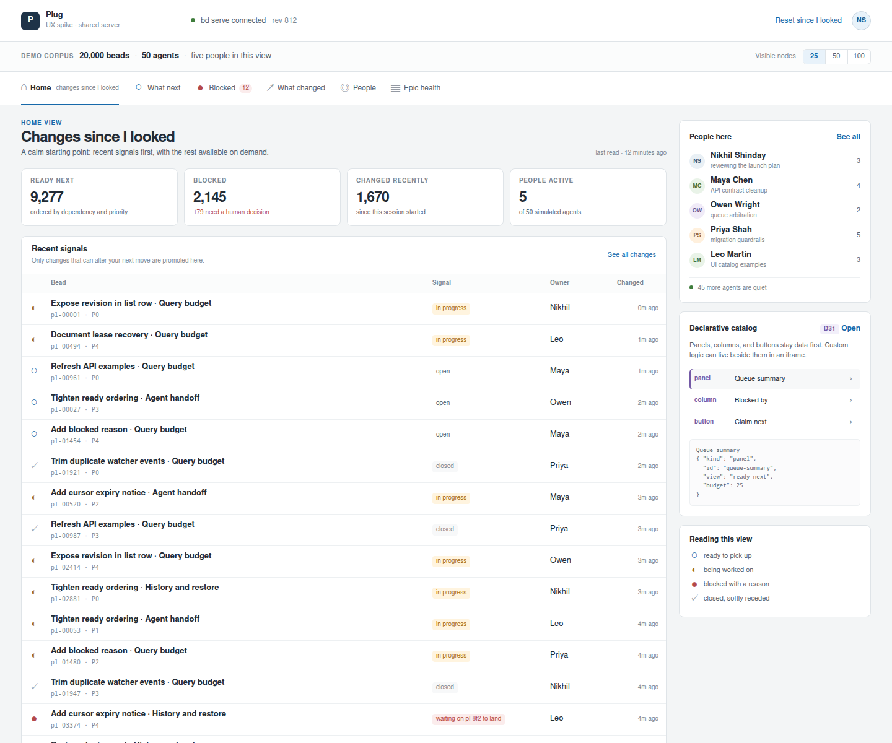
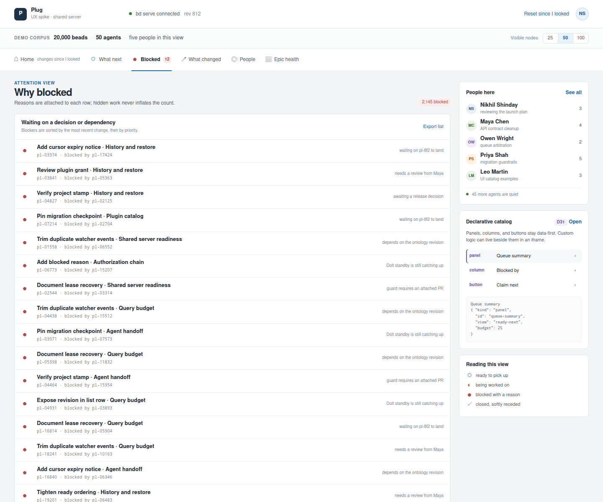
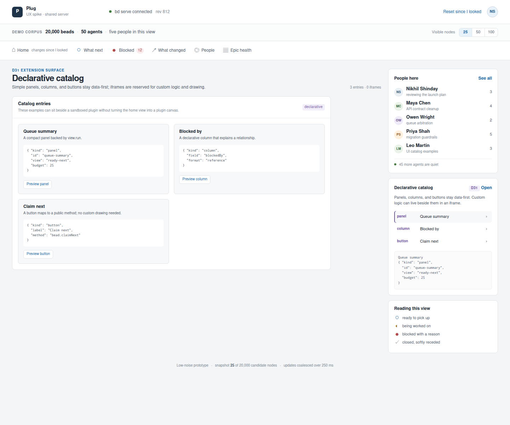

# UX spike decision: low-noise views

Date: 2026-10-28\
Prototype branch: `spike/ux`\
Prototype path: `spikes/ux/`\
Evidence: `spec/ux-screens/`

## Scope and provenance

This spike answers the A7 questions — what next, why blocked, what changed,
who is on what, and whether an epic is on track — with a bounded browser
prototype. The design review's complaint was information overwhelm from noisy
visualizations, so the prototype deliberately uses lists, short explanations,
whitespace, and a small number of semantic status signals. It does not use a
force-directed graph, a heatmap, or a persistent decoration for every bead.

The fixture is deterministic: `makeCorpus()` creates 20,000 beads, 50 fixture
agent identities, and dependency relations; five active owners are shown in
the presence surface. Ready, blocked, human-decision, and epic-health values
are derived from those fixture relations. It is generated in the browser so
the spike can compare view budgets without writing a large test database. The
adapter shape is the read surface that a future `view.run`/`view.watch` client
will consume; this prototype does not claim that today's v0 HTTP API already
provides A7 views.

The pinned server was built from Beads commit
`9d6fff760b7a314b476539198504d77ce0959656` with `bazel build //cmd/bd:bd` in a
disposable worktree. A temporary Dolt SQL server and empty workspace were used
to start `bd serve`; `/healthz` and `/v0/beads/context` returned successfully,
and the startup log reported `bd version 1.3.0`, `mode="server (external dolt)"`,
and the expected v0 capabilities. No production or repository database was
modified.

## Prototype shape

The home view is **Changes since I looked**. It is the low-noise default: four
summary signals, then only recent rows that can change the user's next move.
The other views are intentionally single-question surfaces:

| Question | Surface | Answer pattern |
| --- | --- | --- |
| What next? | Queue rows | Dependency-aware ordering, one short reason, one `Claim next` action. |
| Why blocked? | Blocked rows | Direct blocker reference and reason; causes outside the view become one aggregate count. |
| What changed? | Delta timeline | A stable, coalesced list; new events do not reorder visible rows. |
| Who is on what? | Presence rows | Five people, current focus, claim load; quiet agents collapse to one count. |
| Is the epic on track? | Epic roll-up | Done/total, a compact progress bar, and a bounded trend signal; no graph wall. |

Each surface exposes the same 25/50/100 visible-node control. Rows stop at the
selected budget and end with an explicit count explaining what stayed hidden.
The footer carries the snapshot size, corpus size, and the explicit
fixture-only watch boundary. The 250 ms coalescing rule remains a future A7
transport contract, not a live behavior of this page. Closed work recedes;
blocked work is the only strong red signal; ordinary text and descriptions
remain plain.

## Budget comparison

| Budget | Result | Decision |
| ---: | --- | --- |
| 25 | Fastest scan. Home and queue answer the primary question without a wall of rows. The `25 shown` row makes the cut explicit. | Use for the default home and focused questions. |
| 50 | More context while keeping one screen readable at the 1440 px capture size. The five-person presence card remains compact. | Offer as the normal working setting. |
| 100 | Useful for deliberate review, but the list becomes a review surface rather than a glance. The budget remains bounded and stable. | Keep as an opt-in ceiling; do not make it the default. |

The prototype's five active owners are represented in every budget. The budget
applies to bead rows; presence and epic roll-ups remain compact summaries and
do not silently expand into more bead nodes. The changes view now renders
exactly the selected budget, including 25, 50, or 100 rows, and its hidden count
is calculated from the full 20,000-row fixture.

Representative captures:

## Declarative catalog (D31)

The side card and catalog page render three data entries beside the built-in
view: a `panel` backed by a view, a `column` for `blockedBy`, and a `button`
mapped to `bead.claimNext`. They are rendered from catalog data, with no custom
JavaScript drawing. The page states the complementary boundary: a sandboxed
iframe is reserved for custom logic or custom drawing, while simple additions
stay declarative and visible to the host. This keeps a plugin from turning the
home view into an unbounded canvas.

## Decision

Adopt the following shape for the eventual A7 UI work:

1. Make **Changes since I looked** the home view.
2. Implement the five questions as separate, budgeted facets rather than one
   graph or dashboard canvas.
3. Make every budget cut explicit with a hidden count and a reason/continuation
   affordance. Never let overflow or denied records affect visible counts.
4. Keep watch deltas in place and coalesce them; expose a small new-changes
   affordance instead of moving the reader's current row.
5. Keep presence to one row per visible person plus a quiet-agent count. Show
   focus only where the authorization chain permits it.
6. Keep epic health as denominator-based roll-ups: done, active, blocked,
   ready, and scope change. Add detail on demand.
7. Treat panels, columns, and buttons as validated declarative catalog data.
   Reserve iframes for custom behavior and drawing, with the A7 bridge and
   grants applied later.

These decisions preserve A7's budget, elision, stable-delta, and home-view
rules while keeping the first screen calm enough to answer a single question
quickly.

## Evidence and limits

The prototype is dependency-free and served from `spikes/ux/`; it uses no CDN
and has no production UI code. `spikes/ux/check.sh` drives all seven views at
25, 50, and 100 through `/usr/bin/google-chrome --headless`, checks exact
budget counts and positive row content, verifies fixture-only labels and the
rendered view metadata, and rejects `undefined`, `NaN`, and empty render
failures. `spikes/ux/capture.sh` produced 19 PNGs (six views × three budgets
plus the catalog page) under `spec/ux-screens/`.

This is a design spike, not a usability study: the five people are simulated
presence data, and the fixture stands in for the future A7 view adapter. Before
M7, repeat the tasks with real `view.run`/`view.watch` responses, authorized
and denied records, a populated server, and five human users. Measure time to
answer, wrong clicks, visible-node count, hidden-reason comprehension, and a
subjective noise score before freezing the final catalog schema.
